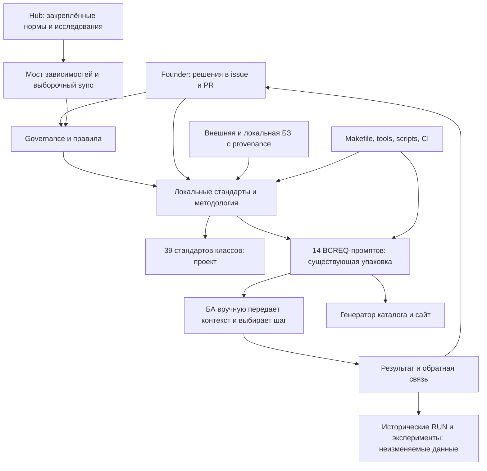
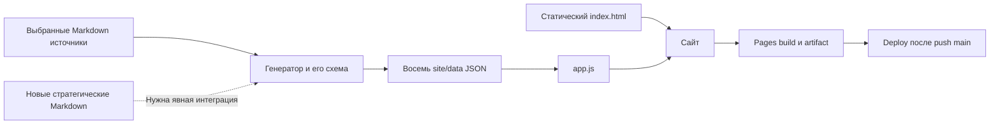

# Текущее состояние репозитория: структура, архитектура и границы аудита

## Мандат и исходное состояние

Этот документ — R1 и уточнённый Gate 0, а не внедрение модернизации. Управляющая постановка: https://github.com/G-Ivan-A/mango_ba_prompts/issues/407. Явная корректировка владельца: https://github.com/G-Ivan-A/mango_ba_prompts/pull/408#issuecomment-6522949478. Она разрешает добавление аналитических отчётов и одного RFC, исключает изменения остальных файлов, исторических данных и выполнение RUN. Поэтому исходное R5 «реализация модернизации» имеет статус SUPERSEDED **в этом PR** именно по явному решению, а не просто из-за более поздней даты. Предложения будущего состояния остаются PROPOSED.

| Источник | Зафиксированная версия | Роль |
| --- | --- | --- |
| https://github.com/G-Ivan-A/mango_ba_prompts | https://github.com/G-Ivan-A/mango_ba_prompts/tree/bc30b9d6bce8f4458895e84deab5f3552b13f394 | OBSERVED: всё дерево после слияния последнего доступного upstream; commit от 2026-10-30 |
| https://github.com/G-Ivan-A/hybrid-Intelligence-lab | https://github.com/G-Ivan-A/hybrid-Intelligence-lab/tree/c105323322d7e3a0450199db28071ea21fa9404d | Нормативный срез; commit от 2026-10-29; применимость и статус проверяются отдельно |
| https://github.com/G-Ivan-A/mango_ba_prompts/pull/408 | Ветка issue-407-28502daafccb | Контейнер результатов, не нормативный источник принятия предложений |

Все ссылки на существующие файлы ниже закреплены на этих SHA. Ссылки на новые отчёты ведут в ветку рецензирования и не подменяют baseline. Перечень ранее согласованных решений не восстанавливается по одному frontmatter: нужны текст решения, область и автор. APPROVED означает явное указание/согласование, OBSERVED — факт содержимого, UNRESOLVED — недостаток свидетельств или конфликт. Draft документа не превращается в APPROVED от прохождения CI.

## Инвентаризация и глубина проверки

Полный пофайловый реестр: https://github.com/konard/G-Ivan-A-mango_ba_prompts/blob/issue-407-28502daafccb/docs/analysis/2026-10-30-repository-inventory.md. Получено **1610 tracked-файлов, 89474008 байт, 16 компонент**. Реестр охватывает код, двоичные материалы, скрытые конфигурации, документацию, публикацию и исторические данные; каждый blob имеет URL, SHA, размер и решение «сохранить». Никакой каталог не исключён из инвентаризации.

Глубина анализа различается намеренно: активные контракты, навигация, стандарты, pipeline и код валидаторов исследованы как действующие связи; исторические массивы проверены по размещению, контрактам и blob-идентичности. Это **не** повторная экспертиза содержания каждого статистического прогона. Запрещённый частный контекст не используется. Полная семантическая сертификация всех 1610 файлов не заявляется.

| Компонент | Файлов | Функция, зависимости и результат проверки |
| --- | ---: | --- |
| Корень | 8 | https://github.com/G-Ivan-A/mango_ba_prompts/blob/bc30b9d6bce8f4458895e84deab5f3552b13f394/README.md — вход в библиотеку; https://github.com/G-Ivan-A/mango_ba_prompts/blob/bc30b9d6bce8f4458895e84deab5f3552b13f394/.hub-profile.json — профиль и история sync; https://github.com/G-Ivan-A/mango_ba_prompts/blob/bc30b9d6bce8f4458895e84deab5f3552b13f394/CONTRIBUTING.md и https://github.com/G-Ivan-A/mango_ba_prompts/blob/bc30b9d6bce8f4458895e84deab5f3552b13f394/Makefile — процесс. Профиль существует: legacy `target_type: HTOM`, нет `archetype`; отсутствие профиля утверждать нельзя. |
| Скрытый архив | 3 | https://github.com/G-Ivan-A/mango_ba_prompts/blob/bc30b9d6bce8f4458895e84deab5f3552b13f394/.archive/README.md объясняет прежние управляющие контракты. Сохранение на месте; не источник новых правил. |
| GitHub-конфигурация | 6 | https://github.com/G-Ivan-A/mango_ba_prompts/blob/bc30b9d6bce8f4458895e84deab5f3552b13f394/.github/workflows/validate.yml запускает локальные проверки; https://github.com/G-Ivan-A/mango_ba_prompts/blob/bc30b9d6bce8f4458895e84deab5f3552b13f394/.github/workflows/github-pages.yml публикует каталог; https://github.com/G-Ivan-A/mango_ba_prompts/blob/bc30b9d6bce8f4458895e84deab5f3552b13f394/.github/workflows/kb.yml обрабатывает БЗ. Формы issue принимают feedback/RUN. Изменений workflow не требуется для отчёта. |
| Управление ИИ | 4 | https://github.com/G-Ivan-A/mango_ba_prompts/blob/bc30b9d6bce8f4458895e84deab5f3552b13f394/ai-governance/ai-governance.md — локальный контракт; https://github.com/G-Ivan-A/mango_ba_prompts/blob/bc30b9d6bce8f4458895e84deab5f3552b13f394/ai-governance/hub-ai-governance.md — отдельный импорт. Два разных назначения, не автоматически ошибочный дубль. |
| Правила ИИ | 6 | https://github.com/G-Ivan-A/mango_ba_prompts/blob/bc30b9d6bce8f4458895e84deab5f3552b13f394/ai-rules/README.md, https://github.com/G-Ivan-A/mango_ba_prompts/blob/bc30b9d6bce8f4458895e84deab5f3552b13f394/ai-rules/agent-onboarding-protocol.md, https://github.com/G-Ivan-A/mango_ba_prompts/blob/bc30b9d6bce8f4458895e84deab5f3552b13f394/ai-rules/AI_SESSION_HANDOVER_PROMPT.md управляют загрузкой/передачей. Нет корневого AGENTS.md по новому bootstrap; старая миграция путей задокументирована в профиле. |
| Документация | 163 | https://github.com/G-Ivan-A/mango_ba_prompts/blob/bc30b9d6bce8f4458895e84deab5f3552b13f394/docs/ba-ecosystem.md объединяет обзор, процессы и стратегию; контракты/ADR/RFC/анализ/таксономия — отдельные дома. Нет единого docs/README.md; уровни L1–L4 не выделены самостоятельными стратегическими артефактами. |
| Эксперименты | 302 | https://github.com/G-Ivan-A/mango_ba_prompts/blob/bc30b9d6bce8f4458895e84deab5f3552b13f394/experiments/issue_405/fetch_sources.py и issue-specific каталоги содержат воспроизводимые исследования/миграции. История, не команда повторить миграции. Сохраняется полностью. |
| База знаний | 41 | https://github.com/G-Ivan-A/mango_ba_prompts/blob/bc30b9d6bce8f4458895e84deab5f3552b13f394/kb/processed/README.md фиксирует перенос processed-корпуса во внешний runtime. https://github.com/G-Ivan-A/mango_ba_prompts/blob/bc30b9d6bce8f4458895e84deab5f3552b13f394/standards/kb-standard.md и https://github.com/G-Ivan-A/mango_ba_prompts/blob/bc30b9d6bce8f4458895e84deab5f3552b13f394/scripts/kb/README.md описывают локальную обработку. Отсутствие старого корпуса не доказывает потерю данных: есть provenance переноса. |
| Паттерны | 15 | https://github.com/G-Ivan-A/mango_ba_prompts/blob/bc30b9d6bce8f4458895e84deab5f3552b13f394/patterns/README.md — повторяемые приёмы, на которые опираются промпты. Не отдельный исполнитель/оркестратор; не смешивать с доменными требованиями. |
| Операционные реестры | 8 | https://github.com/G-Ivan-A/mango_ba_prompts/blob/bc30b9d6bce8f4458895e84deab5f3552b13f394/pr-ops/BACKLOG.md, https://github.com/G-Ivan-A/mango_ba_prompts/blob/bc30b9d6bce8f4458895e84deab5f3552b13f394/pr-ops/artifact-map.md, https://github.com/G-Ivan-A/mango_ba_prompts/blob/bc30b9d6bce8f4458895e84deab5f3552b13f394/pr-ops/session-digests.md фиксируют работу/навигацию. Карта содержит старые корневые имена, требует будущей проверки активных ссылок, но журнал миграции нельзя переписывать. |
| Промпты | 48 | https://github.com/G-Ivan-A/mango_ba_prompts/blob/bc30b9d6bce8f4458895e84deab5f3552b13f394/prompts/README.md задаёт пары full/executable, 14 BCREQ-промптов и legacy. Это артефакты исполнения; 39 новых стандартов не означают 39 уже реализованных промптов. |
| Прогоны | 806 | https://github.com/G-Ivan-A/mango_ba_prompts/blob/bc30b9d6bce8f4458895e84deab5f3552b13f394/standards/runs-contract-standard.md определяет статистический дом. Только реестр/идентичность; не пересчёт, не новый RUN, не исправление старой концепции в старом результате. |
| Скрипты | 86 | https://github.com/G-Ivan-A/mango_ba_prompts/blob/bc30b9d6bce8f4458895e84deab5f3552b13f394/scripts/validate_all.py собирает issue-валидаторы; https://github.com/G-Ivan-A/mango_ba_prompts/blob/bc30b9d6bce8f4458895e84deab5f3552b13f394/scripts/sync_from_hub.py переносит выбранные контракты. Тесты структуры не измеряют качество ответа LLM; sync не равен полномочию обновить всё из текущего Hub. |
| Сайт | 37 | https://github.com/G-Ivan-A/mango_ba_prompts/blob/bc30b9d6bce8f4458895e84deab5f3552b13f394/site/index.html и https://github.com/G-Ivan-A/mango_ba_prompts/blob/bc30b9d6bce8f4458895e84deab5f3552b13f394/scripts/generate-pages-data.mjs — публикация Markdown-каталога. Представление производно; не SSOT методологии. UI в этом PR не меняется. |
| Стандарты | 72 | https://github.com/G-Ivan-A/mango_ba_prompts/blob/bc30b9d6bce8f4458895e84deab5f3552b13f394/standards/README.md, https://github.com/G-Ivan-A/mango_ba_prompts/blob/bc30b9d6bce8f4458895e84deab5f3552b13f394/standards/bcreq-process-standard.md, https://github.com/G-Ivan-A/mango_ba_prompts/blob/bc30b9d6bce8f4458895e84deab5f3552b13f394/standards/bcreq-manual-classes/README.md задают локальные нормы; часть импортирована с прежнего SHA. Draft/accepted и локальные границы требуют различения. |
| Инструменты | 5 | https://github.com/G-Ivan-A/mango_ba_prompts/blob/bc30b9d6bce8f4458895e84deab5f3552b13f394/tools/README.md, https://github.com/G-Ivan-A/mango_ba_prompts/blob/bc30b9d6bce8f4458895e84deab5f3552b13f394/tools/validate-frontmatter.sh, https://github.com/G-Ivan-A/mango_ba_prompts/blob/bc30b9d6bce8f4458895e84deab5f3552b13f394/tools/validate-file-naming.sh, https://github.com/G-Ivan-A/mango_ba_prompts/blob/bc30b9d6bce8f4458895e84deab5f3552b13f394/tools/validate-repository-structure.sh — действующие проверки. Успех старого набора не доказывает соответствие новым нормам, которых в нём ещё нет. |

Расширения: 957 Markdown, 231 Python, 133 JSON, 85 YAML/YML, 51 PNG; остальные 153 файла — текст, логи, таблицы, веб-ассеты и файлы без расширения. Это счёт форматов, не оценка их полезности. Самая большая группа по числу — исторические прогоны; её нельзя «оптимизировать» удалением статистики.

## Архитектурная карта исходного состояния



Связь «стандарты классов → новые исполняемые промпты → семантическая валидация» пока разрыв, а не доказанный работающий конвейер. БЗ используется как источник фактов, сайт как доставка, CI как проверка артефактов. Сервер, n8n и автоматический router не обнаружены как реализованная BCREQ-система. Это согласуется с ранним этапом библиотеки, но не закрывает будущую стратегию.

## Реестр существующей работы

Это реестр свидетельств, где допустимы номера исторических работ. Последовательность merge показывает наличие результата, а не согласование каждой фразы результата.

| Свидетельство | Уже сделано; как используется и чего не доказывает |
| --- | --- |
| https://github.com/G-Ivan-A/mango_ba_prompts/blob/bc30b9d6bce8f4458895e84deab5f3552b13f394/docs/adr/0004-hub-resync-2026-08.md; https://github.com/G-Ivan-A/mango_ba_prompts/blob/bc30b9d6bce8f4458895e84deab5f3552b13f394/.hub-profile.json | Обоснован выборочный sync и сохранена история переездов. Не считать каждый несовпадающий старый путь действующим defect. |
| https://github.com/G-Ivan-A/mango_ba_prompts/blob/bc30b9d6bce8f4458895e84deab5f3552b13f394/docs/analysis/2026-10-23-prompts-catalog-audit.md; https://github.com/G-Ivan-A/mango_ba_prompts/blob/bc30b9d6bce8f4458895e84deab5f3552b13f394/docs/analysis/2026-10-23-bcreq-standards-third-opinion.md | Уже есть аудит упаковки/BCREQ. В настоящем отчёте проверены межкомпонентные разрывы и новые изменения октября, а не повторён аудит одной папки. |
| https://github.com/G-Ivan-A/mango_ba_prompts/pull/392; https://github.com/G-Ivan-A/mango_ba_prompts/blob/bc30b9d6bce8f4458895e84deab5f3552b13f394/docs/reviews/issue-391-golden-inventory.md | Разделены статические проверки и кандидаты Golden Set. Наличие кандидатов не означает утверждённый эталон или успешный LLM eval. |
| https://github.com/G-Ivan-A/mango_ba_prompts/blob/bc30b9d6bce8f4458895e84deab5f3552b13f394/docs/analysis/2026-10-28-bcreq-evolution-failure-analysis.md | Предыдущая реконструкция методологии. Учитывается как вторичный аналитический источник, без повторного анализа исключённого частного контекста. |
| https://github.com/G-Ivan-A/mango_ba_prompts/pull/400; https://github.com/G-Ivan-A/mango_ba_prompts/blob/bc30b9d6bce8f4458895e84deab5f3552b13f394/docs/taxonomy/README.md | Обновлена таксономия продуктов/портала. Её уровни не равны уровням документации L1–L4 или стратегическим этапам. |
| https://github.com/G-Ivan-A/mango_ba_prompts/pull/402; https://github.com/G-Ivan-A/mango_ba_prompts/blob/bc30b9d6bce8f4458895e84deab5f3552b13f394/kb/processed/README.md | Проверены источники и зафиксирован перенос корпуса. Сохранять внешнюю привязку и версию, не импортировать весь корпус ради симметрии дерева. |
| https://github.com/G-Ivan-A/mango_ba_prompts/pull/404; https://github.com/G-Ivan-A/mango_ba_prompts/blob/bc30b9d6bce8f4458895e84deab5f3552b13f394/docs/rfc/2026-10-bcreq-manual-pipeline.md; https://github.com/G-Ivan-A/mango_ba_prompts/blob/bc30b9d6bce8f4458895e84deab5f3552b13f394/standards/bcreq-manual-classes/catalog.json | Добавлены 39 стандартов и контракт ручного состояния. Нормативная детализация шире прежних 14 промптов, их массового переписывания не было. |
| https://github.com/G-Ivan-A/mango_ba_prompts/pull/406; https://github.com/G-Ivan-A/mango_ba_prompts/blob/bc30b9d6bce8f4458895e84deab5f3552b13f394/docs/analysis/2026-10-30-ide-clients-stage-2.md; https://github.com/G-Ivan-A/mango_ba_prompts/blob/bc30b9d6bce8f4458895e84deab5f3552b13f394/docs/adr/2026-10-adr-016-ide-client-process.md | Проведён анализ IDE, выбран кандидат в draft ADR. Не выполнено внедрение клиента и не доказана эксплуатационная переносимость 39 классов. |

## Содержательные разрывы и последствия

| ID / статус | Наблюдение и точный источник | Последствие и граница будущего исправления |
| --- | --- | --- |
| CS-01 OBSERVED | https://github.com/G-Ivan-A/mango_ba_prompts/blob/bc30b9d6bce8f4458895e84deab5f3552b13f394/README.md, раздел текущего состояния: «evals и golden-set отсутствуют»; кандидаты уже есть в https://github.com/G-Ivan-A/mango_ba_prompts/blob/bc30b9d6bce8f4458895e84deab5f3552b13f394/docs/reviews/issue-391-golden-inventory.md. | Уточнить типы доказательств: нет исполняемого eval-harness/утверждённого оракула — не то же, что нет кандидатов. Не объявлять semantic pass. |
| CS-02 OBSERVED | https://github.com/G-Ivan-A/mango_ba_prompts/blob/bc30b9d6bce8f4458895e84deab5f3552b13f394/prompts/README.md описывает A-IN/A-CORE/A-WORK; https://github.com/G-Ivan-A/mango_ba_prompts/blob/bc30b9d6bce8f4458895e84deab5f3552b13f394/docs/contracts/bcreq-stage-gates.md прямо исключает A-RELEASE из своего scope; https://github.com/G-Ivan-A/mango_ba_prompts/blob/bc30b9d6bce8f4458895e84deab5f3552b13f394/docs/rfc/2026-10-bcreq-manual-pipeline.md предлагает расширение. | Версионная граница допустима, но единого маршрута «что применять сегодня» нет. Новый release-контракт требует явной миграции и тестов. |
| CS-03 OBSERVED | https://github.com/G-Ivan-A/mango_ba_prompts/blob/bc30b9d6bce8f4458895e84deab5f3552b13f394/standards/bcreq-prompt-architecture.md и https://github.com/G-Ivan-A/mango_ba_prompts/blob/bc30b9d6bce8f4458895e84deab5f3552b13f394/prompts/README.md — старая упаковка; https://github.com/G-Ivan-A/mango_ba_prompts/blob/bc30b9d6bce8f4458895e84deab5f3552b13f394/standards/bcreq-manual-classes/README.md — 39 классов; https://github.com/G-Ivan-A/mango_ba_prompts/blob/bc30b9d6bce8f4458895e84deab5f3552b13f394/docs/contracts/bcreq-manual-state.md — SLICE/FULL, revision, rule_bundle. | Стандарты нельзя выдавать за реализованные промпты. Требуется будущая матрица «класс → операция → prompt/skill → тест», без произвольного слияния классов. |
| CS-04 OBSERVED | https://github.com/G-Ivan-A/mango_ba_prompts/blob/bc30b9d6bce8f4458895e84deab5f3552b13f394/docs/ba-ecosystem.md совмещает стратегию, таксономию и процесс; отдельные PRODUCT_VISION.md, docs/product-concept.md, docs/solution-concept.md, ROADMAP.md отсутствуют в baseline. | Сначала согласовать архитектуру документов и границы библиотека/runtime. Четыре этапа стратегии не следует объявлять четырьмя уровнями документации. |
| CS-05 OBSERVED | https://github.com/G-Ivan-A/mango_ba_prompts/blob/bc30b9d6bce8f4458895e84deab5f3552b13f394/README.md и https://github.com/G-Ivan-A/mango_ba_prompts/blob/bc30b9d6bce8f4458895e84deab5f3552b13f394/ai-governance/ai-governance.md ограничивают библиотеку GitHub и запрещают серверную оркестрацию; новая стратегия предусматривает n8n и сервер. | Возможны разные области: библиотека сейчас и будущая система. Нужен явный scope/version decision; не стирать текущий запрет молча. |
| CS-06 OBSERVED | Корневого AGENTS.md нет; https://github.com/G-Ivan-A/mango_ba_prompts/blob/bc30b9d6bce8f4458895e84deab5f3552b13f394/.hub-profile.json содержит `target_type`, `phase`, историю sync и project-specific directories, но нет нового `archetype`. | Новое требование bootstrap не покрыто действующим CI. Будущий additive-переход с сохранением старых ключей, не перезапись истории профиля. |
| CS-07 OBSERVED | https://github.com/G-Ivan-A/mango_ba_prompts/blob/bc30b9d6bce8f4458895e84deab5f3552b13f394/ai-governance/ai-governance.md содержит утверждение о корневом размещении генома, а canonical дом уже ai-governance/; https://github.com/G-Ivan-A/mango_ba_prompts/blob/bc30b9d6bce8f4458895e84deab5f3552b13f394/pr-ops/artifact-map.md содержит старые корневые ссылки. | Проверить активную навигацию по https://github.com/G-Ivan-A/mango_ba_prompts/blob/bc30b9d6bce8f4458895e84deab5f3552b13f394/.hub-profile.json. Записи старого sync и миграций оставить прежними. Не добавлять второй контракт в корень. |
| CS-08 OBSERVED | https://github.com/G-Ivan-A/mango_ba_prompts/blob/bc30b9d6bce8f4458895e84deab5f3552b13f394/docs/analysis/2026-10-29-bcreq-checkpoint.md фиксирует промежуточные 38 классов, финальный https://github.com/G-Ivan-A/mango_ba_prompts/blob/bc30b9d6bce8f4458895e84deab5f3552b13f394/standards/bcreq-manual-classes/catalog.json — 39. | Исторический checkpoint не переписывать. Активная навигация должна вести к final catalog с объяснённой версией. |
| CS-09 UNRESOLVED | В https://github.com/G-Ivan-A/mango_ba_prompts/pull/408#issuecomment-6522949478 вместо JSON только `[Uploading chat-export--опс-хаб.json…]()` с пустым href. | Приоритетная реконструкция не завершена. Нельзя объявлять весь октябрь исчерпывающе восстановленным или RFC утверждённым. |

Обнаружены четыре группы одинаковых blobs размером более 1000 байт: переиспользованное screenshot-свидетельство, скопированный verifier и две пары исторических входов/метрик. Это результат сравнения хешей, **не** доказательство лишнего материала; удаления не предлагаются. Детали исторических результатов не переинтерпретируются.

## Контрольная проверка по уточнению Фаундера

Основание: https://github.com/G-Ivan-A/mango_ba_prompts/pull/408#issuecomment-6524028597 от 2026-10-30T13:31:04Z. Повторно проверены оба SHA: upstream main по-прежнему совпадает с baseline, Hub — с нормативным срезом выше. Реестр всех 1610 файлов остаётся тем же. Контроль отвечает на вопросы о структуре, влияющих артефактах, эволюции, совместимости и будущей публикации; он не превращает инвентаризацию в утверждение о чтении содержания всех исторических прогонов.

### Как отделяется история от управления проектом

| Роль / примеры baseline | Критерий влияния и допустимое действие |
| --- | --- |
| Управляющие решения: исходная issue и явные комментарии владельца; governance/profile | Сила определяется автором, предметом и текстом решения. Последний комментарий дополняет разрешённые отчёты/RFC, а не разрешает внедрение по одному слову «хорошо». |
| Применяемые контракты и рабочие артефакты: standards, docs/contracts, prompts, используемые patterns | Определяют вход/выход, роли, gates и поведение в своей версии. Для изменения нужно найти потребителей и покрытие обязанностей. Нахождение в docs/ или статус draft не означает «не используется». |
| Проектные/будущие решения: RFC/ADR, 39 стандартов классов, исследование клиента | Влияют на направление и зависимости, но не доказывают исполнимость/приёмку. Draft IDE ADR, добавленный стандарт и работающий skill — разные результаты. |
| Активная навигация и исполняемые потребители: README, таксономия, индексы, generator, UI, CI | Могут продолжать транслировать старую концепцию после появления нового контракта. Проверяется реальное чтение/импорт/ссылка и ожидаемое поведение, а не только дата файла. |
| Производные представления: site/data и опубликованный сайт | Сохраняют источник и его статус; сами не принимают методологию. Обновляются через pipeline после изменения выбранных источников/схемы. |
| Исторические свидетельства: runs, experiments, статистические отчёты, архив и журналы | Фиксируют состояние на дату, даже если содержат старую концепцию. Сохраняются на месте побайтово. Для активного читателя допустим новый индекс/пояснение, без изменения исходного evidence. |

Классификация задаётся **ролью и связями**, не только каталогом. Например, исторический checkpoint с 38 классами остаётся корректным снимком; активный индекс должен вести к текущему каталогу 39. Старый текст «Валидация ФТ/ТЗ» внутри RUN — история; тот же текст в источнике действующего process tree — предмет будущей актуализации. Отсутствие входящей Markdown-ссылки ещё не доказывает неиспользование: нужны code references, workflow consumers и решение о преемнике.

### Вопросы владельца → свидетельства → заключение

| ID / требование уточнения | Контроль и фактический вывод | Что предложено / проверка будущего изменения |
| --- | --- | --- |
| CC-01 Структура и содержание | Полный Git census и 16 компонент приведены выше; активные зависимости отделены от истории по роли. Технически проверяемая полнота реестра не равна семантической оценке каждого blob. | Сохранить дома; обновлять только адресно выбранные активные артефакты. Exact inventory и A-only diff проверяют текущий результат. |
| CC-02 От «ФТ/ТЗ» к фазам BCREQ | https://github.com/G-Ivan-A/mango_ba_prompts/blob/bc30b9d6bce8f4458895e84deab5f3552b13f394/docs/ba-ecosystem.md, https://github.com/G-Ivan-A/mango_ba_prompts/blob/bc30b9d6bce8f4458895e84deab5f3552b13f394/docs/taxonomy.md и https://github.com/G-Ivan-A/mango_ba_prompts/blob/bc30b9d6bce8f4458895e84deab5f3552b13f394/docs/ba-processes/00-index.md ещё задают девять процессов, включая формирование/валидацию ФТ/ТЗ. Фазовые контракты уже существуют. Это сосуществование версий, а не завершённая миграция. | Перенести прежние обязанности формирования/проверки в операции и gates актуального процесса; сохранить проверку качества как функцию. Не переименовывать один процесс в одну фазу механически. |
| CC-03 Параллельная BA метамодель | Проверены Hub introduction/theory/taxonomy и Working→Release RFC, а не только общий glossary. Есть конкретные различия Skill и A-CORE; mapping и статусы разобраны в compliance-отчёте. | Версионированный compatibility register и semantic diff. Вектор совместим, тождество всех терминов/полная реализация не заявляются. |
| CC-04 Четыре стратегических файла | В baseline нет самостоятельных Vision/Concept/Solution Concept/Roadmap; роли частично смешаны в ba-ecosystem. L3 — предлагаемое место архитектуры; L4 остаётся ADR, roadmap связывает уровни. | В единственном RFC — конкретные тезисы, разделы, rationale и приёмка каждого файла. Четыре стратегических этапа сохранены отдельно. |
| CC-05 Изменения должны отражаться на сайте | Проверена цепочка source→generator→JSON→UI→Pages. Добавление нового Markdown само по себе не попадает в выбранные источники; статический HTML тоже не обновляется автоматически. | Адресные изменения sources/schema/UI/tests/publish описаны в RFC; source-to-view checks проверяют фактическое отражение. |
| CC-06 «Готов к презентации руководству» | Это требование к пользовательскому результату, которого структурный CI не измеряет. Live URL штатно перевёл браузер на login; содержимое после входа в этой сессии не проверено. | D-01–D-08 в RFC: ценность/состояние, документы, процесс, evidence, стратегия, функции БА, доступ/версия, ошибки и rollback. Приёмка/скриншоты ещё не выполнены. |
| CC-07 Архивирование и актуализация | https://github.com/G-Ivan-A/mango_ba_prompts/blob/bc30b9d6bce8f4458895e84deab5f3552b13f394/.archive/README.md требует active successor и deprecation link. По одному возрасту/названию не доказано, что файл ненужный. | RFC даёт lifecycle matrix и решение по группам кандидатов: active update / retain history / archive after evidence / preserve unresolved. Ничего не перенесено и не удалено. |
| CC-08 Взаимное развитие с Hub | Metamodel — изменяемый draft research scope mango-only; принятые решения имеют собственный scope. Практика библиотеки может выявлять недостающие правила. | Evidence→обобщённое предложение→решение Hub→локальный impact/regression; локальный эксперимент не меняет общую норму автоматически. |
| CC-09 Дальнейшая доработка по roadmap | Есть исследования этапа 2, но нет доказательства работающего IDE/n8n/server pipeline. Доработка этапа 1 и презентации не исключает будущие этапы. | Roadmap связывает зависимости и entry/exit четырёх этапов; не добавляет вымышленные даты/проценты или пятый стратегический этап. |

### Фактический путь документации до сайта

В https://github.com/G-Ivan-A/mango_ba_prompts/blob/bc30b9d6bce8f4458895e84deab5f3552b13f394/scripts/generate-pages-data.mjs список `SOURCE_FILES` содержит только шесть входов: каталог prompts, docs/taxonomy.md, индекс ba-processes, ba-ecosystem, индекс patterns и bcreq-manual-process. `parseRoadmap` извлекает таблицы обзора; `makeStats` содержит три старые фазы автоматизации «Промпты/Агенты/Мультиагенты», а `testsPassed` получает число canonical prompts. Последнее не является результатом запуска тестов качества. Активный parser операций также зависит от старой таксономии 13 операций. Нельзя просто заменить одну таблицу, не проверив потребителей и отказ при несовместимом формате.

Генератор пишет восемь JSON: prompts, stats, roadmap, checks, process-tree, processes, patterns, bcreq-flow. Их загружает https://github.com/G-Ivan-A/mango_ba_prompts/blob/bc30b9d6bce8f4458895e84deab5f3552b13f394/site/app.js; статические формулировки/разделы отдельно находятся в https://github.com/G-Ivan-A/mango_ba_prompts/blob/bc30b9d6bce8f4458895e84deab5f3552b13f394/site/index.html. https://github.com/G-Ivan-A/mango_ba_prompts/blob/bc30b9d6bce8f4458895e84deab5f3552b13f394/.github/workflows/github-pages.yml собирает preview на PR, а deploy разрешён только для push в main. Review аналитического PR не обновляет опубликованный сайт.



Итог контрольной проверки — **понимание ролей и конкретных разрывов подтверждено приведёнными связями; актуализация и готовность сайта не выполнены** в разрешённом аналитическом scope. Детальные proposals и критерии находятся в https://github.com/konard/G-Ivan-A-mango_ba_prompts/blob/issue-407-28502daafccb/docs/rfc/2026-10-repository-modernization.md. Приоритетный JSON по-прежнему отсутствует: эта проверка не закрывает полноту октябрьского корпуса и не заменяет содержательную приёмку владельца.

## План проверки и последующие зависимости

Исследовательские итерации в этом пакете: инвентарь/карта → октябрьские первоисточники и атомарные требования → применимость стандартов → один RFC → проверка границ и ссылок. Это подготовка результатов к содержательному review, не запись о прохождении human gates исходной постановки. Предыдущая попытка остановилась на Gate 0; корректировка владельца прямо заказала отчёты и RFC, но не одобрила их содержание заранее.

Приоритетные следующие действия в рамках анализа: получить недоступный JSON; выделить сообщения/авторов/хронологию; сопоставить с таблицей требований и режимами потерь; обновить только новые отчёты и RFC; затем предъявить для содержательной приёмки. Лишь отдельный последующий мандат может разрешить реализацию.

Проверка baseline воспроизводится командами `git ls-tree -rl <SHA>` и `git cat-file -e <SHA>:<path>`. Включение upstream не является авторским изменением его данных. Отсутствие изменений статистики проверяется `git diff --exit-code bc30b9d6bce8f4458895e84deab5f3552b13f394 HEAD -- runs experiments kb .archive`; более сильная проверка — весь итоговый diff должен состоять только из добавленных Markdown в двух разрешённых домах. Значения в таблицах — наблюдения baseline, а не утверждение, что любой найденный файл прочитан/валидирован семантически.

### Воспроизведение проверки результата

Проверка границы на предыдущем состоянии `c40ecbd3f606d37e662e79c792a06f7f81274a31` относительно его исходного `f02766dff46ea09cfafdb29eae913ebc6f50ef9e` выявила **18 изменений вне нового allowlist**. После удаления этих изменений и включения upstream ожидаются ровно пять A-only Markdown: четыре отчёта и один RFC. Это отрицательный/положительный контроль соблюдения мандата, не semantic eval BCREQ.

После checkout итоговой PR-ветки (baseline SHA должен присутствовать в Git objects) можно повторить без добавления скрипта в репозиторий:

```bash
python3 - <<'PY'
import re
import subprocess
from pathlib import Path
base = 'bc30b9d6bce8f4458895e84deab5f3552b13f394'
diff = subprocess.check_output(['git', 'diff', '--name-status', base, 'HEAD'], text=True)
rows = [line.split('\t') for line in diff.splitlines()]
assert len(rows) == 5
assert all(s == 'A' and p.endswith('.md') and
           p.startswith(('docs/analysis/', 'docs/rfc/')) for s, p in rows)
assert sum(p.startswith('docs/rfc/') for s, p in rows) == 1
text = Path('docs/analysis/2026-10-30-repository-inventory.md').read_text()
listed = re.findall(r'^\| https://github.com/G-Ivan-A/mango_ba_prompts/blob/'
                    + base + r'/([^|]+) \| `([0-9a-f]{40})` \| (\d+) \|', text, re.M)
tree = subprocess.check_output(['git', 'ls-tree', '-rlz', base]).split(b'\0')
actual = {}
for record in filter(None, tree):
    meta, path = record.split(b'\t', 1)
    mode, kind, blob, size = meta.decode().split()
    actual[path.decode()] = (blob, int(size))
from urllib.parse import unquote
assert len(listed) == 1610
assert {unquote(p.strip()): (b, int(n)) for p, b, n in listed} == actual
assert sum(int(n) for p, b, n in listed) == 89474008
print('PASS: scope, one RFC, exact inventory, baseline preservation')
PY
make validate-fast
make validate-full
```

Дополнительно проверены все уникальные pinned file targets по обоим Git trees и порядок 12 секций RFC. Локальные логи/исследовательские утилиты не входят в итоговый diff. Свежий CI run и его head SHA фиксируются в описании PR; старые зелёные runs не подтверждают новый commit.

## Покрытие исходной постановки и изменённой приёмки

Источник каждого атома этой таблицы — https://github.com/G-Ivan-A/mango_ba_prompts/issues/407; номера строк относятся к исходному телу постановки, а не к Git-файлу. Явные ограничения уточнены https://github.com/G-Ivan-A/mango_ba_prompts/pull/408#issuecomment-6522949478. Все 60 исходных атомов сохранены для review; одинаковый статус требования APPROVED не означает, что результат принят. Столбец результата фиксирует технические факты и открытые критерии после коррекции scope.

| ID / строки источника | Атомарная обязанность | Артефакт и результат проверки |
| --- | --- | --- |
| S01 / 8,46,99 | Охватить каждый компонент без заранее закрытого списка каталогов. | https://github.com/konard/G-Ivan-A-mango_ba_prompts/blob/issue-407-28502daafccb/docs/analysis/2026-10-30-repository-inventory.md — OBSERVED: весь Git tree, 16 компонент; глубина семантической проверки явно ограничена историческим запретом. |
| S02 / 11 | Адресовать источники полными абсолютными URL. | https://github.com/konard/G-Ivan-A-mango_ba_prompts/blob/issue-407-28502daafccb/docs/analysis/2026-10-30-repository-current-state.md — OBSERVED: полные URL и pinned file targets; ссылки проверены по Git tree. |
| S03 / 14-29 | Различать нормативные, исследуемые и исторические источники. | https://github.com/konard/G-Ivan-A-mango_ba_prompts/blob/issue-407-28502daafccb/docs/analysis/2026-10-30-repository-current-state.md — OBSERVED: baseline/нормативные/исторические/проектные источники разделены. |
| S04 / 32 | Регистрировать противоречия, происхождение и chronology свидетельств. | https://github.com/konard/G-Ivan-A-mango_ba_prompts/blob/issue-407-28502daafccb/docs/analysis/2026-10-30-october-requirements-evolution.md — OBSERVED: chronology и реестр конфликтов; отсутствующий JSON не реконструирован. |
| S05 / 33 | Не отменять согласованное решение только по более поздней дате текста. | https://github.com/konard/G-Ivan-A-mango_ba_prompts/blob/issue-407-28502daafccb/docs/analysis/2026-10-30-october-requirements-evolution.md — OBSERVED: замена scope обоснована прямой коррекцией; остальные версии не отменены автоматически. |
| S06 / 34 | Передавать неразрешимую неоднозначность источников Фаундеру. | https://github.com/konard/G-Ivan-A-mango_ba_prompts/blob/issue-407-28502daafccb/docs/rfc/2026-10-repository-modernization.md — UNRESOLVED: открытые вопросы с вариантами вынесены владельцу, решение не присвоено агентом. |
| S07 / 36-41 | Маркировать согласованные, предложенные, наблюдаемые, заменённые и нерешённые решения раздельно. | https://github.com/konard/G-Ivan-A-mango_ba_prompts/blob/issue-407-28502daafccb/docs/analysis/2026-10-30-october-requirements-evolution.md — OBSERVED: используются все пять decision statuses, отдельно от maturity документов. |
| R1 / 51,65,162-165 | Провести содержательный, структурный и архитектурный аудит всего репозитория. | https://github.com/konard/G-Ivan-A-mango_ba_prompts/blob/issue-407-28502daafccb/docs/analysis/2026-10-30-repository-current-state.md — OBSERVED: структура и 16 контуров; исторические blobs сохранены, повторная экспертиза статистики исключена. |
| R2 / 57,66,162-165 | Восстановить историю требований, эволюцию методологии и причины отказов/потерь. | https://github.com/konard/G-Ivan-A-mango_ba_prompts/blob/issue-407-28502daafccb/docs/analysis/2026-10-30-october-requirements-evolution.md — ЧАСТИЧНО: доступные первоисточники и FMA разобраны; полный октябрь BLOCKED отсутствующим JSON. |
| R3 / 54,67,167-170 | Проверить все компоненты по применимым нормам, включая всю систему документации и L1–L4. | https://github.com/konard/G-Ivan-A-mango_ba_prompts/blob/issue-407-28502daafccb/docs/analysis/2026-10-30-ecosystem-compliance.md — OBSERVED: все 29 нормативных файлов и все контуры; gaps и спорная применимость перечислены, соответствие не сертифицировано. |
| R4 / 68,172-175 | Спроектировать целевую архитектуру и RFC с зависимостями и приоритетами. | https://github.com/konard/G-Ivan-A-mango_ba_prompts/blob/issue-407-28502daafccb/docs/rfc/2026-10-repository-modernization.md — PROPOSED: целевая схема, альтернативы, зависимости и future validation; human acceptance отсутствует. |
| R5 / 69,177-180 | Реализовать весь согласованный RFC в документах, prompts, rules, templates и структуре. | https://github.com/konard/G-Ivan-A-mango_ba_prompts/blob/issue-407-28502daafccb/docs/rfc/2026-10-repository-modernization.md — SUPERSEDED для текущего PR прямой коррекцией владельца; никакой реализации модернизации. |
| T01 / 75,78 | Сохранить первоисточник и исходную формулировку каждого существенного требования. | https://github.com/konard/G-Ivan-A-mango_ba_prompts/blob/issue-407-28502daafccb/docs/analysis/2026-10-30-october-requirements-evolution.md — ЧАСТИЧНО: EV/локаторы/пересказ доступны; отсутствующий JSON не покрыт. |
| T02 / 79 | Установить decision status каждого существенного требования с evidence согласования. | https://github.com/konard/G-Ivan-A-mango_ba_prompts/blob/issue-407-28502daafccb/docs/analysis/2026-10-30-october-requirements-evolution.md — OBSERVED: AR статусы относятся к норме и её источнику, не к приёмке результата. |
| T03 / 80 | Разложить существенные требования на проверяемые атомы. | https://github.com/konard/G-Ivan-A-mango_ba_prompts/blob/issue-407-28502daafccb/docs/analysis/2026-10-30-october-requirements-evolution.md — ЧАСТИЧНО: AR-01–AR-19 и эта матрица атомов; дополнение после JSON обязательно. |
| T04 / 81 | Найти владельца каждого требования в методологии. | https://github.com/konard/G-Ivan-A-mango_ba_prompts/blob/issue-407-28502daafccb/docs/analysis/2026-10-30-october-requirements-evolution.md — ЧАСТИЧНО: колонка методологии и canonical contracts; непокрытые нормы обозначены. |
| T05 / 82 | Связать каждый атом с архитектурой и рабочими ассетами. | https://github.com/konard/G-Ivan-A-mango_ba_prompts/blob/issue-407-28502daafccb/docs/analysis/2026-10-30-october-requirements-evolution.md — ЧАСТИЧНО: рабочие артефакты отделены от design; переход 39 классов → реализация не заявлен завершённым. |
| T06 / 83 | Назвать способ проверки каждого существенного атома. | https://github.com/konard/G-Ivan-A-mango_ba_prompts/blob/issue-407-28502daafccb/docs/analysis/2026-10-30-october-requirements-evolution.md — OBSERVED: AR/FM содержат проверки/oracles; будущие LLM-тесты не подменены наличием текста. |
| T07 / 84 | Зафиксировать фактический результат проверки либо его отсутствие. | https://github.com/konard/G-Ivan-A-mango_ba_prompts/blob/issue-407-28502daafccb/docs/analysis/2026-10-30-october-requirements-evolution.md — OBSERVED: static evidence, not-run и BLOCKED разделены. |
| T08 / 87 | Выявить утратившие актуальность требования. | https://github.com/konard/G-Ivan-A-mango_ba_prompts/blob/issue-407-28502daafccb/docs/analysis/2026-10-30-october-requirements-evolution.md — OBSERVED: scope R5 заменён; сужающие/выдуманные постановки ассистента не приняты; исторический контракт не отменён по дате. |
| T09 / 88 | Выявить частично реализованные требования. | https://github.com/konard/G-Ivan-A-mango_ba_prompts/blob/issue-407-28502daafccb/docs/analysis/2026-10-30-repository-current-state.md — OBSERVED: новая методология материализована частично, это CS-02/03. |
| T10 / 89 | Выявить дублирующие требования. | https://github.com/konard/G-Ivan-A-mango_ba_prompts/blob/issue-407-28502daafccb/docs/analysis/2026-10-30-repository-current-state.md — OBSERVED: повторяемые blobs и роли импортов различены; одинаковый хеш не обоснование удаления. |
| T11 / 90 | Выявить конфликтующие требования. | https://github.com/konard/G-Ivan-A-mango_ba_prompts/blob/issue-407-28502daafccb/docs/analysis/2026-10-30-october-requirements-evolution.md — OBSERVED: реестр конфликтов с источниками и статусом разрешения. |
| T12 / 91 | Выявить требования без проверки. | https://github.com/konard/G-Ivan-A-mango_ba_prompts/blob/issue-407-28502daafccb/docs/analysis/2026-10-30-ecosystem-compliance.md — OBSERVED: отсутствие semantic proof и непринятый Golden oracle выделены отдельно. |
| T13 / 92 | Выявить реализации без подтверждённого исходного намерения. | https://github.com/konard/G-Ivan-A-mango_ba_prompts/blob/issue-407-28502daafccb/docs/analysis/2026-10-30-october-requirements-evolution.md — OBSERVED: отсутствующая фаза/численные пороги — предложения без подтверждённого намерения. |
| T14 / 94 | Обеспечить обновляемую трассировку и контроль регрессий при изменениях. | https://github.com/konard/G-Ivan-A-mango_ba_prompts/blob/issue-407-28502daafccb/docs/rfc/2026-10-repository-modernization.md — PROPOSED: дальнейший lifecycle и regression oracles; полная цепь до execution сейчас не доказана. |
| C01 / 102-103 | Проводить исследование и формулировать предложения автономно в текущем принятом этапе. | https://github.com/konard/G-Ivan-A-mango_ba_prompts/blob/issue-407-28502daafccb/docs/analysis/2026-10-30-repository-current-state.md — OBSERVED: разрешённое аналитическое исследование подготовлено без запроса routine permissions. |
| C02 / 104-105 | Не превращать предложение в утверждение и не менять методологию без согласования. | https://github.com/konard/G-Ivan-A-mango_ba_prompts/blob/issue-407-28502daafccb/docs/rfc/2026-10-repository-modernization.md — OBSERVED: draft/PROPOSED, активная методология не меняется. |
| C03 / 106-107 | Внедрять только согласованный объём RFC; расширение согласовать отдельно. | https://github.com/konard/G-Ivan-A-mango_ba_prompts/blob/issue-407-28502daafccb/docs/rfc/2026-10-repository-modernization.md — OBSERVED: реализация в этом PR исключена; будущий мандат должен перечислить конкретный diff. |
| C04 / 108,115-121 | Назначить исход каждому историческому артефакту и обосновать удаление/архивирование/замену в RFC. | https://github.com/konard/G-Ivan-A-mango_ba_prompts/blob/issue-407-28502daafccb/docs/analysis/2026-10-30-repository-inventory.md — APPROVED ограничение: сохранить каждый blob на месте; archive/delete/recompute не выполняются. |
| C05 / 109 | Не менять production-поведение до окончания анализа и утверждения RFC. | https://github.com/konard/G-Ivan-A-mango_ba_prompts/blob/issue-407-28502daafccb/docs/analysis/2026-10-30-repository-current-state.md — OBSERVED: итоговый A-only diff не меняет production/runtime. |
| C06 / 112 | Актуализировать существующие документы; разделение/слияние/перенос обосновать в RFC. | https://github.com/konard/G-Ivan-A-mango_ba_prompts/blob/issue-407-28502daafccb/docs/rfc/2026-10-repository-modernization.md — PROPOSED: существующие active-файлы актуализируются на месте; новые стратегические роли обоснованы отдельно. |
| C07 / 124 | Разрешать конфликт норм с целями проекта явно, не скрывать формальным соответствием. | https://github.com/konard/G-Ivan-A-mango_ba_prompts/blob/issue-407-28502daafccb/docs/analysis/2026-10-30-ecosystem-compliance.md — UNRESOLVED: спорная применимость/статусы сохранены явно, не скрыты зелёным CI. |
| C08 / 127 | Сохранять полноту проверок и подробные расхождения с прямыми URL. | https://github.com/konard/G-Ivan-A-mango_ba_prompts/blob/issue-407-28502daafccb/docs/analysis/2026-10-30-ecosystem-compliance.md — OBSERVED: конкретные расхождения и прямые URL; непроверенное не объявляется pass. |
| C09 / 130 | Выносить исторические ID в evidence-реестры; обобщённые рекомендации формулировать системно. | https://github.com/konard/G-Ivan-A-mango_ba_prompts/blob/issue-407-28502daafccb/docs/analysis/2026-10-30-october-requirements-evolution.md — OBSERVED: частные ID остаются в evidence, рекомендации сформулированы универсально. |
| C10 / 133 | Проходить Gate 0 и пять итераций с содержательной приёмкой перед каждым переходом. | https://github.com/konard/G-Ivan-A-mango_ba_prompts/blob/issue-407-28502daafccb/docs/rfc/2026-10-repository-modernization.md — UNRESOLVED: свидетельств human acceptance итераций нет; нынешняя коррекция заказывает аналитический packet, а не разрешает R5. |
| C11 / 136 | Накопить все этапы в одном итоговом PR после integrated validation; merge требует финальной приёмки. | https://github.com/konard/G-Ivan-A-mango_ba_prompts/blob/issue-407-28502daafccb/docs/rfc/2026-10-repository-modernization.md — OBSERVED: одна существующая PR, без merge; финальная приёмка ещё не получена. |
| C12 / 139,206 | Закрепить полные commit SHA обоих исходных репозиториев. | https://github.com/konard/G-Ivan-A-mango_ba_prompts/blob/issue-407-28502daafccb/docs/analysis/2026-10-30-repository-current-state.md — OBSERVED: оба полных SHA и раздельные роли baseline зафиксированы. |
| C13 / 142-147 | Различать обязательную норму, рекомендацию, принцип и справку для каждого положения. | https://github.com/konard/G-Ivan-A-mango_ba_prompts/blob/issue-407-28502daafccb/docs/analysis/2026-10-30-ecosystem-compliance.md — OBSERVED: Н/Р/П/С и неприменимые профили разделены, draft не повышен молча. |
| G01 / 155,205 | Опубликовать полный файловый и компонентный Repository Inventory. | https://github.com/konard/G-Ivan-A-mango_ba_prompts/blob/issue-407-28502daafccb/docs/analysis/2026-10-30-repository-inventory.md — OBSERVED: 1610 уникальных файлов, URL/blob/size/retention совпадают с Git tree. |
| G02 / 156 | Показать наблюдаемую карту архитектуры и связей. | https://github.com/konard/G-Ivan-A-mango_ba_prompts/blob/issue-407-28502daafccb/docs/analysis/2026-10-30-repository-current-state.md — OBSERVED: as-is карта с зависимостями и разрывом design → working assets. |
| G03 / 157 | Зарегистрировать существующие исследования и изменения для повторного использования. | https://github.com/konard/G-Ivan-A-mango_ba_prompts/blob/issue-407-28502daafccb/docs/analysis/2026-10-30-repository-current-state.md — OBSERVED: реестр предыдущих исследований/изменений, без повторного исключённого контекста. |
| G04 / 158 | Опубликовать Source Baseline с закреплёнными версиями. | https://github.com/konard/G-Ivan-A-mango_ba_prompts/blob/issue-407-28502daafccb/docs/analysis/2026-10-30-repository-current-state.md — OBSERVED: source baseline не зависит от движущегося main. |
| G05 / 159,207 | Явно указать полный Audit Scope для приёмки. | https://github.com/konard/G-Ivan-A-mango_ba_prompts/blob/issue-407-28502daafccb/docs/analysis/2026-10-30-repository-current-state.md — OBSERVED: весь состав обнаружен; историческая глубина и запреты оговорены. |
| G06 / 160,207 | Предложить подробный план Итерации 1 до глубокого анализа. | https://github.com/konard/G-Ivan-A-mango_ba_prompts/blob/issue-407-28502daafccb/docs/analysis/2026-10-30-repository-current-state.md — OBSERVED: исследовательская последовательность и dependencies подготовлены; ретроактивная human-приёмка не заявлена. |
| G07 / 208 | Задать не более трёх вопросов только при нехватке вводных для Gate 0. | https://github.com/konard/G-Ivan-A-mango_ba_prompts/blob/issue-407-28502daafccb/docs/analysis/2026-10-30-october-requirements-evolution.md — OBSERVED: единственный необходимый вопрос — доступность приоритетного источника; рутинные шаги продолжены. |
| V01 / 182-183 | Проверить согласованность, трассировку, стандарты, тесты и отсутствие регрессий. | https://github.com/konard/G-Ivan-A-mango_ba_prompts/blob/issue-407-28502daafccb/docs/rfc/2026-10-repository-modernization.md — ЧАСТИЧНО: checks packet/репозитория выполнены; будущие semantic/runtime acceptance не выполнены. |
| F01 / 210-211 | Самостоятельно выбирать способ достижения цели; обосновывать изменение артефактов и приоритет проверки качества. | https://github.com/konard/G-Ivan-A-mango_ba_prompts/blob/issue-407-28502daafccb/docs/analysis/2026-10-30-repository-current-state.md — OBSERVED: формат четырёх отчётов и одного RFC обоснован задачами; качество проверяется по coverage, а не токенам. |
| AC01 / 189 | Полный файловый инвентарь | https://github.com/konard/G-Ivan-A-mango_ba_prompts/blob/issue-407-28502daafccb/docs/analysis/2026-10-30-repository-inventory.md — OBSERVED: инвентарь технически проверен по всем blobs. |
| AC02 / 190 | Комплексный содержательный и структурный аудит | https://github.com/konard/G-Ivan-A-mango_ba_prompts/blob/issue-407-28502daafccb/docs/analysis/2026-10-30-repository-current-state.md — ЧАСТИЧНО: активные контуры и связи исследованы, содержимое каждого исторического результата не сертифицируется. |
| AC03 / 191 | Реконструкция методологии и причин отказов | https://github.com/konard/G-Ivan-A-mango_ba_prompts/blob/issue-407-28502daafccb/docs/analysis/2026-10-30-october-requirements-evolution.md — BLOCKED: полная реконструкция требует приоритетного JSON. |
| AC04 / 192 | Соответствие всех компонентов нормам | https://github.com/konard/G-Ivan-A-mango_ba_prompts/blob/issue-407-28502daafccb/docs/analysis/2026-10-30-ecosystem-compliance.md — OBSERVED: матрица аудита готова; обнаруженные gaps не исправляются в этом PR. |
| AC05 / 193 | Согласованная целевая архитектура | https://github.com/konard/G-Ivan-A-mango_ba_prompts/blob/issue-407-28502daafccb/docs/rfc/2026-10-repository-modernization.md — PROPOSED: архитектура представлена; согласование не получено. |
| AC06 / 194 | Утверждённый RFC | https://github.com/konard/G-Ivan-A-mango_ba_prompts/blob/issue-407-28502daafccb/docs/rfc/2026-10-repository-modernization.md — PROPOSED: RFC представлен; утверждение не получено. |
| AC07 / 195 | Реализация согласованных изменений | https://github.com/konard/G-Ivan-A-mango_ba_prompts/blob/issue-407-28502daafccb/docs/rfc/2026-10-repository-modernization.md — SUPERSEDED: текущая приёмка требует анализ/RFC без модернизации. |
| AC08 / 196 | Проверенная сквозная согласованность | https://github.com/konard/G-Ivan-A-mango_ba_prompts/blob/issue-407-28502daafccb/docs/analysis/2026-10-30-repository-current-state.md — ЧАСТИЧНО: разрывы согласованности выявлены; не заявлено, что вся система уже согласована. |
| AC09 / 197 | Трассировка намерения до execution и validation | https://github.com/konard/G-Ivan-A-mango_ba_prompts/blob/issue-407-28502daafccb/docs/analysis/2026-10-30-october-requirements-evolution.md — ЧАСТИЧНО: source-to-artifact/oracle с gaps; полного execution proof новой методологии нет. |
| AC10 / 198 | Автоматические проверки и тесты RFC | https://github.com/konard/G-Ivan-A-mango_ba_prompts/blob/issue-407-28502daafccb/docs/rfc/2026-10-repository-modernization.md — ЧАСТИЧНО: действующие автоматические checks проходят; будущие тесты RFC явно отделены и не выполняются сейчас. |
| AC11 / 199 | Документированные ограничения и открытые вопросы | https://github.com/konard/G-Ivan-A-mango_ba_prompts/blob/issue-407-28502daafccb/docs/rfc/2026-10-repository-modernization.md — OBSERVED: открытые вопросы/ограничения перечислены; не скрыты как выполненные. |
| AC12 / 200 | Один итоговый PR всех итераций | https://github.com/konard/G-Ivan-A-mango_ba_prompts/blob/issue-407-28502daafccb/docs/analysis/2026-10-30-repository-current-state.md — OBSERVED: результаты накоплены в одной PR; она не объявляется финально принятой. |

## Универсальные выводы

Главный архитектурный разрыв — неоднозначный переход от новой методологии к исполняемым артефактам и проверкам. Число документов и зелёный CI этот переход не доказывают. Необходимо обозначить актуальный контракт, версию, область и способ проверки на каждом переходе.

Очистка активной навигации должна отделять действующее правило от исторического свидетельства. История остаётся на месте; библиотека, доставка через сайт, данные и будущая оркестрация сохраняют разные границы ответственности. Все изменения этих границ сначала описываются в RFC и получают отдельное решение владельца.
