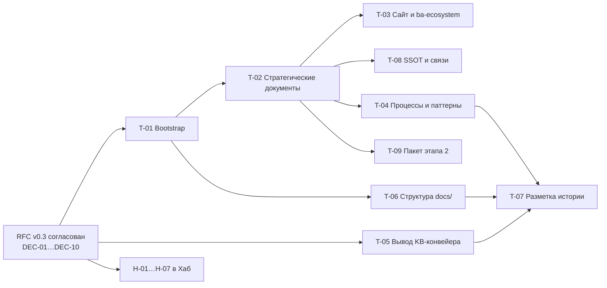

# Реестр задач исполнения и обращений в Хаб

Ответ на пункт issue [#409](https://github.com/G-Ivan-A/mango_ba_prompts/issues/409)
«при необходимости инициировать итеративные отдельные задачи» при ограничении
«внесение изменений в репозитории — только на основе согласованных РФС или
АДР отдельными задачами». Документ содержит готовые к заведению постановки:

- **T-01…T-09** — задачи на изменение этого репозитория. Объём каждой задачи
  взят из [реестра диспозиции](2026-10-31-file-disposition-register.md)
  (колонка «Задача»; машинная копия —
  `experiments/issue_409/disposition.json`).
- **H-01…H-07** — обращения в [Хаб](https://github.com/G-Ivan-A/hybrid-Intelligence-lab)
  по противоречиям, которые нельзя устранить на стороне спицы.

Решения DEC-01…DEC-10, от которых зависят задачи, описаны в
[RFC v0.3](../rfc/2026-10-repository-modernization.md#решения-на-согласование).
Находки F-01…F-18 — в [аудите](../audit/2026-10-31-repository-audit.md#реестр-находок).

## Почему issues не заведены этим PR

1. **Действующее правило Хаба запрещает задачи на этот репозиторий.**
   В [бэклоге Хаба L85–L96](https://github.com/G-Ivan-A/hybrid-Intelligence-lab/blob/32b5fa524e542af23c1a8e67c919bd66d5f4e399/ops/backlog.md#L85-L96)
   репозиторий имеет статус `legacy/archived`: «Новая разработка в нём не
   ведётся». Пока владелец не принял DEC-01, issue на изменение спицы
   противоречило бы этой норме. Это противоречие — находка F-01.
2. **Issue #409 требует согласованного RFC или ADR до изменений.**
   Задача, заведённая до согласования, предрешила бы DEC-01…DEC-10.
3. **Порядок задач зависит от решений.** Например, T-05 при отказе от DEC-10
   превращается из вывода KB-конвейера в его актуализацию — с другим объёмом
   и DoD.

Поэтому каждая постановка ниже готова к копированию в issue и заводится
после согласования RFC. Формат следует [шаблону задачи Хаба v3.1](https://github.com/G-Ivan-A/hybrid-Intelligence-lab/blob/32b5fa524e542af23c1a8e67c919bd66d5f4e399/.github/ISSUE_TEMPLATE/task.md):
цель, SSOT и проверяемые пункты «Готово, когда». Шаблон требует не
перечислять файлы в issue («место артефакта разрешается на момент
исполнения»). Поэтому объём задаётся фильтром реестра, а список ниже —
справочный, на снимке `6f6cbc47`.

## Порядок исполнения

| Задача | Зависит от решений | Зависит от задач | Файлов в реестре | Оценка | Почему здесь |
| --- | --- | --- | --- | --- | --- |
| T-01 | DEC-07 | — | 1 (+2 новых) | S | Без `AGENTS.md` исполнитель любой следующей задачи не получает правил Хаба (F-08) |
| T-02 | DEC-01, DEC-02, DEC-03, DEC-04, DEC-05, DEC-08 | T-01 | 5 (+4–5 новых) | M | Даёт словарь и границы, на которые ссылаются все остальные задачи (F-02, F-03) |
| T-03 | DEC-08 | T-02 | 3 | M | Сайт для руководства должен показывать четыре этапа (F-15) |
| T-04 | — | T-02 | 22 | L | Карта процессов описывает дофазовую модель (F-13) |
| T-05 | DEC-10 | — | 58 | L | Второй источник KB; можно вести параллельно (F-12) |
| T-06 | DEC-09 | T-01 | 11 | M | Дом `docs/` определяет `docs/README.md` из T-01 (F-09, F-16, F-17) |
| T-07 | DEC-09 | T-04, T-05, T-06 | 41 (+113 по `ai-generated`) | M | Архивировать можно только то, у чего уже есть преемник (F-10, F-11) |
| T-08 | DEC-01, DEC-03, DEC-04 | T-02 | 3 | S | Мосты к Хабу и runtime называют решения из T-02 (F-04, F-05) |
| T-09 | DEC-06 | T-02 | 2 | M | Единый источник пакета этапа 2 (F-06) |

Сумма по колонке «Файлов в реестре» — 146: это все файлы с диспозицией
`update`, `relocate` и `archive-candidate` в реестре.

## Задачи на изменение репозитория

### T-01. Bootstrap Хаба: `AGENTS.md`, профиль, `docs/README.md`

- **Цель.** Агент-исполнитель на входе в репозиторий получает правила Хаба
  и профиль спицы. Корень и `.hub-profile.json` соответствуют
  [agents-md-bootstrap-standard](https://github.com/G-Ivan-A/hybrid-Intelligence-lab/blob/32b5fa524e542af23c1a8e67c919bd66d5f4e399/standards/agents-md-bootstrap-standard.md#L14).
- **Объём.** Реестр: `.hub-profile.json`. Новые файлы: `AGENTS.md`,
  `docs/README.md`, ADR о расширении замка корня.
- **Особенность.** Локальный замок корня
  (`tools/validate-repository-structure.sh`, L112–L130, дельта D1)
  разрешает в корне только `README.md`, `CONTRIBUTING.md` и
  `CHANGELOG.md`. Сообщение валидатора само называет путь: «заведи ADR и
  расширь список». Значит, задача начинается с ADR, а `AGENTS.md`
  добавляется в список той же правкой.
- **SSOT.** [Hub AGENTS.md](https://github.com/G-Ivan-A/hybrid-Intelligence-lab/blob/32b5fa524e542af23c1a8e67c919bd66d5f4e399/AGENTS.md);
  [bootstrap-standard L55](https://github.com/G-Ivan-A/hybrid-Intelligence-lab/blob/32b5fa524e542af23c1a8e67c919bd66d5f4e399/standards/agents-md-bootstrap-standard.md#L55);
  DEC-07.
- **Готово, когда:**
  - [ ] Принят ADR спицы, расширяющий список корневых файлов на `AGENTS.md`;
    `allowed_root_markdown` обновлён.
  - [ ] `AGENTS.md` в корне указывает `archetype: B` и `environment: local`,
    те же значения записаны в `.hub-profile.json`.
  - [ ] `docs/README.md` описывает дома подкаталогов `docs/`, включая
    `docs/vision.md`, `concept.md`, `architecture.md`, `roadmap.md`.
  - [ ] `make validate-structure` и `make validate-full` проходят.

### T-02. Стратегические документы и ADR, заменяющий границы #263

- **Цель.** Видение, концепция, архитектура и roadmap четырёх этапов
  существуют в `docs/`. Действующие контракты им не противоречат.
- **Объём.** Новые: `docs/vision.md`, `docs/concept.md`,
  `docs/architecture.md`, `docs/roadmap.md`, ADR о замене границ #263.
  Реестр (5): `README.md`, `ai-governance/ai-governance.md`,
  `ai-rules/AI_SESSION_HANDOVER_PROMPT.md`, `ai-rules/ai-quick-rules.md`,
  `scripts/validate_issue_263_vision_alignment.py`.
- **Особенность.** Валидатор #263 закрепляет текст «уровни 3–4 не являются
  планом работ», «GitHub — единственная платформа» и строку
  `ai-ba-playbooks` (F-03, F-04, F-14). Его меняют в том же PR, что и ADR.
  Иначе либо CI падает, либо старая граница остаётся в силе.
- **SSOT.** [Предложение по стратегическим документам](2026-10-31-strategic-documents-proposal.md):
  черновики и метод обоснования О-1…О-5. DEC-01, DEC-02, DEC-03, DEC-04,
  DEC-05, DEC-08.
- **Готово, когда:**
  - [ ] Четыре файла созданы. Каждое утверждение помечено классом трассы
    [И]/[Х]/[Р]/[П] (метод О-1 предложения).
  - [ ] ADR спицы принят и явно заменяет формулировки #263. Валидатор #263
    проверяет новые формулировки.
  - [ ] `README.md` и `ai-governance/ai-governance.md` не утверждают
    «GitHub — единственная платформа», Private-видимость (DEC-03) и
    «evals и golden-set отсутствуют».
  - [ ] Правило 7 [Hub AGENTS.md L29](https://github.com/G-Ivan-A/hybrid-Intelligence-lab/blob/32b5fa524e542af23c1a8e67c919bd66d5f4e399/AGENTS.md#L29)
    выполнимо: `AGENTS.md` ссылается на `docs/concept.md` и `docs/vision.md`.
  - [ ] `make validate-full` проходит.

### T-03. Разделение `docs/ba-ecosystem.md` и дорожная карта сайта

- **Цель.** Раздел «Дорожная карта» сайта показывает четыре этапа из
  `docs/roadmap.md`, а не уровни L1–L4.
- **Объём (3).** `docs/ba-ecosystem.md`, `scripts/generate-pages-data.mjs`,
  `standards/pages-ux-standard.md`.
- **Особенность.** Уровни L1–L4 — шкала зрелости, а не план. Они остаются в
  методологии и связаны с этапами таблицей соответствия из
  [предложения](2026-10-31-strategic-documents-proposal.md) (L1, L2 → этап 1;
  L3 → этапы 2–3; L4 → этапы 3–4). Каталог `site/` собирается генератором и
  руками не правится.
- **SSOT.** `docs/roadmap.md` (результат T-02); RFC v0.3, раздел о сайте
  (D-01…D-08).
- **Готово, когда:**
  - [ ] `docs/ba-ecosystem.md` содержит только методологию. Раздел §7 со
    словами «Уровни 3–4 не являются планом работ» заменён ссылкой на
    `docs/roadmap.md`.
  - [ ] Генератор читает дорожную карту из `docs/roadmap.md`. Тест или
    валидатор генератора это проверяет.
  - [ ] Пересобранный сайт показывает этапы 1–4 с критериями входа и выхода.
    Скриншот приложен к PR.
  - [ ] `standards/pages-ux-standard.md` описывает этот раздел.

### T-04. Карта процессов, таксономия и паттерны под BCREQ

- **Цель.** Процессы, таксономия и паттерны описывают действующий маршрут
  `A-IN` → `A-CORE` → `A-WORK` → `A-RELEASE` с воротами Г-IN, Г-С1, Г-W.
  Модели «Формирование/Валидация ФТ/ТЗ» в них больше нет.
- **Объём (22).** `docs/ba-processes/00-index.md` и
  `00-index.executable.md`, `docs/ba-processes/README.md`,
  `docs/taxonomy.md`, `patterns/README.md`, семь паттернов
  (`asr-ingestion`, `fr-generation`, `fr-validation`,
  `glossary-context-generation`, `meeting-summary-generation`,
  `usecase-generation`, `user-story-generation`) — по `README.md` и
  `examples/basic-example.md`, `standards/pattern-standard.md`,
  `standards/product-classification-contract.md`,
  `standards/team-directory.md`.
- **SSOT.** [RFC ручного конвейера BCREQ](../rfc/2026-10-bcreq-manual-pipeline.md);
  `prompts/catalog.json` (39 классов); [мета-модель Хаба](https://github.com/G-Ivan-A/hybrid-Intelligence-lab/tree/32b5fa524e542af23c1a8e67c919bd66d5f4e399/research/ba-requirements).
- **Готово, когда:**
  - [ ] Каждый паттерн либо отнесён к фазе маршрута (поле или таблица),
    либо помечен историческим с указанием преемника (DEC-09).
  - [ ] Таксономия и классификация продуктов сверены с ADR-013 спицы.
    Расхождения перечислены в PR.
  - [ ] Слои M0–M4 мета-модели Хаба названы в карте процессов, и маршрут
    с ними не расходится. Уточнения мета-модели по практике оформлены
    обращением в Хаб, а не правкой здесь.
  - [ ] `make validate-full` проходит.

### T-05. Вывод локального KB-конвейера

- **Цель.** У базы знаний один источник — `mango-ba-ai-runtime`
  ([#361](https://github.com/G-Ivan-A/mango_ba_prompts/issues/361)).
  Локальный конвейер не пишет в перенесённый `kb/processed`.
- **Объём (58).** 34 файла `kb/sources/`, 8 файлов `scripts/kb/`,
  `.github/workflows/kb.yml`, `CONTRIBUTING.md`, `Makefile`,
  `docs/contracts/kb-citations.md`, `kb/README.md`, `kb/USAGE.md`,
  `kb/fragments/README.md`, `kb/practices/source-backed-analysis.md`,
  `kb/processed/README.md`, `kb/.gitkeep`,
  `scripts/validate_issue_111_kb_pipeline.py`,
  `scripts/validate_issue_115_kb_mango_pipeline.py`,
  `scripts/validate_issue_310_kb_pdf_ingestion.py`,
  `scripts/validate_pagination_shift.py` и его тест,
  `standards/kb-standard.md`.
- **Особенность.** Контракт 2 issue [#291](https://github.com/G-Ivan-A/mango_ba_prompts/issues/291)
  ([`.archive/README.md`](../../.archive/README.md)) запрещает переносить
  `kb/` и `runs/` в `.archive/`. Поэтому `kb/` выводится на месте: баннер
  депрекации и указатель на runtime. Другой путь — отдельный ADR, который
  пересматривает контракт 2. Сначала нужна проверка потребителей: кто в
  runtime и в Хабе ссылается на `kb/` этого репозитория.
- **SSOT.** DEC-10; [runtime](https://github.com/G-Ivan-A/mango-ba-ai-runtime/tree/b67410f627801345309281faa15e7219722bfb1a).
- **Готово, когда:**
  - [ ] Отчёт о проверке потребителей приложен к PR: каждый внешний
    потребитель и решение по нему.
  - [ ] Цели `kb-*` в `Makefile` и workflow `kb.yml` удалены или переведены
    на runtime. CI не обращается к `kb/processed`.
  - [ ] Три KB-валидатора и проверка пагинации либо удалены вместе с
    вызовами из `validate_all`, либо переписаны на runtime.
  - [ ] `kb/` не перенесён в `.archive/`, у файлов `kb/` есть указатель на
    runtime.
  - [ ] `make validate-full` проходит.

### T-06. Структура `docs/`

- **Цель.** В `docs/` нет запрещённого Хабом дома `docs/contracts/`, нет
  дублей и файлов без дома. Все RFC зарегистрированы.
- **Объём (11).** Перенос: `docs/contracts/bcreq-manual-state.md`,
  `docs/contracts/bcreq-stage-gates.md`, `docs/kb-experiment-report.md`,
  `docs/site-access.md`. Кандидаты в архив: `docs/.gitkeep`,
  `docs/adr/.gitkeep`, `docs/ba-process/README.md`,
  `docs/task-for-konard-template.md`. Обновление:
  `docs/rfc-hub-integration.md`, `docs/rfc/rfc-register.md`,
  `prompts/README.md`. Третий файл `docs/contracts/` (`kb-citations.md`)
  уходит в T-05.
- **Особенность.** Перенос делается с журналом `path_migrations` в
  `.hub-profile.json` и указателем на старом месте там, где есть внешние
  ссылки — по образцу Mango из [B-113 Хаба](https://github.com/G-Ivan-A/hybrid-Intelligence-lab/blob/32b5fa524e542af23c1a8e67c919bd66d5f4e399/ops/backlog.md#L234).
  Ссылки на ADR других репозиториев пишутся с префиксом репозитория
  (F-17): номер ADR-014 есть и здесь, и в Хабе.
- **SSOT.** [Hub AGENTS.md L35](https://github.com/G-Ivan-A/hybrid-Intelligence-lab/blob/32b5fa524e542af23c1a8e67c919bd66d5f4e399/AGENTS.md#L35);
  `docs/README.md` из T-01; DEC-09.
- **Готово, когда:**
  - [ ] Каталога `docs/contracts/` нет. Все ссылки на перенесённые файлы
    обновлены, генератор сайта собирается.
  - [ ] В корне `docs/` — только файлы, описанные в `docs/README.md`.
  - [ ] В `docs/rfc/rfc-register.md` есть все RFC каталога `docs/rfc/`.
    `docs/rfc-hub-integration.md` перенесён в `docs/rfc/` или помечен
    историческим.
  - [ ] `make validate-structure` и `make validate-full` проходят.

### T-07. Разметка истории, статусы ADR, архив

- **Цель.** Каждый файл вне `runs/` либо актуален, либо размечен
  историческим, либо лежит в архиве (требование #409). Решения со статусом
  `proposed` с 2026-06 закрыты.
- **Объём (41).** Восемь ADR `docs/adr/003`…`010`: у семи нужно решение
  accept/reject/supersede, `009-bcreq-formation-process.md` — кандидат в
  архив. Плюс `docs/rfc/knowledge-transfer-to-hub/` (5),
  `docs/rfc/rfc-to-hub-001-knowledge-transfer.md`,
  `docs/superpowers/plans/` (2), `pr-ops/migration-*` (3),
  `pr-ops/session-digests.md`, `pr-ops/sync-matrix-2026-06-17.md`,
  `prompts/asr-ingestion-legacy.md`,
  `prompts/letter-customer-documentation-legacy.md`, 17 логов
  `experiments/*.log` (issue #317) и `standards/README.md`. Отдельно —
  удаление запрещённого поля `ai-generated` из 113 файлов вне `runs/`
  (список — в реестре, раздел о `ai-generated`).
- **Особенность.**
  - Правило `.archive/` — «только файлы с `status: superseded`, у которых
    есть действующий преемник». У логов #317 преемника нет. Поэтому они
    переносятся в `experiments/issue_317/`, по соглашению каталога
    `experiments/issue_NNN/`, а не в `.archive/`.
  - `runs/` не изменяется: это статистика (ограничение #409), поле
    `ai-generated` в 628 файлах `runs/` остаётся.
  - Удаление `ai-generated` правит только метаданные и допустимо для
    исторических файлов.
- **SSOT.** DEC-09; [ADR-014 Хаба (наследие как свидетельство, LG-5)](https://github.com/G-Ivan-A/hybrid-Intelligence-lab/blob/32b5fa524e542af23c1a8e67c919bd66d5f4e399/docs/adr/2026-09-adr-014-legacy-evidence-not-baseline.md);
  [`.archive/README.md`](../../.archive/README.md).
- **Готово, когда:**
  - [ ] Статус каждого ADR 003–010 — `accepted`, `rejected` или
    `superseded` с указанием преемника. Решения принимает владелец.
  - [ ] Перенесённые в `.archive/` файлы имеют баннер «🗄️ АРХИВ» и строку в
    таблице `.archive/README.md`.
  - [ ] Вне `runs/` нет файлов с `ai-generated`. Локальный валидатор
    frontmatter проверяет все каталоги, кроме `runs/`.
  - [ ] Все `.md` вне `runs/` без статуса актуального документа имеют блок
    перехода по DEC-09.
  - [ ] `git diff -- runs/` пуст; `make validate-full` проходит.

### T-08. SSOT и связи с Хабом и runtime

- **Цель.** Мосты к Хабу и runtime называют фактическую модель:
  `mango-ba-ai-runtime` как среда исполнения, видимость по DEC-03, статус
  по DEC-01.
- **Объём (3).** `docs/hub-research-dependencies.md`, `pr-ops/BACKLOG.md`,
  `pr-ops/artifact-map.md`. Плюс ре-синк с Хабом: последний синк —
  2026-08-17 (`3bfa4103`).
- **SSOT.** DEC-01, DEC-03, DEC-04; [projects/ba-ai-process Хаба](https://github.com/G-Ivan-A/hybrid-Intelligence-lab/tree/32b5fa524e542af23c1a8e67c919bd66d5f4e399/projects/ba-ai-process).
- **Готово, когда:**
  - [ ] `pr-ops/artifact-map.md` различает ADR-009 Хаба и локальный
    ADR 009 по префиксу репозитория.
  - [ ] `docs/hub-research-dependencies.md` называет `mango-ba-ai-runtime`
    и `projects/ba-ai-process` Хаба.
  - [ ] Маркеры «evals отсутствуют» в `pr-ops/BACKLOG.md` заменены
    фактическим состоянием Golden Set.
  - [ ] `.hub-profile.json` фиксирует новый `last_sync`, предыдущий синк
    перенесён в `sync_history`.

### T-09. Этап 2: единый источник пакета OpenCode

- **Цель.** У пакета этапа 2 один источник. ADR-016 спицы становится
  профилем применения пакета Хаба, а не третьим кандидатом SSOT (F-06).
- **Объём (2).** `docs/adr/2026-10-adr-016-ide-client-process.md`,
  `docs/analysis/2026-10-30-ide-clients-stage-2.md`.
- **SSOT.** [dist/execution-package-opencode Хаба](https://github.com/G-Ivan-A/hybrid-Intelligence-lab/blob/32b5fa524e542af23c1a8e67c919bd66d5f4e399/projects/ba-ai-process/dist/execution-package-opencode/README.md)
  (`RG-BCREQ-v1`); DEC-06.
- **Готово, когда:**
  - [ ] ADR-016 спицы ссылается на пакет Хаба как на источник сборки и на
    runtime как на место установки. Собственный перечень 39 классов он не
    ведёт, а ссылается на `prompts/catalog.json`.
  - [ ] Анализ этапа 2 дополнен сверкой рекомендации OpenCode с пакетом
    Хаба. Расхождения перечислены.
  - [ ] Переход «этап 1 → этап 2» описан критериями входа из
    `docs/roadmap.md`.

## Обращения в Хаб

Формулировки готовы к заведению в
[issues Хаба](https://github.com/G-Ivan-A/hybrid-Intelligence-lab/issues)
по шаблону задачи. Все ссылки закреплены на `32b5fa52`.

### H-01. Статус `mango_ba_prompts` в таблице статусов бэклога

- **Контекст.** [Бэклог L85–L96](https://github.com/G-Ivan-A/hybrid-Intelligence-lab/blob/32b5fa524e542af23c1a8e67c919bd66d5f4e399/ops/backlog.md#L85-L96)
  присваивает репозиторию статус `legacy/archived` по
  [#583](https://github.com/G-Ivan-A/hybrid-Intelligence-lab/issues/583).
  После этого в репозитории создано 25 issues и слито 25 PR, а владелец
  ставит четыре этапа его развития (#409). Мета-модель M1–M4 Хаба опирается
  на измерения `runs/` этого репозитория.
- **Цель.** Таблица статусов отражает решение DEC-01: гибридный статус —
  лаборатория практики этапа 1 при `mango-ba-ai-runtime` как среде
  исполнения этапов 2–4.
- **Готово, когда:** строка репозитория обновлена; правило «задачи на
  изменение не ставятся» заменено описанием допустимых задач.

### H-02. Устаревшая карта экосистемы

- **Контекст.** [ecosystem-map.md L59](https://github.com/G-Ivan-A/hybrid-Intelligence-lab/blob/32b5fa524e542af23c1a8e67c919bd66d5f4e399/docs/ecosystem-map.md#L59)
  (draft 0.4 от 2026-06-12) показывает репозиторий как `Active`
  «Библиотека промптов». `mango-ba-ai-runtime` в карте нет. Карта
  противоречит таблице статусов бэклога (H-01).
- **Цель.** Карта согласована с решением по H-01 и содержит
  `mango-ba-ai-runtime`.
- **Готово, когда:** обе строки соответствуют таблице статусов;
  `updated` и версия карты подняты.

### H-03. Решение по ADR-009 (видимость)

- **Контекст.** [ADR-009 Хаба](https://github.com/G-Ivan-A/hybrid-Intelligence-lab/blob/32b5fa524e542af23c1a8e67c919bd66d5f4e399/docs/adr/2026-07-adr-009-mango-repo-split.md)
  с июля остаётся `proposed` 0.3 и требует перевести репозиторий в Private.
  Сайт GitHub Pages — канал доставки этапа 1 и витрина для руководства.
  Оба репозитория публичны.
- **Цель.** ADR-009 принят, отклонён или пересмотрен с учётом этапа 1.
  До решения спица сохраняет Public (DEC-03).
- **Готово, когда:** статус ADR-009 не `proposed`; B-080…B-084 приведены в
  соответствие.

### H-04. Место n8n в RFC серверной среды (B-218)

- **Контекст.** Issue #409 формулирует этап 3 как «автоматизацию за счёт
  оркестрации процессов через n8n». Хаб допускает n8n только «как слой
  интеграций поверх API runner, но не вместо него»
  ([runtime-options L62–L71](https://github.com/G-Ivan-A/hybrid-Intelligence-lab/blob/32b5fa524e542af23c1a8e67c919bd66d5f4e399/projects/ba-ai-process/docs/analysis/2026-09-29-ba-ai-process-runtime-options.md#L62-L71)).
  Вариант n8n как ядра (В-6) отклонён
  ([L379](https://github.com/G-Ivan-A/hybrid-Intelligence-lab/blob/32b5fa524e542af23c1a8e67c919bd66d5f4e399/projects/ba-ai-process/docs/analysis/2026-09-29-ba-ai-process-runtime-options.md#L379)).
  Спица формулирует этап 3 как «оркестрацию процесса runner'ом с n8n как
  слоем интеграций» (DEC-05).
- **Цель.** [B-218](https://github.com/G-Ivan-A/hybrid-Intelligence-lab/blob/32b5fa524e542af23c1a8e67c919bd66d5f4e399/ops/backlog.md#L700)
  («n8n только как оболочка интеграций») использует ту же формулировку и
  ссылается на этап 3 roadmap спицы как на потребителя.
- **Готово, когда:** RFC серверной среды называет этап 3 спицы и не
  расходится с DEC-05.

### H-05. Дом `PRODUCT_VISION.md` в product-profile

- **Контекст.** [product-profile L60](https://github.com/G-Ivan-A/hybrid-Intelligence-lab/blob/32b5fa524e542af23c1a8e67c919bd66d5f4e399/standards/product-profile.md#L60)
  требует `PRODUCT_VISION.md` в корне проекта.
  [B-113](https://github.com/G-Ivan-A/hybrid-Intelligence-lab/blob/32b5fa524e542af23c1a8e67c919bd66d5f4e399/ops/backlog.md#L234)
  того же Хаба называет корневой `PRODUCT_VISION.md` запрещённым файлом и
  переносит его в `docs/vision.md`. Сам Хаб держит видение в `docs/vision.md`.
- **Цель.** Стандарт и бэклог называют один дом видения. Спица следует
  `docs/vision.md` (DEC-08).
- **Готово, когда:** product-profile указывает `docs/vision.md`, шаблон
  обновлён.

### H-06. Область действия SF-7 для промптов этапа 1

- **Контекст.** [ADR-016 Хаба L70](https://github.com/G-Ivan-A/hybrid-Intelligence-lab/blob/32b5fa524e542af23c1a8e67c919bd66d5f4e399/docs/adr/2026-09-adr-016-skill-form-and-contract-format.md#L70)
  (SF-7) запрещает имена `stepwise`, `oneshot`, `legacy` «в новых
  артефактах». 14 промптов `prompts/bcreq-*` (#388) используют эти суффиксы.
  На них ссылаются идентификаторы статистики `runs/`, которая не
  изменяется (#409), и ссылки сайта.
- **Цель.** ADR-016 Хаба уточняет, что SF-7 относится к навыкам runtime.
  Промпты этапа 1 сохраняют имена как наследуемые идентификаторы.
- **Готово, когда:** в ADR-016 Хаба есть оговорка о промптах этапа 1;
  переименование в спице не требуется.

### H-07. Противоречивая норма именования ADR

- **Контекст.** [htom-documentation-structure L62](https://github.com/G-Ivan-A/hybrid-Intelligence-lab/blob/32b5fa524e542af23c1a8e67c919bd66d5f4e399/standards/htom-documentation-structure.md#L62)
  задаёт `docs/adr/NNNN-title.md`.
  [adr-structure-standard L46](https://github.com/G-Ivan-A/hybrid-Intelligence-lab/blob/32b5fa524e542af23c1a8e67c919bd66d5f4e399/standards/adr-structure-standard.md#L46)
  и [file-naming L36](https://github.com/G-Ivan-A/hybrid-Intelligence-lab/blob/32b5fa524e542af23c1a8e67c919bd66d5f4e399/standards/file-naming.md#L36)
  задают `YYYY-MM-adr-NNN-name.md`. В `docs/adr/` спицы есть все три
  формы: `0001`…`0004`, `001`…`010`, `2026-xx-adr-011`…`016`. Номера ADR
  повторяются между репозиториями: ADR-014 спицы и ADR-014 Хаба — разные
  решения (F-17).
- **Цель.** У Хаба одна норма именования ADR и правило ссылки на ADR
  другого репозитория (префикс репозитория).
- **Готово, когда:** htom-documentation-structure согласован с
  adr-structure-standard; правило межрепозиторных ссылок записано.

## Остаточные ограничения

- Объём задач посчитан на снимке `6f6cbc47`. Если до исполнения в
  репозиторий придут новые PR, исполнитель пересчитывает объём фильтром
  реестра. Генератор реестра — `experiments/issue_409/build_disposition.py`.
- Оценки S/M/L — экспертные, без учёта времени ревью владельцем.
- Статус каждого ADR 003–010 (T-07) — решение владельца. Реестр фиксирует
  только то, что решение нужно.
