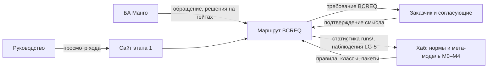

# Видение, концепция, архитектура и roadmap: предлагаемое содержание и способ обоснования

Ответ на пункт DoD [issue #409](https://github.com/G-Ivan-A/mango_ba_prompts/issues/409):
«проанализирована эволюция требований и определены актуализированы: видение,
концепция, архитектура, роадмэп проекта с предложением как их обосновать».
Документ содержит **черновое содержание** четырёх будущих файлов и метод их
обоснования. Сами файлы не создаются: по ограничению issue изменения вносятся
отдельной задачей (T-02 в [плане задач](2026-10-31-follow-up-tasks.md)) после
согласования [RFC v0.3](../rfc/2026-10-repository-modernization.md).

## Результат

1. **Четыре файла — в `docs/`:** `docs/vision.md`, `docs/concept.md`,
   `docs/architecture.md`, `docs/roadmap.md` (решение DEC-08). Корень
   репозитория закрыт локальным валидатором, и корневой `PRODUCT_VISION.md`
   из RFC v0.2 не прошёл бы CI (см. [размещение](#где-живут-файлы-и-почему)).
2. **Видение строится вокруг результата БА, а не вокруг формы.** Результат —
   полное и проверяемое требование BCREQ от обращения до согласованного
   документа. Промпты, агентный клиент, n8n и сервер — сменяемые исполнители
   одного маршрута.
3. **Концепция разводит роли трёх репозиториев.** Хаб задаёт нормы и
   мета-модель. [`mango-ba-ai-runtime`](https://github.com/G-Ivan-A/mango-ba-ai-runtime/tree/b67410f627801345309281faa15e7219722bfb1a)
   исполняет этапы 2–4. Этот репозиторий — лаборатория практики этапа 1:
   промпты, сайт, ручной конвейер и статистика `runs/`. Это рекомендация
   DEC-01; черновики совместимы и с другими вариантами (см.
   [устойчивость к DEC-01](#устойчивость-к-вариантам-dec-01)).
4. **Архитектура — один маршрут `A-IN` → `A-CORE` → `A-WORK` → `A-RELEASE`
   и смена исполнителя по этапам.** n8n — оболочка интеграций вокруг runner,
   а не ядро оркестрации (DEC-05). Это исправление формулировки этапа 3 из
   issue с обоснованием: так решено в анализе сред Хаба.
5. **Roadmap — четыре этапа с критериями входа и выхода.** Выход
   подтверждается новой статистикой `runs/` и сравнением с историческими
   прогонами. Историческая статистика не пересчитывается.
6. **Обоснование — по трассе.** У каждого утверждения есть источник одного из
   четырёх классов (issue и владелец, норма Хаба, свидетельство репозитория,
   отраслевая практика). Принимает владелец, по документу.

## Где живут файлы и почему

| Довод | Свидетельство | Вывод |
| --- | --- | --- |
| Issue требует файлы «в docs» | [Issue #409](https://github.com/G-Ivan-A/mango_ba_prompts/issues/409): «отсутствуют в docs файлы видения, концепции, архиитектуры, роадмэп проекта» | `docs/` |
| Корень закрыт локальным замком | [`tools/validate-repository-structure.sh`](../../tools/validate-repository-structure.sh) (дельта D1, строки 112–130): в корне разрешены только `README.md`, `CONTRIBUTING.md`, `CHANGELOG.md`; иначе ошибка «root markdown file is not in the canonical HTOM root set» | Корневой `PRODUCT_VISION.md` или `ROADMAP.md` из RFC v0.2 сломал бы `make validate-structure` |
| Хаб сам держит видение и концепцию в `docs/` | [Хаб `docs/vision.md`](https://github.com/G-Ivan-A/hybrid-Intelligence-lab/blob/32b5fa524e542af23c1a8e67c919bd66d5f4e399/docs/vision.md), [Хаб `docs/concept.md`](https://github.com/G-Ivan-A/hybrid-Intelligence-lab/blob/32b5fa524e542af23c1a8e67c919bd66d5f4e399/docs/concept.md) | Совпадение с практикой Хаба |
| Хаб убирает корневой `PRODUCT_VISION.md` у спиц | [B-113 Хаба](https://github.com/G-Ivan-A/hybrid-Intelligence-lab/blob/32b5fa524e542af23c1a8e67c919bd66d5f4e399/ops/backlog.md#L234): перенести `PRODUCT_VISION.md` в «каноничные дома (`docs/vision.md` …)» | Прямой прецедент |
| `product-profile` требует корневой файл | [product-profile L60](https://github.com/G-Ivan-A/hybrid-Intelligence-lab/blob/32b5fa524e542af23c1a8e67c919bd66d5f4e399/standards/product-profile.md#L60) | Профиль рыночного продукта; спица — архетип B (DEC-07). Противоречие B-113 и product-profile передаётся в Хаб как H-05 |
| Имена файлов | [`tools/validate-file-naming.sh`](../../tools/validate-file-naming.sh) требует дату только в `docs/analysis`, `docs/rfc`, `docs/adr`; в корне `docs/` уже живут `taxonomy.md`, `ba-ecosystem.md` | Короткие имена без даты допустимы |

Почему файлов четыре, а не три уровня L1–L3 из RFC v0.2. Issue называет
четыре документа, и у каждого свой вопрос, свой темп изменения и свой
способ принятия:

| Документ | Вопрос | Меняется | Принимается |
| --- | --- | --- | --- |
| `docs/vision.md` | Зачем и для кого? Каким будет результат? | Редко, решением владельца | Владелец |
| `docs/concept.md` | Как устроено пространство работы: роли, границы, принципы, кто за что отвечает? | При смене ролей репозиториев или норм Хаба | Владелец; согласованность с концепцией Хаба |
| `docs/architecture.md` | Из каких частей состоит решение и как они связаны на каждом этапе? | При ADR | ADR в `docs/adr/` |
| `docs/roadmap.md` | В каком порядке, с какими входами и доказательствами выхода? | По факту выхода с этапа | Владелец, по статистике `runs/` |

В RFC v0.2 было два уровня концепции: `product-concept` и `solution-concept`
по draft-стандартам веб-портала Хаба. Этот проект не веб-портал, и issue
говорит об одной «концепции». Разделение было бы лишним слоем. Продуктовые
сценарии входят в `concept.md`, решения — в `architecture.md`.

## Метод обоснования

Issue просит предложить, «как их обосновать». Предлагается пять правил.
Они применимы к каждому утверждению четырёх документов.

| № | Правило | Как проверить |
| --- | --- | --- |
| О-1 | **Трасса.** У каждого утверждения есть источник одного из классов: **[И]** issue или комментарий владельца, **[Х]** норма или решение Хаба (закреплённая ссылка), **[Р]** свидетельство репозитория (файл, коммит, RUN), **[П]** отраслевая практика (первичный источник). Утверждение без источника помечается `PROPOSED`. | Ревью по таблице трассы ниже; в итоговом файле — сноска или ссылка у раздела |
| О-2 | **Свидетельство — в форме LG-5.** Вывод из практики пишется как «в корпусе наблюдается X» с замером и коммитом, а не как норма ([ADR-014 Хаба](https://github.com/G-Ivan-A/hybrid-Intelligence-lab/blob/32b5fa524e542af23c1a8e67c919bd66d5f4e399/docs/adr/2026-09-adr-014-legacy-evidence-not-baseline.md)). | В тексте нет норм, выведенных из старых файлов без замера |
| О-3 | **Альтернативы.** Для каждого выбора (роль репозитория, место n8n, SSOT пакета этапа 2) указаны отклонённые варианты и причина. | Ссылка на DEC и реестр противоречий К-01…К-10 [анализа эволюции](2026-10-31-requirements-evolution.md#реестр-противоречий-и-апелляций) |
| О-4 | **Согласованность с Хабом.** Документы не противоречат мета-модели [`research/ba-requirements`](https://github.com/G-Ivan-A/hybrid-Intelligence-lab/tree/32b5fa524e542af23c1a8e67c919bd66d5f4e399/research/ba-requirements) «по вектору». Найденное противоречие не обходится молча, а передаётся в Хаб ([правило 7 AGENTS.md Хаба](https://github.com/G-Ivan-A/hybrid-Intelligence-lab/blob/32b5fa524e542af23c1a8e67c919bd66d5f4e399/AGENTS.md#L29)). | Таблица соответствия этапов слоям `M0`–`M4`; обращения H-01…H-07 |
| О-5 | **Принятие.** Видение и концепцию принимает владелец. Архитектурные решения фиксируются ADR. Переход между этапами roadmap — по критериям выхода с данными `runs/`. Слияние PR само по себе не означает принятие. | Статус `canonical` только после решения владельца в issue или PR |

Отраслевые основания структуры: [ISO/IEC/IEEE 29148](https://www.iso.org/standard/72089.html)
(операционная концепция и трасса требований), [C4 model](https://c4model.com/diagrams)
(контекст и контейнеры), [arc42](https://arc42.org/overview) (цели качества,
ограничения, решения, риски), [ADR по M. Nygard](https://cognitect.com/blog/2011/11/15/documenting-architecture-decisions)
(архитектурные решения отдельными записями). Эти источники задают форму
изложения, а не содержание. Содержание берётся из issue, Хаба и репозитория.

## Черновик `docs/vision.md`

Структура повторяет [видение Хаба](https://github.com/G-Ivan-A/hybrid-Intelligence-lab/blob/32b5fa524e542af23c1a8e67c919bd66d5f4e399/docs/vision.md):
Slogan, Vision, Mission, Target Groups, Value Proposition, Core Innovation,
Initial Focus, Long-term Goal и связь с уровнями L1–L4.

Предлагаемый тезис видения:

> Бизнес-аналитик Манго получает полное и проверяемое требование BCREQ — от
> обращения заказчика до согласованного документа — быстрее, чем вручную, и
> без потери смысла. Каждое решение прослеживается до источника. Исполнитель
> маршрута меняется от чата LLM к агентному клиенту и серверу, а маршрут,
> правила и человеческие решения остаются прежними.

| Раздел | Предлагаемое содержание | Трасса |
| --- | --- | --- |
| Slogan | «Требование без потери смысла» | [И] #407: потери намерения при передаче контекста; [Р] [анализ #407](2026-10-30-october-requirements-evolution.md) |
| Vision | Тезис выше | [И] четыре этапа #409; [Х] [мета-модель Хаба](https://github.com/G-Ivan-A/hybrid-Intelligence-lab/blob/32b5fa524e542af23c1a8e67c919bd66d5f4e399/research/ba-requirements/README.md) — конвейер «обращение → требование» |
| Mission | Превращать практику БА Манго в проверенные шаги маршрута. Измерять каждый шаг статистикой прогонов. Возвращать наблюдения в общую мета-модель. | [И] комментарий владельца к #408: «мета-модель корректируется практикой»; [Х] LG-5 ADR-014 |
| Target Groups | БА Манго — исполнители маршрута. Заказчики и согласующие — получатели требований. Руководство — оценивает ход автоматизации по сайту. Исследователи Хаба — используют статистику `runs/`. | [И] [комментарий 6524028597](https://github.com/G-Ivan-A/mango_ba_prompts/pull/408#issuecomment-6524028597): сайт для презентации руководству; [Р] [`runs/README.md`](../../runs/README.md) |
| Value Proposition | Предсказуемый маршрут и видимые ограничения качества. Сокращение доработок. Решения, которые можно проверить. | [Р] метрики RUN и [аудит](../audit/2026-10-31-repository-audit.md); численные цели — `PROPOSED`, задаются владельцем по baseline этапа 1 |
| Core Innovation | Маршрут не зависит от исполнителя: одни и те же фазы, классы и гейты для чата, агентного клиента и сервера. Переход между этапами доказывается сравнением статистики, а не сменой технологии. | [Х] [анализ сред Хаба, п. 10](https://github.com/G-Ivan-A/hybrid-Intelligence-lab/blob/32b5fa524e542af23c1a8e67c919bd66d5f4e399/projects/ba-ai-process/docs/analysis/2026-09-29-ba-ai-process-runtime-options.md#L437): отделить ядро от оболочки |
| Initial Focus | Этап 1: ручной фазовый конвейер BCREQ на сайте (14 промптов, 39 классов, 4 фазы) и новая статистика прогонов | [Р] [`prompts/`](../../prompts/README.md), [`standards/bcreq-manual-classes/catalog.json`](../../standards/bcreq-manual-classes/catalog.json), [RFC ручного конвейера](../rfc/2026-10-bcreq-manual-pipeline.md) |
| Long-term Goal | Production-исполнение маршрута на выделенном сервере в закрытом контуре Манго, с теми же гейтами и человеческими решениями | [И] этап 4 #409; [Х] Среда 4, [B-218 Хаба](https://github.com/G-Ivan-A/hybrid-Intelligence-lab/blob/32b5fa524e542af23c1a8e67c919bd66d5f4e399/ops/backlog.md#L700) |
| Связь L1–L4 | Уровни L1–L4 из [`docs/ba-ecosystem.md` §7](../ba-ecosystem.md) — модель **зрелости автоматизации** (от ручного запуска промптов до мультиагентной системы). Четыре этапа #409 — план **смены исполнителя**. Таблица соответствия — в `docs/roadmap.md`. | [Р] `ba-ecosystem.md` §7: «Область этого репозитория — уровни 1–2»; К-02 |

Что видение **не** обещает. Видение не заявляет, что конвейер уже
автоматизирован, и не обещает экономический эффект без замера. Видение не
повторяет нормы Хаба; оно ссылается на них.

## Черновик `docs/concept.md`

Структура повторяет [концепцию Хаба](https://github.com/G-Ivan-A/hybrid-Intelligence-lab/blob/32b5fa524e542af23c1a8e67c919bd66d5f4e399/docs/concept.md):
Назначение, Аудитории, Принципы, Модель репозитория, Границы, Связанные
контракты, Стандарты, Правило миграции.

| Раздел | Предлагаемое содержание | Трасса |
| --- | --- | --- |
| Назначение | Репозиторий — лаборатория практики этапа 1 и корпус статистики BCREQ для Манго. Здесь живут промпты и классы ручного конвейера, сайт для БА и руководства, протоколы прогонов `runs/`, локальные контракты фаз. | DEC-01 (рекомендация); [Р] [README](../../README.md); [И] #409 |
| Аудитории | Таблица «роль → что ищет → точка входа». БА → актуальный маршрут и промпты → сайт. Руководство → ценность, ход, доказательства → сайт, `docs/roadmap.md`. Исполнитель-агент → правила → `AGENTS.md` (T-01). Исследователь Хаба → статистика → `runs/`. | [И] комментарий 6524028597; [Х] [стандарт `AGENTS.md`](https://github.com/G-Ivan-A/hybrid-Intelligence-lab/blob/32b5fa524e542af23c1a8e67c919bd66d5f4e399/standards/agents-md-bootstrap-standard.md#L14) |
| Принципы | (1) Статистика неизменна: `runs/` не правится и не пересчитывается; новые требования дают новую статистику. (2) Один источник истины на тип решения. (3) Наследие — свидетельство, а не норма (LG-1…LG-6). (4) Практика влияет на мета-модель через свидетельство «в корпусе наблюдается X». (5) Человек принимает решения на гейтах. (6) Изменения — только по принятому RFC или ADR. | [И] ограничения #409; [Х] [ADR-014](https://github.com/G-Ivan-A/hybrid-Intelligence-lab/blob/32b5fa524e542af23c1a8e67c919bd66d5f4e399/docs/adr/2026-09-adr-014-legacy-evidence-not-baseline.md); [И] комментарий владельца к #408 |
| Модель репозитория | Карта SSOT: нормы и мета-модель — Хаб; маршрут этапов 2–4 — runtime; пакет этапа 2 — `dist/` Хаба как источник сборки, runtime как место установки (DEC-06); промпты, классы, сайт и статистика этапа 1 — эта спица. Каталоги: активные (`prompts/`, `standards/`, `docs/contracts/`, `site/`), статистика (`runs/`), история (`experiments/`, датированные `docs/analysis`, `docs/report`, `docs/reviews`), архив (`.archive/`, `prompts/archive/`). | [Р] [аудит, таблица SSOT](../audit/2026-10-31-repository-audit.md); [Р] [реестр файлов](2026-10-31-file-disposition-register.md); DEC-09 |
| Границы | В области: этап 1, сайт, статистика, обратная связь в Хаб. Вне области: код runner и навыки агентного клиента (runtime), нормы (Хаб), n8n-потоки (runtime по DEC-05). Видимость — по DEC-03. | DEC-01, DEC-03, DEC-04, DEC-05; [Х] [ADR-009 Хаба](https://github.com/G-Ivan-A/hybrid-Intelligence-lab/blob/32b5fa524e542af23c1a8e67c919bd66d5f4e399/docs/adr/2026-07-adr-009-mango-repo-split.md) |
| Связанные контракты | [`docs/contracts/bcreq-manual-state.md`](../contracts/bcreq-manual-state.md), [`docs/contracts/bcreq-stage-gates.md`](../contracts/bcreq-stage-gates.md), каталог классов, `runs/README.md` | [Р] |
| Стандарты | Наследуются из Хаба по `.hub-profile.json`; локальные дельты перечислены явно. Архетип B, среда `local` (DEC-07). | [Х] [стандарт `AGENTS.md`, L55](https://github.com/G-Ivan-A/hybrid-Intelligence-lab/blob/32b5fa524e542af23c1a8e67c919bd66d5f4e399/standards/agents-md-bootstrap-standard.md#L55) |
| Правило миграции | Устаревший активный файл обновляется на месте или уходит в архив с указателем на преемника. Исторические файлы не правятся; их статус задаётся правилом каталога. Удаление без журнала запрещено. | [Х] [artifact-deprecation-standard](https://github.com/G-Ivan-A/hybrid-Intelligence-lab/blob/32b5fa524e542af23c1a8e67c919bd66d5f4e399/standards/artifact-deprecation-standard.md); DEC-09 |

Пользовательские сценарии (операционная концепция по ISO/IEC/IEEE 29148):

| Сценарий | Шаги | Результат |
| --- | --- | --- |
| БА ведёт задачу BCREQ | Открывает сайт → выбирает фазу (`A-IN` → `A-CORE` → `A-WORK` → `A-RELEASE`) → копирует промпт с полным набором правил → передаёт состояние между фазами → проходит гейты с решением человека → фиксирует RUN | Требование и новая запись статистики |
| Руководство оценивает ход | Открывает сайт → видит видение и этап → смотрит доказательства (статистика, ограничения) → видит roadmap | Решение о следующем шаге инвестиций |
| Исследователь Хаба сверяет мета-модель | Берёт срез `runs/` на коммите → формулирует наблюдение в форме LG-5 → предлагает правку в Хабе | Мета-модель уточнена практикой |

## Черновик `docs/architecture.md`

Форма — C4 (контекст и контейнеры) плюс разделы arc42: цели качества,
ограничения, решения, риски. Архитектура описывает **маршрут и смену
исполнителя**, а не только содержимое этого репозитория.

Контекст (C4, уровень 1):

Контейнеры (C4, уровень 2) по этапам:

| Контейнер | Этап 1 | Этап 2 | Этап 3 | Этап 4 | SSOT |
| --- | --- | --- | --- | --- | --- |
| Правила и классы маршрута | Промпты и классы этой спицы | Пакет навыков | Тот же пакет у runner | Тот же | Мета-модель Хаба → пакет `dist/` Хаба (DEC-06) |
| Исполнитель маршрута | БА в чате LLM | Агентный клиент (OpenCode и др.) | runner (API) | runner как служба | runtime |
| Состояние задачи | Копируемый блок состояния | Файлы в рабочей папке | Хранилище runner | То же | Контракт [`bcreq-manual-state`](../contracts/bcreq-manual-state.md) → контракт runtime |
| Интеграции | Нет | Нет | n8n: формы, ожидания, уведомления, Jira | n8n или аналог | runtime (DEC-05) |
| Протокол прогона | `runs/` спицы | `runs/` спицы (пилот) | Журнал runner + выгрузка в формате `runs/` | То же | Формат `runs/README.md` |
| Витрина | Сайт GitHub Pages | Сайт: инструкция по установке пакета | Сайт: статус и отчёты | Внутренний портал (решение ADR) | Сайт — проекция, не SSOT |

Маршрут не меняется между этапами:

| Фаза спицы | Слой мета-модели Хаба | Гейт | Выход |
| --- | --- | --- | --- |
| `A-IN` | `M0` (обращение → требование) | Г-IN | Нормализованное обращение |
| `A-CORE` | `M1` (ядро) | Г-С1 «Согласование 1» | Ядро требования |
| `A-WORK` | `M2` (рендер рабочего документа) | Г-W | Рабочий BCREQ |
| `A-RELEASE` | `M2` + `M3` (выпуск, обратная связь) | Реплика уполномоченного человека (`ready_for_human_release` → `released`) | Согласованный BCREQ, запись RUN |
| Маршрутный лист | `M4` (маршрутизация) | — | Порядок фаз и возвраты |

Фазы и гейты — по [RFC ручного конвейера](../rfc/2026-10-bcreq-manual-pipeline.md)
и [контракту гейтов](../contracts/bcreq-stage-gates.md). `A-RELEASE` там —
предлагаемое расширение; в `architecture.md` оно получает статус из решения
по этому RFC. Маршрут runtime сейчас `A-IN` → `A-CORE` → `A-BCREQ`.
Соответствие `A-BCREQ` фазам `A-WORK` и `A-RELEASE` нужно записать явно
(задача T-09), а не выводить из совпадения имён.

Цели качества (arc42 §1.2), без придуманных чисел:

| Цель | Сценарий проверки | Источник порога |
| --- | --- | --- |
| Полнота | Все обязательства источника прослежены до требования | Владелец по baseline этапа 1 |
| Сохранение смысла | Отрицания, условия и конфликты не теряются при передаче состояния | Набор эталонных кейсов (golden), утверждённый владельцем |
| Переносимость | Те же кейсы дают сопоставимый вердикт в чате и в агентном клиенте | Сравнение статистики `runs/` этапов 1 и 2 |
| Наблюдаемость | Каждый прогон оставляет запись RUN в едином формате | `runs/README.md` |
| Безопасность данных | Чувствительные данные не попадают в публичный репозиторий и сайт | Решение DEC-03 и проверка `runs/` |

Ограничения (arc42 §2): GitHub Pages как витрина этапа 1. Локальный
[`.hub-profile.json`](../../.hub-profile.json) и наследование Хаба.
Неизменность `runs/`. Запрет «n8n вместо runner»
([анализ сред Хаба, L62–L71](https://github.com/G-Ivan-A/hybrid-Intelligence-lab/blob/32b5fa524e542af23c1a8e67c919bd66d5f4e399/projects/ba-ai-process/docs/analysis/2026-09-29-ba-ai-process-runtime-options.md#L62-L71)).

Решения (arc42 §9). Это ссылки на ADR, которые предстоит принять: ADR,
заменяющий #263 (DEC-02); роль runtime (DEC-04); место n8n (DEC-05); SSOT
пакета этапа 2 (DEC-06). Существующие ADR `docs/adr/` не перенумеровываются.

Риски (arc42 §11): расхождение трёх копий маршрута (спица, пакет Хаба,
runtime) — снимается DEC-06. Вторая копия графа в n8n — снимается DEC-05.
Публичность чувствительных прогонов — снимается DEC-03. Статус `legacy` в
Хабе, блокирующий задачи по спице, — снимается DEC-01 и H-01.

## Черновик `docs/roadmap.md`

Порядок этапов задан владельцем в #409. Ниже уточнены формулировки этапов,
критерии входа и выхода и связь со статистикой. Сроки и бюджет не указаны:
их задаёт владелец.

| Этап | Формулировка (уточнённая) | Вход | Результат | Выход (доказательство) | Где ведётся |
| --- | --- | --- | --- | --- | --- |
| 1 | Ручной фазовый конвейер BCREQ в чате LLM по инструкции сайта | Принятый RFC ручного конвейера; сайт с фазами | Промпты и классы всех четырёх фаз, гейты, протокол RUN | Серия новых RUN по всем фазам с прохождением гейтов; базовая линия метрик для этапа 2 | Эта спица |
| 2 | Агентный клиент (OpenCode и аналоги) с пакетом навыков | Выход этапа 1; принятый ADR о клиенте; пакет `dist/execution-package-opencode` Хаба | Пакет навыков, установленный у БА; файловое состояние | Те же кейсы, что на этапе 1, без потери смысла; сравнение статистики с этапом 1; пилот `RG-BCREQ-v1` | runtime + пакет Хаба; RUN — в `runs/` спицы |
| 3 | **Оркестрация процесса runner'ом с n8n как слоем интеграций** (вместо «оркестрации через n8n») | Выход этапа 2; runner с API; доступы к корпоративным системам | Формы, ожидания, уведомления, Jira через n8n вокруг runner | Работающие интеграции без второй копии графа в n8n; повтор и возобновление без двойных решений | runtime |
| 4 | Production на выделенном сервере | Выход этапа 3; решение по инфраструктуре и данным (B-218 Хаба) | Служба runner в закрытом контуре, наблюдаемость | Эксплуатационные метрики, восстановление, решение по безопасности | runtime |

Обоснование уточнения этапа 3. Issue формулирует этап 3 как «Автоматизация
за счет оркестрации процессов через n8n». Анализ сред Хаба рекомендует:
«n8n допустим как слой интеграций поверх API runner, но не вместо него»
([L62–L71](https://github.com/G-Ivan-A/hybrid-Intelligence-lab/blob/32b5fa524e542af23c1a8e67c919bd66d5f4e399/projects/ba-ai-process/docs/analysis/2026-09-29-ba-ai-process-runtime-options.md#L62-L71)).
Вариант n8n как ядра (В-6) отклонён по рискам Г-44…Г-49
([L379](https://github.com/G-Ivan-A/hybrid-Intelligence-lab/blob/32b5fa524e542af23c1a8e67c919bd66d5f4e399/projects/ba-ai-process/docs/analysis/2026-09-29-ba-ai-process-runtime-options.md#L379)):
вторая копия графа и недетерминированность узла AI Agent. Цель этапа
(автоматизация оркестрации) сохраняется, меняется только место n8n. Владелец
разрешил исправлять постановку с обоснованием: «Если постановки некорректны —
исправляйте с обоснованием, эффективность — приоритет» (комментарий к #408).
Решение — DEC-05.

Пакет готовности сайта к презентации. Это не отдельный этап, а работа
внутри этапа 1: сценарии D-01…D-08 из [RFC](../rfc/2026-10-repository-modernization.md)
и задача T-03.

Статистика по этапам. Каждый этап копит новую статистику в `runs/` в
едином формате, с полем этапа и версии маршрута. Сравнение этапов — новым
анализом в `docs/analysis/`, а не правкой старых RUN. Так выполняется
ограничение issue: «мы будем накапливать новую статистику с возможностью
анализировать исторические данные».

Соответствие уровням зрелости из `docs/ba-ecosystem.md` §7:

| Уровень зрелости (L1–L4) | Этапы issue #409 | Комментарий |
| --- | --- | --- |
| L1 «ручной запуск промптов» | 1 | Текущее состояние сайта |
| L2 «системный prompt + KB/RAG» | 1 | Полный набор правил и копируемое состояние фазового конвейера |
| L3 «агент управляет workflow» | 2–3 | `ba-ecosystem.md` §7 сейчас пишет: «Уровни 3–4 не являются планом работ `mango_ba_prompts`». Это расходится с #409 (К-02); снимается ADR, заменяющим #263 (DEC-02) |
| L4 «мультиагентная система» | 3–4 | То же; исполнение — в runtime (DEC-04) |

Соответствие не один к одному. Уровни L1–L4 описывают зрелость
автоматизации процесса, этапы — смену исполнителя маршрута.

## Устойчивость к вариантам DEC-01

| Вариант DEC-01 | Что меняется в черновиках |
| --- | --- |
| C (рекомендация): гибрид, спица — лаборатория этапа 1 и статистика | Ничего |
| A: спица остаётся архивом, всё переносится в runtime | Четыре документа создаются в runtime; в спице — только указатель в README и статус `archived`. `runs/` остаётся здесь как статистика. |
| B: отменить `legacy` полностью, спица — основной продукт | В `concept.md` расширяются границы на этапы 2–4. Пакет навыков и runner переносятся в спицу, что противоречит DEC-04/DEC-06; потребуется отдельный ADR. |

## Что берётся из существующих файлов

| Существующий файл | Что переиспользуется | Что устарело |
| --- | --- | --- |
| [`docs/ba-ecosystem.md`](../ba-ecosystem.md) | Уровни L1–L4 (§7), карта процессов | §5.2 «Валидация ФТ/ТЗ» как основной процесс; заменён фазами `A-IN`/`A-CORE` (#384–#403) |
| [`README.md`](../../README.md) | Описание каталогов и сайта | «GitHub — единственная платформа», «Целевая видимость — Private» (К-02, К-03) |
| [RFC ручного конвейера](../rfc/2026-10-bcreq-manual-pipeline.md) | Фазы, 39 классов, гейты | Статус `draft`: его принятие — вход этапа 1 |
| [Исследование IDE-клиентов](2026-10-30-ide-clients-stage-2.md) | Сравнение клиентов этапа 2 | Не учитывает пакет `dist/execution-package-opencode` Хаба (2026-10-07) и runtime как место установки |
| [`scripts/validate_issue_263_vision_alignment.py`](../../scripts/validate_issue_263_vision_alignment.py) | — | Закрепляет тексты #263; обновляется вместе с ADR DEC-02 |

## Остаточные ограничения

- Черновики не проверены на реальных данных этапа 2: прогонов пилота
  `RG-BCREQ-v1` в `runs/` нет.
- Численные цели (полнота, время, доработки) не заданы: для них нужен
  baseline этапа 1 и решение владельца.
- Октябрьский JSON-диалог из #407 недоступен (пустая ссылка загрузки).
  Эволюция восстановлена по истории issues, как и предлагает #409. Если
  JSON будет получен, его сверка — отдельная аналитическая задача.
