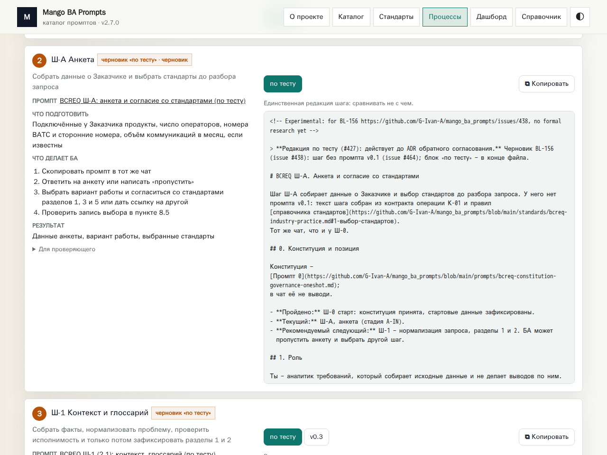
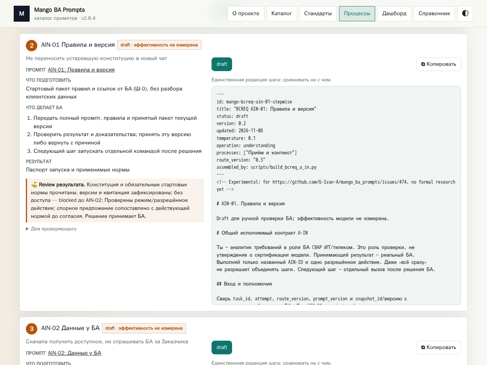
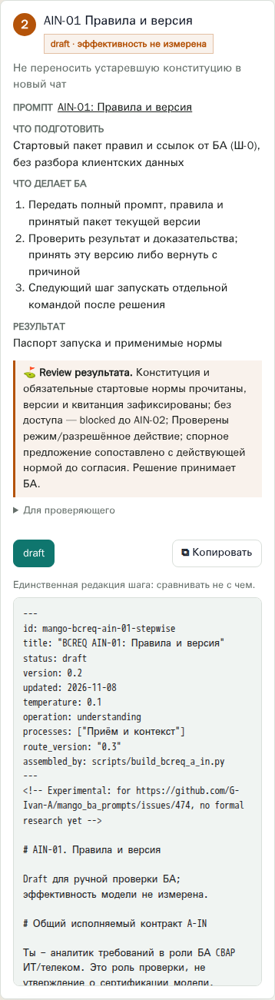

# #478 — полнота сайта и готовность комплекта

Проверен [реально опубликованный сайт](https://g-ivan-a.github.io/mango_ba_prompts/)
09.11.2026 UTC и пересобран текущий кандидат. Прод **2.7.0**, кандидат
**2.8.4** из merged [PR #475](https://github.com/G-Ivan-A/mango_ba_prompts/pull/475).
Смысловое содержимое кандидата совпадает с upstream/main
`f0f5ad561f7fe2cd0de0c40bffe97ea3bdd0fefd`: 22 файла сайта, кроме снимков;
при сравнении JSON исключено только `generatedAt`. Генерация обновила
эти временные метки. Новую продуктовую версию при документальном аудите
не вводим: изменений поведения относительно 2.8.4 нет, релизного пакета
с отдельной версией в репозитории нет.

Это подготовка к публикации по [ADR-018](../adr/2026-11-adr-018-rfc-audit-decisions.md),
не факт деплоя. Прежние промежуточные изменения #466/#468/#470/#472/#474
включены merged main. Новая исследовательская записка находится в
[docs/analysis](2026-11-09-academy-decision-makers.md); имена не смешиваются
с рабочим каталогом промптов BCREQ.

## Проверенные данные и форма

| Проверка | Прод 2.7.0 | Кандидат 2.8.4 / результат |
| --- | --- | --- |
| Каталог `data/prompts.json` | 53 записи: 39 рабочих классов + 14 архивных | Все 53 ID сохранены, состав и счётчики те же; новые AIN draft не подменяют 39 классов |
| Комплект процессов | 14 карточек, включая прежние Ш-А/Ш-1/Ш-2 | 35 карточек: эти три заменены на 24 AIN, остальные 11 сохранены; вкладка старта 25 карточек |
| Форма карточки | Инструкция слева; текст, редакция и copy справа | 35 `.testkit-step-layout`, одна общая инструкция; та же форма на desktop, адаптивный стек на mobile |
| Тексты AIN | Не представлены отдельными 24 шагами | 24 preview равны JSON; 24 копирования в clipboard равны полному тексту с ID-префиксом побайтно |
| Сравнение старых редакций | Кнопки редакций в последующих стадиях | Переключение двух редакций g2 меняет текст и возвращается обратно |
| Навигация | Шесть основных разделов | О проекте, Каталог, Стандарты, Процессы, Дашборд, Справочник открываются; активная ссылка и видимость совпадают |
| Ошибка загрузки | Отдельно не моделировалась на проде | Прерывание a-in-kit.json показывает «Данные не загрузились»; снятие ошибки + reload восстанавливает 24 шага и copy |
| Mobile | Исторический desktop сохранён для сравнения | 390×844, горизонтального переполнения документа нет; снимок всей карточки |
| JavaScript | Продуктовые сценарии не менялись | В выполненных сценариях `pageerror` отсутствуют; ошибка сети при fault injection ожидаема |
| История/публикация | Старые прогоны доступны по правилам сайта | Исключение `reports/run-0060` сохранено; проверки прежних контрактов и генератора входят в validate-full |

Основания: [site-audit.json](../../experiments/issue_478/site-audit.json)
(URL, версии, счётчики, SHA-256 публичных ответов и 22 файлов кандидата),
[browser-result.json](../../experiments/issue_478/browser-result.json),
[скрипт браузерного прогона](../../experiments/issue_478/browser-smoke.js).
Хеши сырых файлов относятся к сохранённой сборке; следующая генерация меняет
временные метки. `normalized_sha256` позволяет проверить JSON без этих меток.
Снимки исходных HTTP-ответов и локальные логи исключены из git, их можно
восстановить `audit_site.py --refresh-live`; это новая проверка, не прежний срез.

Под «без деградации» здесь понимаются сохранение объявленного каталога,
инструкций, редакций, навигации и копирования, а также соответствие merged
кандидату. Проверка не доказывает эффективность LLM, полноту внешних знаний
или результаты настоящего 24-шагового прогона БА. BL-175 не закрывается.

## Визуальное сравнение

Опубликованная 2.7.0, карточка Ш-А (база сравнения, не новый UI-дефект):

Подготовленная 2.8.4, карточка AIN-01 в той же форме:

Мобильная карточка:

## Воспроизводимость и публикация

1. `node scripts/generate-pages-data.mjs` — без установки зависимостей.
2. `python3 experiments/issue_478/audit_site.py` — использует сохранённый
   локальный кэш; в новом checkout получает четыре ограниченных ответа Pages.
   Сравнивает с закреплённым main, пишет манифест. Для offline CI этот шаг
   не нужен: манифест уже сохранён.
3. `python3 scripts/validate_issue_478_research.py` и `make validate-full` —
   целостность evidence и манифеста плюс все обнаруженные проверки репозитория.
4. Для UI запустить `python3 -m http.server 8768 --directory site` и
   `experiments/issue_478/browser-smoke.js` через Playwright MCP
   `browser_run_code_unsafe(filename=...)`. В начале файла заданы адрес и
   каталог снимков; адаптировать путь под checkout. Закрыть браузер и сервер.
5. По завершении цикла BL-232: пересобрать итоговый main, проверить актуальные
   CI и правила [site-access](../site-access.md), опубликовать единым пакетом,
   сверить версию/данные/маршруты на боевом URL. Не объявлять этот шаг сделанным
   по локальной проверке или наличию workflow.

В этом PR подготовлены исходники сайта, данные, манифест, проверки и снимки.
Пакет `site/` готов для существующего workflow GitHub Pages; создание отдельного
zip, установка пакетов и запуск тяжёлого KB extraction не нужны.
Отправка в production и расширение тестов на двух моделях остаются по
ранее принятой последовательности; они не являются требованиями #478.
