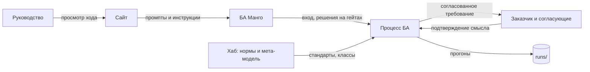

# Архитектура

Форма — [C4](https://c4model.com/diagrams) (контекст и контейнеры) и разделы
[arc42](https://arc42.org/overview): цели качества, ограничения, решения,
риски. Архитектура описывает смену исполнителя процесса по этапам. Шаги
процессов описаны в их собственных контрактах.

## Контекст

## Контейнеры по этапам

| Контейнер | Этап 1 | Этап 2 | Этап 3 | Этап 4 |
| --- | --- | --- | --- | --- |
| Исполнитель процесса | БА в чате LLM | Агентный клиент типа OpenCode | Поток n8n | Потоки n8n на выделенном сервере |
| Правила процесса | Промпты и классы на сайте | Пакет правил клиента | Узлы потока по тем же правилам | То же |
| Состояние задачи | Копируемый блок состояния | Файлы в рабочей папке | Состояние исполнения n8n по контракту состояния | То же, с резервированием |
| Гейты | Решение БА в чате | Остановка агента, решение БА | Узел ожидания решения человека | То же, с журналом аудита |
| Интеграции | Нет | Нет | Почта, трекер, уведомления | То же |
| Протокол прогона | Запись в `runs/` | Запись в `runs/` | Выгрузка в формате `runs/` | То же |
| Витрина | Сайт GitHub Pages | Сайт: установка клиента | Сайт: статус и отчёты | Решение по порталу |

## Цели качества

| Цель | Сценарий проверки | Порог |
| --- | --- | --- |
| Сохранение смысла | Отрицания, условия и конфликты не теряются при передаче состояния | Golden set процесса, утверждённый владельцем |
| Полнота | Все обязательства источника прослежены до требования | Владелец по базовой линии этапа 1 |
| Переносимость | Те же кейсы дают сопоставимый вердикт в чате, агентном клиенте и n8n | Сравнение статистики этапов |
| Наблюдаемость | Каждый прогон оставляет запись в едином формате | [`runs/README.md`](../runs/README.md) |
| Безопасность данных | Чувствительные данные не попадают в репозиторий и на сайт | Обезличивание входа, правила шаблонов issue |

## Ограничения

- Корень репозитория закрыт для новых Markdown-файлов
  (`tools/validate-repository-structure.sh`).
- Статистика `runs/` неизменна.
- Промпты этапа 1 защищены побайтовыми baseline-тестами; их содержание
  меняется только через трек промптов ([#411](https://github.com/G-Ivan-A/mango_ba_prompts/issues/411)).

## Решения

| Решение | Документ |
| --- | --- |
| Четыре этапа, n8n — оркестратор этапа 3, замена границ #263 | [ADR-017](adr/2026-10-adr-017-four-stages-n8n-orchestration.md) |
| Профиль агентного клиента этапа 2 | [ADR-016](adr/2026-10-adr-016-ide-client-process.md) (draft) |
| Классы ручного процесса | [ADR-015](adr/2026-10-adr-015-bcreq-manual-classes.md) |
| Промпт содержит только паттерны, классы и принципы | [Стандарт промптов](../standards/prompt-standard.md#обобщение-содержимого-промпта-issue-413) |
| Открытые решения DEC-01, DEC-03, DEC-04, DEC-06, DEC-07, DEC-09, DEC-10 | [RFC модернизации](rfc/2026-10-repository-modernization.md) |

## Риски

| Риск | Мера |
| --- | --- |
| Поток n8n расходится с описанием процесса | Требования ADR-017: экспорт в Git, сверка узлов с шагами |
| Модель принимает решение на гейте | Детерминированные узлы переходов, решение только человека |
| Частные случаи задач разрастаются в промптах | Правило обобщения и валидатор `scripts/validate_issue_413_prompt_generalization.py` |
| Чувствительные данные в публичном репозитории | Обезличивание и решение по видимости (DEC-03) |
