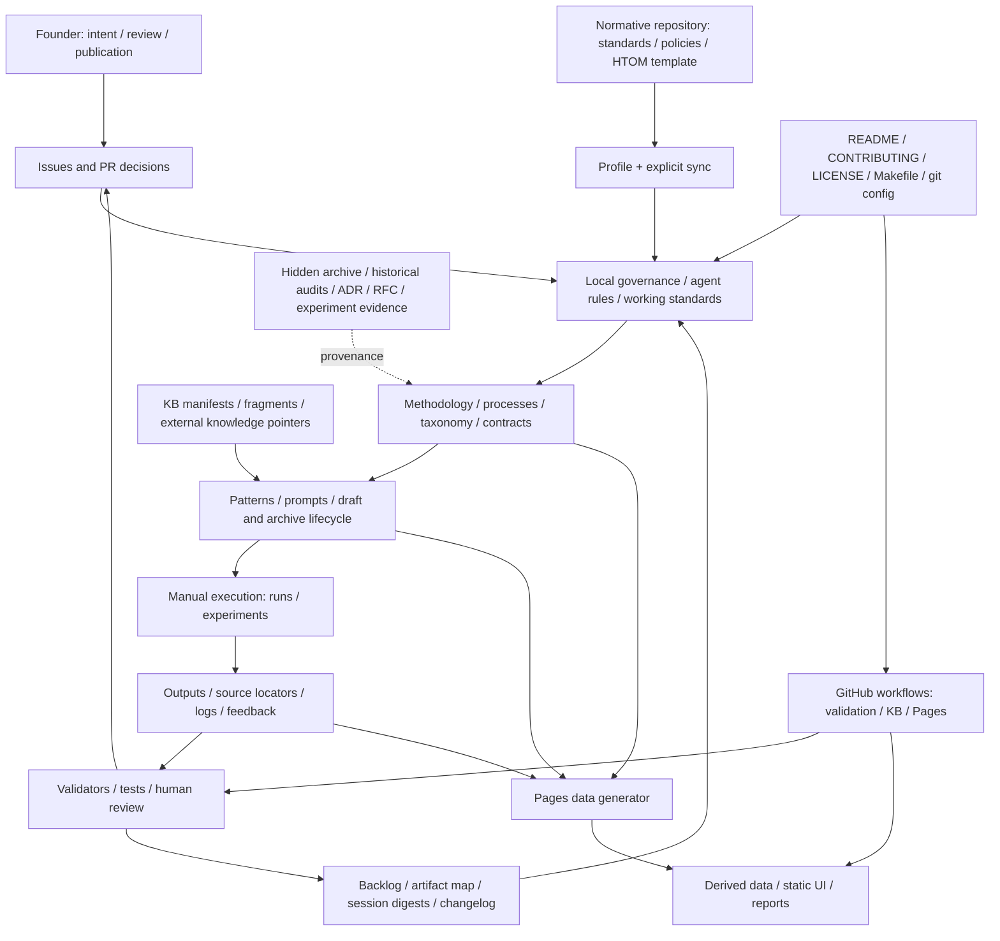

# Gate 0 — исходная модель комплексной модернизации

Полная файловая инвентаризация подготовлена: **1 588 файлов, 89 171 069 байт,
15 каталогов верхнего уровня и 8 корневых файлов**. Периметр включает весь
репозиторий, в том числе скрытые файлы. Это результат Gate 0; содержательный
аудит, восстановление методологии, оценка соответствия, утверждение RFC,
модернизация и интегральная валидация **не завершены**. Следующий этап требует
содержательной приёмки Фаундером по
https://github.com/G-Ivan-A/mango_ba_prompts/issues/407.

## Scope / Target — границы и источники

Объект: https://github.com/G-Ivan-A/mango_ba_prompts целиком. Нормативный
репозиторий: https://github.com/G-Ivan-A/hybrid-Intelligence-lab. Единственный
накопительный PR: https://github.com/G-Ivan-A/mango_ba_prompts/pull/408.
Ни один каталог не исключён по тематике. Различаются нормативные источники,
исследуемые артефакты и исторические свидетельства; наличие файла или merge
само по себе не удостоверяет согласование каждого утверждения внутри него.

### Source Baseline — неизменяемые версии

| Источник | Commit SHA | Дата коммита UTC | Неизменяемая ссылка |
| --- | --- | --- | --- |
| Исследуемый репозиторий | `f02766dff46ea09cfafdb29eae913ebc6f50ef9e` | 2026-10-30 06:36:07 | https://github.com/G-Ivan-A/mango_ba_prompts/commit/f02766dff46ea09cfafdb29eae913ebc6f50ef9e |
| Нормативный репозиторий | `c105323322d7e3a0450199db28071ea21fa9404d` | 2026-10-29 21:08:39 | https://github.com/G-Ivan-A/hybrid-Intelligence-lab/commit/c105323322d7e3a0450199db28071ea21fa9404d |

Машиночитаемая фиксация, включая tree SHA, время наблюдения, хэш постановки,
даты и счётчики обсуждений:
https://github.com/konard/G-Ivan-A-mango_ba_prompts/blob/issue-407-28502daafccb/experiments/issue_407/source-baseline.json.
Ссылки на исследуемые файлы в TSV закреплены на commit SHA; ссылки на новые
артефакты этого PR указывают на рабочую ветку и будут изменяться при итерациях.

Исходная ветка содержит служебный bootstrap-коммит
https://github.com/konard/G-Ivan-A-mango_ba_prompts/commit/44d91a28e0b8824bc65b64e6abf6392df94e32cd.
Его единственная добавка — корневой placeholder, который удаляется в этом PR
согласно назначению bootstrap и действующей проверке merge hygiene. Он не
является компонентом upstream baseline. Продуктовые файлы не удалялись.

На момент фиксации прочитана вся постановка, включая заключительное замечание
Фаундера. API вернули **0 комментариев issue, 0 обязательных sub-issues,
0 conversation comments PR, 0 inline comments и 0 reviews**. Проверены все три
типа комментариев PR раздельно с пагинацией. Это снимок состояния, а не
утверждение об отсутствии будущих требований. Перед каждым этапом обсуждения
и новые обязательные sub-issues подлежат повторной проверке.

Входной baseline не включает локальные ignored/untracked данные, Git object
database и артефакты других веток. Это граница воспроизводимого снимка, а не
исключение соответствующих компонентов из содержательного аудита: генерация,
источники, сборка и деплой рассматриваются по их tracked-контрактам. Новые
коммиты после снимка регистрируются отдельной дельтой с новым SHA; незаметная
подмена baseline текущим `main` запрещена.

## Method / Evidence — как получена полнота

1. Полный рекурсивный `git ls-tree -rlz` закреплённого commit без allowlist
   каталогов перечисляет каждый tracked blob, mode, blob SHA и размер.
2. `git cat-file --batch` читает объекты из этого commit. Содержимое грязного
   рабочего дерева и untracked-файлы не влияют на результат. Объекты читаются
   потоком; для классификации и заголовка используется префикс до 64 KiB.
3. Каждый файл получает компонент, тип, наблюдаемый статус frontmatter,
   ссылку на точную версию и политику сохранения на время исследования.
   Заголовок/статус — discovery-метаданные, не содержательная верификация и не
   полноценный YAML-аудит. Поле без значения означает «не извлечено/не задано»,
   а не автоматически дефект.
4. Полное API-дерево нормативного репозитория сохранено без текстов его файлов.
   `truncated: false`, уникальность путей и **SHA каждого tree-объекта**, включая
   корень, проверяются реконструкцией Git tree. Пропущенная запись нарушает хэш.
5. Пагинированные списки issues/PR дают 408 discovery-записей. Для прошлых
   обсуждений это **только метаданные**: их полное чтение и анализ решений
   входят в Итерацию 1. Закрытие issue, merge PR и `status: accepted` пока не
   преобразуются автоматически в `APPROVED`.
6. Из полного инвентаря выделены 231 запись существующих исследований,
   решений, реестров, прогонов и экспериментальных свидетельств. Этот индекс
   служит маршрутом повторного использования, не заменяет первоисточники.

### Repository Inventory — полный файловый реестр

Все **1 588 строк** доступны без сокращения:
https://github.com/konard/G-Ivan-A-mango_ba_prompts/blob/issue-407-28502daafccb/experiments/issue_407/repository-inventory.tsv.
Агрегаты по компонентам, типам и извлечённым статусам:
https://github.com/konard/G-Ivan-A-mango_ba_prompts/blob/issue-407-28502daafccb/experiments/issue_407/inventory-summary.json.
TSV читается CSV-парсером с табуляцией: quoted-поля могут содержать специальные
символы; счётчик строк оболочки не является проверкой количества записей.

| Компонент | Файлов | Фактическая роль и типы артефактов |
| --- | ---: | --- |
| Корневые файлы | 8 | README, CONTRIBUTING, CHANGELOG, LICENSE, Makefile, профиль наследования, git attributes и ignore rules |
| `.archive` | 3 | Индекс и две прежние версии onboarding; исторические свидетельства |
| `.github` | 6 | Workflow проверки/KB/Pages и issue forms |
| `ai-governance` | 4 | Локальный операционный контракт, рабочая копия политики, security checklist и индекс |
| `ai-rules` | 6 | Onboarding, quick rules, handover, правила исполнения и stress testing |
| `docs` | 155 | Анализ, аудиты, ADR/RFC, контракты, процессы, таксономия, отчёты, обзоры, скриншоты |
| `experiments` | 289 | Исследовательские утилиты, replay, evidence JSON/JSONL, таблицы, журналы и планы |
| `kb` | 41 | Манифесты источников, ссылки, фрагменты и указатели переноса извлечённой БЗ |
| `patterns` | 15 | Паттерны БА и их проверка, индексы и метаданные |
| `pr-ops` | 8 | Бэклог, карта артефактов, миграционные реестры, дайджесты, feedback |
| `prompts` | 48 | Активные ассеты, drafts/archive, executable-слой handover и индексы |
| `runs` | 806 | 78 metadata.yaml, входы/выходы, feedback/logs, отчёты и служебные placeholders |
| `scripts` | 85 | Генераторы витрины, KB-конвейер, синхронизация, валидаторы и regression tests |
| `site` | 37 | HTML/CSS/JS, производные JSON-данные, SVG и страницы отчётов |
| `standards` | 72 | Общие рабочие копии, проектные стандарты, BCREQ sections и manual classes |
| `tools` | 5 | Bash-проверки frontmatter, именования и структуры, legacy allowlist и описание дельт |

Типы включают 944 Markdown, 229 Python, 126 JSON, 85 YAML, 51 raster image,
21 log, 12 JavaScript, 12 SVG, 5 HTML, 5 shell, 5 spreadsheets, 3 CSS,
4 JSONL, 1 TSV, 1 binary и 84 прочих текстовых файла. Эти классы определены
расширением и префиксом; тип артефакта по смыслу уточняется содержательным аудитом.

## Architecture Map — наблюдаемая система

Карта **OBSERVED**, не целевая архитектура и не утверждённый контракт.
Источники назначения и связей:
https://github.com/G-Ivan-A/mango_ba_prompts/blob/f02766dff46ea09cfafdb29eae913ebc6f50ef9e/README.md,
https://github.com/G-Ivan-A/mango_ba_prompts/blob/f02766dff46ea09cfafdb29eae913ebc6f50ef9e/Makefile,
https://github.com/G-Ivan-A/mango_ba_prompts/blob/f02766dff46ea09cfafdb29eae913ebc6f50ef9e/.hub-profile.json,
https://github.com/G-Ivan-A/mango_ba_prompts/blob/f02766dff46ea09cfafdb29eae913ebc6f50ef9e/ai-governance/ai-governance.md.



| Связь | Механизм и проверяемый контракт |
| --- | --- |
| Наследование общих норм | Профиль и sync-манифест; источник и локальные дельты проверяются в https://github.com/G-Ivan-A/mango_ba_prompts/blob/f02766dff46ea09cfafdb29eae913ebc6f50ef9e/tools/README.md |
| Методология → ассеты | Индекс процессов и контракты: https://github.com/G-Ivan-A/mango_ba_prompts/blob/f02766dff46ea09cfafdb29eae913ebc6f50ef9e/docs/ba-processes/00-index.md |
| Ассеты → исполнение | Реестр и формат прогонов: https://github.com/G-Ivan-A/mango_ba_prompts/blob/f02766dff46ea09cfafdb29eae913ebc6f50ef9e/runs/README.md |
| Исполнение → feedback | Метаданные и результаты каждого прогона перечислены индивидуальными URL в файловом инвентаре; наличие связи не удостоверяет её содержательную полноту |
| Markdown → витрина | Генератор: https://github.com/G-Ivan-A/mango_ba_prompts/blob/f02766dff46ea09cfafdb29eae913ebc6f50ef9e/scripts/generate-pages-data.mjs |
| Тесты → CI | Автообнаружение: https://github.com/G-Ivan-A/mango_ba_prompts/blob/f02766dff46ea09cfafdb29eae913ebc6f50ef9e/scripts/validate_all.py; workflow: https://github.com/G-Ivan-A/mango_ba_prompts/blob/f02766dff46ea09cfafdb29eae913ebc6f50ef9e/.github/workflows/validate.yml |
| Внешняя БЗ → локальные указатели | https://github.com/G-Ivan-A/mango_ba_prompts/blob/f02766dff46ea09cfafdb29eae913ebc6f50ef9e/kb/processed/README.md; внешний репозиторий рассматривается как зависимость, не как разрешение на его изменение |

## Existing Work Registry — повторное использование

Полный индекс **231 артефакта** с SHA, заголовками, declared status и URL:
https://github.com/konard/G-Ivan-A-mango_ba_prompts/blob/issue-407-28502daafccb/experiments/issue_407/existing-work.tsv.
Все 78 metadata.yaml прогонов включены; все остальные файлы каждого прогона и
эксперимента остаются в полном инвентаре. Пагинированный индекс **408 issues/PR**
включает и закрытые, и открытые PR:
https://github.com/konard/G-Ivan-A-mango_ba_prompts/blob/issue-407-28502daafccb/experiments/issue_407/github-activity.tsv.

Приоритетные точки входа ниже — внутренний реестр свидетельств, не обобщённые
рекомендации. Их существование подтверждено; достоверность содержательных
выводов предстоит перепроверить в Итерации 1.

| Материал | Зачем перечитать | Источник |
| --- | --- | --- |
| Исходная миграция | Ранняя роль репозитория, исходные обязательства и границы | https://github.com/G-Ivan-A/mango_ba_prompts/blob/f02766dff46ea09cfafdb29eae913ebc6f50ef9e/docs/audit/initial-state-2026-06.md |
| Аудит локальных контрактов | Предыдущие разрывы правил и механизмы сверки | https://github.com/G-Ivan-A/mango_ba_prompts/blob/f02766dff46ea09cfafdb29eae913ebc6f50ef9e/docs/audit/audit-contracts-mango-2026-06-17.md |
| Аудит структуры | Дрейф и история смены канонических домов | https://github.com/G-Ivan-A/mango_ba_prompts/blob/f02766dff46ea09cfafdb29eae913ebc6f50ef9e/docs/audit/2026-08-21-root-structure-audit.md |
| Границы фиксации прогона | Отличие наблюдения от изменения правил | https://github.com/G-Ivan-A/mango_ba_prompts/blob/f02766dff46ea09cfafdb29eae913ebc6f50ef9e/docs/audit/audit-run-scope-boundary-2026-08-21.md |
| Типы прогонов | Различение evidence и методологии | https://github.com/G-Ivan-A/mango_ba_prompts/blob/f02766dff46ea09cfafdb29eae913ebc6f50ef9e/docs/analysis/2026-08-21-runs-type-gap-analysis.md |
| Оптимизация проверок | Реальное автообнаружение и область гарантий тестов | https://github.com/G-Ivan-A/mango_ba_prompts/blob/f02766dff46ea09cfafdb29eae913ebc6f50ef9e/docs/analysis/2026-08-22-validator-optimization.md |
| Аудит каталога | Ранее предложенная упаковка ассетов и их provenance | https://github.com/G-Ivan-A/mango_ba_prompts/blob/f02766dff46ea09cfafdb29eae913ebc6f50ef9e/docs/analysis/2026-10-23-prompts-catalog-audit.md |
| Проверка достаточности норм | Альтернативная оценка методологических разрывов | https://github.com/G-Ivan-A/mango_ba_prompts/blob/f02766dff46ea09cfafdb29eae913ebc6f50ef9e/docs/analysis/2026-10-23-bcreq-standards-third-opinion.md |
| Эволюция и FMA | Повторное использование исходных требований и forensic-проверок без признания частного анализа общим аудитом | https://github.com/G-Ivan-A/mango_ba_prompts/blob/f02766dff46ea09cfafdb29eae913ebc6f50ef9e/docs/analysis/2026-10-28-bcreq-evolution-failure-analysis.md |
| Последний checkpoint | Состояние методологии перед новыми стандартами | https://github.com/G-Ivan-A/mango_ba_prompts/blob/f02766dff46ea09cfafdb29eae913ebc6f50ef9e/docs/analysis/2026-10-29-bcreq-checkpoint.md |
| Последняя архитектура ручного маршрута | Предложенные классы, release gate и неутверждённые решения | https://github.com/G-Ivan-A/mango_ba_prompts/blob/f02766dff46ea09cfafdb29eae913ebc6f50ef9e/docs/rfc/2026-10-bcreq-manual-pipeline.md |

Последние связанные merged PR для изучения первичных решений и комментариев:
https://github.com/G-Ivan-A/mango_ba_prompts/pull/404,
https://github.com/G-Ivan-A/mango_ba_prompts/pull/402,
https://github.com/G-Ivan-A/mango_ba_prompts/pull/400,
https://github.com/G-Ivan-A/mango_ba_prompts/pull/398,
https://github.com/G-Ivan-A/mango_ba_prompts/pull/396.
Порядок определяется временем merge и тематической зависимостью, а не правилом
«более поздний текст автоматически отменяет предыдущий».

## Findings / Verdict — состояние Gate 0

### Обнаруженные вопросы для проверки

Ниже — первичные наблюдения, не завершённый compliance assessment.

| Наблюдение | Свидетельство | Статус / последующее действие |
| --- | --- | --- |
| В baseline нет корневого AGENTS.md | Полный файловый инвентарь; кандидат нормы: https://github.com/G-Ivan-A/hybrid-Intelligence-lab/blob/c105323322d7e3a0450199db28071ea21fa9404d/standards/agents-md-bootstrap-standard.md | OBSERVED; Итерации 1/2 проверяют применимость и способ доставки правил; новый контракт сейчас не вводится |
| Quick rules называют прежние корневые дома governance; профиль фиксирует их перенос | https://github.com/G-Ivan-A/mango_ba_prompts/blob/f02766dff46ea09cfafdb29eae913ebc6f50ef9e/ai-rules/ai-quick-rules.md и https://github.com/G-Ivan-A/mango_ba_prompts/blob/f02766dff46ea09cfafdb29eae913ebc6f50ef9e/.hub-profile.json | OBSERVED; реконструировать последовательность согласованных решений, проверить onboarding и тесты; не переписывать историю |
| В baseline нет docs/README.md; существуют разные схемы ADR naming | Полный файловый инвентарь; https://github.com/G-Ivan-A/hybrid-Intelligence-lab/blob/c105323322d7e3a0450199db28071ea21fa9404d/standards/htom-documentation-structure.md | OBSERVED; источник прямо называет layout рекомендуемым; недопустимо объявить обязательность по одному имени файла |
| Общий контракт заявляет отсутствие golden-set, а дерево содержит более поздние golden/replay evidence | https://github.com/G-Ivan-A/mango_ba_prompts/blob/f02766dff46ea09cfafdb29eae913ebc6f50ef9e/ai-governance/ai-governance.md и полный реестр experiments/runs | UNRESOLVED; проверить различие golden-кандидатов, утверждённого эталона и eval; наличие файлов не доказывает закрытие пробела |
| У нормативного Audit standard draft-status при ссылке на принятое ADR; другой accepted-standard содержит оговорку «до утверждения — рекомендация» | https://github.com/G-Ivan-A/hybrid-Intelligence-lab/blob/c105323322d7e3a0450199db28071ea21fa9404d/standards/audit-standard.md и https://github.com/G-Ivan-A/hybrid-Intelligence-lab/blob/c105323322d7e3a0450199db28071ea21fa9404d/standards/contract-documentation-standard.md | UNRESOLVED; найти исходные решения и при неустранимой неоднозначности передать Фаундеру; не выводить обязательность из frontmatter |

### Классификация нормативной базы

Исходный discovery-реестр **60 кандидатов** (все файлы standards, policies,
agent rules, HTOM template и основные карты):
https://github.com/konard/G-Ivan-A-mango_ba_prompts/blob/issue-407-28502daafccb/experiments/issue_407/standards-candidates.tsv.
Все строки изначально `UNRESOLVED / pending_iteration_2`. Реестр не закрывает
периметр: транзитивные нормативные ссылки, принятые ADR и решения из обсуждений
обязательно расширяют его в Итерации 2.

Для каждого атомарного положения будут отдельно записаны: нормативное
требование / рекомендуемая практика / архитектурный принцип / справочный
материал; источник согласования; applicability (обязательно / с адаптацией /
неприменимо); основание; компонент; evidence; проверка и статус. В частности,
https://github.com/G-Ivan-A/hybrid-Intelligence-lab/blob/c105323322d7e3a0450199db28071ea21fa9404d/standards/project-structure-inheritance.md
описывает проекты **внутри** нормативного репозитория; автоматическое
применение его каталожной схемы к отдельному HTOM-репозиторию необоснованно.

Определения L1–L4, их обязательность и владельцы устанавливаются по
нормативным источникам и утверждённым решениям. Присвоение уровней существующим
файлам по похожим именам не является доказательством соответствия. Проверка
охватывает всю систему документации и архитектурных контрактов, а не четыре
формально созданных файла.

### Исторические артефакты

Каждая строка полного инвентаря имеет явный `disposition`:
`preserve_as_evidence` — сохранить историческое свидетельство;
`preserve_in_place` — сохранить текущий файл на месте. Это временное
**OBSERVED**-правило исследования, не утверждение актуальности содержимого.
Файлы прогонов, экспериментов, архивов и прошлых решений не изменяются.
Окончательный RFC должен назначить каждому историческому артефакту один из
исходов: сохранить / архивировать с объяснением / заменить / объединить /
исключить из активной навигации, с основанием, backlink и миграционной проверкой.
Никакая такая операция не выполнена заранее.

## Audit Scope / Iteration 1 Plan

План **PROPOSED**, охват всего baseline подтверждён исполнителем и ожидает
приёмки Фаундером. Цель Итерации 1 — R1/R2, а не преждевременная модернизация.

| Шаг | Действия и охват | Выход и способ проверки |
| --- | --- | --- |
| 1. Проверить вход | Повторно прочитать постановку, все новые комментарии трёх типов и sub-issues; зарегистрировать приёмку Gate 0 URL/автором/временем/объёмом | Дельта требований к хэшу постановки; отсутствие молчаливого изменения baseline |
| 2. Построить очередь каждого файла | Разбить все 1 588 записей на содержательные группы без исключения корня, hidden, binary и generated; для больших текстов читать блоками до 1 500 строк; изображения загружать локально, проверять MIME и просматривать | Для каждой записи: reviewed / generated-with-reviewed-generator / historical / unavailable, метод, reviewer и evidence; нулевое число unassigned-файлов |
| 3. Исследовать систему контрактов | Прочитать governance, onboarding, наследование, стандарты, ADR/RFC и рабочие процессы; разделить norm, narrative, executable и derived | Карта владельцев и связей, пропуски, дубли, конфликтующие/неподтверждённые правила; прямые URL файлов и локаторы |
| 4. Восстановить chronology | От исходной миграции до последних решений, по всем релевантным issues/PR и существующим реестрам; читать conversation, inline reviews и reviews; chat exports — историческое evidence, не автоматическая норма | Реестр Founder Intent: исходная формулировка, время, URL/локатор, автор, статус решения, цепочка изменения; противоречия не разрешаются датой |
| 5. Сопоставить реализацию | Все prompts/rules/templates/patterns, KB pointers, конфигурации, site/data и генераторы; проверить, как правило доставляется исполнителю и отображается в витрине | Матрица methodology → architecture → executable assets; orphan implementations и отсутствующие механизмы проверки |
| 6. Прочитать execution evidence | Все 78 прогонов, экспериментальные результаты, логи, feedback и prior FMA; искать повторные ошибки и положительные counterexamples | FMA: отказ, эффект, исходное требование, propagation path, причина/конкурирующая гипотеза, вероятность/влияние с основанием, детектор и воспроизведение |
| 7. Проверить гипотезы | Минимальные воспроизводящие тесты до исправлений; bounded input/memory для стресс-проб; отдельные experiments-скрипты; исходный код при недостатке tracing пока только анализируется | Отрицательные и положительные случаи с воспроизводимыми командами; отсутствие заявления об улучшении LLM по одному статическому тесту |
| 8. Собрать трассировку | Для каждого существенного атома: источник, decision status, decomposition, methodology owner, implementation owner, verification method, фактический результат | Founder Intent → Requirements → Methodology → Architecture → Prompts/Rules/Templates → Execution → Validation → Feedback; отсутствующие звенья явно маркируются |
| 9. Закрыть R1/R2 на review | Содержательный аудит структуры и содержания, эволюция и FMA; существующие отчёты актуализируются по применимости; необходимость нового/разделённого артефакта обосновывается | Отдельная содержательная приёмка результатов Фаундером перед Итерацией 2; полнота файлового реестра не заменяет полноту анализа |

Классы требований для поиска: актуальные, утратившие актуальность, частичные,
дублирующие, противоречивые, без проверки, реализации без подтверждённого
намерения. Для `SUPERSEDED` требуется конкретное согласованное решение о
замене, для `APPROVED` — источник явного согласования. Наблюдение файла —
`OBSERVED`, идея — `PROPOSED`, открытая неоднозначность — `UNRESOLVED`.

## Remediation / Deviation — переходы и оставшаяся работа

| Результат / критерий исходной постановки | Состояние | Доказательство / условие завершения |
| --- | --- | --- |
| Gate 0: inventory, baseline, architecture map, existing work, scope, plan | Подготовлено, приёмка ожидается | Этот документ и полные машиночитаемые реестры |
| 1. Полная инвентаризация | Технически проверена | Сопоставление каждой записи с pinned Git tree; не означает приёмку всего задания |
| 2. Содержательный и структурный аудит, R1 | Не завершено | Итерация 1 и содержательный review каждого компонента |
| 3. История методологии и FMA, R2 | Не завершено | История первичных решений, проверенные гипотезы и причины потерь |
| 4. Соответствие всех компонентов, R3 | Не завершено | Итерация 2, атомарная классификация норм и доказательства применимости |
| 5. Целевая архитектура согласована | Не выполнено | Итерация 3 и явная приёмка; наблюдаемая карта не заменяет целевую |
| 6. RFC разработан и утверждён, R4 | Не выполнено | Итерация 3; предложенный RFC не считается утверждённым |
| 7. Изменения реализованы, R5 | Не выполнено | Итерация 4 в пределах согласованного RFC |
| 8. Сквозная согласованность проверена | Не выполнено | Итерация 5, проверка документов, методологии и executable assets |
| 9. Трассировка Founder Intent → Validation | Не выполнено для методологии | В Gate 0 есть трассировка требований самого задания; доменная матрица — Итерация 1 с перепроверкой в 5 |
| 10. Автоматические проверки RFC | Не выполнено | Тесты инвентаря не подменяют ещё не утверждённые проверки RFC |
| 11. Все оставшиеся ограничения отражены | Выполнено для текущего Gate 0 | Этот раздел, открытый вопрос приёмки и рабочий план |
| 12. Один итоговый PR всех итераций | Накопительный PR открыт; итог ещё не готов | https://github.com/G-Ivan-A/mango_ba_prompts/pull/408 остаётся draft до Итерации 5 |

Атомарный реестр требований **самого задания**, владельцев стадий и текущих
доказательств:
https://github.com/konard/G-Ivan-A-mango_ba_prompts/blob/issue-407-28502daafccb/experiments/issue_407/requirements.json.
Рабочий checklist:
https://github.com/konard/G-Ivan-A-mango_ba_prompts/blob/issue-407-28502daafccb/experiments/issue_407/work-plan.md.

**Открытый переход — UNRESOLVED.** Постановка явно требует содержательную
приёмку перед следующей итерацией. Заключительное замечание делегирует
исполнителю способ достижения цели и допускает обоснованное изменение состава
артефактов, но явно не отменяет human gates. При отсутствии согласования
исполнитель не удостоверяет его самостоятельно. Конкретный запрос к
Фаундеру: принять или скорректировать этот Gate 0, его полный периметр и план
Итерации 1. Это единственный вопрос, необходимый для следующего этапа;
дополнительных вводных для выполнения самого Gate 0 не потребовалось.

Архитектура и методология не менялись; новый параллельный набор норм не
создавался. Новый отчёт необходим как отсутствующий общерепозиторный Gate 0:
существующие частные аудиты зарегистрированы для повторного использования.
Новый evidence-каталог имеет конкретное содержимое и покрывает требуемую
воспроизводимость; новый тип репозитория или runtime-инфраструктура не вводится.
Здесь нет оснований объявлять задачу завершённой или выполнять merge.

## Validation / Related Artifacts

Воспроизведение без сети, из checkout этого PR с доступным baseline commit:

```bash
python3 experiments/issue_407/inventory.py --check
python3 scripts/test_issue_407_inventory.py
make validate-fast
make validate-full
```

Тесты покрывают скрытые и произвольно названные каталоги, Unicode и специальные
символы путей, неполные Git records и неподдержанные submodules, пропуски,
дубли и неверные размеры, immutable SHA, усечённое/изменённое дерево нормативного
репозитория, игнорирование dirty/untracked содержимого, UTF-8 на границе чтения,
полноту и байтовую воспроизводимость опубликованных реестров. Submodule не
пропускается молча: при появлении потребуется явное расширение метода учёта.

Тесты созданы до генератора; отдельный тест для обнаруженного UTF-8 дефекта
сначала показал потерю frontmatter и заголовка, затем прошёл после исправления.
Это проверки evidence pipeline, а не доказательство модернизации методологии.
Проверки автоматически подхватываются действующим CI. Для validate-all
checkout получает полную историю: без неё shallow CI clone не содержит
исходный commit, необходимый для проверки неизменяемого baseline:
https://github.com/konard/G-Ivan-A-mango_ba_prompts/blob/issue-407-28502daafccb/scripts/test_issue_407_inventory.py.

Форма audit target / evidence / conditional verdict / deviation handling
использована для reviewability по
https://github.com/G-Ivan-A/hybrid-Intelligence-lab/blob/c105323322d7e3a0450199db28071ea21fa9404d/standards/audit-standard.md;
это не снимает зарегистрированную неоднозначность статуса нормативного источника.
Содержательные conclusions и recommendations последующих этапов формулируются
как системные паттерны; исторические ID остаются в реестрах evidence.
