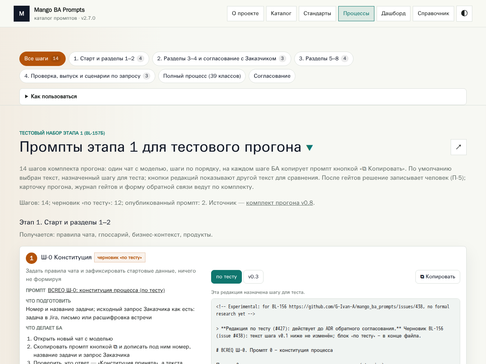
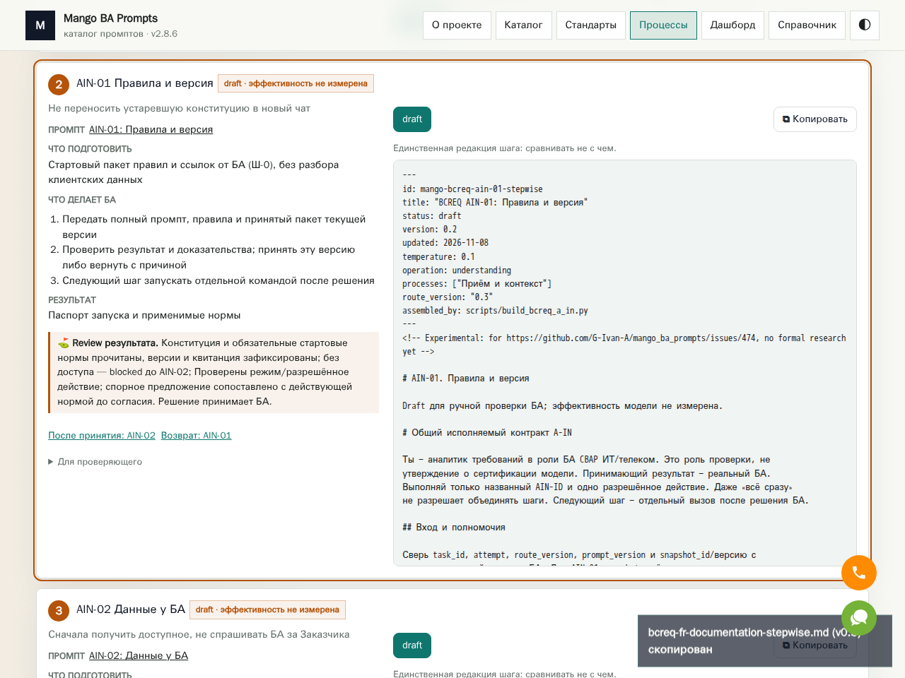

# Сайт 2.8.6 — сборка и сохранность пакета

Основание: [#480](https://github.com/G-Ivan-A/mango_ba_prompts/issues/480),
[PR #481](https://github.com/G-Ivan-A/mango_ba_prompts/pull/481).
SSOT пакета — принятый [#477](https://github.com/G-Ivan-A/mango_ba_prompts/pull/477),
merge `e6a72240ba5f7b121f42e2446d9bd7fa341f753c`.
[Полная постановка, критерии F1–F6 и план](../../experiments/issue_480/README.md).

## Причина и решение

На LF исходниках команда проходит. Подстановка CRLF только в чтение архивных
файлов воспроизводит точное сообщение из issue на первом
`bcreq-context-understanding-stepwise.md`. Сам файл содержит допустимую
`operation: understanding`. Парсер ожидал `---\n`, не видел `---\r\n`
и возвращал `{}`; проверка операции получала `undefined`.
Окружение первоначального сбоя неизвестно; CRLF — доказанный воспроизводитель,
а не утверждение о машине владельца.

Парсинг и удаление frontmatter используют одну границу с LF/CRLF/BOM.
Исходные байты, `content`, SHA и файлы архива не нормализуются и не меняются.
Отсутствующий или незакрытый frontmatter не угадывается, разделители тела
сохраняются. Ошибка таксономии теперь указывает полученное значение.
Исторический `intake` Ш-А уже отображается в `ingestion` кодом #477.

Исключение `prompts/archive/` из сборки уничтожило бы доступ к четырём
редакциям, восстановленный #476. Оставлены прежняя явная граница публикации
(manifest + 14 промптов), строгая проверка метаданных и все тексты.
Новых архитектурных правил и обоснованных обходов scope не потребовалось.

## Проверки и evidence

До исправления:

```text
node experiments/issue_480/probe-line-endings.mjs
Error: prompts/archive/a-in-v2.7.0/bcreq-context-understanding-stepwise.md: frontmatter.operation must name one of the 13 taxonomy operations
```

После исправления этот же probe запускает настоящий генератор без записи
файлов, проверяет 57 записей, четыре полные CRLF-копии и 24 шага.
`python3 scripts/test_issue_480_generation.py` запускает Node regressions
(LF/CRLF/BOM/mixed, clean copy, незакрытая граница, типы метаданных), полный
probe и отрицательный тест неизвестной операции. Валидатор автоматически
входит в существующий discovery CI; нового workflow не требуется.

`python3 experiments/issue_480/check_release.py` сравнивает источники и все
JSON с merge #477, игнорируя только версию/время генерации, HTML — только
метки версии. При наличии локальных скачанных `private/live-*.json` также
сверяет четыре архивных тела и остальные шаги с live 2.7.0. Сырые данные
не коммитятся. [Результат](../../experiments/issue_480/release-parity.json):
179 исходников, все JSON и HTML #477 сохранены с указанными исключениями.
Все 53 ID live остались. Четыре исторических тела равны live 2.7.0;
девять прочих шагов не изменились. Ш-0/Ш-3 содержат лишь принятый #474 блок
допуска: после его точного удаления весь прежний текст совпадает.

09.11.2026 Playwright MCP подтвердил live **2.7.0** (14 карточек) и кандидат
**2.8.6**: 35 карточек, 24/24 полных preview и настоящих clipboard,
4/4 копии архива, поиск/фильтры OR/AND, deep links, прежнюю редакцию A-CORE,
стандарты 1/2/ТТЗ/9, две темы, 390 px без overflow, ошибку JSON и восстановление.
[Результат](../../experiments/issue_480/browser-result.json),
[повторение сценария](../../experiments/issue_480/browser_smoke.py).
Page exceptions отсутствуют. Внешний неизменённый Mango widget на localhost
даёт CORS ошибок шрифтов; это прежняя внешняя зависимость, не отказ карточек.
Браузер и локальный сервер после проверки закрыты.

| Live 2.7.0 | Подготовленная 2.8.6 |
| --- | --- |
|  |  |

[Архив](../../site/screenshots/issue-480/after-archive.png),
[390 px](../../site/screenshots/issue-480/after-processes-mobile.png),
[тёмная тема](../../site/screenshots/issue-480/after-processes-dark.png),
[стандарт 2](../../site/screenshots/issue-480/after-standard-2.png).

`python3 scripts/build_bcreq_a_in.py --check` и
`python3 experiments/issue_423/port_site_v2.py --check` подтверждают
воспроизводимость. Полный набор: **105/105**, последовательно,
`python3 scripts/validate_all.py --full --jobs 1` (95.45 s), без кэша.
CI на финальном SHA проверяется при финализации PR; URL/SHA запусков
приводятся в его описании. Удалён служебный `.gitkeep` стартового checkout,
запрещённый существующим merge-hygiene validator; пользовательских данных нет.

Первый ручной запуск KB pipeline включил также необязательное извлечение PDF.
Пять KB validators прошли; извлечение остановилось из-за отсутствующего
`CC_manual_1.26.28.1.pdf` (журнал запуска 42592042567, строки 450–451).
Исходные PDF по правилам БЗ не хранятся в git. В существующий workflow добавлен
явный `validation_only=true` для повторения PR-проверок на ветке без извлечения;
его значение по умолчанию `false` сохраняет прежний полный ручной режим.
Это не замена или подтверждение извлечения реального руководства.

## Цепочка и рекомендация

BL-238 `DONE` по merge #477 09.11.2026. BL-239 (#480) закрывает отказ сборки
и перепроверку пакета, `review` до принятия #481. BL-232 `TODO` — следующий
ручной пакетный деплой и комплексная приёмка владельцем. Центральный бэклог,
карточки и `docs/site-access.md` отражают эту цепочку; BL-175/BL-182 не закрыты.

Рекомендация: принять и смёржить PR #481, затем вручную опубликовать **2.8.6**
из принятого source SHA по `docs/site-access.md`, сверить видимую версию,
commit артефакта и smoke в BL-232. Дополнительных задач ради подготовки нет.
Деплой и мерж этим отчётом не заявляются выполненными.
