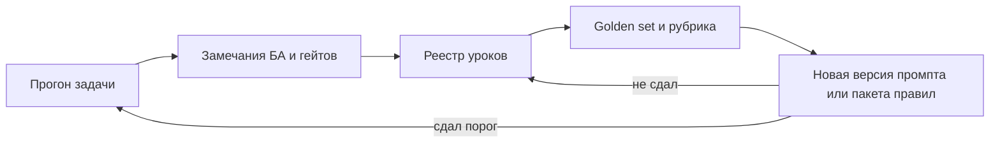
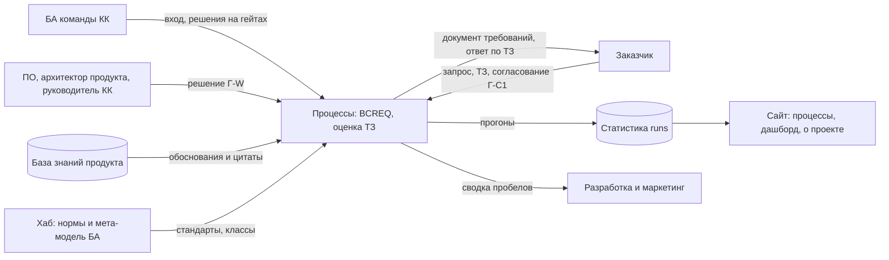
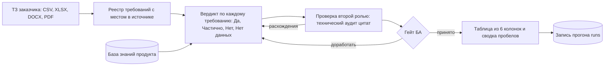
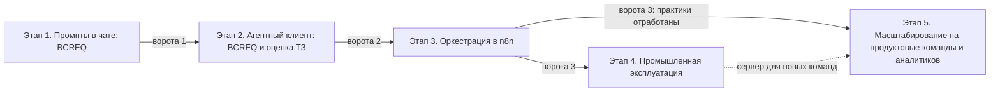

# RFC: автоматизация бизнес-анализа команды крупных клиентов — видение, концепция, архитектура, дорожная карта

## Кратко для руководителя

**Цель.** Команда бизнес-аналитиков крупных клиентов (КК) Манго готовит
требования заказчика и оценивает его технические задания быстрее и без
потери смысла. Каждое решение в документе прослеживается до источника.
Решения на гейтах по-прежнему принимает человек.

**Что уже есть.**
- Процесс BCREQ описан от обращения до согласования, с гейтами и
  ответственными.
- 14 промптов процесса опубликованы на сайте с инструкцией.
- Накоплено 79 записей статистики прогонов.
- Собран golden set процесса BCREQ — проверочный набор кейсов. На нём
  улучшенный промпт сдал 61 кейс из 62, прежняя версия сдала 49 из 62
  ([RUN-0079](../../runs/2026/RUN-0079/outputs/golden-set-report.md)).
- Пробная оценка исполнимости ТЗ заказчика: 198 требований, у каждого
  вердикта есть ссылка на базу знаний
  ([RUN-0077](../../runs/2026/RUN-0077/outputs/README.md), пример).

**Что предлагается.** Пять этапов. Каждый этап меняет исполнителя работы,
а процесс, правила и решения человека остаются прежними.

| Этап | Коротко | Чем полезен руководству | Состояние |
| --- | --- | --- | --- |
| 1. Промпты в чате | БА запускает выверенные промпты процесса BCREQ вручную по инструкции сайта | Базовая линия метрик: сколько времени и доработок стоит требование сегодня | идёт |
| 2. Агентный клиент + оценка ТЗ | Агентный клиент (базовый кандидат — OpenCode) ведёт BCREQ по пакету правил; добавляется второй процесс — оценка исполнимости ТЗ заказчика | Быстрый ответ заказчику и тендеру «можем / частично / нет»; список продуктовых пробелов | план |
| 3. Оркестрация в n8n | Процесс ведёт визуальный поток n8n; подключаются базы знаний, почта, трекер, веб-интерфейс гейтов | Процесс идёт без ручного переноса между шагами; виден статус каждой задачи | план |
| 4. Промышленная эксплуатация | Потоки работают на выделенном сервере в контуре Манго | Надёжность, безопасность, журнал аудита | план |
| 5. Масштабирование | Отработанные практики этапов 1–3 переносятся на продуктовые команды и других аналитиков; идёт **параллельно** этапу 4 | Эффект выходит за пределы одной команды | новый, план |

**Чего мы не обещаем.**
- Сроков и бюджета: их задаёт владелец по базовой линии этапа 1.
- Экономического эффекта без замера.
- Замены аналитика моделью: модель готовит и проверяет, решает человек.

**Что нужно от руководства.**
- Подтвердить область (команда КК) и пять этапов.
- Выделить задачи и аналитиков для серии прогонов этапа 1.
- Принять решения DEC-415-01…DEC-415-08 ([раздел «Решения на согласование»](#решения-на-согласование)).

## Как читать

Документ рассчитан на чтение как страница сайта. Четыре раздела
предложения по одному переносятся в канонические файлы `docs/` после
принятия RFC ([раздел «Перенос в канонические документы»](#перенос-в-канонические-документы)).

| Раздел | На какой вопрос отвечает | Кому в первую очередь | Канонический файл |
| --- | --- | --- | --- |
| [1. Видение](#1-видение) | Зачем и для кого; какой результат считаем успехом | Руководитель разработки, руководитель маркетинга, руководитель КК | [`docs/vision.md`](../vision.md) |
| [2. Концепция](#2-концепция) | Что входит и что не входит; на каких принципах держится работа | Руководители, владелец, БА команды КК | [`docs/concept.md`](../concept.md) |
| [3. Архитектура](#3-архитектура) | Из каких частей состоит система и как она меняется по этапам | Руководитель разработки, архитектор продукта, ИБ | [`docs/architecture.md`](../architecture.md) |
| [4. Дорожная карта](#4-дорожная-карта) | Что, зачем, как и сколько на каждом этапе; что точно войдёт и что не рассматривалось | Все руководители | [`docs/roadmap.md`](../roadmap.md) |

## RFC Metadata

| Поле | Значение |
| --- | --- |
| Постановка | [#415](https://github.com/G-Ivan-A/mango_ba_prompts/issues/415) — видение, концепция, архитектура, роадмэп в одном документе |
| Источник истины | [#409](https://github.com/G-Ivan-A/mango_ba_prompts/issues/409) (четыре этапа, неизменность `runs/`, изменения только по RFC/ADR) и [#411](https://github.com/G-Ivan-A/mango_ba_prompts/issues/411) (уроки прогонов, golden set, запуск этапа 1); результаты: [RFC модернизации](2026-10-repository-modernization.md), [RFC уроков прогонов](2026-10-bcreq-run-lessons-pipeline.md), [ADR-017](../adr/2026-10-adr-017-four-stages-n8n-orchestration.md), [отчёт #413](../report/2026-10-31-repository-action-plan.md) |
| Расширение источника | Этап 5, оценка ТЗ на этапе 2 и фокус на команде КК — из постановки #415. Требования владельца из чатов CH-1…CH-7 ([отчёт #413, раздел 4.5](../report/2026-10-31-repository-action-plan.md)) учтены как `proposed` |
| Почему RFC, а не ADR | ADR фиксирует одно принятое решение. Здесь согласуется связка из четырёх документов и восьми решений. После принятия изменения переносятся в канонические файлы отдельной задачей — порядок [RFC-процесса](rfc-process.md) |
| Владелец решения | G-Ivan-A |
| Тип и область | RFC архетипа B. Меняет содержание четырёх канонических документов только после принятия. Не меняет `runs/`, промпты и сайт |
| Структура | [rfc-structure-standard Хаба](https://github.com/G-Ivan-A/hybrid-Intelligence-lab/blob/32b5fa524e542af23c1a8e67c919bd66d5f4e399/standards/rfc-structure-standard.md). Разделы «Видение», «Концепция», «Архитектура», «Дорожная карта» составляют Proposal и вынесены на верхний уровень, чтобы их было удобно читать и переносить |

## Summary

Канонические документы v1.0 ([видение](../vision.md),
[концепция](../concept.md), [архитектура](../architecture.md),
[roadmap](../roadmap.md)) созданы в #413 для «БА Манго» вообще. В них
четыре этапа, а этапы описаны языком исполнителя. Постановка #415
уточняет четыре вещи:

1. **Область** — команда БА крупных клиентов (КК), а не все БА Манго.
2. **Читатель** — руководители разработки и маркетинга. Им нужно понять
   цели, ценность и затраты, а не устройство промптов.
3. **Содержание этапов.**
   - Этап 1 — только BCREQ с ручным запуском.
   - Этап 2 — агентный клиент и новый процесс «оценка ТЗ заказчика».
   - Новый этап 5 — масштабирование на продуктовые команды и других
     аналитиков, параллельно этапу 4.
4. **Формат дорожной карты** — понятный менеджеру и индустриальный: что,
   зачем, как, сколько.

RFC предлагает новое содержание четырёх документов и правила переноса.
Решения DEC-415-01…DEC-415-08 оформлены как **PROPOSED**.

## Motivation

- **Читатель не тот.** Документы v1.0 писались для владельца и
  исполнителя. Руководитель разработки не найдёт в них, что получит его
  команда. Руководитель маркетинга не найдёт, как это влияет на ответы
  заказчикам и тендерам.
- **Область шире реальной.** Пилот идёт в одной команде — КК. Обещание
  «для всех БА Манго» создаёт ожидания, которые этапы 1–4 не закрывают.
- **Нет второго процесса.** Оценка ТЗ заказчика уже дала результат
  ([RUN-0077](../../runs/2026/RUN-0077/outputs/README.md)), но в roadmap её
  нет. В [карте процессов](../ba-processes/00-index.md#3-анализ-тендерных-тз)
  три из пяти шагов этого процесса выполняются вручную.
- **Нет пути масштабирования.** Roadmap заканчивается сервером для одной
  команды. Как перенести практику на другие команды, не сказано.
- **Нет ответа «сколько».** Менеджеру нужен порядок затрат, хотя бы как
  гипотеза для калибровки.

## Goals and Non-goals

| Цели | Не цели |
| --- | --- |
| Дать один документ, который руководитель прочтёт за 15 минут и поймёт цель, этапы и свою выгоду | Менять промпты, процессы BCREQ, статистику `runs/` или сайт |
| Сузить область до команды КК и описать путь масштабирования (этап 5) | Обещать сроки, бюджет и экономический эффект без базовой линии |
| Добавить оценку ТЗ заказчика в этап 2 на основе примера RUN-0077 | Делать RUN-0077 эталоном: это пример, а не стандарт процесса |
| Задать формат дорожной карты «что — зачем — как — сколько» со стадийными воротами | Выбирать конкретную LLM, поставщика или сервер — это решения этапов 2–4 |
| Подготовить перенос в `docs/vision.md`, `docs/concept.md`, `docs/architecture.md`, `docs/roadmap.md` | Решать за владельца открытые DEC-01…DEC-11 RFC модернизации |

## Proposal

Предложение состоит из четырёх разделов ниже. Каждый начинается строкой
«Переносится в», где указан канонический файл. Внутри раздела нет ссылок
на служебные части RFC, поэтому его можно перенести целиком.

---

## 1. Видение

> Переносится в [`docs/vision.md`](../vision.md) (версия 2.0).

### Формулировка

**Требование без потери смысла — для каждого крупного клиента.**

Аналитик команды крупных клиентов Манго получает от заказчика запрос или
техническое задание. Он за часы, а не за дни, готовит:
- полную и проверяемую спецификацию требований;
- честную оценку «что мы можем, что частично, чего нет».

Каждое утверждение документа прослеживается до источника: слов заказчика,
базы знаний продукта или решения человека. Решения на гейтах принимают
люди. Модель готовит черновик, проверяет и показывает риски.

### Проблема сегодня

| Что происходит | Чем это оборачивается |
| --- | --- |
| Требование крупного клиента собирается вручную из встреч, писем и ТЗ | Смысл теряется при пересказе: отрицания, условия и исключения пропадают. Разработка получает неполное требование и возвращает вопросы |
| Оценка ТЗ заказчика или тендера делается вручную по сотням строк | Ответ заказчику занимает дни. Вердикты «можем» не подкреплены ссылкой на продукт |
| Опыт аналитиков остаётся в чатах и в головах | Модель повторяет ошибки, которые уже разбирали ([#411](https://github.com/G-Ivan-A/mango_ba_prompts/issues/411)) |
| Пробелы продукта, найденные в ТЗ, нигде не собираются | Продукт и маркетинг не видят, каких возможностей чаще всего не хватает крупным клиентам |

### Для кого и какая ценность

| Кто | Что получает | Как это увидеть |
| --- | --- | --- |
| Команда БА КК | Выверенный процесс, промпты и правила вместо ручной сборки. Меньше рутины и меньше возвратов | Время подготовки требования и число доработок по статистике прогонов |
| Руководитель разработки | Требования с трассировкой «ФТ ↔ решение» и проверкой второй ролью до гейта Г-W. Меньше уточнений в разработке | Доля требований, вернувшихся с гейтов на доработку; замечания архитектора продукта на Г-W |
| Руководитель маркетинга | Быстрый и обоснованный ответ на ТЗ и тендер. Реестр продуктовых пробелов. Единый язык возможностей продукта (7 доменов, 43 возможности таксономии) | Время оценки ТЗ; доля вердиктов со ссылкой на базу знаний; сводка пробелов «Нет / Частично» |
| Руководитель КК | Предсказуемый процесс с гейтами, видимый статус и доказательная статистика вместо мнений | Сайт: этап, прогоны, метрики |
| Заказчик | Понятный документ, где видно, что из его запроса учтено, а что нет и почему | Гейт Г-С1 «Согласование 1» без возвратов по смыслу |
| Продуктовые команды и другие аналитики Манго | Готовый путь подключения своих процессов к отработанной практике (этап 5) | Подключённые процессы и их golden set |

### Как поймём, что идём верно

Метрики — гипотезы. Базовую линию даёт серия прогонов этапа 1, целевые
значения назначает владелец. Без замера численных обещаний нет.

| Метрика | Что показывает | Источник | С какого этапа |
| --- | --- | --- | --- |
| Время подготовки BCREQ от входа до гейта Г-С1 | Скорость | Записи прогонов `runs/` | 1 |
| Число возвратов с гейтов Г-IN, Г-С1, Г-W | Качество с первого раза | Журнал решений документа | 1 |
| Результат на golden set (ядро и полный набор) | Модель не повторяет известных ошибок | Рубрика K1–K6 | 1 |
| Доля утверждений со ссылкой на источник | Прослеживаемость | Проверка документа | 1 |
| Время оценки ТЗ заказчика на 100 требований | Скорость ответа заказчику и тендеру | Записи прогонов оценки ТЗ | 2 |
| Доля вердиктов оценки ТЗ с цитатой из базы знаний и без расхождения цитат | Обоснованность ответа «можем» | Технический аудит прогона | 2 |
| Число процессов и команд, работающих по практике | Масштаб | Реестр процессов | 5 |

### Чего видение не обещает

- Не заявляет, что процессы уже автоматизированы: этап 1 идёт, этапы 2–5 —
  план.
- Не обещает экономический эффект без замера.
- Не заменяет аналитика: решение на гейте всегда за человеком.
- Не распространяется на все команды БА Манго до решения по этапу 5.

---

## 2. Концепция

> Переносится в [`docs/concept.md`](../concept.md) (версия 2.0).

### Что это за проект

`mango_ba_prompts` — проект автоматизации бизнес-анализа команды крупных
клиентов Манго (телеком). Проект собирает практику аналитиков в проверенные
шаги процессов. Каждый шаг измеряется статистикой прогонов, после чего шаги
переносятся на всё более автоматических исполнителей. Нормы и мета-модель
БА берутся из Хаба
[`hybrid-Intelligence-lab`](https://github.com/G-Ivan-A/hybrid-Intelligence-lab/tree/32b5fa524e542af23c1a8e67c919bd66d5f4e399/research/ba-requirements)
и не противоречат ей.

### Область

| В области | Вне области |
| --- | --- |
| Команда БА крупных клиентов (КК) на этапах 1–4 | Другие команды БА Манго — до решения по этапу 5 |
| Процесс BCREQ: спецификация бизнес-требований и дизайна решения (этап 1 и далее) | Остальные процессы карты (UC/US как отдельный процесс, UML/BPMN, статистика, impact и risk analysis) — кандидаты этапа 5 |
| Оценка исполнимости ТЗ заказчика (этап 2 и далее) | Коммерческое предложение, цена и решение «участвовать / не участвовать» в тендере |
| База знаний продукта как источник обоснований | Изменение самой базы знаний продукта и документации продукта |
| Требования к агентному клиенту, потокам n8n и серверу | Выбор поставщика LLM и закупка — решения на входе этапов 2–4 |
| Статистика прогонов `runs/` | Правка исторических прогонов |

### Два процесса этапов 1–4

| Процесс | Вход | Результат | Кто решает | С какого этапа |
| --- | --- | --- | --- | --- |
| **BCREQ** — спецификация бизнес-требований и дизайна решения | Обращение заказчика, встречи, письма, карточка задачи | Документ BCREQ: разделы 1–8, трассировка ФТ ↔ решение, итоговая оценка | Г-IN — БА; Г-С1 «Согласование 1» — заказчик; Г-W — ПО продукта, архитектор продукта, руководитель КК ([контракт гейтов](../contracts/bcreq-stage-gates.md)) | 1 |
| **Оценка ТЗ** — оценка исполнимости технического (в том числе тендерного) задания заказчика | Списки требований заказчика (CSV, XLSX, DOCX, PDF), база знаний продукта | Таблица «требование → Да / Частично / Нет / Нет данных → обоснование со ссылкой → цитата и аудит → комментарий БА»; сводка пробелов | БА проверяет вердикты; руководитель КК утверждает ответ заказчику | 2 |

Оценку ТЗ мы понимаем как процесс 3 «Анализ тендерных ТЗ»
[карты процессов](../ba-processes/00-index.md#3-анализ-тендерных-тз),
сфокусированный на исполнимости. Пример результата —
[RUN-0077](../../runs/2026/RUN-0077/outputs/README.md): 198 требований из
пяти файлов, распределение «Да 127, Частично 21, Нет 48, пусто 2»,
435 цитат и 0 расхождений цитат после технического аудита. RUN-0077 —
пример формы и уровня доказательности, а не эталон процесса. Стандарт
процесса оценки ТЗ создаётся на этапе 2.

### Принципы

1. **Процесс не зависит от исполнителя.** Одни и те же шаги, гейты и
   проверки работают в чате, в агентном клиенте, в n8n и на сервере.
   Переход между этапами доказывается сравнением статистики, а не сменой
   технологии.
2. **Человек решает на гейтах.** Модель готовит, проверяет и рекомендует.
   Гейты переходят по детерминированным правилам, без решения модели.
3. **Каждое утверждение — с источником.** Слова заказчика, база знаний
   продукта или решение человека. «Нет данных» — честный вердикт, а не
   пробел.
4. **Опыт не теряется.** Ошибка из прогона становится уроком в реестре, а
   урок — кейсом golden set. Новая версия промпта не принимается, пока не
   сдаст golden set ([RFC уроков](2026-10-bcreq-run-lessons-pipeline.md)).
5. **Промпт — уровень паттернов.** Промпт содержит паттерны, классы и
   принципы. Вопросы и фразы конкретных задач уходят в golden set
   ([стандарт промптов](../../standards/prompt-standard.md#обобщение-содержимого-промпта-issue-413)).
6. **Статистика неизменна.** `runs/` не правится и не пересчитывается.
   Новые требования порождают новую статистику.
7. **Изменения — по RFC или ADR.** Решение владельца фиксируется в issue,
   PR или ADR и реализуется отдельной задачей.
8. **Читаемость для человека.** Результаты каждого этапа доступны как
   Markdown или текст, а не только как JSON (CH-7).
9. **Безопасность данных.** Вход обезличивается. Данные заказчика не
   попадают в репозиторий и на сайт. Каналы с риском утечки не используются
   для гейтов (CH-4).

### Контур качества

Контур одинаков на всех этапах. На этапе 1 его ведут вручную, на этапах
2–4 — тот же контур проверяется автоматически перед выпуском новой версии
правил. Порог приёмки сейчас предложен в
[DEC-411-04](2026-10-bcreq-run-lessons-pipeline.md#dec-411-04-порог-приёмки-по-golden-set):
ядро 11 из 11, полный набор не ниже 90 % по K1–K3, K5 без исключений.

### Аудитории и точки входа

| Роль | Что ищет | Точка входа |
| --- | --- | --- |
| БА команды КК | Процесс, промпты, порядок работы | [Сайт](https://g-ivan-a.github.io/mango_ba_prompts/): «Процессы» |
| Руководители разработки, маркетинга, КК | Цель, этап, доказательства хода | Сайт: «О проекте» (после DEC-11), «Дашборд»; этот документ |
| AI-исполнитель задач репозитория | Правила работы и проверки | [`ai-governance/ai-governance.md`](../../ai-governance/ai-governance.md), [`CONTRIBUTING.md`](../../CONTRIBUTING.md) |
| Владелец | Что решить дальше | [Реестр RFC](rfc-register.md), [отчёт #413](../report/2026-10-31-repository-action-plan.md) |

---

## 3. Архитектура

> Переносится в [`docs/architecture.md`](../architecture.md) (версия 2.0).

Форма — [C4](https://c4model.com/diagrams) (контекст и контейнеры) и
разделы [arc42](https://arc42.org/overview): цели качества, ограничения,
решения, риски. Архитектура описывает, как меняется исполнитель процесса.
Шаги процессов описаны в их собственных контрактах.

### Контекст

### Неизменное ядро и сменный исполнитель

Главное архитектурное решение — разделить то, что переносится между
этапами, и то, что меняется.

| Неизменное ядро (переносится без изменений) | Сменный исполнитель (меняется по этапам) |
| --- | --- |
| Контракт процесса: стадии, шаги, гейты и кто решает | Где выполняются шаги: чат, агентный клиент, поток n8n, сервер |
| Классы и мета-стандарты разделов документа | Как хранится состояние: копируемый блок, файлы, база исполнения |
| Реестр уроков, golden set, рубрика и порог | Как вызывается модель: вручную, клиентом, узлом потока |
| Формат записи прогона `runs/` | Как доставляются входы и решения: вручную, MCP, почта, трекер |
| База знаний продукта и таксономия возможностей | Как пользователь видит статус: сайт, веб-интерфейс гейтов |

### Контейнеры по этапам

| Контейнер | Этап 1 | Этап 2 | Этап 3 | Этап 4 | Этап 5 |
| --- | --- | --- | --- | --- | --- |
| Исполнитель | БА в чате LLM | Агентный клиент (OpenCode, Goose, Cline…) | Поток n8n (self-hosted) | Потоки n8n на выделенном сервере | Исполнитель этапа 2 или 3 для нового процесса, затем сервер этапа 4 |
| Правила процесса | Промпты и классы на сайте | Навыки (skills) из промптов + маршрутизатор промптов | Узлы потока по тем же правилам | То же | Ядро плюс профиль процесса новой команды |
| Доступ к знаниям | БА вставляет контекст вручную | MCP-доступ к корпоративным ресурсам и базе знаний | Серверный маршрутизатор к базам знаний | То же, с правами доступа | То же; базы знаний новых доменов |
| Состояние задачи | Копируемый блок состояния | Файлы в рабочей папке | Состояние исполнения n8n по контракту | То же, с резервированием | То же |
| Гейты | Решение БА в чате | Остановка агента, решение БА | Узел ожидания и веб-интерфейс гейтов | То же, с журналом аудита | То же |
| Интеграции | Нет | MCP (чтение) | Почта, трекер, уведомления; Telegram исключён | То же, в контуре Манго | По потребности команды |
| Проверка качества | Golden set вручную | Golden set автоматически при выпуске пакета | То же, в потоке | То же, с мониторингом | Golden set каждого нового процесса |
| Протокол прогона | Запись в `runs/` | Запись в `runs/` | Выгрузка в формате `runs/` | То же | То же |
| Витрина | Сайт GitHub Pages | Сайт: установка клиента | Сайт: статус и отчёты | Решение по порталу | Каталог процессов команд |

### Процесс оценки ТЗ на этапе 2

Каркас взят из RUN-0077:
- исходные колонки сверяются с источником;
- каждый вердикт опирается на цитату из базы знаний;
- отдельная роль технического аудитора проверяет цитаты;
- без цитаты ставится «Нет данных», а не «Да».

Конкретные колонки, шкала и правила процесса утверждаются стандартом
процесса на этапе 2.

### Цели качества

| Цель | Сценарий проверки | Порог |
| --- | --- | --- |
| Сохранение смысла | Отрицания, условия и конфликты не теряются при передаче состояния | Golden set процесса, утверждённый владельцем |
| Полнота | Все обязательства источника прослежены до требования | Владелец по базовой линии этапа 1 |
| Обоснованность | Каждый вердикт оценки ТЗ «Да» или «Частично» опирается на цитату из базы знаний | 0 расхождений цитат в техническом аудите |
| Переносимость | Те же кейсы дают сопоставимый вердикт в чате, агентном клиенте и n8n | Golden set: результат не хуже предыдущего этапа |
| Наблюдаемость | Каждый прогон оставляет запись в едином формате | [`runs/README.md`](../../runs/README.md) |
| Безопасность данных | Чувствительные данные не попадают в репозиторий, на сайт и во внешние каналы | Обезличивание входа; self-hosted n8n; сервер в контуре Манго |

### Ограничения

- Корень репозитория закрыт для новых Markdown-файлов
  (`tools/validate-repository-structure.sh`).
- Статистика `runs/` неизменна.
- Промпты этапа 1 защищены побайтовыми baseline-тестами. Их содержание
  меняется только через трек промптов ([#411](https://github.com/G-Ivan-A/mango_ba_prompts/issues/411)).
- Требования ADR-017 к потокам n8n:
  - экспорт потоков в Git;
  - на гейтах нет узла AI Agent;
  - переходы только через детерминированные IF/Switch;
  - без `$ref`;
  - self-hosted;
  - есть узел ожидания решения человека.
- Агентный клиент — средство, а не требование: выбирается квалификацией по
  [ADR-016](../adr/2026-10-adr-016-ide-client-process.md) (CH-1).

### Решения

| Решение | Документ |
| --- | --- |
| Этапы 1–4, n8n — оркестратор этапа 3 | [ADR-017](../adr/2026-10-adr-017-four-stages-n8n-orchestration.md) |
| Профиль агентного клиента этапа 2 | [ADR-016](../adr/2026-10-adr-016-ide-client-process.md) (draft) |
| Классы ручного процесса | [ADR-015](../adr/2026-10-adr-015-bcreq-manual-classes.md) |
| Уроки прогонов, golden set, порог приёмки | [RFC уроков прогонов](2026-10-bcreq-run-lessons-pipeline.md) (proposed) |
| Открытые решения по видимости, роли runtime, пакету этапа 2, истории и сайту | DEC-01, DEC-03, DEC-04, DEC-06, DEC-07, DEC-09, DEC-10, DEC-11 в [RFC модернизации](2026-10-repository-modernization.md#решения-на-согласование) |
| Этап 5, оценка ТЗ на этапе 2, область КК | Этот RFC, DEC-415-02…DEC-415-04 |

### Риски

| Риск | Мера |
| --- | --- |
| Поток n8n расходится с описанием процесса | Требования ADR-017: экспорт в Git, сверка узлов с шагами |
| Модель принимает решение на гейте | Детерминированные узлы переходов; решение только человека |
| Вердикт «Да» в оценке ТЗ без подтверждения в продукте | Цитата из базы знаний обязательна; технический аудит; «Нет данных» вместо догадки |
| База знаний устарела или неполна | Вердикт «Нет данных» виден в сводке; пробелы передаются владельцу базы знаний |
| Агентный клиент теряет уроки этапа 1 | Выход этапа 2: тот же golden set не хуже этапа 1 |
| Частные случаи задач разрастаются в промптах | Правило обобщения и валидатор `scripts/validate_issue_413_prompt_generalization.py` |
| Масштабирование размывает качество | Каждый новый процесс этапа 5 входит со своим golden set и проходит тот же порог |
| Чувствительные данные во внешних сервисах | Обезличивание; решение по видимости (DEC-03); Telegram исключён (CH-4); сервер в контуре Манго |

---

## 4. Дорожная карта

> Переносится в [`docs/roadmap.md`](../roadmap.md) (версия 2.0).

### Формат

Дорожная карта соединяет три индустриальные практики:

| Практика | Что берём | Зачем |
| --- | --- | --- |
| [Stage-gate](https://www.stage-gate.com/blog/the-stage-gate-model-an-overview/) | Этапы с критериями входа и выхода; переход решает владелец по доказательствам | Не перейти дальше без доказанного качества |
| [Now / Next / Later](https://www.prodpad.com/blog/invented-now-next-later-roadmap/) | Горизонты вместо дат | Даты задаёт владелец; карта не обещает лишнего |
| Карточка этапа «Что — Зачем — Как — Сколько» | Одинаковая структура для каждого этапа | Руководитель сравнивает этапы по одним вопросам |

«Сколько» — оценка трудоёмкости в размерах футболки (S, M, L, XL) и в
человеко-неделях. Это гипотеза планирования. Её калибрует фактическая
трудоёмкость этапа 1. Денежный бюджет, даты и состав команды назначает
владелец (DEC-415-05).

### Горизонты

| Сейчас (Now) | Далее (Next) | Позже (Later) |
| --- | --- | --- |
| Этап 1: серия прогонов BCREQ, базовая линия метрик, golden set на review | Этап 2: агентный клиент для BCREQ, процесс оценки ТЗ | Этап 3: оркестрация в n8n. Затем этап 4 (сервер) и этап 5 (масштабирование) параллельно |

### Путь этапов

Этапы 4 и 5 стартуют после одних ворот и идут параллельно. Этап 4 делает
решение надёжным для команды КК. Этап 5 переносит практику на новые
команды на исполнителях этапов 2–3, а на сервер они переходят по мере
готовности этапа 4.

### Сводка этапов

| Этап | Что | Зачем | Как | Сколько (гипотеза) | Статус |
| --- | --- | --- | --- | --- | --- |
| 1 | BCREQ: промпты в чате вручную | Базовая линия и доказанное качество | Серия прогонов, golden set, порог | S: 3–6 ч-н | идёт |
| 2 | Агентный клиент; оценка ТЗ | Убрать ручной перенос шагов; быстрый ответ по ТЗ | Навыки, маршрутизатор, MCP, стандарт оценки ТЗ | M: 8–14 ч-н | план |
| 3 | Оркестрация в n8n | Процесс без ручного ведения; интеграции | Визуальные потоки, маршрутизатор баз знаний, веб-гейты | L: 14–24 ч-н | план |
| 4 | Промышленная эксплуатация | Надёжность и безопасность | Сервер в контуре, мониторинг, восстановление | L: 10–20 ч-н + инфраструктура | план |
| 5 | Масштабирование | Эффект для других команд | Волны подключения процессов по единому шаблону | M на один процесс: 4–8 ч-н | план |

### Этап 1. Промпты в чате: только BCREQ

| Вопрос | Ответ |
| --- | --- |
| **Что** | Процесс BCREQ (A-IN → A-CORE → A-WORK → A-RELEASE) выполняется в чате LLM. БА копирует промпты с сайта шаг за шагом, переносит состояние и решает на гейтах. Других процессов на этапе 1 нет |
| **Зачем** | Получить базовую линию: сколько времени и доработок стоит требование при ручной работе с выверенными промптами. Доказать качество на golden set до автоматизации |
| **Как** | 1) Серия 5–10 реальных обезличенных прогонов по инструкции сайта (П-1). 2) Каждая ошибка модели — урок в реестре и кейс golden set. 3) Golden set и рубрика проходят review. 4) Версии промптов сдают порог. 5) Итог этапа — анализ статистики и решение владельца |
| **Сколько** | S: 3–6 человеко-недель. Время БА на прогоны, владелец на review golden set, AI-исполнитель на оформление записей и уроков. Ресурсы: доступ к чату LLM |
| **Вход** | Промпты процесса и инструкция опубликованы на сайте — выполнено |
| **Выход (ворота 1)** | Реестр уроков без несопоставленных кодов; golden set и рубрика в статусе `reviewed`; прогон по версиям прошёл порог DEC-411-04; базовая линия метрик зафиксирована в серии новых `runs/` |
| **Роли** | БА КК — исполнитель и проверяющий; владелец — решения; заказчик, ПО, архитектор продукта, руководитель КК — гейты процесса |
| **Риски** | Мало реальных задач для серии → владелец выбирает задачи заранее. Модель повторяет ошибки → контур уроков и golden set |

### Этап 2. Агентный клиент и оценка ТЗ

| Вопрос | Ответ |
| --- | --- |
| **Что** | 1) BCREQ переносится в агентный клиент. Базовый кандидат по постановке — OpenCode; по CH-1 клиент выбирается квалификацией из OpenCode, Goose, Cline и др. 2) Промпты превращаются в навыки (skills) клиента, добавляется маршрутизатор промптов и MCP-доступ к корпоративным ресурсам (CH-2). 3) Pipeline оптимизируется под среду: файловое состояние вместо копирования, автоматический прогон golden set перед выпуском пакета. 4) Добавляется процесс **оценки ТЗ заказчика** по образцу RUN-0077 |
| **Зачем** | Убрать ручной перенос шагов и состояния. Дать заказчику и тендеру быстрый обоснованный ответ «можем / частично / нет». Получить сводку продуктовых пробелов для разработки и маркетинга |
| **Как** | 1) Квалификация клиента: проверки P01–P08 [ADR-016](../adr/2026-10-adr-016-ide-client-process.md) на golden set этапа 1 (П-6, DEC-06). 2) Пакет правил: навыки, правила сессии (DEC-411-09), реестр уроков и golden set. 3) Стандарт процесса оценки ТЗ: вход, шкала вердиктов, обязательная цитата, роль технического аудитора, формат таблицы и сводки. 4) Golden set оценки ТЗ: кейсы «Да», «Частично», «Нет», «Нет данных», ловушки ложного «Да». 5) Пилот: серия прогонов обоих процессов, запись в `runs/` |
| **Сколько** | M: 8–14 человеко-недель. BCREQ в клиенте — 3–5; оценка ТЗ (стандарт, golden set, пилот) — 4–7; квалификация и документация — 1–2. Роли: владелец, БА КК, AI-исполнитель, консультация ИБ по MCP. Ресурсы: агентный клиент (OpenCode — open source), доступ к LLM, MCP-серверы |
| **Вход** | Ворота 1 пройдены; версия клиента квалифицирована; доступ к базе знаний продукта |
| **Выход (ворота 2)** | BCREQ: тот же golden set не хуже этапа 1; клиент подставляет правила сессии. Оценка ТЗ: стандарт процесса утверждён; golden set оценки ТЗ сдан; пилот без расхождений цитат; БА подтвердил вердикты |
| **Роли** | БА КК — проверяющий и владелец решений; руководитель КК — утверждает ответ заказчику по ТЗ |
| **Риски** | Клиент меняется быстрее процесса → квалификация версии и фиксация пакета. База знаний неполна → «Нет данных» видно в сводке; пробелы уходят владельцу базы |

### Этап 3. Оркестрация в n8n

| Вопрос | Ответ |
| --- | --- |
| **Что** | Поток n8n ведёт процессы BCREQ и оценки ТЗ: запускает шаги, хранит состояние, вызывает модель, ждёт решения человека. Серверный маршрутизатор к базам знаний (CH-3). Веб-интерфейс гейтов. Почта, трекер, уведомления. Telegram не используется (CH-4) |
| **Зачем** | Процесс идёт без ручного ведения; руководитель видит статус задач; входы и решения приходят из рабочих систем |
| **Как** | Требования [ADR-017](../adr/2026-10-adr-017-four-stages-n8n-orchestration.md): экспорт потоков в Git и валидатор экспорта (П-8); узлы гейтов детерминированы; узел ожидания человека; self-hosted. Потоки собирает БА визуально и с AI-ассистентом. Юридическая проверка лицензии n8n (fair-code) |
| **Сколько** | L: 14–24 человеко-недели. Потоки двух процессов — 6–10; маршрутизатор баз знаний — 3–5; веб-интерфейс гейтов — 2–4; интеграции — 2–4; валидатор экспорта и проверка — 1. Ресурсы: стенд n8n, доступы к почте и трекеру, заключение юристов |
| **Вход** | Ворота 2 пройдены; доступы к корпоративным системам; заключение по лицензии |
| **Выход (ворота 3)** | Требования ADR-017 выполнены; повтор и возобновление без двойных решений; golden set обоих процессов не хуже этапа 2; практики этапов 1–3 описаны как переносимый шаблон для этапа 5 |
| **Роли** | БА — сборка и сопровождение потоков, решения на гейтах; ИБ — согласование интеграций |
| **Риски** | Поток расходится с процессом → экспорт в Git и сверка узлов. Решение модели на гейте → запрет узла AI Agent на гейтах |

### Этап 4. Промышленная эксплуатация

| Вопрос | Ответ |
| --- | --- |
| **Что** | Потоки этапа 3 работают на выделенном сервере в контуре Манго для всей команды КК: мониторинг, резервирование, восстановление, журнал аудита, права доступа |
| **Зачем** | Надёжность и безопасность, достаточные для ежедневной работы и данных крупных клиентов |
| **Как** | Сервер и данные по требованиям ИБ; проверенное восстановление; эксплуатационные метрики. Строят БА с AI-агентами или разработчики. Новый код возможен, но не предпочтителен (CH-5) |
| **Сколько** | L: 10–20 человеко-недель команды плюс инфраструктура (сервер, лицензии, сопровождение) по смете ИТ Манго |
| **Вход** | Ворота 3 пройдены; решения по серверу, данным и лицензии n8n |
| **Выход (ворота 4)** | Эксплуатационные метрики; проверенное восстановление; решение службы безопасности |
| **Роли** | Руководитель КК — владелец сервиса; ИТ и ИБ Манго — инфраструктура и допуск |
| **Риски** | Долгий допуск ИБ → требования ИБ собираются уже на этапе 3 |

### Этап 5. Масштабирование на продуктовые команды и других аналитиков

| Вопрос | Ответ |
| --- | --- |
| **Что** | Отработанные практики этапов 1–3 переносятся на продуктовые команды и других аналитиков Манго. Переносится всё ядро: контракт процесса с гейтами, контур уроков и golden set, формат прогонов, агентный клиент и потоки n8n. Кандидаты — процессы [карты](../ba-processes/00-index.md), востребованные командами: формирование UC/US, impact analysis, risk analysis, анализ тендерных ТЗ для других сегментов |
| **Зачем** | Эффект выходит за пределы одной команды. Компания получает единый язык требований и возможностей продукта |
| **Как** | Волны. Каждая волна — одна команда и один-два процесса. Шаблон подключения: 1) инвентаризация процесса и ответственных за гейты; 2) профиль процесса поверх ядра; 3) golden set процесса; 4) пилотные прогоны на исполнителе этапа 2 или 3; 5) ворота качества — тот же порог; 6) перенос на сервер этапа 4, когда он готов. Новая команда не повторяет технологические этапы, но повторяет доказательство качества |
| **Сколько** | M на один процесс: 4–8 человеко-недель (профиль, golden set, пилот). Плюс время аналитиков команды на пилот и обучение. Число волн задаёт владелец по спросу |
| **Вход** | Ворота 3: практики этапов 1–3 отработаны и описаны как шаблон; есть команда-заказчик и ответственный за её гейты |
| **Выход (на каждую волну)** | Процесс команды сдал свой golden set; серия прогонов команды записана в `runs/`; команда работает без участия владельца проекта |
| **Параллельность** | Идёт параллельно этапу 4. Ресурсы этапов 4 и 5 планируются отдельно: этап 4 — инфраструктура и эксплуатация, этап 5 — методология и обучение |
| **Роли** | Владелец — методология и ворота; аналитики новой команды — исполнители и проверяющие; руководитель новой команды — гейты своего процесса |
| **Риски** | Размывание качества → тот же порог и свой golden set. Перегрузка владельца → шаблон подключения и обучение лидеров команд |

### Что точно войдёт в дорожную карту

| Обязательство | Этап | Почему обязательно |
| --- | --- | --- |
| Процесс BCREQ с ручным запуском промптов и статистикой прогонов | 1 | Постановка #415; база для всех следующих этапов |
| Реестр уроков, golden set и порог приёмки | 1 | #411: опыт прогонов не должен теряться |
| Переход на агентный клиент и оптимизация pipeline под среду | 2 | #409, #415 |
| Оценка исполнимости ТЗ заказчика | 2 | #415; пример RUN-0077 |
| Оркестрация в n8n, маршрутизатор баз знаний, веб-интерфейс гейтов | 3 | ADR-017; CH-3, CH-4 |
| Промышленная эксплуатация на выделенном сервере в контуре Манго | 4 | #409, ADR-017 |
| Масштабирование на продуктовые команды и других аналитиков, параллельно этапу 4 | 5 | #415 |
| Решение человека на каждом гейте и неизменная статистика `runs/` | 1–5 | #409, ADR-017 |

### Что не рассматривалось

Эти темы сознательно не анализировались. Если они нужны, их стоит
поставить отдельной задачей.

| Тема | Почему вне карты сейчас |
| --- | --- |
| Остальные команды БА Манго до этапа 5 | Область этапов 1–4 — команда КК (#415) |
| Процессы карты, кроме BCREQ и оценки ТЗ, на этапах 1–4 | Кандидаты этапа 5; их спрос не оценён |
| Коммерческая часть тендера: цена, условия, решение «участвовать / нет» | Оценка ТЗ отвечает только на вопрос исполнимости |
| Выбор поставщика LLM, локальные модели, дообучение моделей | Решается на входе этапов 2–4 по требованиям ИБ и качества |
| Расчёт экономического эффекта (ROI) | Нужна базовая линия этапа 1 |
| Изменение базы знаний продукта и её процесса сопровождения | Владелец базы знаний — вне проекта; проект только передаёт пробелы |
| Портал для заказчиков и самообслуживание заказчика | Не ставилось в #409–#415 |
| Изменение норм и мета-модели Хаба; передача опыта в Хаб | Вне области по решению владельца (#413) |
| Обучение и сертификация аналитиков | Входит в этап 5 только как часть шаблона подключения |

### Что рассматривалось и отклонено

| Вариант | Почему отклонён | Где решено |
| --- | --- | --- |
| Собственный runner вместо n8n на этапе 3 | Требует программирования; владелец как БА работает визуальной сборкой | [ADR-017](../adr/2026-10-adr-017-four-stages-n8n-orchestration.md) |
| Telegram как интерфейс гейтов | Риск ИБ | CH-4 |
| Пропустить этап 3 и сразу выйти на сервер | Нет доказанного процесса для эксплуатации | ADR-017 |
| Узел AI Agent принимает решения на гейтах | Решает человек | ADR-017 |
| Частные фразы задач внутри промптов | Деградация промптов; фразы уходят в golden set | [Стандарт промптов](../../standards/prompt-standard.md#обобщение-содержимого-промпта-issue-413) |
| Пересчёт исторических прогонов под новые требования | Статистика неизменна | #409 |
| Масштабирование до отработки практики | Размывает качество; этап 5 стартует только после ворот 3 | Этот RFC, DEC-415-04 |

### Связь с уровнями зрелости

Уровни L1–L4 из [`docs/ba-ecosystem.md` §7](../ba-ecosystem.md#7-уровни-зрелости-автоматизации)
описывают зрелость автоматизации процесса, а этапы — смену исполнителя.
Соответствие не один к одному.

| Уровень зрелости | Этапы | Комментарий |
| --- | --- | --- |
| L1 «ручной запуск промптов» | 1 | Текущее состояние |
| L2 «системный prompt + KB/RAG» | 1–2 | Полный набор правил, MCP-доступ к базе знаний |
| L3 «агент управляет workflow» | 2–3 | Агентный клиент, затем поток n8n |
| L4 «мультиагентная система» | 3–4 | Несколько ролей (аналитик, аудитор, критик) под одной оркестрацией и человеческими гейтами |
| Тиражирование уровня | 5 | Новая команда входит на уровень, который поддерживает её процесс, и доказывает его своим golden set |

---

## Решения на согласование

Все решения — **PROPOSED**. Владелец выбирает вариант. Принятое решение
переносится в канонические документы отдельной задачей.

| ID | Решение | Варианты | Рекомендация |
| --- | --- | --- | --- |
| DEC-415-01 | Форма документа | А. RFC с переносом в `docs/` после принятия. Б. ADR. В. Править `docs/` сразу | **А**: связка из четырёх документов и восьми решений; соответствует правилу «изменения только по RFC/ADR» (#409) |
| DEC-415-02 | Область этапов 1–4 | А. Команда БА крупных клиентов. Б. Все БА Манго | **А**: постановка #415; остальные — этап 5 |
| DEC-415-03 | Состав этапа 2 | А. Агентный клиент + оценка ТЗ; RUN-0077 — пример. Б. Только агентный клиент; оценка ТЗ — позже | **А**: постановка #415; процесс уже дал результат |
| DEC-415-04 | Этап 5 | А. Масштабирование после ворот 3, параллельно этапу 4. Б. После этапа 4. В. Без этапа 5 | **А**: постановка #415; практики отработаны на этапах 1–3, сервер не блокирует перенос |
| DEC-415-05 | Формат дорожной карты | А. Stage-gate + Now/Next/Later + карточка «что — зачем — как — сколько», оценки как гипотезы. Б. Диаграмма Ганта с датами | **А**: даты и бюджет задаёт владелец; гипотезы калибруются этапом 1 |
| DEC-415-06 | Метрики для руководства | А. Набор из раздела «Как поймём, что идём верно», базовая линия на этапе 1. Б. Свой набор владельца | **А**, с правом владельца дополнить |
| DEC-415-07 | Агентный клиент этапа 2 | А. OpenCode — базовый кандидат, выбор квалификацией (CH-1). Б. Только OpenCode | **А**: постановка #415 называет OpenCode; CH-1 запрещает делать его требованием |
| DEC-415-08 | Показ на сайте | А. Четыре раздела показываются в «О проекте» после принятия DEC-11. Б. Сайт не меняется | **А**: зависит от [DEC-11](2026-10-repository-modernization.md#dec-11-структура-сайта-413) |

## Перенос в канонические документы

Перенос — отдельная задача после принятия RFC. Каждый раздел
переносится целиком; ссылки пересчитываются относительно `docs/`.
Версия документов меняется с 1.0 на 2.0, в `related_issues` добавляется
#415.

| Раздел RFC | Канонический файл | Что меняется против версии 1.0 |
| --- | --- | --- |
| [1. Видение](#1-видение) | [`docs/vision.md`](../vision.md) | Область сужена до команды КК; добавлены «Проблема сегодня», ценность для руководителей разработки и маркетинга, метрики-гипотезы; долгосрочная цель включает этап 5 |
| [2. Концепция](#2-концепция) | [`docs/concept.md`](../concept.md) | Добавлены два процесса (BCREQ и оценка ТЗ), контур качества, принципы 3, 8, 9; границы уточнены (КК, коммерческая часть тендера вне области). Раздел «Два трека улучшений» сохраняется без изменений |
| [3. Архитектура](#3-архитектура) | [`docs/architecture.md`](../architecture.md) | Контекст дополнен базой знаний, заказчиком и потребителями сводки пробелов; таблица «ядро — исполнитель»; контейнеры этапа 5; поток оценки ТЗ; цель «Обоснованность»; новые риски |
| [4. Дорожная карта](#4-дорожная-карта) | [`docs/roadmap.md`](../roadmap.md) | Пять этапов вместо четырёх; карточки «что — зачем — как — сколько»; горизонты; списки «войдёт», «не рассматривалось», «отклонено». Разделы «Запуск этапа 1» и «Следующие шаги» версии 1.0 сохраняются |

Связанные правки при переносе:
- заголовок `docs/roadmap.md` — «Roadmap: пять этапов автоматизации бизнес-анализа»;
- [ADR-017](../adr/2026-10-adr-017-four-stages-n8n-orchestration.md) дополняется ссылкой на этап 5 (новый ADR или версия ADR — на выбор владельца);
- регрессионный валидатор канонических документов проверяет пять этапов.

## Alternatives

| Альтернатива | Почему не выбрана |
| --- | --- |
| Сразу переписать четыре канонических документа | Нарушает правило «изменения только по согласованным RFC/ADR» (#409) |
| Четыре отдельных RFC | Разделы связаны: область, процессы и этапы согласуются вместе. Постановка просит один документ |
| ADR вместо RFC | ADR фиксирует одно принятое решение, а здесь восемь решений на согласование |
| Дорожная карта с датами (Гант) | Даты и бюджет задаёт владелец; без базовой линии даты были бы обещаниями без опоры |
| Этап 5 после этапа 4 | Задерживает перенос практики, которая уже отработана на этапах 1–3 |

## Trade-offs

| Выигрыш | Цена |
| --- | --- |
| Руководитель видит цель, этапы и затраты в одном документе | Документ дублирует v1.0 до переноса; после переноса RFC остаётся историей |
| Оценки «сколько» дают порядок затрат | Это гипотезы; их надо пересмотреть после этапа 1 |
| Этап 5 параллельно этапу 4 ускоряет эффект | Нужны два независимых ресурса: эксплуатация и методология |
| Оценка ТЗ на этапе 2 даёт быстрый результат для маркетинга | Этап 2 становится крупнее; нужен стандарт нового процесса |

## Impacted Artifacts

| Артефакт | Изменение | Когда |
| --- | --- | --- |
| `docs/rfc/2026-10-ba-automation-strategy.md` | Создан (этот RFC) | Этот PR |
| `docs/rfc/rfc-register.md` | Раздел #415 со строками DEC-415-01…08 | Этот PR |
| `scripts/validate_issue_415_strategy_rfc.py` | Регрессионная проверка структуры RFC | Этот PR |
| `CHANGELOG.md` | Запись в `## Unreleased` | Этот PR |
| `docs/vision.md`, `docs/concept.md`, `docs/architecture.md`, `docs/roadmap.md` | Версия 2.0 по таблице переноса | Отдельная задача после принятия |
| ADR-017 | Ссылка на этап 5 | Отдельная задача после принятия |
| Сайт, раздел «О проекте» | Показ четырёх разделов | После DEC-11 и DEC-415-08 |
| `runs/`, промпты | Не меняются | — |

## Implementation and Validation

**Этот PR.**
- RFC и запись в реестре RFC.
- Валидатор `scripts/validate_issue_415_strategy_rfc.py`. Он проверяет:
  - frontmatter и статус;
  - четыре раздела и таблицу переноса;
  - пять этапов и параллельность этапов 4 и 5;
  - что этап 1 — только BCREQ, а оценка ТЗ входит в этап 2;
  - область КК;
  - списки «войдёт» и «не рассматривалось»;
  - ссылки и якоря;
  - отсутствие запрещённых терминов.

**После принятия.** Задача переноса по таблице
[«Перенос в канонические документы»](#перенос-в-канонические-документы).
Приёмка переноса:
- четыре файла `docs/` в версии 2.0 содержат разделы RFC;
- `make validate-full` проходит;
- RFC получает статус `implemented` в реестре.

## Lifecycle and Decision Path

`proposed` (этот PR) → `in-review` (комментарии владельца в PR или issue)
→ `accepted` или `rejected` по каждому DEC-415 → `implemented` после
задачи переноса. Порядок — [RFC-процесс](rfc-process.md).

## Open Questions

| № | Вопрос | Кто отвечает |
| --- | --- | --- |
| Q1 | «ТТЗ» в постановке понимается как техническое (в том числе тендерное) задание заказчика, а оценка — как оценка исполнимости. Верно ли? | Владелец |
| Q2 | Кто из руководителей утверждает ответ заказчику по оценке ТЗ: руководитель КК или пресейл/маркетинг? | Владелец, руководитель КК |
| Q3 | Нужна ли сводка продуктовых пробелов как регулярный отчёт для продукта и маркетинга, и с какой периодичностью? | Руководители разработки и маркетинга |
| Q4 | Какие команды — первые кандидаты этапа 5? | Владелец |
| Q5 | CH-6 (ключевые артефакты этапа 1 в runtime-репозитории) конфликтует с DEC-01/DEC-04 RFC модернизации. Этот RFC не зависит от исхода, но перенос в `docs/` должен учесть решение | Владелец |

## Related Artifacts

- [Видение v1.0](../vision.md), [концепция v1.0](../concept.md),
  [архитектура v1.0](../architecture.md), [roadmap v1.0](../roadmap.md)
- [RFC модернизации репозитория](2026-10-repository-modernization.md)
- [RFC уроков прогонов BCREQ](2026-10-bcreq-run-lessons-pipeline.md)
- [ADR-016: агентный клиент](../adr/2026-10-adr-016-ide-client-process.md),
  [ADR-017: четыре этапа и n8n](../adr/2026-10-adr-017-four-stages-n8n-orchestration.md)
- [Отчёт и план действий #413](../report/2026-10-31-repository-action-plan.md)
- [Контракт стадий и гейтов BCREQ](../contracts/bcreq-stage-gates.md)
- [Карта процессов БА](../ba-processes/00-index.md)
- [RUN-0077: оценка исполнимости ТЗ (пример)](../../runs/2026/RUN-0077/outputs/README.md),
  [RUN-0079: golden set A/B](../../runs/2026/RUN-0079/outputs/golden-set-report.md)
- [Golden set этапа 1](../../standards/bcreq-lessons/golden-set-bcreq-stage1.md),
  [рубрика](../../standards/bcreq-lessons/rubric-bcreq-stage1.md)
