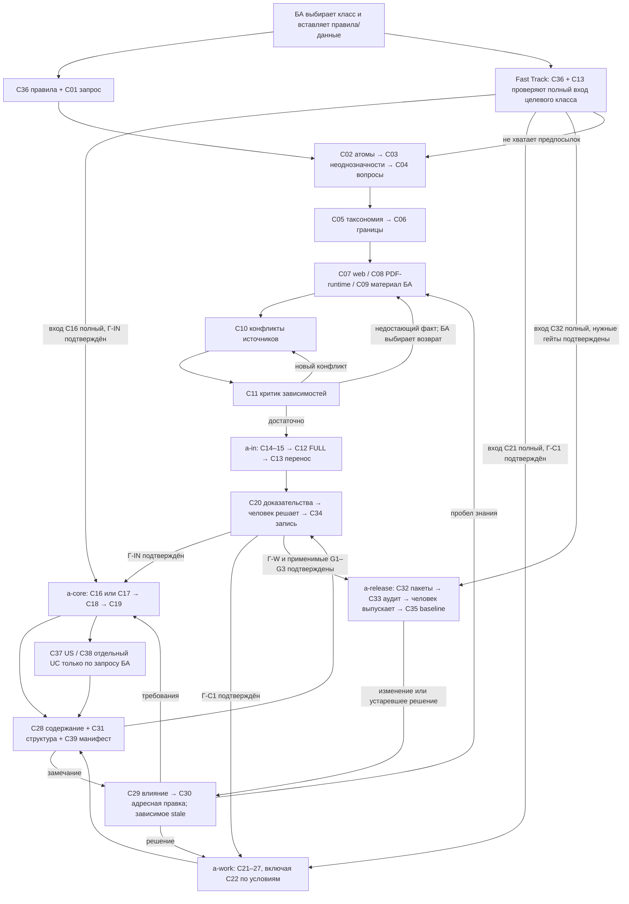

# Ручной маршрут BCREQ: четыре фазы, 39 классов

Основание: [checkpoint](../analysis/2026-10-29-bcreq-checkpoint.md).
Результат — проект стандартов для последующей реализации промптов. Текущие
14 промптов сохраняются; их использование не объявляется автоматически
соответствующим новому контракту. Проект разрешает отдельные классы сверх
прежней упаковки и заполняет A-RELEASE, ранее оставленный за границей
[контракта гейтов](../contracts/bcreq-stage-gates.md). После утверждения
допустима отдельная миграция промптов с повторной проверкой; здесь она не
нужна и не подменяет результат задачи по стандартам.

> **Пометка #420, риск 11.** «14 промптов» — снимок сайта и каталога
> `prompts/` на 31.10.2026, а не целевой состав. После PR #404 ручной
> конвейер BCREQ описан 39 классами (38 исходных и C39), и в изменённый
> проект переносятся они, а не 14 промптов. Классы улучшаются вместе с
> процессами, которые их запускают. Решения, опирающиеся на число 14,
> читаются с этой поправкой; пересмотр — задача BL-134 бэклога
> ([комментарий владельца к PR #422](https://github.com/G-Ivan-A/mango_ba_prompts/pull/422#issuecomment-6560476938)).

## Навигация и обязательные результаты

- [39 подробных стандартов и инвентарь экземпляров](../../standards/bcreq-manual-classes/README.md).
- [Общий контракт копируемого состояния](../contracts/bcreq-manual-state.md).
- [Новый RUN-0078 и сравнение](../../runs/2026/RUN-0078/outputs/README.md).

A-IN: сырой запрос → атомы → неоднозначности/пакет вопросов → таксономия и
границы → достаточные знания и зависимости → разделы 1–2, реестры, FULL,
предложение Г-IN. A-CORE: ФТ delta либо new, НФТ, UC первого прогона,
структурная/содержательная проверка, FULL, доказательства Г-С1. A-WORK: ОРР
L1, необходимый L2, ограничения, UC второго прогона, риски, зависимости,
приёмка, независимая проверка, FULL, доказательства Г-W. Согласование 1
заказчиком не означает одобрения внутреннего решения.

A-RELEASE — предлагаемое расширение: актуальный полный кандидат разделов
1–8, проверка изменений/источников/полномочий, пакеты адресатам, выпускной
контроль, явное решение уполномоченного человека, baseline и передача.
Критерии: нет блокирующих вопросов/stale, есть все обязательные согласования
применимой ревизии, состав и адресаты определены, источники и приложения
доступны, открытые неблокирующие вопросы имеют владельца. Модель готовит
`ready_for_human_release`, а `released` возникает только после реплики
уполномоченного человека. Внутренний раздел 7 не передаётся заказчику по
действующему мета-стандарту. Другие исключения определяет БА.

G1/G2/G3 из процессного стандарта и Г-IN/Г-С1/Г-W из stage-gates сохраняют
свои критерии и роли. Release не переименовывается в новую фазу «валидация»
и не отменяет финальный G3. Привязка критериев release к орг-роли остаётся
явным вопросом; при UNKNOWN выпуск заблокирован.

## Ручная маршрутизация

Стрелки означают варианты выбора БА. Ни один узел не запускает другой сам.
Повторный запуск и перенос полного текста осуществляет БА.

Fast Track означает пропуск уже выполненной работы, а не её обязательных
результатов. БА может сразу вставить нужный промпт или назвать точку входа.
Целевой шаг проверяет предпосылки и совместимость правил, достаточность
источников, актуальность гейтов; иначе возвращает точный список пробелов.
C12 и C13 выполняются на межфазовом переносе; C34 и повторная C12 после
человеческого решения включают его в следующий handoff. Вопросы и возвраты
доступны в каждой фазе. Независимые узлы не ждут не относящихся к ним ответов.

## Самовопросы и учёт неоднозначностей

Знаменатель — 20 выявленных проектных вопросов A01–A20, а не все мысли
автора и не будущие вопросы конкретного BCREQ. «Решён» означает однозначно
определён проектом с основанием, не означает человеческую приёмку.

| ID | Самовопрос | Решение / основание | Статус |
| --- | --- | --- | --- |
| A01 | Сколько фаз? | Только четыре из #403 | решён |
| A02 | Сокращать классы ради удобства? | Нет, прямой запрет #403 | решён |
| A03 | Классы равны файлам прежних промптов? | Нет: цель и I/O; 39 стандартов | решён |
| A04 | Анкета всегда обязательна? | Нет, обязателен сырой запрос; история | решён |
| A05 | Роль автора комментария? | Сохранять, UNKNOWN допустим; история | решён |
| A06 | Нормализация после таксономии? | До, не подменять слова заказчика | решён |
| A07 | Очистка БА отдельным шагом? | Нет, одна C09; прямое уточнение | решён |
| A08 | Web и PDF один класс? | Разные происхождение/локаторы → C07/C08 | решён |
| A09 | Критик сам ищет? | Нет, запрос и ручной возврат C11 | решён |
| A10 | Последний slice — полный контекст? | Нет, baseline + вся цепь, C12 | решён |
| A11 | Правила по URL доставлены? | Нет, фактические тексты, C36/C13 | решён |
| A12 | Есть автономные переходы? | Нет, только рекомендации БА | решён |
| A13 | Fast Track обходит гейты? | Нет, проверяет доказательства | решён |
| A14 | Новые ФТ и delta одинаковы? | Разный обязательный вход; C16/C17 | решён |
| A15 | Сценарии только по запросу или обязательны? | C37/C38 по запросу; C19/C24 обязательны по контракту покрытия | решён |
| A16 | Старая нумерация из RUN-0074? | Смысл переносится в текущие разделы 1–8 | решён |
| A17 | Replay доказывает снижение ошибок? | Нет: ручная имитация и контрольные probes; статистическая сопоставимость не заявляется | решён |
| A18 | Какой release-состав/политика адресатов? | Полный проект C32–C35; нужен выбор БА для применения | вопрос на согласование |
| A19 | Кто имеет право выпустить? | Только явный уполномоченный человек; орг-роль UNKNOWN | вопрос на согласование |
| A20 | Какие поля анкеты обязательны по профилям? | Зависит от поведения, запрос профильному владельцу | вопрос на согласование |

Итого: 17/20 = **85%** решены или явно определены проектом; 3/20 = **15%**
оставлены в блоке «Вопросы на согласование» checkpoint. Ни один вопрос не
скрыт за словом «позже»: для каждого задано поведение по умолчанию и стоп.
Проектные стандарты полны даже при отсутствии реального разрешения выпуска.

## Универсальные практики и границы доказательств

Сначала достаточный вход, затем генерация, отдельная проверка и человеческое
решение. Состояние переносится явными объектами и provenance; изменение
инвалидирует зависимое согласование. Критик предъявляет проверенное основание,
а не число повторений проверки. Это проектное применение паттернов survey,
а не утверждение, что агентный фреймворк уже реализован в ручном чате.
В стандартах используются общие паттерны, без идентификаторов проваленных
клиентских задач. Конкретные контрпримеры вынесены только в RUN/experiments.

## Авто-приёмка итераций 2 и 3

Итерация 2: ровно 39 подробных стандартов с purpose, входом/выходом,
алгоритмом, стопами, контекстом и специальными проверками; общий контракт
задаёт transport и полномочия. Итерация 3: маршрут охватывает четыре фазы,
возврат к добыче знаний, Fast Track и человеческие решения; доля оставшихся
вопросов 15%. Авто-приёмка означает соответствие заданию на разработку
стандартов, не принятие реальных BCREQ или публикацию стандартов как active.

Уточнение по результату имитации: первоначальные 38 классов checkpoint дополнены C39 — отдельной сверкой результата с манифестом. Это сохраняет отдельные цели и I/O проверки структуры, истинности источников и fidelity к заданию. Итог: 39 классов и 39 стандартов.

## Требования → реализация → проверка

| Требование #403 и исторических уточнений | Реализация | Проверяемое свидетельство |
| --- | --- | --- |
| Прочитать эволюцию и реальный репозиторий; checkpoint до стандартов | [Checkpoint](../analysis/2026-10-29-bcreq-checkpoint.md), отдельный ранний коммит; актуальные 14 промптов не изменены | Источники/локаторы, исходные 38 классов и образец C11 в checkpoint |
| Ровно четыре фазы, полный логический путь и один стандарт каждого фундаментального класса | [Инвентарь](../../standards/bcreq-manual-classes/README.md), 39 классов после уточнения C39; экземпляры каждой фазы и аналоги | `test_one_detailed_standard_per_class`: точное соответствие каталогу, файлам, фазовым экземплярам, входам/выходам и структуре |
| Подробные purpose, строгие I/O, алгоритм, circuit breakers, контекст и лучшие практики | Каждый стандарт C01–C39 и [общий контракт](../contracts/bcreq-manual-state.md) | Парсинг примеров JSON, наличие всех специальных контрактов; ручная проверка C11/C12/C34/C39 |
| Сырой запрос обязателен; анкета/комментарии/роли различимы; нормализация до таксономии | C01–C06; отсутствующая роль UNKNOWN; факты, scope и владелец вопроса разделены | RUN-0078 seed, a-in trace и отдельный реестр Q-01…Q-05 |
| Web, PDF/runtime и единое обогащение материала БА; критик возвращает за знаниями | C07/C08/C09/C10/C11 с разными provenance и I/O | Mermaid, события E07–E12 RUN-0078; отсутствие доступа честно блокирует проверку |
| Ручное копирование, START/CONTINUE, SLICE/FULL без скрытой памяти | C12/C13/C36 и контракт; никакого рабочего оркестратора | Четыре полных handoff; probes: потерянный slice, чужая задача/ветвь, неполный объект, неизвестный источник, удаление и dangling reference |
| Человеческие гейты, актуальная ревизия, два фактора спорной команды | C20/C29/C34/C35; область полномочий, stale и локаторы сообщений | Положительные/отрицательные controls: self-approval, старое/чужое решение, blockers, stale, неправильные два фактора; реальный выпуск остаётся DRAFT |
| Возвраты и Fast Track; без автоматического перехода | Mermaid и инвентарь, проверка предпосылок целевого класса | Все четыре фазы в trace, ожидаемые блокировки вместо выдуманных решений |
| Не менее 80% самовопросов определены, не более 20% на согласование | Таблица A01–A20: 17 решены, 3 вопроса с defaults/stops в checkpoint | 85% / 15%, явный знаменатель, вопросы не выданы за человеческую приёмку |
| Новый прогон на основе RUN-0074, фактический результат и сравнение | [RUN-0078](../../runs/2026/RUN-0078/outputs/README.md): новый восьмираздельный draft, 41 событие, review 28 критериев | 19 observed / 9 not_verified; baseline 193 инцидента, 80 confirmed / 113 plausible; показатели несопоставимости перечислены, снижение ошибок не заявлено |
| Универсальные паттерны, не частные задачи; авто-приёмка и продолжение | Стандарты без ID клиентского провала; конкретный контрпример только в RUN/experiments | Новый валидатор автоматически обнаруживается существующим CI; итерации 1–4 завершены без ожидания подтверждения |

Локальные проверки fixtures проверяют инварианты контракта. Они не являются
программной аутентификацией реального человека, оценкой качества модели или
разрешением принять BCREQ с непроверенными сведениями. Такие границы явно
отражены в RUN и отдельных статусах каждого критерия.
