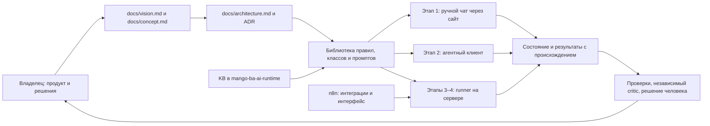

# RFC: модернизация репозитория — четыре этапа BCREQ без изменения истории

## RFC Metadata

| Поле | Значение |
| --- | --- |
| Родительская постановка | [#409](https://github.com/G-Ivan-A/mango_ba_prompts/issues/409) — аудит аудита и улучшение аналитических артефактов; продолжает [#407](https://github.com/G-Ivan-A/mango_ba_prompts/issues/407) |
| Уточнения владельца | [PR #408, комментарий 6522949478](https://github.com/G-Ivan-A/mango_ba_prompts/pull/408#issuecomment-6522949478); [PR #408, комментарий 6524028597](https://github.com/G-Ivan-A/mango_ba_prompts/pull/408#issuecomment-6524028597) |
| Review | [PR #410](https://github.com/G-Ivan-A/mango_ba_prompts/pull/410) (v0.3); [PR #408](https://github.com/G-Ivan-A/mango_ba_prompts/pull/408) (v0.1–v0.2) |
| Владелец решения | G-Ivan-A. Статус `proposed`: RFC вынесен на согласование, решения DEC-01…DEC-10 не приняты |
| Тип и область | RFC архетипа B (библиотека промптов и практики); runtime-части этапов 2–4 требуют собственных решений в `mango-ba-ai-runtime` и Хабе |
| Baseline объекта | [`6f6cbc47`](https://github.com/G-Ivan-A/mango_ba_prompts/tree/6f6cbc477f4b482d3c10bd4d941cbfb481fccf1f) |
| Baseline норм Хаба | [`32b5fa52`](https://github.com/G-Ivan-A/hybrid-Intelligence-lab/tree/32b5fa524e542af23c1a8e67c919bd66d5f4e399) |
| Baseline runtime | [`b67410f6`](https://github.com/G-Ivan-A/mango-ba-ai-runtime/tree/b67410f627801345309281faa15e7219722bfb1a) |
| Область воздействия | Будущие активные стратегические документы, навигация и контракты — только после согласования, отдельными задачами T-01…T-09. `runs/` (статистика) неизменен |
| Остаточное ограничение | Октябрьский JSON-экспорт чата из комментария 6522949478 не загружен (пустая ссылка). Issue #409 назначает первоисточником историю задач, поэтому ограничение не блокирует RFC |

Структура следует [rfc-structure-standard Хаба](https://github.com/G-Ivan-A/hybrid-Intelligence-lab/blob/32b5fa524e542af23c1a8e67c919bd66d5f4e399/standards/rfc-structure-standard.md).
Все предложения помечены **PROPOSED**. Входные требования владельца не
являются предложениями этого RFC: четыре этапа развития, неизменность
статистики `runs/` и правило «изменения — только по согласованным RFC или
ADR отдельными задачами».

### Изменения версии 0.3

| Что изменено | Почему |
| --- | --- |
| Добавлен раздел [«Решения на согласование»](#решения-на-согласование) DEC-01…DEC-10 | Аудит #409 нашёл противоречия, которые v0.2 не видела: статус `legacy/archived` в Хабе, переименование runtime, три кандидата SSOT этапа 2, роль n8n |
| Четыре документа перенесены в `docs/`: `docs/vision.md`, `docs/concept.md`, `docs/architecture.md`, `docs/roadmap.md` | Корневые `PRODUCT_VISION.md` и `ROADMAP.md` из v0.2 не прошли бы локальный замок корня (`tools/validate-repository-structure.sh`, L112–L130). Хаб держит видение в `docs/vision.md` и в B-113 переносит корневой `PRODUCT_VISION.md` туда же |
| `product-concept.md` и `solution-concept.md` заменены на `concept.md` и `architecture.md` | Владелец назвал четыре документа: видение, концепция, архитектура, roadmap. Обоснование — в [предложении](../analysis/2026-10-31-strategic-documents-proposal.md#где-живут-файлы-и-почему) |
| Подробное наполнение документов вынесено в [предложение по стратегическим документам](../analysis/2026-10-31-strategic-documents-proposal.md) | Одна копия черновиков вместо двух. RFC фиксирует решения, предложение — содержание и метод обоснования |
| Этап 3 сформулирован как «оркестрация процесса runner'ом с n8n как слоем интеграций» | Хаб отклонил n8n как ядро маршрута (В-6, Г-44…Г-49) и допускает его «как слой интеграций поверх API runner, но не вместо него» (DEC-05) |
| Ссылки на ветку форка `issue-407-28502daafccb` заменены ссылками на `main` | Ветка форка — временный артефакт; документы #407 слиты в `main` |
| Baseline обновлены: `bc30b9d6` → `6f6cbc47`, `c1053233` → `32b5fa52` | Снимок аудита #409 |
| Статус `draft` → `proposed` | Анализ завершён по первоисточнику #409; JSON — остаточное ограничение |

## Summary

Репозиторий получает четыре стратегических документа в `docs/` и один
маршрут развития: этап 1 (ручные промпты через сайт) → этап 2 (агентный
клиент OpenCode) → этап 3 (оркестрация runner'ом, n8n — слой интеграций) →
этап 4 (промышленная эксплуатация на выделенном сервере). Маршрут BCREQ
`A-IN` → `A-CORE` → `A-WORK` → `A-RELEASE` с воротами Г-IN, Г-С1, Г-W не
меняется при смене исполнителя: меняется только среда.

RFC просит владельца принять десять решений DEC-01…DEC-10. Главное из них —
DEC-01, статус репозитория в экосистеме: Хаб считает его `legacy/archived`,
а владелец ставит четыре этапа его развития. После решений изменения
выполняются задачами T-01…T-09
([реестр задач](../analysis/2026-10-31-follow-up-tasks.md)), противоречия на
стороне Хаба — обращениями H-01…H-07. Каждый файл получает диспозицию из
[реестра](../analysis/2026-10-31-file-disposition-register.md): актуален,
обновляется, переносится, архивируется или исторический.

Этот PR не создаёт стратегических документов, `AGENTS.md`, промптов,
workflow и RUN и не меняет существующие файлы, кроме аналитических
артефактов. История сохраняется на месте.

## Motivation

1. **Нет стратегических документов.** Правило 7 [Hub AGENTS.md](https://github.com/G-Ivan-A/hybrid-Intelligence-lab/blob/32b5fa524e542af23c1a8e67c919bd66d5f4e399/AGENTS.md#L29)
   требует от исполнителя прочитать концепцию и видение проекта. В `docs/`
   их нет (F-02).
2. **Действующие контракты противоречат четырём этапам.**
   `docs/ba-ecosystem.md` §7: «Уровни 3–4 не являются планом работ
   mango_ba_prompts». `ai-governance/ai-governance.md`: «GitHub —
   единственная платформа». Валидатор `scripts/validate_issue_263_vision_alignment.py`
   требует вторую формулировку дословно (`REQUIRED_TEXT`), а в контракте
   (docstring) фиксирует описание роли «без серверной инфраструктуры» (F-03).
3. **Статус репозитория в Хабе расходится с практикой.** Хаб присвоил ему
   статус `legacy/archived` ([бэклог L85–L96](https://github.com/G-Ivan-A/hybrid-Intelligence-lab/blob/32b5fa524e542af23c1a8e67c919bd66d5f4e399/ops/backlog.md#L85-L96)).
   После этого в репозитории создано 25 issues и слито 25 PR, а мета-модель
   Хаба M1–M4 построена на статистике его `runs/` (F-01).
4. **Несколько источников одного решения.** Три кандидата SSOT пакета
   этапа 2 (F-06), два дома процессов и таксономии (F-16), локальный
   KB-конвейер при перенесённой в runtime KB (F-12).
5. **Сайт не показывает стратегию.** Раздел «Дорожная карта» сайта
   собирается из уровней L1–L4 `docs/ba-ecosystem.md`, а не из четырёх
   этапов (F-15). Сайт должен быть готов к показу руководству.

Доказательства: [аудит #409](../audit/2026-10-31-repository-audit.md)
(F-01…F-20), [анализ эволюции требований](../analysis/2026-10-31-requirements-evolution.md),
[текущее состояние #407](../analysis/2026-10-30-repository-current-state.md),
[соответствие экосистеме #407](../analysis/2026-10-30-ecosystem-compliance.md),
[эволюция требований октября #407](../analysis/2026-10-30-october-requirements-evolution.md).

## Goals and Non-goals

Цели:

- у каждого типа активного решения один источник;
- стратегия и документация с прослеживаемыми версиями;
- полная классификация обязанностей без упрощения требований ради токенов;
- переносимые контракты I/O, состояния, ролей и ворот между средами;
- явная граница библиотеки практики и среды исполнения;
- каждый файл либо актуален, либо в архиве, либо размечен историческим.

Вне этого RFC как разрешения на действие:

- реализация и развёртывание любой среды;
- изменение `runs/`, статистики, экспериментов и исторических результатов;
- выбор production-стека до решения о границах;
- безусловная миграция всех стандартов Хаба;
- пустые каталоги и дубликаты ради шаблона;
- перенумерация ADR.

Принятие RFC не разрешает автоматически все этапы: каждая задача T-xx
заводится отдельно.

## Proposal

### Решения на согласование

Каждое решение — **PROPOSED**. Владелец принимает, отклоняет или выбирает
другой вариант. Решение фиксируется комментарием в PR или ADR; после этого
статус RFC меняется на `accepted`, а задачи T-xx заводятся.

#### DEC-01. Статус репозитория в экосистеме (F-01, F-11)

| Вариант | Следствие |
| --- | --- |
| А. Сохранить `legacy/archived` | Этапы 1–4 ведутся только в `mango-ba-ai-runtime`; эта спица замораживается, сайт этапа 1 переезжает. Противоречит постановке #409 и фактической активности |
| Б. Вернуть `active` | Снимает противоречие, но размывает решение #583 Хаба: runtime перестаёт быть единственной средой исполнения |
| **В. Гибрид (рекомендация)** | Спица — лаборатория практики этапа 1: промпты, сайт, ручной конвейер BCREQ, статистика `runs/` как доказательная база мета-модели. `mango-ba-ai-runtime` — исполнение этапов 2–4 |

Следствия варианта В: обращение H-01 (таблица статусов бэклога Хаба) и
H-02 (карта экосистемы); `docs/concept.md` описывает роли трёх репозиториев.
[Черновики документов](../analysis/2026-10-31-strategic-documents-proposal.md#устойчивость-к-вариантам-dec-01)
совместимы со всеми тремя вариантами.

#### DEC-02. Замена границ #263 (F-03, F-14)

**Рекомендация:** новый ADR спицы заменяет границы #263: «уровни 3–4 не
являются планом работ» (`docs/ba-ecosystem.md` §7), «GitHub — единственная
платформа» и «evals и golden-set отсутствуют». Две последние формулировки
валидатор `scripts/validate_issue_263_vision_alignment.py` требует дословно,
поэтому он меняется в том же PR. Альтернатива — править документы без ADR — отклонена:
валидатор остановит CI, а решение #263 останется формально в силе. Задача T-02.

#### DEC-03. Видимость (F-05)

**Рекомендация:** сохранить Public до решения по ADR-009 Хаба (`proposed` 0.3,
требует Private). README не подаёт Private как свершившийся план. Сайт
GitHub Pages — канал доставки этапа 1 и витрина для руководства; перевод в
Private без решения о сайте его отключит. Обращение H-03.

#### DEC-04. Роль `mango-ba-ai-runtime` (F-04)

**Рекомендация:** runtime — исполнение и KB (после [#361](https://github.com/G-Ivan-A/mango_ba_prompts/issues/361));
спица — источник практики этапа 1 и сайт. Упоминания `ai-ba-playbooks` как
«публичной методологии» заменяются фактическим именем и ролью
(`gh api repos/G-Ivan-A/ai-ba-playbooks` возвращает
`G-Ivan-A/mango-ba-ai-runtime`). Связь описывается в `docs/architecture.md`.
Задачи T-02, T-08.

#### DEC-05. Роль n8n на этапе 3 (F-07)

| Вариант | Следствие |
| --- | --- |
| А. n8n как ядро маршрута (буквальное прочтение #409) | Отклонён Хабом как В-6: вторая копия графа, недетерминированный AI Agent, нет `$ref` в структурном выводе, платная Git-синхронизация, поток уязвимостей ([Г-44…Г-49](https://github.com/G-Ivan-A/hybrid-Intelligence-lab/blob/32b5fa524e542af23c1a8e67c919bd66d5f4e399/projects/ba-ai-process/docs/analysis/2026-09-29-ba-ai-process-runtime-options.md#L379)) |
| **Б. Runner управляет маршрутом, n8n — слой интеграций и интерфейса (рекомендация)** | Совпадает с нормой Хаба: «n8n допустим как слой интеграций поверх API runner, но не вместо него» ([L62–L71](https://github.com/G-Ivan-A/hybrid-Intelligence-lab/blob/32b5fa524e542af23c1a8e67c919bd66d5f4e399/projects/ba-ai-process/docs/analysis/2026-09-29-ba-ai-process-runtime-options.md#L62-L71)) и с [B-218](https://github.com/G-Ivan-A/hybrid-Intelligence-lab/blob/32b5fa524e542af23c1a8e67c919bd66d5f4e399/ops/backlog.md#L700) |

Владелец разрешил исправлять постановку с обоснованием («Если постановки
некорректны — исправляйте с обоснованием, эффективность — приоритет»).
Цель этапа 3 — автоматизация — сохраняется; меняется только носитель
маршрута. Обращение H-04.

#### DEC-06. SSOT пакета этапа 2 (F-06)

**Рекомендация:** пакет Хаба [`dist/execution-package-opencode`](https://github.com/G-Ivan-A/hybrid-Intelligence-lab/blob/32b5fa524e542af23c1a8e67c919bd66d5f4e399/projects/ba-ai-process/dist/execution-package-opencode/README.md)
(`RG-BCREQ-v1`) — источник сборки; runtime — место установки; ADR-016 спицы
переписывается в профиль применения пакета. Альтернатива — ADR-016 спицы
как самостоятельный источник — создаёт третью копию. Задача T-09.

#### DEC-07. Архетип и среда (F-08)

**Рекомендация:** `archetype: B`, `environment: local` в `AGENTS.md` и
`.hub-profile.json` ([bootstrap-standard L55](https://github.com/G-Ivan-A/hybrid-Intelligence-lab/blob/32b5fa524e542af23c1a8e67c919bd66d5f4e399/standards/agents-md-bootstrap-standard.md#L55)).
Корневой `AGENTS.md` требует ADR, расширяющего локальный замок корня.
Задача T-01.

#### DEC-08. Размещение четырёх документов (F-02)

**Рекомендация:** `docs/vision.md`, `docs/concept.md`, `docs/architecture.md`,
`docs/roadmap.md`. Основания: замок корня, B-113 Хаба, прецедент Хаба
(`docs/vision.md`, `docs/concept.md`). Противоречие product-profile L60
(корневой `PRODUCT_VISION.md`) вынесено в H-05. Задача T-02.

#### DEC-09. Политика разметки истории (F-10, F-16)

**Рекомендация:** правило каталога плюс блок перехода.

- Датированные артефакты (`docs/analysis/`, `docs/audit/`, `docs/report/`,
  `docs/reviews/`) — исторические по умолчанию: правило записано один раз в
  `docs/README.md`, файлы не правятся.
- Активные документы, у которых сменилась норма, получают блок перехода со
  ссылкой на преемника.
- `.archive/` принимает только `superseded` с преемником (контракт
  [`.archive/README.md`](../../.archive/README.md)); `runs/` и `kb/` туда не
  переносятся.

Альтернатива — баннер в каждом историческом файле — отклонена: 370
исторических файлов пришлось бы править ради метаданных. Задачи T-06, T-07.

#### DEC-10. Вывод локального KB-конвейера (F-12)

**Рекомендация:** депрекация по [artifact-deprecation-standard Хаба](https://github.com/G-Ivan-A/hybrid-Intelligence-lab/blob/32b5fa524e542af23c1a8e67c919bd66d5f4e399/standards/artifact-deprecation-standard.md)
после проверки потребителей: удалить цели `kb-*`, workflow `kb.yml` и
KB-валидаторы или перевести их на runtime; `kb/` оставить на месте с
указателем на runtime. Задача T-05 (58 файлов).

### Четыре стратегических документа

Черновое содержание, трассы и метод обоснования (О-1…О-5) — в
[предложении по стратегическим документам](../analysis/2026-10-31-strategic-documents-proposal.md).
Здесь — роли документов.

| Документ | Отвечает на вопрос | Владелец смысла | Защита от дублирования |
| --- | --- | --- | --- |
| `docs/vision.md` | Зачем проект и что считается успехом | Владелец | README — вход и ссылка; обещания не копируются в промпты |
| `docs/concept.md` | Для кого, какие сценарии, где границы трёх репозиториев | Владелец | Таксономия и процессы живут в своих домах; концепция ссылается |
| `docs/architecture.md` | Из каких частей система, как маршрут переходит между средами, какие атрибуты качества | Исполнитель, принимает владелец | Контракты фаз и состояния остаются нормами своих операций; архитектура ссылается |
| `docs/roadmap.md` | Какие этапы, с какими критериями входа и выхода | Владелец | Сквозной план, не ADR и не пятая концепция; сроки — только после решения владельца |
| `docs/README.md` | Где что лежит и какой статус у каталога | Исполнитель | Навигация без копий содержимого |
| `docs/adr/` | Какое решение принято и почему | Владелец | Только конкретные решения; старые ADR не перенумеровываются |

### Параллельное развитие с мета-моделью и обратная связь

Опорный набор Хаба: [00-introduction](https://github.com/G-Ivan-A/hybrid-Intelligence-lab/blob/32b5fa524e542af23c1a8e67c919bd66d5f4e399/projects/ba-ai-process/ba-meta-model/00-introduction.md),
[10-theory](https://github.com/G-Ivan-A/hybrid-Intelligence-lab/blob/32b5fa524e542af23c1a8e67c919bd66d5f4e399/projects/ba-ai-process/ba-meta-model/10-theory.md),
[20-taxonomy](https://github.com/G-Ivan-A/hybrid-Intelligence-lab/blob/32b5fa524e542af23c1a8e67c919bd66d5f4e399/projects/ba-ai-process/ba-meta-model/20-taxonomy.md)
вместе с [ADR-015 Хаба](https://github.com/G-Ivan-A/hybrid-Intelligence-lab/blob/32b5fa524e542af23c1a8e67c919bd66d5f4e399/docs/adr/2026-09-adr-015-process-operation-taxonomy-rebuild.md)
и [research/ba-requirements](https://github.com/G-Ivan-A/hybrid-Intelligence-lab/blob/32b5fa524e542af23c1a8e67c919bd66d5f4e399/research/ba-requirements/README.md).
Слои мета-модели: M0 — обращение → проверяемое требование, M1 — ядро,
M2 — рендер, M3 — обратная связь и статистика, M4 — маршрутизация и ворота.
Соответствие фаз маршрута слоям и воротам — в черновике `docs/architecture.md`.

**PROPOSED:** перед изменением активной нормы проверять смысловую разницу
двух закреплённых версий. Запись совместимости содержит:

- локальное требование или фазу;
- артефакт, контракт, операцию или навык Хаба;
- статус применимости и локальную дельту;
- доказательство и регрессионный oracle.

Локальные A-WORK и A-RELEASE сопоставляются с Working и Release по выходам и
воротам, а не по совпадению слов.

Цикл обратной связи: новая практика здесь → неизменённое свидетельство в
`runs/` и описание обобщаемого дефекта → обращение в Хаб → принятое или
отклонённое решение Хаба → оценка влияния на локальные контракты, промпты и
сайт → адресная правка и регрессионная проверка. Результат эксперимента сам
по себе норму не меняет. Новая статистика копится в `runs/` и не переписывает
старую: требования меняются, а исторические данные остаются доступными для
сравнения.

### Сайт: путь публикации и готовность к показу

Витрина — https://g-ivan-a.github.io/mango_ba_prompts/. **OBSERVED:**
[`scripts/generate-pages-data.mjs`](https://github.com/G-Ivan-A/mango_ba_prompts/blob/6f6cbc477f4b482d3c10bd4d941cbfb481fccf1f/scripts/generate-pages-data.mjs)
читает выбранные источники, а не весь Markdown. Функция `parseRoadmap`
читает `docs/ba-ecosystem.md`, `makeStats` содержит три старые фазы и считает
`testsPassed` по статусу `canonical`. Поэтому добавление четырёх файлов само
по себе сайт не изменит (F-15).

Путь: принятые документы и активные контракты → явное включение в генератор
и схему данных → `site/data/*.json` и разделы `site/index.html`/`site/app.js` →
preview и review → workflow → опубликованный артефакт с исходным SHA.
[Workflow Pages](https://github.com/G-Ivan-A/mango_ba_prompts/blob/6f6cbc477f4b482d3c10bd4d941cbfb481fccf1f/.github/workflows/github-pages.yml)
собирает сайт на PR, а публикует только push в `main`.

| Будущая правка | Изменение и причина | Проверка |
| --- | --- | --- |
| `docs/taxonomy.md`, `docs/ba-processes/00-index.md`, `docs/ba-processes/bcreq-manual-process.md` | Актуализировать процессы и фазовый маршрут с соответствием старых названий; валидация остаётся обязанностью, а не отдельной идентичностью (T-04) | Полнота старых обязанностей, входов, выходов и ворот; нет слепого переименования «ФТ/ТЗ» в A-IN |
| `scripts/generate-pages-data.mjs` | Читать дорожную карту из `docs/roadmap.md`; заменить три старые стадии четырьмя этапами; отделить статус метаданных от факта тестирования. Идентификаторы промптов и ссылки сохраняются (T-03) | Проверки «источник → представление»; нет ложного «тест пройден» и тихого пустого вывода при смене таблиц |
| `site/index.html`, `site/app.js`, стили | Точка входа для показа руководству и навигация к четырём документам; состояния «нет данных» и ошибок; мобильная и клавиатурная навигация | Playwright-сценарии desktop/mobile; рабочие функции доступны |
| `site/data/` | Перегенерировать только производную проекцию принятых источников | Сверка значений с источником; ни одного изменения исторических данных |
| `scripts/validate_issue_388_bcreq_site.py`, `scripts/test_issue_395_site.py` | Обновить проверки, если принятая модель меняет прежние утверждения. Тест #395 хранит хеши старых секций: менять oracle можно только вместе с решением о новом поведении и новым регрессионным случаем | Негативный случай до реализации; `make validate-full` и сборка Pages; скриншоты до и после в PR реализации |

| Сценарий готовности к показу | Критерий и доказательство |
| --- | --- |
| D-01 Ценность и состояние | Руководитель с первой страницы понимает проблему, результат для БА и реализованный объём; текущее, предлагаемое и историческое различимы. Скриншот и согласованный walkthrough |
| D-02 Четыре документа | С сайта доступны «Видение», «Концепция», «Архитектура», «Дорожная карта» с версией и источником каждого. Представление отражает принятый текст, а не отдельную рукописную стратегию |
| D-03 Процесс BCREQ | Один обезличенный пример показывает A-IN/A-CORE/A-WORK/A-RELEASE, входы, выходы, возвраты и решения людей. Нереализованные шаги помечены |
| D-04 Доказательства и цифры | «Описано», «реализовано», «проверено» и «принято» подкреплены разными доказательствами. Ни `canonical`, ни число файлов не подменяют тест. Историческая статистика показана без пересчёта |
| D-05 План развития | Четыре этапа, зависимости, критерии входа и выхода и открытые решения соответствуют `docs/roadmap.md`. n8n и сервер показаны планом, а не работающей системой |
| D-06 Полезность для БА | Работают поиск, фильтры, просмотр и копирование промпта, стандарты, процессы и отчёты; клавиатура и мобильный вид проверены |
| D-07 Доступ и публикация | Вход, выход и ошибка доступа проверены штатно; показывается только согласованный материал; манифест сборки соответствует опубликованному |
| D-08 Согласованность и отказ | Нет битых активных ссылок и пустых блоков; ошибка источника, схемы или сборки не публикует пустую или старую стратегию; предыдущий артефакт доступен для отката вперёд |

Это **PROPOSED** критерий готовности к показу, а не оценка «сайт готов».
Исполнение D-01…D-08 и скриншоты до и после — в задаче T-03.

### Жизненный цикл файлов: актуализация, архив, история

Пофайловая диспозиция всех 1 615 файлов снимка — в
[реестре](../analysis/2026-10-31-file-disposition-register.md):
`current` 233, `update` 113, `relocate` 4, `archive-candidate` 38,
`archived` 28, `historical` 370, `statistics` 806, `generated` 23.

Критерий архивирования — явный преемник и отсутствие активных потребителей,
а не возраст, размер или старый термин. Действуют
[`.archive/README.md`](../../.archive/README.md) и
[artifact-deprecation-standard Хаба](https://github.com/G-Ivan-A/hybrid-Intelligence-lab/blob/32b5fa524e542af23c1a8e67c919bd66d5f4e399/standards/artifact-deprecation-standard.md).

| Группа | Судьба и условие |
| --- | --- |
| Активные обзоры, таксономия, индекс процессов, архитектура промптов, контракты фаз | Актуализировать на месте (T-02…T-04, T-06). Сначала перенести обязанности в явное соответствие и проверить потребителей. Второй «актуальный» дубль не создаётся |
| Датированные анализы, аудиты, отчёты, ревью | Исторические по правилу каталога (DEC-09). Числа в них не исправляются |
| `prompts/archive/`, `.archive/` | Сохранить; новые указатели не выбирают их как действующую норму |
| Кандидаты в архив (38) | Перенос в `.archive/` только при `superseded` с преемником; логи без преемника — в `experiments/issue_NNN/` (T-07) |
| `fr-validation` и другие паттерны до BCREQ | Кандидаты на пересмотр роли, а не доказанно ненужные файлы: на `fr-validation` ссылаются `patterns/README.md`, `docs/ba-processes/00-index.md`, `site/data/patterns.json`, `site/data/processes.json` (T-04) |
| `runs/`, эксперименты, манифесты источников, метрики, скриншоты, записи решений | Сохраняются побайтово и по прежним путям; из навигации по умолчанию исключаются отдельной точкой входа «История». Не правятся и не пересчитываются |
| Файл без доказанного использования или преемника | UNRESOLVED: сохранить до проверки влияния. «Не найдено поиском» не доказывает отсутствия внешних потребителей |

### Архитектура и переносимые инварианты

Это целевая схема ролей, а не развёрнутая топология. На этапе 1 БА вручную
переносит текст и выбирает шаг. На этапе 2 клиент читает файлы и меняет
контекст по контракту. На этапе 3 runner управляет маршрутом, ожиданиями и
повторами, а n8n подключает внешние системы. На этапе 4 сервер обеспечивает
контролируемое исполнение. Библиотека может оставаться в GitHub, пока
runtime размещён отдельно.

Сохраняемые инварианты:

- оригинал и идентификаторы источников отделены от интерпретации;
- факт, запрос, предложение и решение различимы; «неизвестно» не равно
  «пусто»;
- передаются полный `rule_bundle` и его версия; URL не считается
  доставленным текстом;
- у состояния есть task, phase и revision, а также baseline со срезами или
  полный снимок; FULL сохраняет тела, условия и ссылки;
- устаревшие версии блокируют использование; FastTrack проверяет
  предусловия и ворота человека;
- независимый critic не маскируется под самопроверку; человек утверждает то,
  что требует его решения (Г-С1, A-RELEASE: `ready_for_human_release` →
  `released` по ответу уполномоченного человека);
- статистика не переписывается под новое состояние.

Класс, операция, промпт, навык и вызов — разные единицы. Вложение
процесс → навыки → операции сохраняет 1:N на каждом шаге мета-модели. Число
навыков не назначается числом классов (39 классов `catalog.json`).
Переупаковка допустима только с доказательством сохранения I/O, правил, роли
и проверки. Экономия контекста не разрешает выбросить обязательную норму.

### Четыре этапа и переходы

Порядок этапов задан владельцем. Критерии входа и выхода — **PROPOSED**, без
придуманных численных порогов. Этапы не равны четырём фазам BCREQ и уровням
зрелости L1–L4 `docs/ba-ecosystem.md` §7. Соответствие уровней этапам:
L1, L2 → этап 1; L3 → этапы 2–3; L4 → этапы 3–4.

| Этап | Где исполняется (DEC-01, DEC-04) | Вход и зависимости | Результаты и роль человека | Доказательства выхода |
| --- | --- | --- | --- | --- |
| 1. Чат-промпты через сайт | Эта спица: `prompts/`, сайт, ручной конвейер | Согласованные мета-модель и правила, полнота источников, операции всех четырёх фаз, непротиворечивый активный контракт | Рабочая упаковка классов, SLICE/FULL, входы, выходы, ворота, предохранители; БА переносит тексты и состояние и запускает каждую операцию. Python-валидаторы разработки не становятся требованием к БА | На согласованных кейсах: нет потерь и выдумывания, работают циклы, возвраты и FastTrack, раздельные critic и запись решения человека, трасса до oracle |
| 2. Агентный клиент (OpenCode) | `mango-ba-ai-runtime`; пакет из `dist/execution-package-opencode` Хаба (DEC-06) | Принятые контракты этапа 1, решение по клиенту и доступам, безопасное файловое состояние; [исследование клиентов](../analysis/2026-10-30-ide-clients-stage-2.md) | Навыки, правила и адаптеры; файловые baseline и срезы; контролируемое чтение KB и версий; диалог с БА | Те же кейсы проходят в новой среде; доказаны полный bundle, изоляция ревьюера, обработка устаревших версий, пауза и возобновление человеком |
| 3. Оркестрация runner'ом, n8n — слой интеграций | `mango-ba-ai-runtime`; место n8n — в RFC серверной среды B-218 Хаба (DEC-05) | Проверенная семантика этапа 2, корпоративные доступы, владелец исполнения, контракты интеграций | Runner ведёт маршрут, контрольные точки и человека в цикле; n8n подключает почту, трекеры, MCP и веб по разрешённым источникам; эксплуатационные логи отдельно от `runs/` | Идемпотентность, повтор и возобновление; нет двойного одобрения и побочных эффектов; происхождение внешнего ввода; возврат в ручной режим |
| 4. Промышленная эксплуатация на сервере | `mango-ba-ai-runtime` на выделенном сервере | Стабильные контракты этапов 1–3, оценённая потребность, решение об инфраструктуре, данных и ответственности | Промышленный runner, состояние и наблюдаемость; векторный поиск только при доказанной необходимости; версии bundle и права | Смысловая эквивалентность, границы доступа, восстановление и откат, согласованные эксплуатационные цели, управление людьми |

Roadmap задаёт зависимости, а не обязательство строить все среды сразу.
Исследование следующей среды параллельно с текущей не означает её готовности.

### Актуализация существующего без переписывания истории

После согласования определяется активная версия BCREQ: что действующая норма,
что проект, а что прежняя упаковка. Существующие README, обзоры, архитектура
промптов и контракты обновляются в своих домах; второй «актуальный» дубль
не создаётся. До полного покрытия новым рабочим артефактом новый конвейер
не объявляется реализованным.

Bootstrap Хаба (T-01): корневой `AGENTS.md` как диспетчер к правилам по
[bootstrap-standard](https://github.com/G-Ivan-A/hybrid-Intelligence-lab/blob/32b5fa524e542af23c1a8e67c919bd66d5f4e399/standards/agents-md-bootstrap-standard.md);
`archetype` и `environment` в `.hub-profile.json` с сохранением `target_type`,
истории синхронизаций и `path_migrations`. Правила Хаба не копируются в
корень вторым SSOT.

Исторические RUN, эксперименты, вложения, метрики, контрольные точки,
скриншоты, миграционные манифесты и архив сохраняются побайтово и по прежним
путям. Объяснение их статуса — в активной навигации.

## Alternatives

| Вариант | Оценка |
| --- | --- |
| Оставить всё в одном обзорном документе | Меньше файлов, но смешаны жизненные циклы стратегии, процесса и технических решений; не решает вопрос «какое правило действует». Отклоняется |
| Развернуть полный шаблон Хаба и runtime сразу | Формально полное дерево, высокая цена сопровождения, неподтверждённые обязанности; нарушает Anti-Inflation ([repo-model Хаба](https://github.com/G-Ivan-A/hybrid-Intelligence-lab/blob/32b5fa524e542af23c1a8e67c919bd66d5f4e399/ops/repo-model.md)) и аналитический объём #409. Отклоняется |
| Добавить новые актуальные копии старых документов | Быстрый старт, но параллельные SSOT. Отклоняется в пользу адресной правки существующих файлов |
| Перейти сразу к серверу, минуя ручной этап и агентный клиент | Скрывает смысловые пробелы за автоматизацией и противоречит заданной последовательности. Не предлагается |
| Принять решение Хаба `legacy/archived` буквально и прекратить развитие спицы | Противоречит постановке #409 и фактической работе; лишает мета-модель источника практики. Вынесено в DEC-01 как вариант А |
| Новый RFC вместо переписывания v0.2 | Две конкурирующие версии одного предложения — второй SSOT. Issue #409 разрешает изменить результирующие артефакты, включая RFC. Отклоняется |
| **Предлагаемый вариант:** решения DEC → документы → поэтапная реализация задачами T-xx | Сохраняет историю и обратимость, оставляет явные ворота и проверяемые доказательства. Требует решений владельца и не даёт мгновенной автоматизации |

## Trade-offs

- **Четыре документа вместо одного.** Проще распределить ответственность и
  версии, но нужны навигация и проверка ссылок. Поэтому детали живут в
  одном доме, обзор ссылается.
- **Сохранение всей статистики.** Дерево растёт (806 файлов `runs/`), зато
  история воспроизводима и сравнима с новой статистикой. Очистка касается
  активных маршрутов и ложных обещаний, а не данных.
- **Строгие проверки.** Стоят времени, но должны проверять риск потери
  смысла, а не повторять собственную реализацию.
- **Перенос мета-модели между средами.** Обученные правила БА сохраняются,
  но одинаковое поведение разных LLM и инструментов не гарантировано. Нужна
  эквивалентность на согласованных кейсах.
- **Гибридный статус (DEC-01).** Требует обращения в Хаб и дисциплины границ
  между двумя репозиториями; взамен сохраняет действующий канал этапа 1 и
  источник доказательств мета-модели.

## Impacted Artifacts

Все строки — **будущие** изменения по задачам из
[реестра задач](../analysis/2026-10-31-follow-up-tasks.md). Этот PR ни одну
строку не реализует.

| Цель | Задача | Риск и защита |
| --- | --- | --- |
| Новые `AGENTS.md`, `docs/README.md`; `.hub-profile.json`; `tools/validate-repository-structure.sh` | T-01 | ADR до правки замка корня; старые ключи профиля сохраняются до проверки потребителей синхронизации |
| Новые `docs/vision.md`, `concept.md`, `architecture.md`, `roadmap.md`; `README.md`, `ai-governance/ai-governance.md`, `ai-rules/ai-quick-rules.md`, `ai-rules/AI_SESSION_HANDOVER_PROMPT.md`, валидатор #263 | T-02 | Не копировать нормы; ADR и валидатор меняются в одном PR |
| `docs/ba-ecosystem.md`, `scripts/generate-pages-data.mjs`, `standards/pages-ux-standard.md`, производные `site/` | T-03 | Сайт — проекция, не SSOT; рабочие функции сохраняются |
| `docs/ba-processes/`, `docs/taxonomy.md`, `patterns/`, стандарты паттернов и классификации | T-04 | Не терять обязанности при смене модели процессов |
| `kb/`, `scripts/kb/`, `Makefile`, `.github/workflows/kb.yml`, KB-валидаторы | T-05 | Проверка потребителей до вывода; `kb/` не переносится в `.archive/` |
| `docs/contracts/`, файлы корня `docs/`, `docs/rfc/rfc-register.md`, `prompts/README.md` | T-06 | Журнал `path_migrations` и указатели на старом месте |
| ADR 003–010, кандидаты в архив, поле `ai-generated` вне `runs/`; `FRONTMATTER_SCOPE` в `Makefile` | T-07 | Статусы ADR — решение владельца; `runs/` не изменяется; область валидатора frontmatter расширяется по каталогам, исключения — с причиной (F-20) |
| `docs/hub-research-dependencies.md`, `pr-ops/BACKLOG.md`, `pr-ops/artifact-map.md`; ссылки на ветки форка в ADR-013, ADR-014 и `docs/taxonomy/` | T-08 | Ссылки на ADR других репозиториев — с префиксом репозитория; в JSON `docs/taxonomy/` меняется только префикс URL, исторические генераторы не правятся (F-19) |
| `docs/adr/2026-10-adr-016-ide-client-process.md`, `docs/analysis/2026-10-30-ide-clients-stage-2.md` | T-09 | Один источник пакета; ADR-016 становится профилем применения |
| `runs/`, `site/`, `CHANGELOG.md` в этом PR | — | Не изменяются. Запись в `CHANGELOG.md` появится в задачах исполнения |

## Implementation and Validation

### Текущий PR

Результат PR #410 — аналитические артефакты и этот RFC. Проверки:

- `make validate-fast`, `make validate-full`;
- `scripts/validate_issue_409_audit_artifacts.py` (подхватывается
  `make validate-full` автоматически): frontmatter по валидатору Хаба;
  согласованность JSON и Markdown-реестра и совпадение итогов с аудитом,
  реестром задач и RFC; разрешимость F-xx, DEC-xx, T-xx, H-xx; существование
  относительных ссылок и якорей, включая строки RFC-409-DEC в
  `rfc-register.md`; закрепление ссылок на Хаб и runtime на коммитах;
  отсутствие ссылок на ветки форка, поля `ai-generated` и устаревшего
  обозначения владельца;
- `experiments/issue_409/mutation_check.sh`: девять намеренных порч
  артефактов, каждая из которых должна ронять приёмку;
- пустой `git diff` для `runs/` и `site/` относительно `main`.

### Порядок реализации

1. Владелец принимает решения DEC-01…DEC-10.
2. Обращения H-01…H-07 заводятся в Хабе.
3. Задачи T-01…T-09 заводятся и исполняются в порядке из
   [реестра задач](../analysis/2026-10-31-follow-up-tasks.md#порядок-исполнения).
4. Переход между этапами — по критериям входа и выхода.

Каждая реализация — отдельный разрешённый diff без изменения исторической
выборки.

### Приёмочные проверки будущей реализации

| Проверка | Oracle и негативный случай | Доказательство |
| --- | --- | --- |
| Требование → артефакт → результат | У каждой атомарной нормы источник, версия, статус, операция, рабочая инструкция, тест и обратная связь; недоставленный источник остаётся непрочитанным | Проверка соответствия владельцем; нет необоснованного автоматического APPROVED |
| Состояние без потерь и FULL | Входы с отрицаниями, условиями и конфликтами; после цепочки SLICE полный снимок содержит все тела, ID и ссылки на источник | Сравнение с ожидаемым состоянием по oracle кейса; счёта сущностей недостаточно |
| Правила и фазы | Новый чат без `rule_bundle`, устаревшая ревизия, чужой task, неизвестная фаза | Запрос или блокировка по контракту, без додумывания |
| Роли и ворота человека | Комментарий без роли, предложение ассистента, FastTrack без обязательного решения, critic без независимого входа | Нет самоприсвоенного одобрения человека и пропуска ворот |
| Полнота четырёх фаз | Матрица классов против разделов, операций и ворот, включая release, влияние и доработку | Ни одной обязанности без покрытия или явного UNRESOLVED |
| Golden и оценка | Утверждённый ожидаемый вердикт, класс дефекта, обоснование, отрицательные и пограничные случаи; offline и реальный прогон LLM раздельно | Владелец утверждает oracle и критерий успеха до исполнения; порог агент не назначает |
| Документы и bootstrap | Одно место каждого правила, согласие профиля и `AGENTS.md`, рабочие ссылки, различие draft/current/history | Машинные проверки структуры и проверка смысловых границ человеком |
| Неизменность доказательств | Сравнение исходных данных и путей с baseline | `git diff` пуст для `runs/` и исторических домов |
| Перенос среды | Тот же набор кейсов в ручном режиме, клиенте, runner и на сервере; сбои, возобновление, повтор, устаревание, доступ | Воспроизводимые трассы и согласованные вердикты; название клиента или зелёный CI не заменяют результат |

До выполнения этих проверок их статус — **не выполнено**, а не «pass».

Совместимость и откат: сначала навигация, стратегические документы и явные
указатели версий; затем адресные изменения контрактов и упаковки. Ссылки
совместимости и старые ключи клиентов сохраняются до проверки потребителей.
При неудаче — revert конкретного изменения вперёд, возврат к прежнему
указателю и фиксация причины. Статистика и старые записи решений не
откатываются и не редактируются.

## Lifecycle and Decision Path

| Статус | Условие |
| --- | --- |
| `draft` (v0.1–v0.2, PR #408) | Анализ #407; блокер — JSON-экспорт |
| `proposed` (v0.3, PR #410) | Аудит #409 завершён; решения DEC-01…DEC-10 сформулированы с вариантами и доказательствами |
| `accepted` | Владелец явно принял решения DEC (комментарий в PR, issue или ADR). Ссылка на решение добавляется сюда |
| `rejected` или `superseded` | Владелец отклонил RFC или заменил его другим решением; RFC остаётся историческим свидетельством |

Слияние аналитического PR само по себе не одобряет будущие изменения.
Финальное решение по каждому DEC принимает владелец.

## Open Questions

| Вопрос | Статус |
| --- | --- |
| Решения DEC-01…DEC-10 | UNRESOLVED: на согласовании владельца |
| Где содержимое октябрьского JSON-экспорта? | Остаточное ограничение: пустая ссылка `Uploading…` в комментарии 6522949478. Если файл будет загружен, сверка с [анализом эволюции](../analysis/2026-10-31-requirements-evolution.md) — отдельная задача |
| Какая версия BCREQ активна и как принимается расширение release? | UNRESOLVED: нужно решение и соответствие старых и новых обязанностей (T-04) |
| Статусы ADR 003–010, `proposed` с 2026-06 | UNRESOLVED: решение владельца (T-07) |
| Кто утверждает oracle, пороги, выход из этапа и эксплуатационные цели? | Предлагается владелец или назначенный человек; значения не заданы |
| Нужны ли отдельные сервисы runtime и когда? | После `docs/concept.md`, `docs/architecture.md` и подтверждённой потребности; зависит от B-218 Хаба |

## Related Artifacts

- [Аудит репозитория #409](../audit/2026-10-31-repository-audit.md) — находки F-01…F-20, SSOT спицы и Хаба, решения DEC.
- [Реестр диспозиции файлов](../analysis/2026-10-31-file-disposition-register.md) — все файлы снимка `6f6cbc47`.
- [Анализ эволюции требований](../analysis/2026-10-31-requirements-evolution.md) — история задач и проверка ожиданий к #405 и #407.
- [Предложение по стратегическим документам](../analysis/2026-10-31-strategic-documents-proposal.md) — черновики четырёх документов и метод обоснования.
- [Реестр задач и обращений в Хаб](../analysis/2026-10-31-follow-up-tasks.md) — T-01…T-09 и H-01…H-07.
- Анализ #407: [инвентарь](../analysis/2026-10-30-repository-inventory.md), [текущее состояние](../analysis/2026-10-30-repository-current-state.md), [эволюция требований октября](../analysis/2026-10-30-october-requirements-evolution.md), [соответствие экосистеме](../analysis/2026-10-30-ecosystem-compliance.md).
- [RFC ручного конвейера BCREQ](2026-10-bcreq-manual-pipeline.md) — проект классов и ручного процесса; не переписывается.
- [Исследование клиентов этапа 2 (#405)](../analysis/2026-10-30-ide-clients-stage-2.md).
- Хаб: [rfc-structure-standard](https://github.com/G-Ivan-A/hybrid-Intelligence-lab/blob/32b5fa524e542af23c1a8e67c919bd66d5f4e399/standards/rfc-structure-standard.md), [repo-model](https://github.com/G-Ivan-A/hybrid-Intelligence-lab/blob/32b5fa524e542af23c1a8e67c919bd66d5f4e399/ops/repo-model.md).
