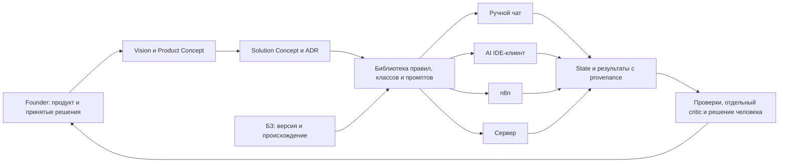

# RFC: согласованная документация и развитие BCREQ без изменения истории

## RFC Metadata

| Поле | Значение |
| --- | --- |
| Родительская постановка | https://github.com/G-Ivan-A/mango_ba_prompts/issues/407 |
| Управляющее уточнение | https://github.com/G-Ivan-A/mango_ba_prompts/pull/408#issuecomment-6522949478 |
| Контрольная проверка и дополнение | https://github.com/G-Ivan-A/mango_ba_prompts/pull/408#issuecomment-6524028597 — содержание четырёх документов, согласованность с метамоделью и готовность сайта к презентации |
| Review | https://github.com/G-Ivan-A/mango_ba_prompts/pull/408 |
| Владелец решения | G-Ivan-A; статус frontmatter draft, принятие не зафиксировано |
| Тип/область | Micro-RFC для библиотеки промптов/паттернов, предлагаемый archetype B; будущие runtime-части требуют собственных мандатов |
| Baseline объекта | https://github.com/G-Ivan-A/mango_ba_prompts/tree/bc30b9d6bce8f4458895e84deab5f3552b13f394 |
| Baseline нормативных источников | https://github.com/G-Ivan-A/hybrid-Intelligence-lab/tree/c105323322d7e3a0450199db28071ea21fa9404d |
| Область воздействия | Только будущие активные стратегические документы/навигация/контракты после согласования; статистика неизменна |
| Открытый блокер | Приоритетный октябрьский JSON имеет пустой upload-link; анализ его сообщений не выполнен |

Структура: https://github.com/G-Ivan-A/hybrid-Intelligence-lab/blob/c105323322d7e3a0450199db28071ea21fa9404d/standards/rfc-structure-standard.md. Нормативность/применимость стандартов исследована отдельно; этот RFC не повышает draft-стандарты до принятых норм. Все решения в Proposal — **PROPOSED**; явно заданные Фаундером четыре стратегических этапа и запрет менять историю — входные требования, не новые предложения.

## Summary

Предлагается согласовать стратегическую цепочку Vision → Product Concept → Solution Concept → ADR и отдельный roadmap переходов, затем актуализировать существующую активную документацию BCREQ по проверяемой матрице требований. Библиотека артефактов, данные, доставка и runtime получают явные границы. Развитие идёт через ручные промпты, AI IDE-клиент, n8n и сервер; метамодель состояния, полнота правил, происхождение требований, critic и human gates сохраняются при смене среды.

Этот PR добавляет аналитические отчёты и **этот один RFC**. Он не создаёт Vision/Concept/Architecture/Roadmap, AGENTS.md, новые промпты, оркестратор, workflow или RUN и не переписывает существующие файлы. Исторические результаты сохраняются на месте с прежними blobs, даже если содержат устаревшие концепции. Получение недоступного приоритетного диалога и содержательное решение владельца предшествуют признанию анализа полным и разрешению реализации.

## Motivation

Новая классификация и контракт ручного состояния существуют рядом с прежней упаковкой промптов; они не гарантируют, что текущая исполняемая инструкция реализует весь новый процесс. Стратегия четырёх этапов пока не отделена от границ текущей библиотеки. Смешанные уровни документации и старые активные ссылки затрудняют выбор актуального правила. Автоматические структурные проверки не доказывают отсутствие потери смысла в LLM-ответе.

Фактические разрывы, ссылки и ограничения: https://github.com/konard/G-Ivan-A-mango_ba_prompts/blob/issue-407-28502daafccb/docs/analysis/2026-10-30-repository-current-state.md. Анализ потерь намерения и трассировка: https://github.com/konard/G-Ivan-A-mango_ba_prompts/blob/issue-407-28502daafccb/docs/analysis/2026-10-30-october-requirements-evolution.md. Применимость норм и корректное понимание L1–L4: https://github.com/konard/G-Ivan-A-mango_ba_prompts/blob/issue-407-28502daafccb/docs/analysis/2026-10-30-ecosystem-compliance.md. Эти документы содержат evidence; RFC фиксирует предлагаемое решение, не дублирует сырую инвентаризацию.

## Goals and Non-goals

Цели: один явный источник каждого типа активного решения; стратегия и документация с прослеживаемыми версиями; полная классификация обязанностей без упрощения требований ради токенов; переносимые I/O/state/role/gate контракты; понятные границы библиотеки и исполнения; будущая очистка неоднозначной навигации при сохранённой истории.

Вне этого RFC как разрешения на действие: реализация и деплой; изменение исторических RUN/статистики/экспериментов; выполнение исключённого частного контекста; выбор production-stack до решения о границах; безусловная миграция всех Hub-стандартов; создание пустых каталогов/дубликатов ради шаблона; перенумерация ADR и прошлых сущностей. Одобрение предложения не следует трактовать как автоматическое разрешение всех последующих этапов.

## Proposal

### Уровни документов и один источник решения

| Артефакт будущего изменения | Содержание/владелец смысла | Связь и защита от дублирования |
| --- | --- | --- |
| L1: PRODUCT_VISION.md в корне | Ценность для БА, ожидаемые результаты, аудитория, границы продукта, принципы полноты/качества/provenance/human authority. Принятие Фаундером. | README остаётся входом и ссылкой; стратегические обещания не копируются в каждом prompt. Product-profile используется по применимости к библиотеке, не как весь runtime-профиль. |
| L2: docs/product-concept.md | Персоны/JTBD, сценарии, UX-потоки, продуктовые границы, проверяемые outcomes; пользовательские возможности четырёх этапов без преждевременного стека. | Наследует L1; доменная таксономия остаётся в существующем доме; существующий обзор будущей правкой делегирует детали. |
| L3: docs/solution-concept.md | Context/container, компоненты/state, interfaces, boundaries, NFR, интеграции, deployment options, риски и зависимости. | Обосновывает архитектуру по L2; локальные contracts остаются нормами своих операций. Не превращает стратегию в новую универсальную системную инструкцию. |
| L4: существующий дом docs/adr/ | Только конкретные решения с альтернативами, последствиями, статусом/версией и evidence принятия. | Не создавать заранее пустые ADR, не переписывать старые решения; принятие IDE/different runtime отражается явно. |
| ROADMAP.md в корне | Четыре этапа, owners, prerequisites, deliverables, exit evidence, зависимости и unresolved. | Сквозной план, **не** L4 и не пятая концепция. Даты/бюджет после решения владельца, не прогноз агента. |
| docs/README.md | Навигация по назначению и статусу: действующие нормы, proposals, history, standards, execution/evidence. | Один active selector с pinned versions; без второй копии содержимого концепций или мета-стандартов. |

Предложенные новые пути — будущие цели, они отсутствуют в исходном дереве и не создаются этим PR. После содержательного согласования допускается уточнение имён согласно локальному naming validator. Отдельные Vision/Concept/Architecture оправданы разными вопросами и жизненными циклами, а не количеством документов. Для маленького изменения детали остаются в существующем контракте, если отдельный артефакт не решает новую задачу.

### Наполнение четырёх стратегических документов и основания

Дополнение по https://github.com/G-Ivan-A/mango_ba_prompts/pull/408#issuecomment-6524028597. Ниже — **PROPOSED содержание**, пригодное для отдельного согласования, а не пустые шаблоны и не уже созданные файлы. «Архитектура» предлагается как русское название L3 `docs/solution-concept.md`: второй параллельный `ARCHITECTURE.md` с тем же содержанием не нужен. L4 остаётся домом решений ADR; roadmap связывает уровни и этапы. Так исправляется неоднозначность названий без изменения цели Фаундера.

#### Видение — PRODUCT_VISION.md, L1

Предлагаемый тезис: «Проект развивает управляемое производство BCREQ для работы БА Манго: от исходного запроса до согласованного результата с сохранением источников, решений и проверок. Промпты, сайт и будущая автоматизация — средства этой работы». Это проектный вектор, не заявление о завершённом конвейере и не обещание измеренного экономического эффекта.

| Раздел будущего документа | Конкретное наполнение | Обоснование и проверка полноты |
| --- | --- | --- |
| Проблема и ценность | Потери намерения при передаче контекста, неоднозначный выбор актуального правила, разрыв между формированием, проверкой и согласованием. Ценность — воспроизводимый путь и видимые ограничения качества. | Основание: наблюдения и FMA в https://github.com/konard/G-Ivan-A-mango_ba_prompts/blob/issue-407-28502daafccb/docs/analysis/2026-10-30-october-requirements-evolution.md. Не обещать устранение потерь до semantic evidence. |
| Получатели результата | БА — рабочий маршрут; заказчик и согласующие — обоснованное решение; руководитель — понятное текущее состояние, ограничения и следующий инвестиционный шаг. | Разделяет исполнителя и аудиторию презентации; для каждой роли указан результат, а не только технология. |
| Продуктовые границы | Рабочие артефакты BCREQ, правила, контракты, проверка, навигация и обратная связь. Сайт — представление; будущие IDE/n8n/сервер — среды исполнения с отдельным решением о размещении. | Согласовать с текущей границей https://github.com/G-Ivan-A/mango_ba_prompts/blob/bc30b9d6bce8f4458895e84deab5f3552b13f394/ai-governance/ai-governance.md. Не объявлять репозиторий только публичным каталогом или уже развёрнутым runtime. |
| Принципы и критерии успеха | Полнота source-to-result, сохранение смысла/ограничений, раздельные роли проверок, решение человека, неизменность статистики. Измерять долю прослеженных обязательств, дефекты по классу, доработки и трудозатраты на сопоставимых новых кейсах. | Для каждой метрики нужны определение, единица, выборка, baseline, владелец и источник результата; неизвестные значения отмечаются неизвестными. Численные targets и ROI не выдумываются. |
| Горизонт и полномочия | Четыре среды развития; Фаундер принимает vision/границы и переходы. Текущее состояние и целевой вектор показаны раздельно. | Полный план делегируется roadmap; концепция/архитектура наследуют принципы, не копируют vision. Основание структуры: https://github.com/G-Ivan-A/hybrid-Intelligence-lab/blob/c105323322d7e3a0450199db28071ea21fa9404d/standards/product-profile.md, с адаптацией к назначению проекта. |

#### Концепция — docs/product-concept.md, L2

Основной сценарий: БА получает источник, устанавливает границы и продуктовую принадлежность, формирует ядро и рабочие разделы BCREQ, собирает замечания и решения, затем готовит принятую проекцию для получателя. Сценарий руководителя: открыть сайт, понять ценность и реализованный объём, увидеть доказательства/ограничения и зависимый следующий шаг. Это две аудитории одного проекта, а не требование построить два продукта.

| Раздел будущего документа | Конкретное наполнение | Обоснование и проверка полноты |
| --- | --- | --- |
| Роли и задачи | БА выбирает маршрут и исправляет результат; заказчик подтверждает бизнес-смысл; продукт/архитектор/руководитель принимают свои решения; посетитель презентации оценивает состояние проекта. | У каждой роли триггер, вход, ожидаемый результат и критерий успешного сценария. Роль из конкретной задачи берётся из источника, а не из примера persona. |
| Пользовательский поток | Приём A-IN → формирование A-CORE → разработка A-WORK → подготовка A-RELEASE, с возвратами, независимой проверкой и человеческими gates. Для каждого блока — вход, выход, доступное действие, причина остановки и следующий шаг. | Это локальные стадии; требуется mapping к артефактам и контрактам метамодели, а не декларация тождества имён. Существующие обязанности Ш-В/уточнения сохраняются. |
| Реализованные и планируемые возможности | Отдельные состояния: доступная упаковка 14 BCREQ-промптов; проект 39 стандартов классов; ещё не подтверждённое полное исполнение четырёх фаз; будущий перенос между средами. | На сайте и в концепции нельзя объединять «описано», «реализовано», «проверено» и «принято». Каждое утверждение с версией и evidence. |
| Информационная архитектура | Вход для руководителя: ценность → процесс → текущие возможности/доказательства → ограничения → roadmap. Вход для БА: актуальная версия → нужная операция → полный рабочий артефакт/критерии → feedback. История доступна отдельным маршрутом. | Сохраняются каталог, копирование, стандарты, процессы и отчёты; стратегическая навигация не подменяет рабочие функции. |
| Приёмка и развитие | Готовность сайта проверяется сценариями D-01–D-08 ниже; продуктовая результативность — новыми сопоставимыми кейсами и человеческим решением по oracle. | MVP презентации не зависит от завершения n8n/сервера. Основание адаптации L2: https://github.com/G-Ivan-A/hybrid-Intelligence-lab/blob/c105323322d7e3a0450199db28071ea21fa9404d/standards/webportal-product-concept-standard.md; draft-шаблон не становится обязательным стандартом всего проекта. |

#### Архитектура — docs/solution-concept.md, L3

Предлагаемая граница: нормативные решения и активные рабочие артефакты в Git; сайт как управляемая проекция; состояние исполнения и БЗ с явными версиями; среды исполнения подключаются через переносимые контракты. Не все эти компоненты должны размещаться в одном репозитории или существовать на этапе 1.

| Раздел будущего документа | Конкретное наполнение | Обоснование и проверка полноты |
| --- | --- | --- |
| Контекст и компоненты | Context: БА, заказчик, согласующие, Фаундер, нормативные источники, библиотека, сайт, БЗ, будущая среда исполнения. Container: активные contracts/prompts, генератор проекции, Pages, state и adapters по этапам. | Показывать существующее и предложенное разными статусами. Context/container достаточны для обсуждения границ; подход: https://c4model.com/diagrams и https://docs.arc42.org/section-3/. |
| Владение данными и версиями | Источник → нормализованное требование → versioned working state → принятое решение → проекция; task/revision/parent_revision/rule_bundle и ссылки на provenance. Исторические результаты остаются immutable evidence. | Контракт состояния уже имеет дом: https://github.com/G-Ivan-A/mango_ba_prompts/blob/bc30b9d6bce8f4458895e84deab5f3552b13f394/docs/contracts/bcreq-manual-state.md. L3 ссылается на него и описывает границы, не ведёт вторую схему. |
| Процесс, роли и интерфейсы | Матрица phase → artifact → contract → operation/skill → prompt/adapter → gate/actor. Передача полного bundle/state, stale/unknown/failure handling, независимый critic, human pause/resume. | Нет равенства «39 классов = 39 skills = 39 вызовов». Один subprocess-skill содержит несколько атомарных операций; проекция в конкретный клиент требует отдельной упаковки и проверки. |
| Сайт и доставка | Явная карта source → generator → JSON/HTML → workflow → gh-pages; стратегические источники добавляются в этот путь только будущей реализацией. Build manifest с исходным SHA/версиями и типом evidence. | Схема публикации ниже проверена по коду; изменение Markdown само по себе не обеспечивает новый раздел сайта. Не объявлять front-end password gate полноценным серверным контролем доступа. |
| Качество, риски и решения | Сценарии потери source, stale revision, отсутствующего rule_bundle, отказа gate, ошибочного публичного содержимого, сбоя сборки/возврата. Для каждого — ожидаемое поведение, тест и owner; выбор клиента/размещения/границ фиксируется отдельными ADR. | Сценарный подход к качеству: https://docs.arc42.org/section-1/. Значения SLO/ресурсов задаются после согласования и замеров. L3 не дублирует продуктовые personas и не принимает deployment за архитектурное обоснование. |

#### Дорожная карта — ROADMAP.md, сквозной план

| Раздел будущего документа | Конкретное наполнение | Обоснование и проверка полноты |
| --- | --- | --- |
| Исходная точка | Baseline/версии, реализованные возможности, проекты и открытые критерии. Прогресс не измеряется количеством Markdown или canonical-prompts. | Показывает руководителю реальную точку старта; неизвестные оценка/срок не превращаются в ноль или обещание. |
| Пакет готовности к презентации | Согласовать четыре документа и active selector; адресно актуализировать существующие тексты; внедрить отображение стратегии/процесса/доказательств; выполнить D-01–D-08. | Это зависимый пакет внутри развития этапа 1, **не пятый этап автоматизации**. Не требует дождаться сервера и не меняет статистику. |
| Четыре этапа | Использовать таблицу entry/results/exit ниже: ручные промпты → AI IDE-клиент → n8n → сервер. Для каждой возможности статус, зависимость, предполагаемый ответственный и ссылка на доказательство. | Переход означает проверенную переносимость обязанностей, а не смену названия технологии. Параллельное исследование следующей среды не объявляется её готовностью. |
| Приоритет и ответственность | Сначала источники/активный контракт, затем документы/публикация, затем перенос исполнения. Предлагаемые роли: Фаундер — смысл/решения, БА — oracle/рабочий сценарий, исполнитель — артефакты/проверки; назначения подтверждаются владельцем. | Ни бюджет, ни персональные обязательства, ни сроки в доступном мандате не заданы. Приоритизация отражает зависимости и риски. |
| Управление изменением | Для перехода — входные evidence, разрешённый diff, проверки совместимости и rollback; для смены методологии — impact на концепцию, L3, prompts, generator, сайт и тесты. | Поддерживает дальнейшую доработку процессов, не «замораживает» метамодель. Каждая ревизия ссылается на принятое решение и сохраняет предыдущий baseline. |

Общая приёмка четырёх документов: у каждого свой вопрос/владелец, статус, дата/версия, upstream baseline, зависимости и открытые решения; существенные обещания прослеживаются к источнику или помечены PROPOSED. Переиспользуемое содержание извлекается из существующего https://github.com/G-Ivan-A/mango_ba_prompts/blob/bc30b9d6bce8f4458895e84deab5f3552b13f394/docs/ba-ecosystem.md с адресной актуализацией и ссылкой-преемником, без второй активной копии. Сам обзор остаётся входом и картой, пока его роли не перераспределены явно.

### Параллельное развитие с метамоделью и цикл обратной связи

Опорный набор — https://github.com/G-Ivan-A/hybrid-Intelligence-lab/blob/c105323322d7e3a0450199db28071ea21fa9404d/projects/ba-ai-process/ba-meta-model/00-introduction.md, https://github.com/G-Ivan-A/hybrid-Intelligence-lab/blob/c105323322d7e3a0450199db28071ea21fa9404d/projects/ba-ai-process/ba-meta-model/10-theory.md и https://github.com/G-Ivan-A/hybrid-Intelligence-lab/blob/c105323322d7e3a0450199db28071ea21fa9404d/projects/ba-ai-process/ba-meta-model/20-taxonomy.md. Их draft maturity и область применения сохраняются; решения читаются вместе с https://github.com/G-Ivan-A/hybrid-Intelligence-lab/blob/c105323322d7e3a0450199db28071ea21fa9404d/docs/adr/2026-09-adr-015-process-operation-taxonomy-rebuild.md. Старый обзор не заменяет этот набор.

**PROPOSED:** перед изменением активной нормы проверять semantic diff двух закреплённых версий. Запись совместимости содержит local requirement/phase, upstream artifact/contract/operation/skill, статус применимости, локальную дельту, evidence и regression oracle. Локальные A-WORK/A-RELEASE сопоставляются по выходам/gates с Working/Release, а не переименовываются по совпадению слова. A-CORE в модели — машиночитаемое ядро; локальный пакет согласования не считается автоматически тем же контрактом. Детальное сопоставление и противоречия приведены в контрольной проверке текущего состояния.

Цикл: новая практика в проекте → неизменённое evidence и описание обобщаемого дефекта → предложение изменения в нормативном проекте → review и принятое/отклонённое решение → оценка влияния на локальные contracts/prompts/site → адресная совместимая правка и regression check. Результат эксперимента сам по себе не меняет норму. Требуется сохранять различие общего правила, доменной дельты и клиентского adapter. Этот обратный поток относится к совместному развитию метамодели; он не отменяет отдельный запрет обратного импорта из публичной библиотеки плейбуков. Отправка предложений в другие репозитории этим RFC не выполняется.

### Сайт как результат актуализации: путь публикации и приёмка

Целевая витрина: https://g-ivan-a.github.io/mango_ba_prompts/. **OBSERVED:** https://github.com/G-Ivan-A/mango_ba_prompts/blob/bc30b9d6bce8f4458895e84deab5f3552b13f394/scripts/generate-pages-data.mjs читает избранные источники, а не весь Markdown; `parseRoadmap` читает обзор экосистемы, `makeStats` содержит три старые фазы и считает `testsPassed` по canonical-статусу. Это требует будущего адресного изменения источников и проекции. Сайт нельзя считать готовым к презентации только по добавлению четырёх файлов или зелёному структурному CI.

Предлагаемый путь: принятые Vision/Concept/L3/Roadmap и active process/contract → явное включение в генератор и схему данных → `site/data/*.json` и управляемые разделы `site/index.html`/`site/app.js` → preview и review → workflow → опубликованный артефакт с исходным SHA. Существующий workflow https://github.com/G-Ivan-A/mango_ba_prompts/blob/bc30b9d6bce8f4458895e84deab5f3552b13f394/.github/workflows/github-pages.yml собирает на PR, но деплоит только push в main. Значит review PR не означает публикацию; новый deployment требует обычного принятия/merge и действующего решения владельца о публикации.

| Будущая правка существующего файла/источника | Изменение и причина | Проверка после отдельного разрешения |
| --- | --- | --- |
| https://github.com/G-Ivan-A/mango_ba_prompts/blob/bc30b9d6bce8f4458895e84deab5f3552b13f394/docs/taxonomy.md; https://github.com/G-Ivan-A/mango_ba_prompts/blob/bc30b9d6bce8f4458895e84deab5f3552b13f394/docs/ba-processes/00-index.md; https://github.com/G-Ivan-A/mango_ba_prompts/blob/bc30b9d6bce8f4458895e84deab5f3552b13f394/docs/ba-processes/bcreq-manual-process.md | Актуализировать активные процессы/операции и фазовый маршрут с mapping старых названий; валидация остаётся обязанностью, не отдельной идентичностью продукта. | Полнота старых обязанностей, входов/выходов и gates; нет слепого rename «ФТ/ТЗ» в A-IN и нет новой выдуманной фазы. |
| https://github.com/G-Ivan-A/mango_ba_prompts/blob/bc30b9d6bce8f4458895e84deab5f3552b13f394/scripts/generate-pages-data.mjs | Подключить стратегические источники; заменить hard-coded три стадии автоматизации принятой четырёхэтапной моделью; отделить metadata status от факта тестирования. Сохранить совместимые prompt IDs/ссылки. | Source-to-view assertions, корректные даты/версии/ограничения; отсутствие ложного semantic pass и silent empty output при изменении Markdown-таблиц. |
| https://github.com/G-Ivan-A/mango_ba_prompts/blob/bc30b9d6bce8f4458895e84deab5f3552b13f394/site/index.html | Добавить согласованную точку входа для презентации и навигацию к четырём документам; статические критерии/формулировки связать с active version. | Содержательный walkthrough D-01–D-08; действующие рабочие функции доступны. |
| https://github.com/G-Ivan-A/mango_ba_prompts/blob/bc30b9d6bce8f4458895e84deab5f3552b13f394/site/app.js; https://github.com/G-Ivan-A/mango_ba_prompts/blob/bc30b9d6bce8f4458895e84deab5f3552b13f394/site/styles.css; https://github.com/G-Ivan-A/mango_ba_prompts/blob/bc30b9d6bce8f4458895e84deab5f3552b13f394/site/standards.css | Представить стратегию/ограничения нативно на сайте; понятные состояния «нет данных», ошибки, mobile/keyboard navigation. CSS менять только по нуждам утверждённого сценария. | Playwright сценарии на desktop/mobile; ошибки загрузки видимы, длинные тексты/диаграммы читаемы. |
| https://github.com/G-Ivan-A/mango_ba_prompts/tree/bc30b9d6bce8f4458895e84deab5f3552b13f394/site/data | Перегенерировать только производную проекцию принятых источников; отделить metadata/новый publication manifest от исходной исторической статистики. | Сверка значений с источником, reproducible build за исключением объявленных timestamps; ни одного изменения исторических blobs. |
| https://github.com/G-Ivan-A/mango_ba_prompts/blob/bc30b9d6bce8f4458895e84deab5f3552b13f394/scripts/validate_issue_388_bcreq_site.py; https://github.com/G-Ivan-A/mango_ba_prompts/blob/bc30b9d6bce8f4458895e84deab5f3552b13f394/scripts/test_issue_395_site.py | После проверки существующих ожиданий адресно обновить проверки, если принятая модель меняет прежние статические утверждения; прежние возможности не удалять ради зелёного CI. В issue 395 проверка сохраняет hash старых файлов/секций: изменять такой oracle можно только вместе с явным решением о новом поведении и новым содержательным regression case. | Reproducing/negative case до реализации, итоговый `make validate-full` и Pages build; визуальные before/after evidence в PR реализации. |

Имена будущих тестов/артефактов уточняются при реализации. Ссылка на существующий скрипт означает impact review, а не предположение, что он уже проверяет новую модель. Ни эти файлы, ни сайт в текущем PR не меняются.

| ID / сценарий готовности к демонстрации | Предлагаемый критерий и evidence будущего review |
| --- | --- |
| D-01 Ценность и состояние | Руководитель с первой точки входа понимает проблему, результат для БА и реализованный объём; current/proposed/history различимы. Снимок экрана и согласованный walkthrough, без выдуманного лимита секунд. |
| D-02 Четыре документа | С сайта доступны русские названия «Видение», «Концепция», «Архитектура», «Дорожная карта», актуальная версия и источник каждого. Ссылка/представление отражает принятый текст, а не отдельную вручную написанную стратегию. |
| D-03 Процесс BCREQ | Один обезличенный согласованный пример показывает A-IN/A-CORE/A-WORK/A-RELEASE, входы/выходы, возвраты и решения людей. Нереализованные шаги помечены; старая «Валидация ФТ/ТЗ» не представлена актуальной общей архитектурой проекта. |
| D-04 Доказательства и цифры | «Описано», «реализовано», «проверено» и «принято» имеют разное evidence. Ни `canonical`, ни число файлов не подменяют тест; даты/выборки/ограничения показаны. Историческая статистика сохранена без пересчёта. |
| D-05 План развития | Все четыре этапа, зависимости, entry/exit и открытые решения соответствуют roadmap. n8n/сервер показаны планом, не работающей системой. |
| D-06 Полезность для БА | Работают поиск/фильтры, просмотр и копирование полного промпта, стандарты/критерии, процессы и исторические отчёты; keyboard/mobile сценарии проверены. Существующие функции доступны после изменения навигации. |
| D-07 Доступ и публикация | Вход/выход/ошибка доступа проверены штатным способом; аудитории доступен только согласованный к показу материал. Build/version manifest соответствует опубликованному содержимому. Новый raw-клиентский материал не нужен для презентации. |
| D-08 Согласованность и отказ | Нет битых активных ссылок/пустых блоков; ошибка source/schema/build не даёт тихо опубликовать пустую или старую стратегию. Старый опубликованный артефакт доступен для forward rollback; новый выбор нормы проходит impact review и проверку проекции. |

Это **PROPOSED Definition of Ready for Presentation**, не оценка «сайт уже готов». Браузерная проверка 2026-10-30 показала штатный переход на https://g-ivan-a.github.io/mango_ba_prompts/login.html; содержимое за входом в этой сессии не проверено. Исходный код даёт доказательство структуры сборки, но не сертификат визуальной готовности опубликованной версии. Исполнение D-01–D-08 и before/after screenshots относится к отдельному разрешённому внедрению.

### Жизненный цикл: актуализация, исключение из активной навигации и архив

Критерий архивирования — явный преемник и доказанное отсутствие активных потребителей, а не возраст, размер или старый термин. Использовать существующий архивный контракт https://github.com/G-Ivan-A/mango_ba_prompts/blob/bc30b9d6bce8f4458895e84deab5f3552b13f394/.archive/README.md и рекомендованный lifecycle https://github.com/G-Ivan-A/hybrid-Intelligence-lab/blob/c105323322d7e3a0450199db28071ea21fa9404d/standards/artifact-deprecation-standard.md. Ниже будущие действия, не permission на перемещение.

| Группа / конкретные основания | Предлагаемая судьба и условие |
| --- | --- |
| Активные обзор/таксономия/индекс/архитектура промптов и контракт фаз: URL в матрицах этого RFC | Актуализировать на месте после выбора active version; сначала перенести обязанности в явный mapping и проверить consumers. Не создавать второй «актуальный» дубль. |
| https://github.com/G-Ivan-A/mango_ba_prompts/blob/bc30b9d6bce8f4458895e84deab5f3552b13f394/docs/analysis/2026-10-29-bcreq-checkpoint.md и другие датированные анализы/предложения | Сохранить историческим свидетельством по прежнему URL; из активного selector вести к принятому преемнику, историю обозначать явно. Число классов в checkpoint не исправлять. |
| https://github.com/G-Ivan-A/mango_ba_prompts/tree/bc30b9d6bce8f4458895e84deab5f3552b13f394/prompts/archive; https://github.com/G-Ivan-A/mango_ba_prompts/tree/bc30b9d6bce8f4458895e84deab5f3552b13f394/.archive | Сохранить существующий архив; не переносить заново и не удалять. Новый активный selector не должен выбирать его как текущую норму. |
| Существующие legacy validation assets, включая https://github.com/G-Ivan-A/mango_ba_prompts/blob/bc30b9d6bce8f4458895e84deab5f3552b13f394/patterns/fr-validation/README.md | Кандидат на пересмотр активной роли, **не доказанно ненужный файл**. Сначала найти входящие ссылки/потребителей/тесты, показать сохранение проверки в новой модели и определить replacement; затем отдельное решение о superseded/архиве с compatibility links. |
| Исторические RUN, эксперименты, source manifests, метрики, screenshots и decision records | Сохранить blobs и пути; можно исключить из default-навигации через отдельный history entry. Не архивировать физическим переносом, не редактировать, не повторять исполнение и не пересчитывать статистику. |
| Файл без доказанного использования или преемника | UNRESOLVED, сохранить до impact review. «Не найдено при поиске» не доказывает отсутствия внешних потребителей. Удаление не предлагается. |

Контроль конкретного кандидата: `fr-validation` уже связан с действующим BCREQ review в https://github.com/G-Ivan-A/mango_ba_prompts/blob/bc30b9d6bce8f4458895e84deab5f3552b13f394/patterns/README.md и с процессами в https://github.com/G-Ivan-A/mango_ba_prompts/blob/bc30b9d6bce8f4458895e84deab5f3552b13f394/docs/ba-processes/00-index.md; его ссылки также присутствуют в https://github.com/G-Ivan-A/mango_ba_prompts/blob/bc30b9d6bce8f4458895e84deab5f3552b13f394/site/data/patterns.json и https://github.com/G-Ivan-A/mango_ba_prompts/blob/bc30b9d6bce8f4458895e84deab5f3552b13f394/site/data/processes.json. Следовательно, его нельзя объявить неиспользуемым по старому названию: сначала актуализировать роль/обязанности и потребителей. Проверенные active sources направляются на обновление, исторические — на сохранение; файл, уже доказанно готовый к новому физическому архивированию, этим анализом не установлен.

Будущая пофайловая запись deprecation: полный source URL/blob, роль (active/history/generated), все найденные consumers, причина, принятый replacement/version, решение владельца, planned action, совместимость ссылок/ID, regression evidence и способ возврата. Сначала добавить преемника/обновить consumers, затем обозначить deprecation и только после разрешения перемещать допустимые неисторические файлы. Полный baseline-инвентарь остаётся реестром сохранения всех исходных артефактов; изменение меню не меняет эту политику хранения.

### Архитектура и переносимые инварианты

Это целевая схема ролей, не deployed topology. На этапе 1 БА вручную выполняет транспорт и выбор шага; на этапе 2 клиент читает файлы и меняет контекст по контракту; на этапе 3 workflow управляет ожиданиями/ретраями; на этапе 4 сервер предоставляет контролируемое исполнение. Репозиторий библиотеки может оставаться GitHub-only, пока runtime размещён отдельно. Какое размещение выбрать — открытый scope decision, а не повод немедленно снять действующий запрет внешней оркестрации.

Сохраняемые инварианты: оригинал и source IDs отделены от интерпретации; факт/запрос/предложение/решение различимы; unknown не равен empty; переданы полный rule_bundle и версия, URL не считается доставленным текстом; state имеет task/phase/revision и baseline+slices либо полный snapshot; FULL сохраняет тела/условия/ссылки; stale версии блокируют использование; FastTrack проверяет prerequisites и human gates; independent critic не маскируется под self-review; человек утверждает то, что требует его решения; статистика не переписывается под новое состояние.

Класс, операция, prompt, skill и вызов — разные единицы. Вложение Process→Skills→Operations сохраняет 1:N на каждом шаге согласно закреплённой метамодели. Отдельная матрица связывает стандарты классов с рабочей упаковкой; здесь возможны many-to-many связи, но они не заменяют вложение процесса/навыка/операции. Переупаковка допустима только с доказательством сохранения I/O, правил, роли и проверки. Число skills не назначается числом классов. Никакая экономия контекста не разрешает выбросить обязательную норму или релевантное условие. Транспортные оптимизации допустимы с lossless-проверкой.

### Четыре этапа стратегии и переходы

Порядок manual → IDE → n8n → server — исходное требование Фаундера. Приведённые ниже entry/exit evidence и распределение ролей — предложение для согласования, а не утверждённые численные thresholds. Этапы не равны четырём BCREQ-фазам, четырём уровням документов или шести subprocess.

| Этап | Entry / зависимости | Будущие результаты и человек | Exit evidence / переход |
| --- | --- | --- | --- |
| 1. Ручные промпты | Согласованные метамодель/правила, source completeness, операции всех четырёх BCREQ-фаз и непротиворечивый active contract. | Рабочая упаковка классов, SLICE/FULL, input/output/gates/circuit breakers; БА передаёт тексты/состояние и запускает каждую операцию. Dev-валидаторы не превращаются в требование Python для БА. | Проверенные на согласованных кейсах отсутствие потерь/выдумывания, возможность циклов/возвратов/FastTrack, раздельные critic и human record, трассировка до oracle. Слабые места/правила готовы к переносу, а не объявлены решёнными по числу файлов. |
| 2. AI IDE-клиент | Принятые переносимые контракты этапа 1, решение по клиенту/доступам, тестовый безопасный file-state; учтён draft исследования IDE. | Skills/rules/adapters, file-based baseline/slices, контролируемое чтение БЗ/версий, диалог БА; агент управляет доступным контекстом в рамках правил. Метамодель может эволюционировать через решение/compatibility. | Одни и те же утверждённые кейсы проходят в новой среде; доказаны полный bundle, isolation reviewer, stale/impact, human pause/resume и отсутствие скрытой Python-оркестрации в workflow БА. Есть evidence выбора клиента и ограничения. |
| 3. n8n | Проверенная IDE-семантика, корпоративные доступы/политики, owner исполнения, решение о размещении и integration contracts. | No-code workflow, MCP/web по разрешённым источникам, checkpoint/human-in-loop, возобновление, идентификация вызовов; эксплуатационные логи отдельно от неизменяемых исторических RUN. | Проверены idempotency, retry/resume, отсутствие двойного human approval/side effect, provenance внешнего ввода и возврат в ручной режим; согласованы SLO/операционные обязанности без придуманных чисел. |
| 4. Сервер | Стабильные контракты этапов 1–3 и оценённая потребность/масштаб; принято решение об инфраструктуре, данных и ответственности. | Production router/state/observability; vector retrieval только при доказанной необходимости, versioned bundles и права; строгий контроль исполнения/утверждения. | Подтверждены semantic equivalence, access boundaries, контроль актуальности, recovery/rollback, измеримые согласованные эксплуатационные цели и human governance. Не запуск по одному факту наличия deployment YAML. |

Roadmap задаёт зависимости, а не обязательное разовое строительство всех сред. Выбор Goose/OpenCode/Cline из уже существующего исследования рассматривается отдельно с draft ADR, не переобъявляется новым «готовым победителем» в этом RFC.

### Актуализация существующего без переписывания истории

После отдельного разрешения определить active selector для BCREQ: что является действующей нормой, что проектом, а что предыдущей упаковкой. Обновлять **существующие** README/overview/архитектуру промптов/контракты в их canonical домах, а не создавать второй «актуальный» дубль каждого. Различие «старый контракт не включает release» и «новый проект включает release» явно фиксируется с версией и миграцией. До полноценного покрытия новым рабочим артефактом не обещать новый pipeline как реализованный.

Обновление Hub bootstrap предлагается отдельно: добавить root AGENTS.md как dispatcher к canonical правилам по https://github.com/G-Ivan-A/hybrid-Intelligence-lab/blob/c105323322d7e3a0450199db28071ea21fa9404d/standards/agents-md-bootstrap-standard.md; добавить согласованный `archetype`/effective environment в существующий профиль с сохранением `target_type`, истории sync и path_migrations до доказанной совместимости клиентов. Native adapters — только generated ссылки, не независимые правила. Не копировать governance обратно в корень вторым SSOT.

Исторические RUN, эксперименты, вложения, метрики, checkpoints, screenshot evidence, старые миграционные manifests и архив сохраняются побайтово и по прежним путям. Объяснение их статуса размещается в активной навигации. Не создавать «исправленный исторический результат», не пересчитывать статистику, не удалять одинаковые blobs только потому, что они одинаковы. Будущие изменения active-контрактов не распространяются назад на evidence.

## Alternatives

| Вариант | Оценка |
| --- | --- |
| Оставить всё в одном обзорном документе | Меньше навигационных файлов, но разные жизненные циклы стратегии/процесса/техрешений смешаны. Не устраняет active selector и двусмысленность текущего/будущего. |
| Создать полный универсальный Hub-шаблон и runtime сразу | Формально полное дерево, высокая цена сопровождения и неподтверждённые обязанности. Нарушает incremental/Anti-Inflation и текущий аналитический scope. Отклоняется. |
| Добавить новые актуальные копии каждого старого документа | Быстрый старт, но новые параллельные SSOT и неясная маршрутизация. Отклоняется в пользу адресного изменения существующих canonical файлов после решения. |
| Сразу мигрировать на сервер, пропустив ручную/IDE-проверку | Скрывает семантические gaps за автоматизацией и расходится с заданной последовательностью стратегии. Не предлагается. |
| Предлагаемый вариант: согласовать роли документов и минимальный план, затем поэтапно реализовывать | Сохраняет историю/обратимость, оставляет явные gates и измеряемые доказательства. Требует содержательной приёмки и не даёт мгновенной автоматизации. |

## Trade-offs

Раздельные стратегические артефакты облегчают ответственность и изменение версий, но требуют навигации и проверки ссылок. Поэтому детали живут в одном canonical доме; overview делегирует по ссылке. Уровни адаптируются к библиотеке, веб-портальные draft-шаблоны не применяются механически.

Сохранение всей статистики увеличивает дерево, но обеспечивает воспроизводимость и доверие к истории. Предлагаемая очистка касается активных маршрутов/ложных обещаний. Более строгие checks стоят времени и ресурсов; они должны проверять риск потери смысла, а не отражать собственную реализацию или заменять human judgment формальным счётом.

Перенос метамодели между средами сохраняет обученные правила БА, но не даёт гарантии одинакового поведения разных LLM/tools. Нужна эквивалентность по согласованным кейсам и явные ограничения среды. Сбор полного корпуса источников задерживает принятие RFC; это честнее неподтверждённого заявления о завершении анализа.

## Impacted Artifacts

Все строки ниже — **будущие** изменения. Новые пути описаны как предложения, существующие источники даны абсолютными pinned URL. Этот PR ни одну строку не реализует.

| Цель | Будущее действие / зависимость | Риск / защита |
| --- | --- | --- |
| Новые PRODUCT_VISION.md, docs/product-concept.md, docs/solution-concept.md, ROADMAP.md, docs/README.md | Добавить согласованные роли документов; сначала L1/L2, затем L3/roadmap/навигация. | Не копировать нормы; владельцу согласовать границы/имена и actual success criteria. |
| https://github.com/G-Ivan-A/mango_ba_prompts/blob/bc30b9d6bce8f4458895e84deab5f3552b13f394/README.md; https://github.com/G-Ivan-A/mango_ba_prompts/blob/bc30b9d6bce8f4458895e84deab5f3552b13f394/docs/ba-ecosystem.md | Обновить вход/обзор: current vs proposed, уровни/этапы, статус Golden-кандидатов, ссылки на новые стратегические дома. | Сохранить факты/доступные функции; актуализация только активных утверждений, не слепое сокращение текста. |
| https://github.com/G-Ivan-A/mango_ba_prompts/blob/bc30b9d6bce8f4458895e84deab5f3552b13f394/ai-governance/ai-governance.md; https://github.com/G-Ivan-A/mango_ba_prompts/blob/bc30b9d6bce8f4458895e84deab5f3552b13f394/ai-rules/ai-quick-rules.md; https://github.com/G-Ivan-A/mango_ba_prompts/blob/bc30b9d6bce8f4458895e84deab5f3552b13f394/pr-ops/artifact-map.md | Исправить активную маршрутизацию и формулировку GitHub-only после scope decision. | Не ослаблять hard rules и не менять миграционную историю. |
| Новый AGENTS.md; https://github.com/G-Ivan-A/mango_ba_prompts/blob/bc30b9d6bce8f4458895e84deab5f3552b13f394/.hub-profile.json; https://github.com/G-Ivan-A/mango_ba_prompts/blob/bc30b9d6bce8f4458895e84deab5f3552b13f394/tools/validate-repository-structure.sh; https://github.com/G-Ivan-A/mango_ba_prompts/blob/bc30b9d6bce8f4458895e84deab5f3552b13f394/.github/workflows/validate.yml | Отдельная совместимая bootstrap-миграция после выбора профиля/правил. | Сохранить старые ключи до проверки sync consumers; новое CI не требует человеческого действия для зелёного анализа-only PR. |
| https://github.com/G-Ivan-A/mango_ba_prompts/blob/bc30b9d6bce8f4458895e84deab5f3552b13f394/standards/bcreq-prompt-architecture.md; https://github.com/G-Ivan-A/mango_ba_prompts/blob/bc30b9d6bce8f4458895e84deab5f3552b13f394/docs/contracts/bcreq-stage-gates.md; https://github.com/G-Ivan-A/mango_ba_prompts/blob/bc30b9d6bce8f4458895e84deab5f3552b13f394/docs/contracts/bcreq-manual-state.md; https://github.com/G-Ivan-A/mango_ba_prompts/blob/bc30b9d6bce8f4458895e84deab5f3552b13f394/prompts/README.md | Согласовать active version, mapping старых/новых обязанностей, release extension, правила state и переходов. | Разделить design/реализацию, явно показать partial coverage и prerequisites. |
| https://github.com/G-Ivan-A/mango_ba_prompts/blob/bc30b9d6bce8f4458895e84deab5f3552b13f394/standards/bcreq-manual-classes/catalog.json; https://github.com/G-Ivan-A/mango_ba_prompts/blob/bc30b9d6bce8f4458895e84deab5f3552b13f394/standards/bcreq-manual-classes/README.md; существующие prompt/rule/template файлы из полного инвентаря | После semantic review адресно привести рабочие артефакты к принятому contract. Новые классы/skills только при доказанной обязанности. | Не терять существующие функции; I/O/roles/conditions/source IDs и gate evidence в diff review. |
| https://github.com/G-Ivan-A/mango_ba_prompts/blob/bc30b9d6bce8f4458895e84deab5f3552b13f394/docs/hub-research-dependencies.md; https://github.com/G-Ivan-A/mango_ba_prompts/blob/bc30b9d6bce8f4458895e84deab5f3552b13f394/kb/processed/README.md; https://github.com/G-Ivan-A/mango_ba_prompts/blob/bc30b9d6bce8f4458895e84deab5f3552b13f394/site/index.html; https://github.com/G-Ivan-A/mango_ba_prompts/blob/bc30b9d6bce8f4458895e84deab5f3552b13f394/scripts/generate-pages-data.mjs | При необходимости обновить **активные** ссылки/версию/проекцию уже принятого состояния. | Внешний корпус не копировать ради дерева; generated site остаётся проекцией, не SSOT. |
| https://github.com/G-Ivan-A/mango_ba_prompts/blob/bc30b9d6bce8f4458895e84deab5f3552b13f394/docs/adr/001-prompt-standard.md; https://github.com/G-Ivan-A/mango_ba_prompts/blob/bc30b9d6bce8f4458895e84deab5f3552b13f394/CONTRIBUTING.md; https://github.com/G-Ivan-A/mango_ba_prompts/blob/bc30b9d6bce8f4458895e84deab5f3552b13f394/CHANGELOG.md | При отдельной реализации записать принятое решение/доказательства и действующий процесс проверки. | Не перенумеровывать старые ADR; текущий analysis-only PR эти файлы не редактирует по прямому запрету владельца. |
| Все исторические данные из https://github.com/konard/G-Ivan-A-mango_ba_prompts/blob/issue-407-28502daafccb/docs/analysis/2026-10-30-repository-inventory.md | Сохранить место, blob, timestamps/статистику; пояснение только в активном индексе. | Retention не зависит от наличия устаревшей концепции внутри. Никаких migrate/re-run/recompute. |

## Implementation and Validation

### Текущее исследование и последующий порядок

Текущий разрешённый результат — отчёты и RFC. Для него проверяются: полнота Git inventory, корректность pinned links, единственность RFC, A-only diff и неизменность всего baseline вне новых Markdown; `make validate-fast`, `make validate-full`, свежий CI на точном SHA. Локальные исследовательские скрипты/логи остаются вне tracked tree. Это не выполнение будущих тестов LLM/IDE/n8n/server и не приёмка их качества.

Порядок будущего внедрения: (1) получить JSON и завершить атомарные требования/FMA; (2) содержательно принять scope/уровни/применимость норм и RFC; (3) согласовать L1/L2 и границы системы; (4) подготовить L3/ADR/roadmap/active navigation; (5) отдельно bootstrap/compatibility; (6) обновить активные контракты и рабочую упаковку этапа 1 с semantic evidence; (7) переходить по entry/exit этапов. Каждая следующая реализация — отдельный разрешённый diff, без изменения исторической выборки.

### Предлагаемые приёмочные проверки будущей реализации

| Проверка | Минимальный oracle и negative case | Что считается доказательством |
| --- | --- | --- |
| Требование → артефакт → результат | У каждой атомарной нормы source/version/status, операция, рабочая инструкция, тест и feedback link; недоставленный source остаётся unread. | Review mapping владельцем; нет необоснованного auto-APPROVED или скрытых пропусков. |
| Lossless state и FULL | Несколько входов с отрицаниями, условиями и конфликтами; после цепочки SLICE полный snapshot содержит все тела/ID/source links; tombstone только с решением. | Сравнение ожидаемого состояния по case-specific oracle; одного счёта сущностей/хеша prompt недостаточно для смысла. |
| Правила и фазы | Новый чат без rule_bundle, stale revision, чужой task, неизвестная фаза. | Запрос/блокировка согласно контракту, отсутствие додумывания; FULL/state receipt указывает реально прочитанное. |
| Роли и человеческие gates | Дополнительный комментарий без роли, предложение ассистента, FastTrack без обязательного решения, critic без независимого входа. | Роль/статус остаются неизвестными или proposed; нет самоприсвоенного human approval/пропуска gate. |
| Полнота четырёх фаз/операций | Матрица классов против разделов/операций/gates, включая release/impact/rework; повторная редакция меняет зависимые сущности. | Ни одной обязательной обязанности без покрытия или явного unresolved; stale помечены, affected checks повторены. |
| Golden/evaluation | Для каждого случая утверждённый ожидаемый вердикт, defect class, обоснование, отрицательные/пограничные случаи; отдельно offline и реальный LLM-run. | Владелец утверждает oracle и критерий успеха до исполнения; judge — вход в review, не финальное решение. Численный порог агент не назначает. |
| Документы/навигация/bootstrap | Одно canonical место каждого правила, profile/tag agreement, adapters generated, live links, различение draft/current/history. | Машинные проверки структуры плюс human review смысловых границ; historical links проверяются в версии их создания. |
| Неизменность evidence | Сравнение всех исходных blobs/путей с baseline; ни переписывания statistics, ни повторного RUN. | Git diff пуст для исторических домов и любых исключённых файлов; новый evidence хранится отдельно при отдельном разрешении. |
| Перенос среды | Тот же утверждённый набор кейсов в manual/IDE/n8n/server, fail/resume/retry/stale/access cases. | Воспроизводимые traces, согласованные вердикты и перечисленные ограничения; название клиента/зелёный CI не заменяет результат. |

До фактического выполнения этих будущих проверок статус их результата — **не выполнено**, не «pass». Бюджет/модель/доступы/таймлимиты фиксируются в отдельном execution-мандате. Regression baseline не создаётся переобучением на исправленной истории.

Совместимость/откат: сначала добавить навигацию/стратегические документы и explicit version selectors, затем адресные изменения контрактов/упаковки; сохранить compatibility links и старые client keys до проверки потребителей. При неудаче — forward revert конкретного изменения активной части, возврат к прежнему selector и фиксация причины; статистика и старые decision records не откатываются/не редактируются. Расширение на runtime не означает перемещение библиотеки или исторических домов.

## Lifecycle and Decision Path

Текущий статус draft. Для proposed нужен полный обязательный source baseline, включая приоритетный JSON, и проверенная матрица расхождений. Для accepted — явное решение Фаундера о документе, применимости профиля/уровней, active-version migration и границах последующей реализации. Ссылка на решение добавляется после его появления. Слияние аналитического PR само по себе не является approval будущих runtime-изменений.

Исходные human gates итераций не помечаются пройденными без свидетельства. Коррекция владельца разрешает подготовить отчёты и один RFC; она не утверждает их содержание. Ответ «хорошо» в https://github.com/G-Ivan-A/mango_ba_prompts/pull/408#issuecomment-6524028597 подтверждает продолжение анализа с дополнительной контрольной проверкой; он не содержит отмены ограничения на реализацию или приоритетного JSON. R5 в текущем PR отменено явной коррекцией scope. Реализация переносится в будущие отдельно разрешённые задачи **как предмет данного RFC**, а не выдаётся за выполненное требование. Финальная содержательная приёмка этой аналитической работы пока открыта.

## Open Questions

| Вопрос | Текущий статус / зависимость |
| --- | --- |
| Где содержимое приоритетного октябрьского JSON? | BLOCKED: в комментарии пустой upload href; без него невозможно проверить всю последовательность требований. Не заменяется другим TXT/старым отчётом. |
| Подтверждён ли archetype B и граница библиотека/runtime? | UNRESOLVED: предложено по назначению; legacy profile остаётся прежним до решения/compatibility. |
| Какая BCREQ-версия active и как принимается release extension? | UNRESOLVED: нужно явное решение и mapping старых/новых обязанностей; рабочие артефакты не считаются мигрированными по наличию стандарта. |
| Какова сила contract/executable норм с accepted frontmatter и текстом «до утверждения — рекомендация»? | UNRESOLVED: искать явное решение в нормативном источнике до обязательной миграции; не выбирать удобную трактовку автоматически. |
| Кто утверждает semantic oracle, thresholds, stage exit и эксплуатационные цели? | Предлагается Фаундер/назначенный человеческий владелец; конкретное назначение и значения не заданы. |
| Нужны ли отдельные repositories/runtime services и когда? | Решение после L2/L3 и подтверждённой потребности; не выводится из самого слова «сервер». |

## Related Artifacts

- https://github.com/konard/G-Ivan-A-mango_ba_prompts/blob/issue-407-28502daafccb/docs/analysis/2026-10-30-repository-inventory.md — полный Git baseline и сохранение файлов.
- https://github.com/konard/G-Ivan-A-mango_ba_prompts/blob/issue-407-28502daafccb/docs/analysis/2026-10-30-repository-current-state.md — карта, существующая работа и разрывы.
- https://github.com/konard/G-Ivan-A-mango_ba_prompts/blob/issue-407-28502daafccb/docs/analysis/2026-10-30-october-requirements-evolution.md — атомарные требования/FMA и пределы реконструкции.
- https://github.com/konard/G-Ivan-A-mango_ba_prompts/blob/issue-407-28502daafccb/docs/analysis/2026-10-30-ecosystem-compliance.md — применимость норм, L1–L4 и первичные отраслевые источники.
- https://github.com/G-Ivan-A/mango_ba_prompts/blob/bc30b9d6bce8f4458895e84deab5f3552b13f394/docs/rfc/2026-10-bcreq-manual-pipeline.md — существующий проект классов/ручного процесса; не переписывается.
- https://github.com/G-Ivan-A/mango_ba_prompts/blob/bc30b9d6bce8f4458895e84deab5f3552b13f394/docs/analysis/2026-10-30-ide-clients-stage-2.md — уже выполненное исследование среды этапа 2.
- https://github.com/G-Ivan-A/hybrid-Intelligence-lab/blob/c105323322d7e3a0450199db28071ea21fa9404d/standards/rfc-structure-standard.md и https://github.com/G-Ivan-A/hybrid-Intelligence-lab/blob/c105323322d7e3a0450199db28071ea21fa9404d/ops/repo-model.md — структура предложения и Anti-Inflation.
