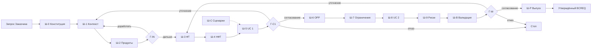

# RFC: Поток BCREQ этапа 1 — процессы, стандарты, промпты и раздел «Процессы» (#427)

## Summary / BLUF

Предложение в одном абзаце. Сложносоставной процесс получения документа
BCREQ называем **потоком** (поток создания ценности, value stream) —
термин владельца подтверждён производственной и ИТ-практикой (ГОСТ Р
56020-2020, Lean Enterprise Institute, SAFe, Business Architecture
Guild) и принят владельцем. Цепочка элементов — та, что задана в
БА-модели: **Поток → Процесс (подпроцессы) → Операция → Артефакт**;
поток — процесс верхнего уровня, результат которого (утверждённый BCREQ)
получается циклом **девяти процессов**. Процесс описывает шаги и гейты;
на каждом шаге и гейте выполняются атомарные операции; стадии A-IN,
A-CORE, A-WORK, A-RELEASE — состояния артефакта, а не уровни. Тип
операции задаётся контрактом (это «класс промпта» #403), промпт —
исполнимая форма операций шага. Каждый процесс взят из уже существующих
источников — процесса v0.1, каталога 39 операций и мета-модели БА — и
ничего не придумывает. На этапе 1 БА
работает **по 11 шагам маршрута v0.1 и шагу Ш-С**: промпт — исполняемый
текст шага, который собирается из **стандартов** (один базовый стандарт
ручного промпта, восемь профилей по типу действия) и **контрактов
операций** (39 сигнатур каталога). Слово для того, что копирует БА, —
«промпт»; «контракт» остаётся за входом и выходом операции и за
контрактами состояния и гейтов. Стандарты и промпты вводятся «по тесту»
— до приёмки, с проверкой прогонами; цепочка приёмки восстанавливается
задним числом через ADR (техдолг S-009). Промпты ссылаются на
mango-ba-ai-runtime только по перечню исключений этого RFC и только по
закреплённому коммиту; чего в runtime нет — заглушка и задача. Слово
«операция» в моделях проекта означает три уровня (13 типов работы, 39
контрактов, 31 атомарная операция runtime) — это техдолг S-010, его
разбирает BL-125 после этапа 1, не сейчас. Раздел
сайта «Процессы» возвращает форму до 2.0.0: шаги по порядку, кнопка
копирования, «зачем шаг» и «что дальше» (продолжить, вернуться,
диалог с моделью), — не заменяя сайт 2.0.0. Реализация — Спринт 9
бэклога: **6 шагов, 11 задач**; техдолг S-010 — задача BL-125 Спринта 6.
Редакция 0.2 учитывает ревью владельца PR #428. Этот PR меняет только документы
согласования: RFC, бэклог, реестр RFC.

## Навигация и обязательные результаты

| Ожидание issue #427 | Где в RFC | Результат этого PR | Реализация |
| --- | --- | --- | --- |
| Полная постановка по стандарту задачи | [1](#1-постановка-задачи) | Переформулировка | — |
| SSOT | [2](#2-ssot-и-источники) | Перечень и правило приоритета | — |
| Термин «Поток»: сверить и согласовать или отклонить | [3](#3-термин-поток-сверка-с-практикой) | Согласовано: поток создания ценности | [BL-150](#шаги-реализации-и-число-задач) |
| Процессы не противоречат мета-модели БА | [4](#4-цепочка-поток--процесс--операция--артефакт-и-совместимость-с-мета-моделью-ба) | Цепочка из четырёх элементов; шаг и гейт — элементы процесса; мета-модель не меняется | BL-150 |
| Операция: промпт, контракт или класс — определить точно (ревью PR #428) | [4.3](#43-операция-точное-определение) | Тип операции = контракт; промпт — исполнимая форма | BL-150 |
| Таксономия операций («Нормализация» — процесс?) (ревью PR #428) | [4.4](#44-уровни-таксономии-операций-техдолг-s-010) | Три уровня слова «операция»; исправлять позже | BL-125, S-010 |
| Процессы потока BCREQ — только актуализация | [5](#5-процессы-потока-bcreq) | Девять процессов с источником каждого | BL-150, BL-230 |
| Промпт или контракт: как называть | [6](#6-промпт-контракт-стандарт) | «Промпт»; «контракт» — сигнатура | BL-150 |
| Полный набор стандартов по SSOT | [7](#7-полный-набор-стандартов) | 1 базовый + 8 профилей + каталог сигнатур | BL-151, BL-152, BL-153 |
| Стандарты «по тесту» и техдолг ADR | [7.3](#73-режим-по-тесту), [7.4](#74-технический-долг-обратное-согласование-через-adr) | Режим определён, S-009 записан | BL-158 |
| Исключения: ссылки на runtime, требования | [8](#8-исключения-ссылки-промптов-на-mango-ba-ai-runtime) | Перечень, требования, заглушки | BL-154, BL-155 |
| Промпты по процессам из стандартов | [9](#9-полный-набор-промптов-по-процессам) | 12 шагов, 11 файлов, у каждого состав | BL-156, BL-157 |
| Сайт: «Процессы» в форме до 2.0.0 | [10](#10-раздел-процессы-сайта) | Спецификация формы и проверок | BL-230, BL-231 |
| RFC с шагами и числом задач | [12](#шаги-реализации-и-число-задач) | 6 шагов, 11 задач | Спринт 9 |
| Спринт в бэклоге | [12](#шаги-реализации-и-число-задач) | Спринт 9 в `pr-ops/BACKLOG.md` | — |

## 1. Постановка задачи

Переформулировка issue #427 по
[стандарту постановки задачи](../task-for-konard-template.md).

### Контекст задачи

Этап 1 проекта — ручные прогоны BCREQ: БА копирует промпт в чат модели и
ведёт документ шаг за шагом ([дорожная карта](../roadmap.md)). Задача
[#403](https://github.com/G-Ivan-A/mango_ba_prompts/issues/403) разложила
14 промптов на 39 операций (C01…C39), каждую оформила стандартом.
PR [#424](https://github.com/G-Ivan-A/mango_ba_prompts/pull/424) перевёл
раздел сайта «Процессы» на 39 классов и отправил 14 промптов в архив.
Проверка [#425](../analysis/2026-11-02-bcreq-prompts-classes-standards-check.md)
(SSOT этого RFC) показала: классы — хорошие контракты шагов, но не
проверены прогонами, а 39 стандартов на 74% повторяют друг друга.

### Решаемая проблема

У владельца нет набора промптов, с которым можно идти в следующие
прогоны на новых задачах и по их итогам подтвердить или поправить
промпты. Сейчас:

- промпт, класс и стандарт — один файл (П-02 SSOT), поэтому промпт нечем
  проверить «по стандарту»;
- на сайте БА идёт по непроверенным классам, ручная вставка выросла в
  3,6–8,2 раза (П-04, П-07 SSOT);
- нет общего имени для сложного процесса «от запроса до выпущенного
  BCREQ» и не определено, как поток ложится на цепочку БА-модели
  «процесс → операция → артефакт» и чем операция отличается от промпта;
- нет правил, когда промпт ссылается на справочник runtime вместо того,
  чтобы раздуваться.

### Story

**Как есть.** БА открывает «Процессы», видит 39 классов и 93 вызова,
копирует стандарт класса как промпт; порядок шагов и «что делать после
шага» читаются из таблиц, но выбора «продолжить / вернуться / спросить
модель» на шаге нет. Набор промптов для прогонов на новых задачах не
определён.

**Как должно быть.** Владелец принимает RFC; по Спринту 9 исполнитель
выпускает стандарты и промпты «по тесту», раздел «Процессы» показывает
поток BCREQ шаг за шагом в форме до 2.0.0, а владелец запускает прогоны
на новых задачах и по ним правит промпты.

### ФТ

- [x] Термин «Поток» сверен с практикой; вердикт и определение — раздел 3.
- [x] Цепочка «Поток — Процесс — Операция — Артефакт», определение
  операции, уровни таксономии операций и соответствие мета-модели БА —
  раздел 4.
- [x] Процессы потока BCREQ с источником каждого — раздел 5.
- [x] Словарь «промпт / контракт / стандарт» и вердикт по названию — раздел 6.
- [x] Полный набор стандартов по рекомендациям SSOT — раздел 7.
- [x] Режим «по тесту» и техдолг обратного согласования через ADR —
  разделы 7.3, 7.4; строка S-009 бэклога.
- [x] Исключения со ссылками на runtime, обоснование и требования —
  раздел 8.
- [x] Промпты по процессам: состав, стандарты, ссылки, заглушки — раздел 9.
- [x] Спецификация раздела «Процессы» сайта — раздел 10.
- [x] Решения на согласование DEC-427-01…13 — раздел 11.
- [x] Шаги с числом задач и Спринт 9 бэклога — раздел 12.
- [ ] Стандарты, промпты и сайт изменены — **не в этом PR**: Спринт 9
  после решения владельца (см. «Обоснованные обходы»).

### НФТ

- Только актуализация: у каждого процесса, шага и стандарта есть
  источник в репозитории, runtime или SSOT; новое — только с
  обоснованием в этом RFC.
- Мета-модель БА не меняется ([бэклог, раздел 3](../../pr-ops/BACKLOG.md#3-мета-модель-ба-хаба-на-этом-шаге)).
- Ссылки на runtime — по закреплённому коммиту, не по `main`.
- Бэклог проходит `scripts/validate_issue_418_backlog.py`; реестр RFC и
  CHANGELOG обновлены.

### Цель

DoD issue: «получен RFC на изменения; получен спринт в бэклоге (если вы
как исполнитель согласен с такой реализацией)». Исполнитель согласен:
RFC — этот файл, спринт — Спринт 9 в `pr-ops/BACKLOG.md`.

### Operating Mode

Creative (так задано в issue). Исполнитель определяет SSOT и инициирует
задачи; качество важнее токенов.

### Специфика работы

Язык документов — русский. Исполнитель не правит нормы до решения
владельца: RFC → решение → задачи спринта
([процесс RFC](rfc-process.md)). Сайт — только после принятия решения
и отдельными задачами (Р-09 бэклога).

### Обоснованные обходы

| Правило | Обход | Почему | Где проверить |
| --- | --- | --- | --- |
| Ожидания issue «сформированы по тесту все стандарты», «сформированы … все промпты», «внесен ыизменения на сайт проекта» | В этом PR не выполняются; переведены в задачи Спринта 9 | DoD issue требует RFC и спринт; issue прямо разрешает: «можете дооплнить РФС (разрешаю) созданием отдельного спринта в Бэклоге». Правка норм и сайта до решения нарушила бы процесс RFC и DEC-11 RFC модернизации — ту же ошибку, что SSOT нашёл в PR #424 (П-04) | Раздел 12; Спринт 9 бэклога |
| Цепочка приёмки стандартов «RFC → ADR → стандарт» | Стандарты Спринта 9 вводятся «по тесту» до ADR | Так требует issue; долг записан как S-009 и задача BL-158 | Раздел 7.4 |
| Правило #403 «Количество выявленных классов промптов строго равно количеству разрабатываемых стандартов» | Стандартов 9, операций 39 | SSOT, REC-425-02 и REC-425-03; 39 операций и их контракты сохраняются без слияния | Раздел 7.5 |

## 2. SSOT и источники

| Приоритет | Источник | Что берём |
| --- | --- | --- |
| 1 | [Issue #427](https://github.com/G-Ivan-A/mango_ba_prompts/issues/427) | Ожидания владельца, DoD |
| 2 | [Проверка #425](../analysis/2026-11-02-bcreq-prompts-classes-standards-check.md) (SSOT, назван в issue) | Вариант C + D, архетипы, словарь, REC-425-01…09 |
| 3 | [Процесс BCREQ v0.1](https://github.com/G-Ivan-A/mango_ba_prompts/blob/a7fbf928%5E/docs/ba-processes/bcreq-manual-process.md) (до PR #424) и [текущий v0.2](../ba-processes/bcreq-manual-process.md) | Шаги Ш-0…Ш-В, Ш-С, согласование, возвраты; порядок операций по стадиям |
| 4 | [Каталог 39 операций](../../standards/bcreq-manual-classes/catalog.json), [ADR-015](../adr/2026-10-adr-015-bcreq-manual-classes.md), [RFC ручного конвейера](2026-10-bcreq-manual-pipeline.md) | Контракты операций, связь «операция → промпт v0.1» (поле `existing`) |
| 5 | [Контракт стадий и гейтов](../contracts/bcreq-stage-gates.md), [контракт состояния](../contracts/bcreq-manual-state.md) | Стадии, гейты, перенос состояния |
| 6 | Мета-модель БА в составе [mango-ba-ai-runtime @ `5d8c201`](https://github.com/G-Ivan-A/mango-ba-ai-runtime/tree/5d8c201511fd730a596c9f9b4588470a7b01edc9): `taxonomy/processes.yaml`, `taxonomy/operations.yaml`, `routes/rg-bcreq-v1.yaml`, `templates/bcreq-skeleton.md` | Уровни L0–L3, процессы P-01…P-10, граф маршрута, слоты A-BCREQ |
| 7 | [База знаний runtime](https://github.com/G-Ivan-A/mango-ba-ai-runtime/tree/5d8c201511fd730a596c9f9b4588470a7b01edc9/docs/kb) | Источник фактов о продуктах |
| 8 | [Бэклог](../../pr-ops/BACKLOG.md), [реестр RFC](rfc-register.md) | Решения Р-01…Р-12, задачи BL-109, BL-110, BL-114, BL-134 |
| 9 | Внешняя практика (раздел 3) | Термин «поток» |

Правило конфликта: ожидание владельца в issue → SSOT → репозиторий →
runtime → внешняя практика. Срез: `main` на 2026-11-02 (коммит
`1bd48293`), runtime — коммит `5d8c201511fd730a596c9f9b4588470a7b01edc9`
от 2026-11-01.

## 3. Термин «Поток»: сверка с практикой

### 3.1. Утверждения владельца и проверка

| № | Утверждение владельца | Вердикт | Доказательство |
| --- | --- | --- | --- |
| У-1 | «Поток» — по аналогии с производственным анализом | Подтверждено | ГОСТ Р 56020-2020, п. 4.1.10: «поток создания ценности; ПСЦ (value stream)» — «Все действия, как создающие, так и не создающие ценность, которые позволяют продукции пройти все процессы от разработки концепции до запуска в производство и от принятия заказа до доставки потребителю» ([текст стандарта](https://meganorm.ru/mega_doc/norm/gost-r_gosudarstvennyj-standart/11/gost_r_56020-2020_natsionalnyy_standart_rossiyskoy.html)) |
| У-2 | Поток отделяет набор процессов для получения определённого сложносоставного продукта | Подтверждено | Lean Enterprise Institute: value stream — «All of the actions … required to bring a product from concept to launch … and from order to delivery», включая «actions to process information from the customer» ([LEI, Value Stream](https://www.lean.org/lexicon-terms/value-stream/)); построение карты потока начинается с «Select a product family» ([LEI, Value-Stream Mapping](https://www.lean.org/lexicon-terms/value-stream-mapping/)) |
| У-3 | Термин применим в ИТ-анализе | Подтверждено | SAFe: «An Operational Value Stream (OVS) is the sequence of activities needed to deliver a product or service to a customer» ([SAFe, OVS](https://framework.scaledagile.com/operational-value-streams)); Business Architecture Guild: «process activities or subprocesses implement a value stream stage» ([BPM paper, 2019](https://cdn.ymaws.com/www.businessarchitectureguild.org/resource/resmgr/public_resources/bpm_paper_final_dec2019.pdf)) |
| У-4 | «Поток BCREQ» — словосочетание по смыслу, а не жёсткая последовательность | Подтверждено с уточнением | Guild: «A single value stage may map to one or more business processes» ([Dugan, McWhorter, 2014](https://cdn.ymaws.com/www.businessarchitectureguild.org/resource/resmgr/docs/batobpmalignmentpositionpape.pdf)). Порядок задан шагами и гейтами процессов, внутри процесса возможны возвраты и петли |

### 3.2. Вердикт исполнителя и решение владельца

**Термин согласован**: «поток» — поток создания ценности (value
stream). Решение владельца по ревью PR #428: определение принято,
пятиуровневая иерархия редакции 0.1 («поток → этап с гейтом → процесс →
шаг → операция») **отклонена**. Цепочка элементов остаётся той, что
задана в БА-модели: **Поток → Процесс → Операция → Артефакт** (раздел 4).

Уточнения, которые остаются в силе:

1. **От запроса до ценности.** Поток начинается с запроса Заказчика и
   кончается переданным принятым результатом (утверждённый BCREQ), а не
   внутренней вехой.
2. **Поток — верхнеуровневый процесс.** По ADR-003 процесс
   декомпозируется в подпроцессы. Поток — процесс верхнего уровня,
   результирующий артефакт которого получается запуском цикла процессов
   и подпроцессов; от любого другого процесса его отличает граница
   ценности: на выходе — продукт для Заказчика.
3. **Один поток — один тип продукта.** Поток BCREQ — для документа
   BCREQ. Другие документы (ТЗ, отчёт о тендере) — свои потоки.
4. **Не уровень классификации.** Поток — не категория и не группа
   процессов APQC PCF (там уровни «Level 2—Process group», «Level
   3—Process» — узлы дерева, а не цепочка,
   [APQC PCF](https://www.apqc.org/sites/default/files/files/PCF%20Collateral/Understanding%20the%20PCF%20Elements%20%20-%20FINAL.pdf)),
   и не цепочка таксономии продукта Domain → Capability → Feature →
   Atomic function: та классифицирует продукт, а не работу над
   документом.

Снято по решению владельца: уточнение редакции 0.1 «Этап ≠ процесс»
(этап как отдельный уровень между потоком и процессом). Стадии A-IN,
A-CORE, A-WORK, A-RELEASE остаются, но как состояния артефакта, а гейты —
как элементы описания процесса (раздел 4.2).

Отклонённые варианты: «сквозной процесс» — нормативного определения не
найдено, и он не отделяет процесс с границей ценности от остальных;
«цепочка» — путается с цепочкой ценности (value chain); «конвейер»
(pipeline) — в репозитории уже означает автоматизированный конвейер
П1–П6 и CI. Риск путаницы с «потоком выполнения» (thread), Kanban flow и
«потоком n8n» (workflow n8n в дорожной карте и ADR-017) снимается
расшифровкой при первом упоминании и риском Р-5.

### 3.3. Определение

> **Поток** (поток создания ценности, value stream; ср. ГОСТ Р 56020-2020,
> п. 4.1.10) — процесс верхнего уровня, который проводит один
> сложносоставной продукт определённого типа (например, документ BCREQ)
> от запроса Заказчика до передачи ему принятого результата. Результат
> потока получается запуском цикла процессов и подпроцессов; на шагах и
> гейтах процессов выполняются атомарные операции, которые потребляют и
> производят артефакты.

**Поток BCREQ** — поток для документа «спецификация бизнес-требований и
дизайна решения»: от сырого запроса в Jira до утверждённого и
зафиксированного BCREQ. Если в тексте нужно слово без нового термина,
допустимо «процесс BCREQ (верхнего уровня)» — это синоним.

Ограничение проверки: определения BIZBOK и ITIL 4 в первоисточнике не
открыты (доступ платный или страница не отображается); вердикт на них
не опирается.

## 4. Цепочка «Поток — Процесс — Операция — Артефакт» и совместимость с мета-моделью БА

### 4.1. Четыре элемента

Цепочка — та, что владелец задал для БА-модели. Производственный аналог —
«поток — процесс — операция — продукт»: у С. Синго производство — «a
network of operations and processes, with one or more operations
corresponding to each step in the process»; процесс — поток продукта,
операция — работа, которая «is performed in one spot and involves
actually shaping the product» ([Shingo Institute, 2021](https://shingo.org/focus-on-the-process-before-focusing-on-the-operations/),
вторичный источник по «A Study of the Toyota Production System», 1989).
В БА-модели продукт — артефакт.

| № | Элемент | Определение | Пример в потоке BCREQ | Чем задан |
| --- | --- | --- | --- | --- |
| 1 | Поток | Процесс верхнего уровня с границей ценности (раздел 3.3) | Поток BCREQ | Этот RFC; ADR-003 «Процесс» |
| 2 | Процесс (подпроцесс) | Повторяемый сценарий, который описывает шаги и гейты; декомпозируется в подпроцессы любой глубины | ПБ-3 «Формирование требований»; подпроцесс гейта Г-С1 | [ADR-003](../adr/003-ba-ontology.md), ребро «декомпозируется в»; раздел 5 |
| 3 | Операция | Атомарное действие, которое выполняется на шаге или гейте процесса; задаётся контрактом (раздел 4.3) | C16 «ФТ изменения существующего поведения» на шаге Ш-3 | ADR-003, ребро «применяет»; `catalog.json` |
| 4 | Артефакт | Информационный объект, который операция потребляет или производит; имеет состояние | раздел 3 BCREQ; документ в состоянии A-CORE | ADR-003, рёбра «потребляет», «производит», «имеет состояние» |

Цепочка совпадает с runtime: L2-процесс (`P-01`) → L3-навык,
«навык (подпроцесс)» (`SK-transcript-normalization`) → операции
закрытого словаря (`normalize-text`, `deduplicate-items`,
`check-schema`) — [`taxonomy/processes.yaml`](https://github.com/G-Ivan-A/mango-ba-ai-runtime/blob/5d8c201511fd730a596c9f9b4588470a7b01edc9/taxonomy/processes.yaml).

### 4.2. Шаг, гейт и стадия — не уровни

Решение владельца: «Процесс описывает шаги и гейты, где на каждом шаге и
гейте выполняются атомарные операции». Поэтому шаг, гейт и стадия —
элементы описания процесса или артефакта, а не звенья цепочки.

| Понятие | Чем является | В потоке BCREQ | Источник |
| --- | --- | --- | --- |
| Шаг | Место в последовательности процесса, где выполняется одна или несколько операций. В ручном режиме — один вызов промпта | Ш-0…Ш-Р, Ш-С (раздел 5.4) | ADR-003: подпроцесс — «Шаг процесса: одна строка в детальной карте процесса»; runtime: `operations` навыка — «последовательность шагов навыка» |
| Гейт | Точка решения человека в процессе. Исполняется как подпроцесс или как процесс — в зависимости от архитектуры запуска родительского процесса: операции «собрать доказательства» (C20) → решение человека → «записать решение» (C34) | Г-IN закрывает ПБ-1, Г-С1 — ПБ-3, Г-W — ПБ-5, выпуск — ПБ-7 | ADR-003: «Контрольная точка (Gate)»; [контракт гейтов](../contracts/bcreq-stage-gates.md) |
| Стадия (A-IN, A-CORE, A-WORK, A-RELEASE) | Состояние артефакта BCREQ, которое фиксирует пройденный гейт | A-IN после Г-IN, A-CORE после Г-С1 и т. д. | ADR-003: артефакт «имеет состояние»; runtime: A-IN, A-CORE, A-BCREQ |

В ручном режиме этапа 1 гейт — подпроцесс процесса, который он
закрывает: БА в том же маршруте собирает доказательства и записывает
решение. На этапе 3 (n8n) гейт может стать отдельным процессом: поток
ждёт решения человека во внешнем интерфейсе. Модель от этого не меняется.

«Этап 1…4» в дорожной карте — этап проекта; слово «этап» для
стадий потока в текстах Спринта 9 не используется.

### 4.3. Операция: точное определение

> **Операция** — атомарное действие процесса: одно преобразование
> входных артефактов в один выходной артефакт, вердикт или запись,
> заданное контрактом (вход, выход, поведение, стоп-кран, проверки).
> Атомарна, потому что дальнейшее деление не даёт проверяемого
> промежуточного артефакта.

Ответ на вопрос владельца «операция — промпт, контракт или класс
промпта»: **тип операции задаётся её контрактом; это и есть «класс
промпта» из #403; промпт — исполнимая форма операций шага для модели.**

| Понятие | Что это | Пример | Где лежит |
| --- | --- | --- | --- |
| Тип операции (класс, контракт) | Операция как понятие: сигнатура вход → выход, стоп-кран, проверки | C16 | `catalog.json` (39 записей C01…C39) |
| Экземпляр операции | Тип, применённый на конкретном шаге или гейте процесса | C16 на шаге Ш-3; C04 в A-RELEASE | таблица шагов процесса (раздел 5.4); «Экземпляр» в README каталога |
| Исполнение | Кто и как выполнил экземпляр: промпт и модель, человек, скрипт | Промпт Ш-3 в чате; решение Заказчика на Г-С1 | `prompts/`, `runs/` |

Почему промпт ≠ операция:

1. Один промпт шага исполняет несколько операций: промпт Ш-1 — C02, C03,
   C04, C14, C15 (раздел 9.2).
2. Одна операция исполняется разными исполнителями: ADR-003, ребро
   «выполняется» — «одна операция — разные исполнители в разных
   режимах». Решение гейта — операция человека, промпта у неё нет.
3. ADR-003 уже разводит слои: «паттерн `реализует` операцию; промпт
   `исполняет` паттерн».

Поэтому «контракт операции» в разделе 6 — тип операции, а «промпт» —
текст для модели, собранный из стандартов и контрактов операций шага.

### 4.4. Уровни таксономии операций: техдолг S-010

Вопрос владельца: операция типа «Нормализация» больше похожа на процесс.
Проверка по источникам подтверждает: слово «операция» в моделях проекта
означает три разных уровня.

| Уровень | Что называется операцией | «Нормализация» на этом уровне | Источник |
| --- | --- | --- | --- |
| Тип когнитивной работы | 13 операций таксономии | `ingestion` «Приём данных»: «Нормализация формы без интерпретации смысла» | [`docs/taxonomy.md`](../taxonomy.md), [ADR-003](../adr/003-ba-ontology.md) §4 |
| Контракт ручного вызова | 39 классов C01…C39 | C02 «Атомарная нормализация» | `catalog.json` |
| Атомарная машинная операция | 31 операция `OP-*` в 5 классах | `OP-TRN-01 normalize-text`; нормализация целиком — навык (подпроцесс) `SK-transcript-normalization` из трёх операций | runtime `taxonomy/operations.yaml`, `taxonomy/processes.yaml` |

Вывод исполнителя: интуиция владельца верна — нормализация расшифровки
целиком является подпроцессом, атомарна только `normalize-text`. 13
«операций» ADR-003 — типы когнитивной работы (категории), классы C
близки по зерну к L3-навыкам runtime (C02 ↔ `SK-transcript-normalization`,
C03 ↔ `SK-ambiguity-detection`, C04 ↔ `SK-question-formation`).

**Исправлять сейчас нецелесообразно.** Цель этапа — набор промптов и
процессов; переименование 13 операций меняет ADR-003, ADR-004, теги
промптов, сайт и прогоны и не даёт ни одного промпта. Для промптов
этапа 1 достаточно определения раздела 4.3: операция — тип из
`catalog.json`. **Исправлять позже целесообразно**: этот спор возник из
одного слова на трёх уровнях и повторится при переходе на этап 2.
Записано как техдолг S-010 и задача
[BL-125](../../pr-ops/backlog-ba-model.md#bl-125-уровни-таксономии-операций-тип-работы-контракт-атомарная-операция)
после сверки BL-121 (решение DEC-427-13).

### 4.5. Соответствие мета-модели runtime

Мета-модель runtime (`taxonomy/processes.yaml`, версия 1.0, закрытый
словарь) имеет уровни: L0 — области знаний BABOK, L1 — семейства
преобразований, L2 — процессы Манго КК («единица маршрута»), L3 — навыки
(подпроцессы). Маршрут — граф `RG-BCREQ-v1`: «Граф описывает ВСЕ
допустимые пути; прогон — одна траектория по нему».

| Элемент RFC | Мета-модель | Совместимость |
| --- | --- | --- |
| Поток | Граф маршрута (`route_graph_id`), A-IN → A-CORE → A-BCREQ | Совместимо: поток — имя процесса верхнего уровня, который проходит граф маршрута для документа. Новый элемент мета-модели не нужен |
| Процесс (подпроцесс) | L2 P-01…P-10; L3-навыки — подпроцессы | Совместимо: каждый процесс раздела 5 сопоставлен L2 или помечен «поддерживающий» |
| Шаг (элемент процесса) | Узел маршрута; шаг навыка | Совместимо: шаг ручного режима — узел с `actor: human` + модель в чате |
| Гейт (элемент процесса) | Гейты G-self, G-mach, G-human | Совместимо: гейты процессов потока — человеческие (G-human) |
| Операция C01…C39 | L3-навыки и операции `OP-*` | Совместимо на уровне назначения; ID и зерно разные (раздел 4.4). Сверка C ↔ OP — в BL-121 (после этапа 1), уровни — BL-125 |
| Артефакт и стадия | Классы A-IN, A-CORE, A-BCREQ и их состояния | Совместимо: A-WORK и A-RELEASE — локальные состояния A-BCREQ процесса #388 (`in-review` → `approved`) |

**Вывод: мета-модель не меняется.** «Поток» — локальное имя процесса
верхнего уровня в глоссарии репозитория. Если владелец решит передать
термин в Хаб, это делает BL-122 по решению Р-12, а не этот RFC.

Расхождение, которое фиксируется, но не блокирует: в runtime только
процессы P-01, P-02, P-03 имеют `in_slice: true`; ручной поток BCREQ
использует ещё P-06, P-07, P-09, P-10 руками БА. Для ручного режима это
допустимо по правилу графа: узел без скомпилированного навыка обязан
нести `actor: human`.

## 5. Процессы потока BCREQ

### 5.1. Принцип

Новых процессов нет. Каждый процесс собран из трёх уже существующих
источников: шагов процесса v0.1 (Ш-0…Ш-В, Ш-С), операций каталога
C01…C39 (поле `phases`) и процессов L2 мета-модели. Процесс без
источника в двух из трёх — не включается.

### 5.2. Стадии артефакта и гейты процессов

Стадия — состояние артефакта BCREQ (раздел 4.2), а не уровень цепочки.
Гейт — элемент процесса, который закрывает стадию.

| Стадия артефакта | Цель (из процесса v0.1, раздел 2.1) | Гейт | Процесс гейта | Кто решает |
| --- | --- | --- | --- | --- |
| A-IN | подготовить данные для ФТ | Г-IN | ПБ-1 | БА |
| A-CORE | согласовать ФТ с Заказчиком до технической спецификации | Г-С1 «Согласование 1» | ПБ-3 | Заказчик |
| A-WORK | подготовить решение и итоговую оценку | Г-W | ПБ-5 | ПО продукта, архитектор продукта, руководитель КК |
| A-RELEASE | утверждение и baselining документа | выпуск | ПБ-7 | по процессу A-RELEASE |

### 5.3. Процессы

| ID | Процесс | Стадии артефакта | Мета-модель (L2) | Шаги v0.1 | Операции | Гейт / выход |
| --- | --- | --- | --- | --- | --- | --- |
| ПБ-0 | Подготовка прогона: правила, каркас, состояние | старт каждой стадии | поддерживающий: правила исполнения (`AGENTS.md` runtime) | Ш-0 | C36 | каркас, «Состояние BCREQ» |
| ПБ-1 | Приём и понимание запроса | A-IN; повтор в A-CORE, A-WORK | P-01 обработка сессии выявления | Ш-1, Ш-2 | C01, C02, C03, C05, C06, C07, C08, C09, C11, C14, C15 | Г-IN |
| ПБ-2 | Управление уточнениями | A-IN, A-CORE, A-WORK, A-RELEASE | P-02 управление уточнениями | на каждом шаге: реестр 8.4, правило П-6 v0.1 | C04, C10 | ответы Заказчика в 8.4 |
| ПБ-3 | Формирование требований | A-CORE; повтор в A-WORK | P-03 формирование BCREQ (S-FR, S-NFR), P-06 сценарное моделирование | Ш-3, Ш-4, Ш-5 | C16, C17, C18, C19 | Г-С1 |
| ПБ-4 | Дизайн решения, ограничения, риски | A-WORK | P-03 (S-SOLUTION, S-LIMITS, S-AC), P-06 | Ш-6, Ш-7, Ш-8, Ш-9 | C21, C22, C23, C24, C25, C26, C27 | пакет Г-W |
| ПБ-5 | Верификация второй ролью | A-CORE, A-WORK, A-RELEASE | P-07 верификация требований | Ш-В | C28 | Г-W |
| ПБ-6 | Ведение изменений: возвраты и адресные правки | любая стадия по исходу «уточнение» | P-09 оценка влияния изменения | таблица возвратов 2.2 v0.1 | C29, C30, C31 | раздел 8.5 |
| ПБ-7 | Выпуск и передача | A-RELEASE | P-10 ведение жизненного цикла (baseline) | этап 5 v0.1 «по процессу A-RELEASE» | C32, C33, C35 | утверждённый BCREQ |
| ПБ-С | Сценарии по запросу БА (вне последовательности) | любой | P-06 сценарное моделирование | Ш-С | C37, C38 | US или UC |

Операции гейта (выполняются в подпроцессе гейта того процесса, который
закрывает стадию, поэтому в столбце «Операции» не повторяются): C12
сборка фазы, C13 проверка переносимого контекста, C20 доказательства
гейта, C34 регистрация решений, C39 сверка с манифестом. Все 39 операций
распределены: 34 на шагах процессов, 5 на гейтах.
Процессы мета-модели P-04, P-05, P-08 к потоку BCREQ этапа 1 не
относятся (ТЗ, детализация ФТ, тендер — другие потоки).

### 5.4. Последовательность шагов этапа 1

Это содержание таблицы «Шаги» процесса v0.3 для сайта (задача BL-230).
Колонки v0.1 сохранены, добавлены «Зачем шаг» и «Варианты дальше».

| № | Шаг | Процесс | Стадия | Промпт | Зачем шаг | Результат | Гейт после шага | Варианты дальше |
| --- | --- | --- | --- | --- | --- | --- | --- | --- |
| 1 | Ш-0 Конституция | ПБ-0 | старт | bcreq-constitution-governance-oneshot | задать правила, параметры и каркас из 8 разделов до первого раздела | каркас, «Состояние BCREQ» | — | продолжить → Ш-1 |
| 2 | Ш-1 Контекст и глоссарий | ПБ-1 | A-IN | bcreq-context-understanding-stepwise | понять запрос и термины до продуктов и требований | разделы 1, 2 | — | продолжить → Ш-2; диалог: ответить на вопросы 8.4 в том же чате |
| 3 | Ш-2 Продукты и стейкхолдеры | ПБ-1 | A-IN | bcreq-products-impact-analysis-stepwise | привязать запрос к продуктам и командам, доказать по базе знаний | ＋2.5, вопросы 8.4 | Г-IN (БА) | продолжить → Ш-3; вернуться → Ш-1 |
| 4 | Ш-3 ФТ | ПБ-3 | A-CORE | bcreq-fr-documentation-stepwise | записать ФТ как дельту к продукту | раздел 3 | — | продолжить → Ш-4; вернуться → Ш-1 или Ш-2 |
| 5 | Ш-4 НФТ | ПБ-3 | A-CORE | bcreq-nfr-documentation-stepwise | только НФТ из входа, с метрикой | раздел 4 | — | продолжить → Ш-5 |
| 6 | Ш-5 UC, прогон 1 | ПБ-3 | A-CORE | bcreq-uc-modeling-stepwise (`прогон: 1`) | покрыть ФТ сценариями 100% до согласования | раздел 7 (прогон 1) | Г-С1 (Заказчик) | согласование → Ш-6; уточнение → Ш-1…Ш-5 по таблице возвратов; отказ → стоп |
| 7 | Ш-6 ОРР | ПБ-4 | A-WORK | bcreq-orr-solution-design-stepwise | описать решение L1 и при необходимости L2 | раздел 5 | — | продолжить → Ш-7 |
| 8 | Ш-7 Ограничения | ПБ-4 | A-WORK | bcreq-constraints-documentation-stepwise | ограничения с источником | раздел 6 | — | продолжить → Ш-8; вернуться → Ш-3, если ограничение ломает ФТ |
| 9 | Ш-8 UC, прогон 2 | ПБ-4 | A-WORK | bcreq-uc-modeling-stepwise (`прогон: 2`) | граничные кейсы, ошибки, UI | раздел 7 (прогон 2) | — | продолжить → Ш-9 |
| 10 | Ш-9 Риски и приёмка | ПБ-4 | A-WORK | bcreq-extra-risk-analysis-stepwise | риски с владельцем, план приёмки | раздел 8 | — | продолжить → Ш-В |
| 11 | Ш-В Валидация второй ролью | ПБ-5 | A-WORK | bcreq-review-validation-oneshot | автор не проверяет сам себя: новый чат без истории | замечания, отчёт Г-W | Г-W (ПО, архитектор, руководитель КК) | согласование → выпуск; уточнение → Ш-1…Ш-9 по таблице возвратов |
| 12 | Ш-Р Выпуск | ПБ-7 | A-RELEASE | заглушка: пилот операций C32, C33, C35 | утвердить и зафиксировать baseline | утверждённый BCREQ | выпуск | — |
| — | Ш-С Сценарии по запросу | ПБ-С | вне последовательности | bcreq-scenarios-modeling-oneshot | US или UC без документа BCREQ | US или UC | — | вернуться в поток к текущему шагу |

Ш-Р — единственный новый номер шага: в v0.1 выпуск был этапом
согласования 5 без промпта. Промпта выпуска с проверкой нет — на сайте
шаг показывается как заглушка с меткой «пилот» (раздел 9.3).

### 5.5. Три варианта на каждом шаге

| Вариант | Когда | Что делает БА | Источник |
| --- | --- | --- | --- |
| Продолжить | Результат шага принят, гейт (если есть) пройден | Переносит раздел в документ (П-7 v0.1), копирует следующий промпт | v0.1, П-4, П-7 |
| Вернуться | Исход «уточнение» гейта или ошибка в разделе раньше | Идёт к шагу-точке входа по таблице возвратов; разделы после неё помечает `устарело`; пишет возврат в 8.5 | v0.1, раздел 2.2; ПБ-6 |
| Диалог с моделью | Вопрос 8.4, `[ТРЕБУЕТСЯ УТОЧНЕНИЕ]`, непонятный вывод | Отвечает в том же чате или переносит вопрос Заказчику; модель ответы не придумывает | v0.1, П-6; ПБ-2 |

### 5.6. Схема



## 6. Промпт, контракт, стандарт

### 6.1. Вердикт по названию

**Для того, что БА копирует в чат, оставить слово «промпт».** Контракт
— часть промпта, а не его синоним.

Обоснование:

1. В репозитории и runtime «контракт» уже занят: `docs/contracts/`
   (состояние, гейты, цитаты KB) и `contracts/` runtime (c-in, c-core,
   c-out-bcreq) — это контракты входа и выхода артефакта, а не тексты
   для модели. Назвать промпт контрактом — третий смысл слова (риск Т-1
   SSOT).
2. DSPy называет контрактом сигнатуру — «the declarative contract
   between your program and the language model»; промпт пишется или
   генерируется под неё ([DSPy, Signatures](https://dspy.ai/diving-deeper/signatures-in-depth/)).
3. Каталог, стандарт промптов, сайт и прогоны (`runs/`) уже называют
   исполняемый текст промптом: переименование ломает ссылки и
   сопоставимость прогонов без пользы.

### 6.2. Словарь

| Термин | Значение | Где лежит | Кто проверяет |
| --- | --- | --- | --- |
| Стандарт | Обязательные правила для всех ручных промптов (базовый) или для типа действия (профиль) | `standards/` | ADR (задним числом, S-009) |
| Контракт операции (сигнатура) | Вход, выход, стоп-краны, проверки одной операции C01…C39 | `catalog.json` | Генератор, валидатор каталога |
| Контракт состояния, контракт гейтов | Перенос состояния между вызовами; критерии гейтов | `docs/contracts/` | Ревью, тесты |
| Промпт | Исполняемый текст шага: базовый стандарт + профиль + контракты операций шага + ссылки на справочники | `prompts/` | Golden set, прогоны |
| Шаг | Один вызов промпта в потоке (Ш-0…Ш-Р, Ш-С) | процесс BCREQ | БА |
| Справочник | Внешний к промпту артефакт, на который промпт ссылается | runtime | Требования раздела 8 |

Цепочка: **стандарт → (контракт операции) → промпт → шаг → прогон**.
Промпт ≠ стандарт: стандарт нормирует, промпт исполняется и проверяется
по стандарту и golden set.

## 7. Полный набор стандартов

### 7.1. Состав

По рекомендациям SSOT (REC-425-02, REC-425-03, REC-425-04) — вариант C.

| № | Стандарт | Статус сейчас | Что делаем | Задача |
| --- | --- | --- | --- | --- |
| 1 | Базовый стандарт ручного промпта BCREQ | нет | Новый «по тесту»: общая часть 39 стандартов классов (≈74% текста): контракт состояния, стоп-краны, receipt, человеческие гейты, порядок источников, правило ссылок на runtime (раздел 8) | BL-151 |
| 2–9 | Профили INGEST, EXTRACT, ANALYZE, ELICIT, GENERATE, VERIFY, TRANSFORM, RECORD | гипотеза `experiments/issue_425/archetypes.json` | Восемь профилей «по тесту» с MUST-правилами своего типа; профиль, у которого нет своих MUST-правил, сливается с соседним (триггер B, REC-425-04) | BL-152 |
| — | Каталог сигнатур операций | `catalog.json` v0.1, ID `C01…C39` | Остаётся контрактом; ID получают префикс `К-` (REC-425-07, снимает конфликт с кодами ошибок `C01…C25`); добавляется поле «шаг потока» | BL-153 |
| — | Мета-стандарты разделов `standards/bcreq-sections/` | draft | Без изменений: доменные правила разделов — часть профиля GENERATE по разделам | — |
| — | `standards/prompt-standard.md` | действует | Без изменений: общий стандарт промпта репозитория; базовый стандарт BCREQ — его профиль | — |
| — | 39 файлов `standards/bcreq-manual-classes/NN-*.md` | draft, на сайте как промпты | Пилот до сравнения BL-134; не удаляются. После BL-134 — генерируются из базового стандарта + профиля + сигнатуры или переходят в архив по решению владельца | BL-134 |

Итого стандартов в наборе: **9** (1 базовый + 8 профилей). Дальше число
растёт только по триггеру B.

### 7.2. Почему не 39 и не 1

- 39 — 74% повторов; правка общего правила — 39 файлов; промпт нечем
  проверить (SSOT, вариант A — «Нет»).
- 1 универсальный — смешение задач, отклонено ADR-015 и практикой
  цепочек промптов (SSOT, вариант B — «Нет»).
- 1 + 8 — соответствует DSPy, каталогу паттернов White et al. и ADR-006
  этого репозитория (базовый стандарт и профили).

### 7.3. Режим «по тесту»

Толкование исполнителя (issue не определяет термин): **«по тесту» —
пробная редакция до приёмки**. Стандарт или промпт вводится со статусом
`draft` и пометкой «по тесту» в заголовке; применяется в прогонах этапа 1;
приёмка — по результату прогонов и golden set, а не до них.

Правила режима:

1. В заголовке файла: «Редакция по тесту (#427): действует до ADR
   обратного согласования».
2. Каждое MUST-правило базового стандарта и профилей ссылается на
   источник: строку стандарта класса, урок `L-NN` или контракт.
   Правило без источника не вводится («запрещено придумывание»).
3. Промпт «по тесту» не заменяет промпт v0.1 в истории прогонов: в
   `runs/` пишется версия промпта и пометка «по тесту».
4. Golden set RUN-0079 (49/62 → 61/62) — нижняя граница: промпт «по
   тесту» хуже базовой линии на golden set не публикуется в `prompts/`
   и остаётся в `prompts/drafts/`.

### 7.4. Технический долг: обратное согласование через ADR

Режим «по тесту» меняет порядок «RFC → ADR → стандарт» на «RFC →
стандарт по тесту → прогоны → ADR». Это долг соответствия процессу
приёмки норм. Записывается в бэклог как **S-009** (раздел 6 бэклога) и
задача **BL-158**: один ADR (номер — следующий свободный; ADR-018
закреплён за уроками решением Р-11), который принимает базовый
стандарт и профили по итогам прогонов, с таблицей «правило → прогон →
результат» и решением по 39 файлам классов. Тот же приём описан
в S-006 бэклога: норма восстанавливается задним числом через анализ и
RFC.

### 7.5. Расхождение с #403 и обоснование

#403: «Количество выявленных классов промптов строго равно количеству
разрабатываемых стандартов» и «ЗАПРЕЩЕНО УПРОЩАТЬ, СОКРАЩАТЬ ИЛИ
ОБОБЩАТЬ». RFC это правило меняет, и это изменение — на решение
владельца (DEC-427-05):

- 39 операций, их входы, выходы, стоп-краны и проверки **сохраняются без
  слияния** — то, что #403 защищал, не сокращается;
- меняется только упаковка правил: общий текст выносится в базовый
  стандарт, специфика типа действия — в профиль, специфика операции —
  в сигнатуру;
- SSOT нашёл причину: в #403 «классификация (этап 3) и стандартизация
  (этап 4) склеены правилом «классов = стандартов»» (П-01).

## 8. Исключения: ссылки промптов на mango-ba-ai-runtime

### 8.1. Почему исключение

Правило по умолчанию: промпт самодостаточен — всё, что нужно модели,
внутри текста или во входе от БА. Исключение разрешил владелец для
этапа 1: «Где он раздувается - выделять чтение справочников в
mango-ba-ai-runtime» (риск 12 #420, задача BL-114). Issue #427
уточняет: «однозначно - к Базе знаний», возможно — таксономии, шаблоны,
golden set.

Критерии исключения (все три):

1. Справочник больше бюджета вставки (замер в токенах по REC-425-08) или
   меняется чаще промпта.
2. Справочник нужен модели как факт или образец, а не как правило
   (правила — в стандарте и промпте).
3. У справочника есть стабильный путь и версия в runtime.

### 8.2. Перечень

| № | Справочник | Путь в runtime | Есть в runtime | Решение | Обоснование |
| --- | --- | --- | --- | --- | --- |
| И-1 | База знаний продуктов | `docs/kb/MAP.json` → `docs/kb/maps/<id>.json` → `docs/kb/<slug>/sections/NN-*.md` | Да: 25 документов в `MAP.json`, 18 каталогов документов | **Ссылка обязательна** в Ш-1, Ш-2, Ш-3, Ш-6, Ш-7 | Issue: «однозначно»; объём KB несопоставим с промптом; `USAGE.md` описывает путь поиска |
| И-2 | Таксономия продуктов | `taxonomy/products.yaml` | Частично: 3 класса, уровни Domain → Capability → Feature → Atomic Function, значений ниже класса нет | Ссылка + **заглушка** «уровни ниже класса не заполнены» в Ш-2 | `c-in` требует `atomic_function`, а каталога функций нет |
| И-3 | Шаблон документа BCREQ | `templates/bcreq-skeleton.md` | Да: 14 слотов, формы F-SHORT, F-APPROVAL, F-CLASSIC, F-NARRATIVE | Ссылка в Ш-0 (каркас) и Ш-В (сверка слотов) | Скелет — образец формы, меняется отдельно от промптов |
| И-4 | Примеры разделов (ФТ, UC, US, НФТ, ОРР) | нет (`A-FR`, `A-UC`, `A-US` вне среза) | Нет | **Заглушка** + задача | Образцы улучшают форму вывода, но их нет |
| И-5 | Golden set по классу продуктовой таксономии | `golden/cases.yaml` | Частично: только contact-center, 6 синтетических кейсов, `structural_only` | Ссылка в Ш-В для contact-center; **заглушка** для voice-ucaas и analytics-reporting | Issue: «голден сет по каждому классу проуктовой таксономии» |
| И-6 | Доменный глоссарий | `taxonomy/domain-glossary.yaml` | Частично: только contact-center, 8 терминов | Ссылка в Ш-1; **заглушка** для двух других классов | Термины продукта нужны глоссарию раздела 1 |
| И-7 | Порядок источников и уровни доверия | `taxonomy/source-tiers.yaml` | Да | Ссылка в базовом стандарте | Правило 10 `AGENTS.md` runtime; один источник для промптов и агента |
| И-8 | Чек-листы гейтов | `evaluation/g-human-checklist.md` | Да | Ссылка в Ш-В | Критерии гейта не дублируются в промпте |
| И-9 | Уроки прогонов | нет в runtime; `standards/bcreq-lessons/lessons.json` здесь | — | **Не исключение**: уроки — правила, входят в промпт (ADR-017, DEC-411-01: реестр уроков — SSOT) | Критерий 2 |
| И-10 | Мета-стандарты разделов | здесь, `standards/bcreq-sections/` | — | **Не исключение**: правила входят в промпт через профиль GENERATE | Критерий 2 |

### 8.3. Требования к справочникам

| № | Требование | Проверка |
| --- | --- | --- |
| ТС-1 | Ссылка закреплена по коммиту: `https://github.com/G-Ivan-A/mango-ba-ai-runtime/tree/<SHA>/…` или raw-URL с `<SHA>`; не `main` | Валидатор промптов: в ссылке на runtime 40-символьный SHA |
| ТС-2 | Путь стабилен и описан в `USAGE.md` или `README.md` runtime | Ссылка открывается (HTTP 200) на закреплённом SHA |
| ТС-3 | У справочника есть версия (`version` в YAML или `meta.json`) и источник происхождения | Поле есть |
| ТС-4 | Справочник не содержит правил исполнения, только факты и образцы | Ревью при включении в перечень |
| ТС-5 | Одна точка обновления SHA: таблица исключений в базовом стандарте; промпты берут SHA оттуда при сборке | Один SHA во всех промптах набора |
| ТС-6 | Если модель не открывает ссылки — БА прикладывает файл (`docs/guides/00-quick-start.md` runtime: «Если модель не может открыть ссылку, вставьте или приложите …»); промпт говорит об этом явно | Строка в промпте |
| ТС-7 | Цитата из справочника — с локатором (документ, раздел) по [контракту цитат KB](../contracts/kb-citations.md) | Проверка Ш-В |

### 8.4. Заглушка

Где справочника нет, промпт содержит блок:

```text
[СПРАВОЧНИК ОТСУТСТВУЕТ: <имя>; задача BL-155]
Действуй без образца: не придумывай значения, которых нет во входе;
пометь место [ТРЕБУЕТСЯ УТОЧНЕНИЕ] и добавь вопрос в 8.4.
```

Заглушка — не ошибка прогона: в реестре прогона она пишется как
известный пробел, а не как дефект промпта.

## 9. Полный набор промптов по процессам

### 9.1. Принцип

Промпт — единица шага, а не операции: «Шаг — единица смысла, файл —
единица упаковки» (`bcreq-prompt-architecture.md`, А1). Поэтому на
этапе 1 промптов столько, сколько шагов маршрута v0.1, а не 93 вызова.
Это сохраняет сопоставимость с базовой линией RUN-0079 (REC-425-01) и
снимает рост ручной вставки (П-07). Операции C01…C39 входят в промпт
шага как контракты.

### 9.2. Состав

| Шаг | Процесс | Файл промпта | Профили | Операции (контракты) | Справочники runtime |
| --- | --- | --- | --- | --- | --- |
| Ш-0 | ПБ-0 | `bcreq-constitution-governance-oneshot` | INGEST, RECORD, VERIFY | C36, C34, C13 | И-3, И-7 |
| Ш-1 | ПБ-1 | `bcreq-context-understanding-stepwise` | INGEST, ANALYZE, ELICIT, GENERATE | C02, C03, C04, C14, C15 | И-1, И-6 |
| Ш-2 | ПБ-1 | `bcreq-products-impact-analysis-stepwise` | ANALYZE, EXTRACT | C05, C06, C07, C08, C11 | И-1, И-2 |
| Ш-3 | ПБ-3 | `bcreq-fr-documentation-stepwise` | GENERATE | C16, C17 | И-1, И-4 |
| Ш-4 | ПБ-3 | `bcreq-nfr-documentation-stepwise` | GENERATE | C18 | И-4 |
| Ш-5 | ПБ-3 | `bcreq-uc-modeling-stepwise` (`прогон: 1`) | GENERATE | C19 | И-4 |
| Ш-6 | ПБ-4 | `bcreq-orr-solution-design-stepwise` | GENERATE | C21, C22 | И-1 |
| Ш-7 | ПБ-4 | `bcreq-constraints-documentation-stepwise` | GENERATE | C23 | И-1 |
| Ш-8 | ПБ-4 | `bcreq-uc-modeling-stepwise` (`прогон: 2`) | GENERATE | C24 | И-4 |
| Ш-9 | ПБ-4 | `bcreq-extra-risk-analysis-stepwise` | GENERATE | C25, C26, C27 | — |
| Ш-В | ПБ-5, ПБ-6 | `bcreq-review-validation-oneshot` | VERIFY, TRANSFORM | C28, C10, C29, C30, C20, C39 | И-3, И-5, И-8 |
| Ш-Р | ПБ-7 | заглушка выпуска (пилот) | VERIFY, RECORD, TRANSFORM | C31, C32, C33, C35, C12 | И-3 |
| Ш-С | ПБ-С | `bcreq-scenarios-modeling-oneshot` | GENERATE | C37, C38 | И-4 |

Итого: **12 шагов маршрута и Ш-С; 11 файлов промптов** (10 файлов
v0.1, один — `uc-modeling` — на два шага, плюс Ш-С), **одна заглушка**
(Ш-Р). Все 39 операций покрыты: C01 и C09 приходят в Ш-1 из входа БА
(запрос и материалы), C12 и C13, C20, C34, C39 — операции гейтов (раздел 5.3).

Промпты агентного маршрута (`bcreq-in-understanding-oneshot`,
`bcreq-core-documentation-oneshot`, `bcreq-work-solution-design-oneshot`)
в ручной поток не входят: это один вызов на стадию для ИИ-агента
(v0.1, введение). Преемник `bcreq-work-solution-design-oneshot` для
REC-425-09 — шаги Ш-6…Ш-9 (C21…C27): сам файл описывает стадию A-WORK
как «Ш-6 (раздел 5), Ш-7 (раздел 6), Ш-8 (раздел 7, прогон 2), Ш-9
(раздел 8)».

### 9.3. Как промпт собирается из стандартов

1. Исходный текст — промпт v0.1 шага: в нём правила, проверенные
   прогонами и RUN-0079.
2. Базовый стандарт добавляет общий блок: состояние, стоп-краны,
   receipt, правило ссылок и заглушек.
3. Профили добавляют MUST-правила типов действий шага.
4. Контракты операций шага добавляют вход, выход и проверки.
5. Таблица исключений добавляет ссылки И-N с закреплённым SHA.
6. Правило, которое противоречит тексту v0.1, не вносится молча: оно
   идёт в отчёт задачи как «расхождение» и решается по golden set.

Промпт-инжиниринг (смысловые правки после прогонов) — отдельные
задачи по инициативе пользователя; Спринт 9 только собирает промпты
из стандартов.

### 9.4. Комплект прогона на новых задачах

Цель владельца — «набор промптов для реализиции следующих прогонов на
новых задачах». Комплект (BL-157):

- ссылка на раздел «Процессы» и порядок шагов 5.4;
- карточка прогона: задача, модель, версия промптов «по тесту», SHA
  runtime;
- форма обратной связи по шагу: «шаг → что не так → предложение»,
  которая идёт в реестр уроков (`standards/bcreq-lessons/lessons.json`);
- правило: правка промпта по итогам прогона — отдельной задачей
  пользователя, а не в ходе прогона.

## 10. Раздел «Процессы» сайта

### 10.1. Что возвращаем

Не заменяем сайт 2.0.0 — возвращаем **форму** представления процесса
v0.1: шаги по порядку, сверху вниз, БА листает по ходу работы.

| Элемент карточки шага | Источник | Было в v0.1 | Сейчас (2.0.0) |
| --- | --- | --- | --- |
| Номер и название шага, процесс, стадия | таблица 5.4 | да | класс вместо шага |
| Кнопка ⧉ «Копировать промпт» (весь текст) | файл промпта | да | копируется стандарт класса |
| «Зачем шаг» | колонка «Зачем шаг» | нет (новое, разрешено issue: «с пояснениями какой шаг зачем») | нет |
| «Что подготовить», «Что делает БА», «Результат» | таблица шагов | да | да |
| «Гейт после шага» и кто решает | таблица шагов | да | да |
| «Варианты дальше»: продолжить, вернуться, диалог с моделью — ссылками на шаги | колонка «Варианты дальше», таблица 5.5 | частично (возвраты отдельной таблицей) | нет |
| Метка «по тесту» и версия промпта | frontmatter промпта | нет | нет |
| Блок «Пилот: 39 операций» со ссылкой на каталог | каталог | нет | основное содержание |

### 10.2. Что меняется технически

- `docs/ba-processes/bcreq-manual-process.md` → v0.3: таблица шагов 5.4
  с колонками v0.1 и двумя новыми; таблица «Порядок промптов по
  стадиям» — по шагам Ш-, а не по классам; таблица возвратов —
  по шагам v0.1 (BL-230).
- `scripts/generate-pages-data.mjs`: `makeBcreqFlow` принимает ссылку
  на файл `prompts/`, а не только на класс; `listPromptFiles` не
  помечает 11 файлов маршрута архивом; поля `why` и `next` в
  `bcreq-flow.json` (BL-231).
- `site/v2.js`: карточка шага с кнопкой копирования и «Варианты
  дальше»; блок пилота классов (BL-231).
- Проверки: тест генератора (каждый шаг ссылается на существующий
  неархивный промпт; каждый вариант «дальше» ведёт на существующий шаг),
  скриншот раздела в PR.

## 11. Решения на согласование

Каждое решение — отдельная строка реестра RFC в статусе `proposed`.

### DEC-427-01. Термин «Поток» и цепочка элементов

Принять «поток» (поток создания ценности, value stream) как имя процесса
верхнего уровня, который даёт один сложносоставной продукт; цепочка
элементов БА-модели: **Поток → Процесс (подпроцессы) → Операция →
Артефакт**. Шаг и гейт — элементы описания процесса; гейт исполняется
как подпроцесс или процесс по архитектуре запуска; стадия — состояние
артефакта. Операция — атомарное действие, тип операции задаётся
контрактом, промпт — исполнимая форма операций шага. Иерархия редакции
0.1 «поток → этап с гейтом → процесс → шаг → операция» отклонена
владельцем. Определения — разделы 3.3, 4.1–4.3, глоссарий — BL-150.

### DEC-427-02. Мета-модель не меняется

Поток — локальное имя процесса верхнего уровня; процессы сопоставлены
L2 мета-модели, подпроцессы — L3-навыкам (раздел 4.5). Передача термина в Хаб — только BL-122 по
Р-12.

### DEC-427-03. Девять процессов потока BCREQ

Принять процессы ПБ-0…ПБ-7 и ПБ-С (раздел 5.3) — актуализация шагов
v0.1, операций каталога и L2 мета-модели, без новых процессов.

### DEC-427-04. Основная линия этапа 1 — шаги v0.1

На этапе 1 БА работает по шагам Ш-0…Ш-Р и Ш-С (раздел 5.4); 39 классов
— пилот и контракты операций до сравнения BL-134 (REC-425-01).

### DEC-427-05. Набор стандартов: базовый + восемь профилей

Один базовый стандарт ручного промпта BCREQ и восемь профилей по типу
действия; 39 операций — сигнатуры в `catalog.json` с префиксом `К-`;
правило #403 «классов = стандартов» заменяется (раздел 7.5).

### DEC-427-06. Слово «промпт» и словарь

Копируемый текст шага — «промпт»; «контракт» — сигнатура операции и
контракты состояния и гейтов; «стандарт» — правила, из которых промпт
собирается и по которым проверяется (раздел 6).

### DEC-427-07. Режим «по тесту»

Стандарты и промпты Спринта 9 вводятся пробной редакцией до ADR, по
правилам раздела 7.3; golden set RUN-0079 — нижняя граница.

### DEC-427-08. Техдолг обратного согласования

Записать S-009 и BL-158: один ADR принимает стандарты «по тесту» по
итогам прогонов (раздел 7.4).

### DEC-427-09. Исключения: ссылки на runtime

Промпт ссылается на runtime только по перечню И-1…И-8 и требованиям
ТС-1…ТС-7 (раздел 8); база знаний — обязательно; ссылки — по SHA.

### DEC-427-10. Заглушки и задачи на недостающие справочники

Где справочника нет (И-2 ниже класса, И-4, И-5 и И-6 для двух классов,
промпт выпуска) — блок заглушки 8.4 и задача BL-155.

### DEC-427-11. Промпты по процессам

11 файлов промптов на 12 шагов и Ш-С собираются из стандартов «по
тесту» по разделу 9.3; публикуются в `prompts/` только не хуже базовой
линии golden set; промпт-инжиниринг — отдельно по инициативе
пользователя.

### DEC-427-12. Раздел «Процессы» в форме до 2.0.0

Раздел «Процессы» показывает шаги потока по порядку с кнопкой
копирования, «Зачем шаг» и «Варианты дальше» (раздел 10), не заменяя
сайт 2.0.0; классы — блок «пилот».

### DEC-427-13. Уровни таксономии операций — техдолг, не правка сейчас

Слово «операция» в моделях проекта означает три уровня: 13 типов
когнитивной работы (ADR-003, ADR-004), 39 контрактов C01…C39 и 31
атомарную операцию `OP-*` runtime (раздел 4.4). Таксономию сейчас не
менять: для промптов этапа 1 операция — тип из `catalog.json`. Записать
техдолг S-010 и задачу BL-125 (Спринт 6, после BL-121): развести уровни
одним ADR — например, 13 операций назвать типами работы, а «операцию»
оставить атомарному действию — и сопоставить C ↔ навык L3 ↔ `OP-*`.

## 12. План реализации

### Шаги реализации и число задач

| Шаг | Что | Задачи | Число задач | Вход | Выход (DoD шага) | Решения |
| --- | --- | --- | --- | --- | --- | --- |
| 0 | Решение владельца по RFC | — | 0 (решение) | Этот RFC | Статусы DEC-427-01…13 в реестре | Р-13, Р-14, Р-15 |
| 1 | Словарь и процессы | BL-150 | 1 | DEC-427-01…03, 06 | Глоссарий: поток, процесс, подпроцесс, операция, артефакт; шаг, гейт, стадия артефакта; промпт, контракт операции; процессы ПБ в документе процесса | Р-13 |
| 2 | Стандарты «по тесту» | BL-151, BL-152, BL-153 | 3 | Шаг 1; SSOT; 39 стандартов классов; уроки | Базовый стандарт, 8 профилей, каталог `К-` с полем «шаг потока»; у каждого MUST-правила источник | Р-13, Р-14 |
| 3 | Справочники runtime | BL-154, BL-155 | 2 | Шаг 2 (базовый стандарт) | Таблица исключений с SHA в базовом стандарте; заглушки и перечень задач на справочники | Р-13 |
| 4 | Промпты и комплект прогона | BL-156, BL-157 | 2 | Шаги 2, 3 | 11 промптов «по тесту», отчёт golden set против RUN-0079; комплект прогона | Р-14, Р-15 |
| 5 | Сайт «Процессы» | BL-230, BL-231 | 2 | Шаг 4 | Процесс v0.3; генератор и страница; тесты; скриншот | Р-15 |
| 6 | Обратное согласование | BL-158 | 1 | Прогоны на новых задачах (Спринт 3) | ADR по стандартам «по тесту»; S-009 закрыт | Р-14 |
| | **Итого** | | **11** | | | |

Шаги 1–5 — Спринт 9; шаг 6 стартует после прогонов Спринта 3. Шаги 2 и
3 можно вести параллельно после BL-151.

Вне плана Спринта 9: техдолг S-010 (уровни таксономии операций, раздел
4.4) — задача BL-125 Спринта 6 после сверки BL-121; на промпты этапа 1
не влияет (DEC-427-13).

### Почему такой порядок

- Словарь первым: без него стандарт снова назовёт промпт классом (Т-1).
- Стандарты до промптов: issue — «сформированы по стандартам все
  промпты».
- Справочники до промптов: ссылки и заглушки вставляются при сборке.
- Сайт после промптов: сайт показывает то, что уже есть, и меняется
  только после решения (Р-09, DEC-11 RFC модернизации).
- ADR последним: приёмка «по тесту» опирается на данные прогонов.

### Задачи для запуска

| Задача | Цель | SSOT | DoD |
| --- | --- | --- | --- |
| BL-150 | Ввести словарь потока и цепочку элементов | Разделы 3, 4, 6 | Термины в `standards/GLOSSARY.md`; процесс BCREQ называет поток, процессы ПБ, их шаги и гейты, стадии артефакта |
| BL-151 | Базовый стандарт ручного промпта BCREQ «по тесту» | Раздел 7; 39 стандартов классов; контракт состояния | Файл в `standards/`; общий текст классов покрыт; каждое правило с источником |
| BL-152 | Восемь профилей архетипов «по тесту» | `archetypes.json`; раздел 7.1 | 8 профилей или меньше по триггеру B; у каждого свои MUST-правила с источником |
| BL-153 | Каталог сигнатур с префиксом `К-` и полем «шаг потока» | `catalog.json`; раздел 9.2 | Все 39 операций с шагом Ш-; генератор и сайт читают новые ID |
| BL-154 | Таблица исключений и требования к справочникам | Раздел 8 | Таблица И-N с SHA в базовом стандарте; проверка ТС-1 в валидаторе |
| BL-155 | Заглушки и задачи на отсутствующие справочники | Раздел 8.2, 8.4 | Заглушки в промптах; задачи на справочники записаны для runtime |
| BL-156 | 11 промптов маршрута «по тесту» из стандартов | Раздел 9 | Промпты собраны; golden set не хуже RUN-0079; расхождения в отчёте |
| BL-157 | Комплект прогона на новых задачах | Раздел 9.4 | Карточка прогона и форма обратной связи; ссылка из раздела «Процессы» |
| BL-230 | Процесс BCREQ v0.3 для сайта | Раздел 5.4, 5.5 | Таблица шагов с «Зачем шаг» и «Варианты дальше»; возвраты по шагам |
| BL-231 | Раздел «Процессы»: карточки шагов и копирование | Раздел 10 | Генератор, страница, тесты; скриншот в PR |
| BL-158 | ADR обратного согласования стандартов «по тесту» | Раздел 7.4 | ADR принят; S-009 закрыт |

## 13. Риски

| № | Риск | Вероятность | Что делаем |
| --- | --- | --- | --- |
| Р-1 | Профили не покроют специфику операций, промпт станет хуже v0.1 | Средняя | Нижняя граница golden set RUN-0079; правило 9.3 п. 6 |
| Р-2 | Стандарты «по тесту» закрепятся без ADR | Средняя | S-009 и BL-158 в бэклоге; пометка в заголовке файла |
| Р-3 | Ссылки на runtime устареют | Средняя | Ссылки по SHA (ТС-1), одна точка обновления (ТС-5) |
| Р-4 | Модель в чате не открывает ссылки | Высокая для части моделей | ТС-6: БА прикладывает файл; промпт говорит об этом |
| Р-5 | Путаница терминов: «этап проекта» и стадия артефакта; «поток» BCREQ и «поток n8n» (workflow) | Средняя | Стадии — только «стадия артефакта» (раздел 4.2); «поток n8n» в документах этапа 3 — «сценарий n8n» или «workflow n8n» при следующей правке |
| Р-6 | Владелец выберет классы как основную линию | Низкая | DEC-427-04 отдельным решением; при отказе шаги 4–5 меняют источник промптов на классы, остальные шаги не меняются |

## 14. Альтернативы

| Вариант | Почему не выбран |
| --- | --- |
| Сделать стандарты, промпты и сайт в этом PR | Нарушает процесс RFC и Р-09; повторяет ошибку PR #424 (П-04 SSOT); DoD issue требует RFC и спринт |
| Оставить классы основной линией на сайте | Классы не прошли прогонов, вставка в 3,6–8,2 раза больше (П-04, П-07) |
| Назвать копируемый текст «контрактом» | Третий смысл слова в репозитории (раздел 6.1) |
| Термин «сквозной процесс» вместо «поток» | Нет нормативного определения; не отделяет процесс с границей ценности от остальных |
| Один универсальный стандарт | Отклонено ADR-015 и практикой цепочек |
| Ссылки на runtime по `main` | Невоспроизводимые прогоны; runtime без тегов и релизов |

## 15. Самовопросы

| ID | Самовопрос | Решение / основание | Статус |
| --- | --- | --- | --- |
| A-01 | Не придумывает ли RFC процессы? | Каждый процесс ПБ из шагов v0.1, операций каталога и L2 мета-модели (раздел 5.3) | закрыт |
| A-02 | Не придумывает ли RFC шаг Ш-Р? | Этап согласования 5 v0.1 и стадия A-RELEASE v0.2 уже есть; новое — только номер шага и заглушка | закрыт |
| A-03 | Меняется ли мета-модель? | Нет (раздел 4.5) | закрыт |
| A-03а | Не вводит ли RFC новый уровень между потоком и процессом? | Нет: после ревью владельца стадия — состояние артефакта, гейт — элемент процесса (разделы 4.1, 4.2) | закрыт |
| A-03б | Операция — это промпт? | Нет: тип операции — контракт; промпт исполняет операции шага; операцию гейта исполняет человек (раздел 4.3) | на решение |
| A-03в | Исправлять ли таксономию операций сейчас? | Нет: цель — промпты и процессы; три уровня слова «операция» — техдолг S-010, BL-125 (раздел 4.4) | на решение |
| A-04 | Не нарушено ли правило #403 о числе стандартов? | Нарушено осознанно, на решение DEC-427-05; операции сохранены (раздел 7.5) | на решение |
| A-05 | Что значит «по тесту»? | Толкование исполнителя — раздел 7.3; если владелец имел в виду иное, меняется только DEC-427-07 | на решение |
| A-06 | Почему промпт на шаг, а не на операцию? | А1 архитектуры промптов; сопоставимость с RUN-0079; объём вставки | закрыт |
| A-07 | Покрыты ли все 39 операций? | Да: 34 на шагах процессов, 5 на гейтах (раздел 5.3) | закрыт |
| A-08 | Где задачи на справочники runtime, если репозиторий runtime другой? | BL-155 записывает их; создание задач в runtime — действие владельца | закрыт |
| A-09 | Не противоречит ли спринт BL-114? | BL-114 вводит правило; BL-154 даёт перечень и требования к нему | закрыт |
| A-10 | Не дублирует ли BL-157 Спринт 3? | Спринт 3 ведёт прогоны; BL-157 даёт комплект, с которым они идут | закрыт |

## 16. Что не сделано в этом PR и почему

| Ожидание issue | Где сделается | Почему не здесь |
| --- | --- | --- |
| «сформированы по тесту все стандарты» | BL-151, BL-152, BL-153 | Нужно решение Р-13 и Р-14 по составу и режиму |
| «сформированы по стандартам все промпты к каждому процесса по тесту» | BL-156 | Зависит от стандартов и справочников |
| Заглушки и задачи на отсутствующие в runtime справочники | BL-155 | Заглушки вставляются при сборке промптов |
| «внесен ыизменения на сайт проекта» | BL-230, BL-231 | Сайт — только после решения (Р-09) |
| Обратное согласование стандартов | BL-158 | После прогонов Спринта 3 |
| Пересмотр таксономии операций (ревью PR #428) | BL-125, долг S-010 | Цель этапа — промпты и процессы; правка меняет ADR-003, ADR-004, теги промптов и сайт (раздел 4.4) |

## Related Artifacts

- [Issue #427](https://github.com/G-Ivan-A/mango_ba_prompts/issues/427), [PR #428](https://github.com/G-Ivan-A/mango_ba_prompts/pull/428)
- [Ревью владельца PR #428 (редакция 0.2)](https://github.com/G-Ivan-A/mango_ba_prompts/pull/428#issuecomment-6576047799)
- [ADR-003: онтология БА](../adr/003-ba-ontology.md), [таксономия операций и процессов](../taxonomy.md)
- [Проверка #425 (SSOT)](../analysis/2026-11-02-bcreq-prompts-classes-standards-check.md)
- [Процесс BCREQ](../ba-processes/bcreq-manual-process.md), [контракт стадий и гейтов](../contracts/bcreq-stage-gates.md), [контракт состояния](../contracts/bcreq-manual-state.md)
- [Каталог операций](../../standards/bcreq-manual-classes/README.md), [ADR-015](../adr/2026-10-adr-015-bcreq-manual-classes.md)
- [RFC ручного конвейера](2026-10-bcreq-manual-pipeline.md), [RFC уроков](2026-10-bcreq-run-lessons-pipeline.md), [реестр RFC](rfc-register.md)
- [Бэклог, Спринт 9](../../pr-ops/BACKLOG.md#спринт-9-поток-bcreq-стандарты-и-промпты-по-тесту)
- [mango-ba-ai-runtime @ 5d8c201](https://github.com/G-Ivan-A/mango-ba-ai-runtime/tree/5d8c201511fd730a596c9f9b4588470a7b01edc9)
