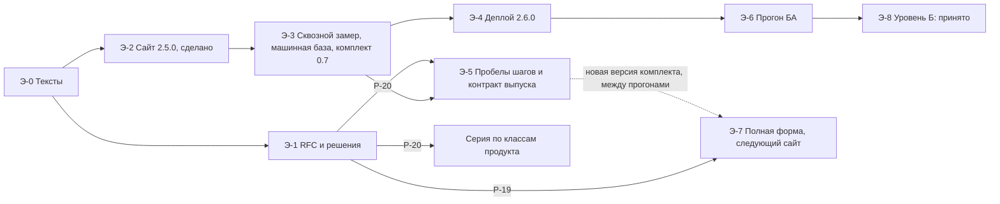

# RFC-PUB-001: Роадмэп закрытия потока BCREQ промптами и контрактами (#454)

## Summary / BLUF

**Подтверждаю: промпты шагов для A-IN, A-CORE и A-WORK созданы, но однозначной
готовности сайта к прогону от ФТ до ТЗ я подтвердить не могу.** Текстов, контрактов и
кнопок хватает. Содержательно поток проходит с пробелами, а БА его ещё не проходил.

1. **Что создано.** [Раздел 13](#13-подтверждение-по-стадиям-и-8-разделам): 13 шагов на
   сайте, 39 операций из 39 с контрактом, 8 разделов из 8 со стандартом и чек-листом.
   Отдельных промптов гейтов нет и не задумывалось: гейт — это критерии, блок отчёта в
   закрывающем шаге, поле карточки и форма журнала.
2. **Что не закрыто контрактом.** Стадия A-RELEASE и гейт «Выпуск» контрактом не описаны,
   критериев у него нет. Задача — [BL-234](../../pr-ops/backlog-repository.md#bl-234-контракт-стадии-a-release-и-гейта-выпуск).
3. **Что показал сквозной замер.** [RUN-0089](../../runs/2026/RUN-0089/outputs/report.md):
   черновики — `готов с пробелами` (35 пунктов чек-листов из 41), основная кнопка
   комплекта 0.6 — `не готов`. Поэтому в этой ветке Ш-3…Ш-9 переведены в `by-test`:
   комплект 0.7, сайт 2.6.0. Шесть пунктов не сданы и в лучшем плече: [BL-233](../../pr-ops/backlog-repository.md#bl-233-содержательные-пробелы-шагов-по-замеру-run-0089).
   [RUN-0092](../../runs/2026/RUN-0092/outputs/report.md) подтвердил правки Ш-В, записи гейтов и Ш-С. Правку пакетов он
   не подтвердил, поэтому **пакеты ФТ и ТЗ читает и правит БА**: [BL-174](../../pr-ops/backlog-ba-model.md#bl-174-промпт-шага-выпуска-ш-р-вместо-заглушки).
   [RUN-0088](../../runs/2026/RUN-0088/outputs/report.md), новый чат на шаг и возврат с Г-С1: цепочка дошла до конца без вымысла и решений за человека, но документ
   в договор не идёт. A-IN, A-CORE, A-WORK — `готова с дефектами`, итоговый документ 24 пункта из 41, трассировку ломает правка после Ш-В,
   пакеты ФТ и ТЗ `не собирается`. Карточки поправлены здесь, промпты — BL-233 и BL-174.
4. **На проде стоит тот набор, который замер признал худшим.** Сайт 2.5.0, комплект 0.6,
   относительно этой ветки актуальны **4 из 13** шагов. После слияния нужен деплой 2.6.0:
   [BL-232](../../pr-ops/backlog-repository.md#bl-232-публикация-сайта-на-прод-и-приёмка), действие владельца.
5. **Реальные задачи пока прошла только машина.** [RFC-MR-001](2026-11-bcreq-machine-run-baseline.md), PR #459:
   [RUN-0090](../../runs/2026/RUN-0090/outputs/report.md) (задача 1135) и [RUN-0091](../../runs/2026/RUN-0091/outputs/report.md) (задача 1137) дали документы из 8 разделов,
   вердикт обоих — `partial-success`, гейты `pending`, К-31 и К-33 FAIL. Это база сравнения, а не
   приёмка. Сделана она на текстах комплекта 0.5: на 2.5.0 совпадают 12 шагов из 12, в комплекте 0.7
   различаются [9 из 12](../../experiments/issue_454/kit_vs_machine_base.json). Что с этим делать —
   DEC-454-09: выложить 0.7 и записать версию в карточку, а разницу читать с учётом текста.
6. **План закрытия** — [раздел 14](#14-план-закрытия-потока-промптами-и-контрактами),
   **вердикт готовности** — [раздел 15](#15-вердикт-готовности-сайта-от-фт-до-тз). Без
   прогона БА слово «готов» не появится: [BL-157в](../../pr-ops/backlog-ba-model.md#bl-157в-первый-прогон-bl-111-с-комплектом),
   задачи 1135 и 1137, БА не читает машинную базу до своего варианта.
7. **Параллельная подготовка возможна** — [раздел 12](#12-параллельный-трек-синтетика-рядом-с-тестом-ба):
   измерено, какая правка какие тексты двигает, правила записаны. Серия по другим классам
   продукта — [BL-173](../../pr-ops/backlog-ba-model.md#bl-173-синтетическая-серия-по-классам-продукта).
8. **Решения владельца две** — [Р-19](../../pr-ops/BACKLOG.md#2-решения-владельца) и [Р-20](../../pr-ops/BACKLOG.md#2-решения-владельца). Деплой их не ждёт.

## 1. Цель и как её измерить

| Код | Цель | Как проверить | Значение на 2026-11-05 |
| --- | --- | --- | --- |
| Ц-1 | На проде каждый из 13 шагов отдаёт текущий текст этой ветки с меткой `published` или `by-test` | `python3 experiments/issue_454/audit_flow_coverage.py`, поле `prod.steps_current` | **4 из 13**: прод 2.5.0, ветка 2.6.0 |
| Ц-2 | БА может пройти шаги по сайту: вкладки этапов, копирование | [`site_walkthrough.cjs`](../../experiments/issue_454/site_walkthrough.cjs) | Прод 2.5.0: 13 точных копий из 13, браузер. Ветка 2.6.0: 13 из 13, локально. Прод 2.6.0: нет, ждёт деплоя |
| Ц-3 | Движение к цели видно в одном документе | Этот RFC и `scripts/validate_issue_454_publication_roadmap.py` | этот PR |
| Ц-4 | Задача проходит от запроса до пакетов ФТ и ТЗ по контрактам 8 разделов | Прогон в `runs/` по правилу, записанному до запуска | Синтетика: `готов с пробелами`. Машина на реальных задачах: `partial-success`, не приёмка. БА: нет прогона |

Ц-1 и Ц-2 закрывают цель 1 issue #454, Ц-3 — цель 2, Ц-4 — условие готовности из
[комментария владельца](https://github.com/G-Ivan-A/mango_ba_prompts/pull/455#issuecomment-6653026839).

**Два уровня публикации.** Их нельзя смешивать, иначе метка на сайте обещает
больше, чем проверено.

| Уровень | Что значит | Условие | Кто закрывает |
| --- | --- | --- | --- |
| А. Доступно | Текст на сайте, метка честная: `published` или `by-test` | Деплой | BL-232 |
| Б. Принято | Текст измерен и принят человеком, пометка «по тесту» снята | Прогоны БА, `ba_reviewed: true`, ADR | BL-157в, остаток BL-156, BL-111, BL-158 |

Правило DEC-427-11 остаётся: в `prompts/` текст попадает, только если он не хуже
базовой линии. Цель уровня А это правило не ослабляет: черновики идут на сайт с
меткой `by-test`.

## 2. Где мы сейчас

Срез на 2026-11-05. Все значения проверены чтением.

| Что | Факт | Свидетельство |
| --- | --- | --- |
| Прод | `gh-pages` = `50a547aa`, сайт 2.5.0, комплект 0.6, пароль отключён на время отладки; копирование 13 из 13 в браузере, прод байт в байт равен `main` источника | [обход прода](../../experiments/issue_454/site_walkthrough_prod.json), [лог аудита](../../experiments/issue_454/audit_flow_coverage.log) |
| Эта ветка | Сайт 2.6.0, комплект 0.7: 13 шагов, 11 `by-test`, 2 `published` (Ш-В, Ш-С), хеши сходятся | [`site/data/test-kit.json`](../../site/data/test-kit.json), аудит: `integrity problems: none` |
| Runtime | Срез `68ad8fcf` = runtime `main`, реестр 0.5, маршрут `sections_toc`. Образцы И-5 и глоссарий И-6 есть для трёх классов, синтетика, `confirmed_by: none`. Осталась заглушка З-2 | [реестр](../../standards/bcreq-runtime-references.md) |
| Замеры | Сквозной RUN-0089; подтверждение правок RUN-0092: R4, R5, R6 сданы, R3' не сдан; машинная база RUN-0090, RUN-0091 на реальных задачах 1135 и 1137, тексты комплекта 0.5: `partial-success`; повтор с новым чатом на шаг RUN-0088: стадии `готова с дефектами`, пакеты `не собирается`. У всех `ba_reviewed: false` | раздел 4, [реестр прогонов](../../runs/README.md), [RFC-MR-001](2026-11-bcreq-machine-run-baseline.md) |
| Человек | Прогона БА с `ba_reviewed: true` нет. Реплики БА в RUN-0090 и RUN-0091 давал симулятор | строка BL-157 |

Прежние «0 из 13» и «один деплой закрывает цель» устарели: владелец выложил сайт 2.5.0, а
RUN-0089 показал, что одной публикации мало.

## 3. Роадмэп

Статус — срез на дату в шапке. Источник статуса — только
[`pr-ops/BACKLOG.md`](../../pr-ops/BACKLOG.md): валидатор падает при расхождении.

<!-- roadmap:start -->
| Этап | Результат | Задача или пробел | Статус | Кто | Зависит от | Критерий |
| --- | --- | --- | --- | --- | --- | --- |
| Э-0 | Тексты, метки и данные сайта | [BL-156](../../pr-ops/backlog-ba-model.md#bl-156-промпты-шагов-потока-из-стандартов-по-тесту) | ЧАСТИЧНО | исполнитель | — | 13 шагов, хеши сходятся; остаток — уровень Б |
| Э-0 | Промпт Ш-В v0.3 | [BL-156г](../../pr-ops/backlog-ba-model.md#bl-156г-правило-правка-без-добавлений-и-шаги-одного-процесса) | DONE | исполнитель | — | RUN-0085 |
| Э-0 | Блок практики и правила сессии | [BL-167](../../pr-ops/backlog-ba-model.md#bl-167-блок-отраслевая-практика--на-решение-ба-в-шагах-ш-1-ш-3-ш-6), [BL-168](../../pr-ops/backlog-ba-model.md#bl-168-правила-многоходовой-сессии-правок) | DONE, DONE | исполнитель | — | RUN-0086, RUN-0087 |
| Э-1 | Роадмэп, границы цели, задачи | Этот RFC, [Р-19](../../pr-ops/BACKLOG.md#2-решения-владельца), [Р-20](../../pr-ops/BACKLOG.md#2-решения-владельца) | ждёт, ждёт | владелец | — | Ответ в PR #455, статус RFC |
| Э-2 | Сайт 2.5.0 на проде, копирование 13 из 13 | Порядок BL-232, выполнил владелец 5.11 | — | владелец | — | Сделано: `gh-pages` = `50a547aa` |
| Э-3 | Сквозной замер: RUN-0089, RUN-0092, комплект 0.7 | [BL-157](../../pr-ops/backlog-ba-model.md#bl-157-комплект-прогона-на-новых-задачах) | deferred (triggered) | исполнитель | BL-157б | Этап BL-157б: вердикты по правилам до запуска |
| Э-3 | Машинная база на задачах 1135 и 1137: RUN-0090, RUN-0091 | [BL-157г](../../pr-ops/backlog-ba-model.md#bl-157г-машинный-прогон-новых-промптов-по-задачам-1135-и-1137) | DONE | исполнитель | PR #451 | PR #459 слит; это база сравнения, а не приёмка |
| Э-3 | Маршрут Коллтрекинга в runtime: каталог расходится с базой знаний | [BL-170](../../pr-ops/backlog-ba-model.md#bl-170-расхождение-маршрута-каталог--база-знаний-для-коллтрекинга) | TODO | владелец создаёт задачу в runtime, Р-МР-2 | BL-157г | Задача слита в runtime; до этого БА отвечает на Q-01 сам |
| Э-4 | **Сайт 2.6.0 на проде** | [BL-232](../../pr-ops/backlog-repository.md#bl-232-публикация-сайта-на-прод-и-приёмка) | TODO | владелец | Слит PR #455 | `prod.steps_current` = 13, обход 13 из 13 на проде |
| Э-5 | Содержательные пробелы шагов | [BL-233](../../pr-ops/backlog-repository.md#bl-233-содержательные-пробелы-шагов-по-замеру-run-0089) | TODO | исполнитель | RUN-0089, Р-20 | Шесть пунктов сданы новым прогоном или сняты решением |
| Э-5 | Контракт A-RELEASE, критерии гейта «Выпуск» | [BL-234](../../pr-ops/backlog-repository.md#bl-234-контракт-стадии-a-release-и-гейта-выпуск) | TODO | исполнитель | Р-20 | Аудит считает критерии в Ш-Р |
| Э-6 | Прогон БА по сайту: задачи 1135 и 1137, по RUN на задачу, защита от якоря, калибровка судьи | [BL-157в](../../pr-ops/backlog-ba-model.md#bl-157в-первый-прогон-bl-111-с-комплектом) | deferred (triggered) | БА | BL-232, Р-19 | Записи в `runs/` с `ba_reviewed: true`, до пакетов ФТ и ТЗ; сравнение по разделу 3 RFC-MR-001 |
| Э-6 | Те же шаги на других классах продукта: сначала `contact-center` | [BL-173](../../pr-ops/backlog-ba-model.md#bl-173-синтетическая-серия-по-классам-продукта) | deferred (triggered) | исполнитель | Р-20 | По записи в `runs/` на класс, текст у БА не меняется |
| Э-7 | Таблица шагов процесса v0.3 | [BL-230](../../pr-ops/backlog-repository.md#bl-230-процесс-bcreq-v03-шаги-потока-в-форме-v01) | TODO | исполнитель | Р-19 | Каждый шаг ссылается на существующий промпт |
| Э-7 | «Варианты дальше», промпты шагов без пометки архива, сайт следующей версии | [BL-231](../../pr-ops/backlog-repository.md#bl-231-раздел-процессы-копирование-промпта-и-варианты-дальше) | TODO | исполнитель | BL-230, Р-19 | Тесты сайта, скриншот, деплой порядком BL-232 |
| Э-7 | Документы ФТ и ТЗ в Word автоматически | [BL-123](../../pr-ops/backlog-ba-model.md#bl-123-проекции-выпуска-документы-фт-и-тз-в-word) | deferred (triggered) | исполнитель | BL-121, Р-12 | До него БА переносит пакет в Word сам |
| Э-8 | Серия прогонов и замер остальных шагов | [BL-111](../../pr-ops/backlog-ba-model.md#bl-111-серия-реальных-прогонов-этапа-1) | TODO | БА, исполнитель | Р-01, BL-101…BL-103 | Уровень Б |
| Э-8 | Снятие пометки «по тесту» | [BL-158](../../pr-ops/backlog-ba-model.md#bl-158-обратное-согласование-стандартов-по-тесту-через-adr) | deferred (triggered) | владелец | BL-111 | Уровень Б |
| Вне ряда | Пакет правок промптов по находкам машины | [BL-171](../../pr-ops/backlog-ba-model.md#bl-171-пакет-правок-промптов-по-машинному-прогону) | deferred (triggered) | исполнитель | BL-157в; Р-03, Р-18 | Прогон БА записан и подтвердил дефект, Р-МР-4 |
| Вне ряда | Содержательные правила выпуска | [BL-174](../../pr-ops/backlog-ba-model.md#bl-174-промпт-шага-выпуска-ш-р-вместо-заглушки) | deferred (triggered) | исполнитель | BL-157 | Прогон дошёл до настоящего выпуска или просьба владельца |
| Вне ряда | Образцы разделов для Ш-3…Ш-8, снятие З-2 | **Пробел П-6**, задачи нет | — | владелец в runtime (РТ-2) | Данные прогона БА | Прогон БА покажет дефекты формы вывода |
<!-- roadmap:end -->

**Что не блокирует цель, хотя открыто.** BL-162 (поправка ADR-003) можно делать в
любой момент, на цель не влияет. BL-161, BL-164…BL-166 ждут своих триггеров.

## 4. Покрытие по шагам потока

Состав шагов — [RFC #427, раздел 9.2](2026-11-bcreq-flow-processes-prompts.md) и
[комплект прогона](../ba-processes/bcreq-run-kit.md). «Промпт» — последняя опубликованная
версия; при `by-test` кнопка отдаёт черновик. «Прод» — версия в каталоге и то, совпадает
ли кнопка на проде с кнопкой этой ветки.

<!-- coverage:start -->
| Шаг | Промпт | Режим | `main` | Прод | Замер | Заглушка | Закрывает шаг |
| --- | --- | --- | --- | --- | --- | --- | --- |
| Ш-0 | `bcreq-constitution-governance-oneshot` | by-test | 0.5 | 0.2, текст другой | RUN-0083, RUN-0087, RUN-0088, RUN-0089 | — | BL-232 |
| Ш-А | `bcreq-intake-questionnaire-stepwise` | by-test | нет | нет | не измерен | черновик v0.2 | BL-232, затем BL-157в |
| Ш-1 | `bcreq-context-understanding-stepwise` | by-test | 0.5 | 0.2, текст другой | RUN-0083, RUN-0086, RUN-0088, RUN-0089 | — | BL-232, затем BL-233 |
| Ш-2 | `bcreq-products-impact-analysis-stepwise` | by-test | 0.4 | 0.1, текст другой | RUN-0083, RUN-0088, RUN-0089, RUN-0092 | — | BL-232 |
| Ш-3 | `bcreq-fr-documentation-stepwise` | by-test | 0.5 | 0.2, текст другой | RUN-0086, RUN-0088, RUN-0089 | З-2 | BL-232, затем BL-233 |
| Ш-4 | `bcreq-nfr-documentation-stepwise` | by-test | 0.2 | 0.1, текст другой | RUN-0088, RUN-0089 | З-2 | BL-232 |
| Ш-5 | `bcreq-uc-modeling-stepwise` | by-test | 0.2 | 0.1, текст другой | RUN-0088, RUN-0089, RUN-0092 | З-2 | BL-232 |
| Ш-6 | `bcreq-orr-solution-design-stepwise` | by-test | 0.3 | 0.2, текст другой | RUN-0086, RUN-0088, RUN-0089 | — | BL-232 |
| Ш-7 | `bcreq-constraints-documentation-stepwise` | by-test | 0.2 | 0.1, текст другой | RUN-0088, RUN-0089 | — | BL-232 |
| Ш-8 | `bcreq-uc-modeling-stepwise` | by-test | 0.2 | 0.1, текст другой | RUN-0088, RUN-0089 | З-2 | BL-232 |
| Ш-9 | `bcreq-extra-risk-analysis-stepwise` | by-test | 0.2 | 0.1, текст другой | RUN-0088, RUN-0089 | — | BL-232, затем BL-233 |
| Ш-В | `bcreq-review-validation-oneshot` | published | 0.3 | 0.3, актуален | RUN-0081, RUN-0082, RUN-0084, RUN-0085, RUN-0088, RUN-0089, RUN-0092 | — | BL-232 |
| Ш-Р | `bcreq-release-readiness-oneshot` | by-test | нет | нет, кнопка другая | RUN-0088, RUN-0089, RUN-0092 | черновик v0.2 | BL-232, затем BL-174, BL-234 |
| Ш-С | `bcreq-scenarios-modeling-oneshot` | published | 0.2 | 0.1, текст другой | RUN-0088, RUN-0089, RUN-0092 | З-2 | BL-232 |
<!-- coverage:end -->

**Поправка issue #474.** Для A-IN действует принятый RFC-AIN-001:
Ш-0 → AIN-01…24, Ш-А — совместимый AIN-02, Ш-1 — диспетчер.
[Инструкция](../ba-processes/bcreq-a-in-execution.md) и карточки сайта формы
2.7.0 содержат полный комплект 24 draft контрактов. В интерфейсе 35 шагов;
14 строк ниже сохраняют связь прежнего комплекта с измерениями. Версии в таблице обновлены;
все RUN в колонке «Замер» относятся к прежним текстам, новые guards и AIN
ими не измерены. Кандидат сайта — 2.8.4 для ручного пакетного деплоя BL-232.

**Поправка issue #464.** Добавлен шаг Ш-А, правлены тексты всех шагов, кроме Ш-В. В колонке
«Замер» — прошлые прогоны: новый текст они не покрывают, его проверит BL-157в. В разделах ниже
план и замеры на 2026-11-05 до #464 оставлены как история: «13 шагов» там — прежний состав.

Итого 14 шагов и 13 файлов: Ш-5 и Ш-8 используют один файл. Текст Ш-А и Ш-Р — только
черновик в `prompts/drafts/`, на сайт он попадает через комплект прогона. Комплект и строка
таблицы по-прежнему называют Ш-Р заглушкой выпуска: правил из настоящего случая выпуска у
него нет, это BL-174. Замеры синтетические (`ba_reviewed: false`) и потому не приёмка.
RUN-0090 и RUN-0091 в столбце «Замер» идут по текстам комплекта 0.5, то есть по кнопке 2.5.0. С кнопкой
этой ветки совпадают только Ш-0, Ш-1, Ш-В: они не замер текста 0.7 на остальных 9 шагах (П-11).
RUN-0088 идёт по текстам 0.5 на Ш-0…Ш-5 и по текстам 0.7 с Ш-6 (его поправка 2).

Промпты агентного маршрута в поток не входят и пробелом не считаются: RFC #427
прямо выводит их из ручного потока.

## 5. Пробелы

| Код | Пробел | Мешает цели | Что с ним |
| --- | --- | --- | --- |
| П-1 | Деплой ручной: после слияния этого PR прод снова отстаёт. У деплоя не было задачи: README и `docs/site-access.md` описывают его по-разному | **Да** | [BL-232](../../pr-ops/backlog-repository.md#bl-232-публикация-сайта-на-прод-и-приёмка) |
| П-2 | У Ш-Р черновик v0.2 без правил из настоящего случая выпуска. RUN-0092: R3' не сдан, на документе K пакеты потеряли основное требование | Прогону нет: состав задан, исключения шаг называет. Отправке без правки — **да** | [BL-174](../../pr-ops/backlog-ba-model.md#bl-174-промпт-шага-выпуска-ш-р-вместо-заглушки), по триггеру; до неё пакеты читает и правит БА |
| П-3 | Формальные зависимости: BL-157в ждёт BL-111, та — BL-101…BL-103, BL-202 и Р-01, Р-02; BL-230 ждёт весь BL-156; BL-231 ждёт Р-09 | Мешает Э-6 и Э-7 | [Р-19](../../pr-ops/BACKLOG.md#2-решения-владельца), DEC-454-03 |
| П-4 | Шесть пунктов чек-листов не сданы лучшим плечом RUN-0089: S1.1, S1.3, S1.4, S3.2, S3.6, S8.1. Замер N = 1 | **Да**, для Ц-4 | [BL-233](../../pr-ops/backlog-repository.md#bl-233-содержательные-пробелы-шагов-по-замеру-run-0089) |
| П-5 | Граница цели не была записана: вне её `asr-*`, `letter-customer-*`, `meeting-*`, `session-debug-*`, агентный маршрут, 39 классов пилота | Уточняет цель | Р-19, DEC-454-01 |
| П-6 | Заглушка З-2: образцов разделов нет в срезе runtime (РТ-2, P1) | Нет: заглушка явная | **Задачи нет сейчас.** РТ-2 создаёт владелец, если прогон БА покажет дефекты формы вывода Ш-3…Ш-8 |
| П-7 | 14 промптов шагов помечены архивом в каталоге, «Варианты дальше» не реализованы | Нет: набор на сайте идёт мимо этой пометки | BL-230, BL-231 |
| П-8 | У гейта «Выпуск» нет критериев: контракт стадий заканчивается на Г-W и прямо выводит A-RELEASE за свои рамки | **Да**, для «весь поток контрактами» | [BL-234](../../pr-ops/backlog-repository.md#bl-234-контракт-стадии-a-release-и-гейта-выпуск), [Р-20](../../pr-ops/BACKLOG.md#2-решения-владельца) |
| П-9 | Word не проверен, и здесь его нечем проверить: на машине нет `pandoc`, `libreoffice`, `python-docx` | Для Этапа 1 нет: БА переносит пакет сам | Проверяет BL-157в; автоматика — [BL-123](../../pr-ops/backlog-ba-model.md#bl-123-проекции-выпуска-документы-фт-и-тз-в-word) |
| П-10 | Класс `contact-center` сквозным прогоном не проверен. `analytics-reporting` проверен только машиной, RUN-0091: As-Is собран не по тем документам (Н-1 RFC-MR-001) | Да, для других продуктов | [BL-173](../../pr-ops/backlog-ba-model.md#bl-173-синтетическая-серия-по-классам-продукта), [BL-170](../../pr-ops/backlog-ba-model.md#bl-170-расхождение-маршрута-каталог--база-знаний-для-коллтрекинга) |
| П-11 | Машинная база снята на текстах 0.5: с комплектом 0.7 различаются Ш-2…Ш-9 и Ш-Р, 9 шагов из 12 ([сверка](../../experiments/issue_454/kit_vs_machine_base.json)). Разницу «БА против машины» на этих шагах нельзя приписать только человеку | Да, для чистоты сравнения; не для самого прогона | DEC-454-09; карточка прогона хранит версию комплекта |
| П-12 | Ш-Р v0.2: К-33 стоит раньше К-32, хотя контракт К-33 требует пакеты на входе. Находка Н-6 RUN-0091 сделана на тексте v0.1, порядок в v0.2 тот же. Обязательный вход без источника из той же находки в v0.2 закрыт политикой адресатов по умолчанию | Нет: К-33 скажет «не готово», решение всё равно за человеком | [BL-174](../../pr-ops/backlog-ba-model.md#bl-174-промпт-шага-выпуска-ш-р-вместо-заглушки) |
| П-13 | Промпты не знают режима возврата: нумерация новых пунктов, снятие «устарело», правка разделов 1, 2, ＋2.5 при повторе Ш-5. Правка после Ш-В ломает таблицы трассировки: в [RUN-0088](../../runs/2026/RUN-0088/outputs/report.md) в разделе 3 стало 20 ФТ, а таблицы по-прежнему говорят «15 из 15». Ш-3 требует EARS, а стандарт раздела 3 считает «Когда»/«Если» отклонением. Шаг выпуска не получает значений для входов К-31, К-12, К-33 ([журнал](../../runs/2026/RUN-0088/outputs/ba-missing.json)) | **Да**, для Ц-4: после возврата и правок БА документ собирается руками | Карточки поправлены, правка промптов — [BL-233](../../pr-ops/backlog-repository.md#bl-233-содержательные-пробелы-шагов-по-замеру-run-0089), входы Ш-Р — [BL-174](../../pr-ops/backlog-ba-model.md#bl-174-промпт-шага-выпуска-ш-р-вместо-заглушки), [BL-234](../../pr-ops/backlog-repository.md#bl-234-контракт-стадии-a-release-и-гейта-выпуск) |

**Наблюдение вне пробелов.** RFC стратегии имеет `status: accepted`, а строка Р-01
в бэклоге — «ждёт». Ответа владельца с принятием в PR #421 я не нашёл, поэтому
статус не менял. На цель это не влияет: DEC-454-03 развязывает BL-157в и BL-111.

## 6. План на 5–7 ноября

| День | Кто | Что | Результат |
| --- | --- | --- | --- |
| 5.11 | исполнитель | RUN-0089, RUN-0092, этот RFC, бэклог, сайт 2.6.0 в PR #455; машинная база RUN-0090, RUN-0091 слита в PR #459 | Сделано, RUN-0088 с вердиктом |
| 5.11 | владелец | Смержить PR #455, ответить на Р-19 и Р-20 одной строкой; создать задачу в runtime по BL-170 (Р-МР-2) | Комплект 0.7 в `main`, зависимости сняты |
| 6.11 | владелец | Деплой 2.6.0 по [`docs/site-access.md`](../site-access.md#ручной-деплой) (BL-232), повторить аудит и обход | **Ц-1, Ц-2** |
| 6.11 | БА | Начать задачи 1135 и 1137 по сайту 2.6.0 (BL-157в), по отдельному RUN на задачу, не читая RUN-0090 и RUN-0091 до своего варианта. Для 1137 ответить на Q-01, если BL-170 не слита. Новый чат на шаг при длинной цепочке | Данные человека |
| 6.11 | исполнитель | BL-233, BL-234 на ветке; BL-173: `contact-center`. Кандидаты BL-171 не трогаем. На прод не идёт, пока идёт прогон | Новая версия комплекта наготове |
| 7.11 | исполнитель | BL-230 и BL-231 одним PR, если Р-19 получено | PR на ревью |
| 7.11 | БА, исполнитель | Записать прогоны в `runs/` с `ba_reviewed: true`, если задача завершена; сравнить с базой по разделу 3 RFC-MR-001 отдельным коммитом | Ц-4 с человеком |

**Что в плане не гарантировано.** Деплой зависит только от владельца. Прогон БА за два дня
не обещаю: его длительность задаёт реальная задача, а 7 ноября — суббота. Если прогон не
завершён, BL-157в остаётся открытой, и Ц-4 не закрыта.

**Если Р-19 и Р-20 не даны.** Деплой 2.6.0 всё равно выполним. BL-230, BL-231, BL-157в,
BL-234 и BL-173 ждут.

## 7. Решения на согласование

Ответ — одна строка в комментарии к
[PR #455](https://github.com/G-Ivan-A/mango_ba_prompts/pull/455): `Р-19 да, Р-20 да` или
`Р-20: DEC-454-NN нет`.

| Код | Вопрос | Рекомендация | Почему |
| --- | --- | --- | --- |
| DEC-454-01 | Что значит «все промпты» | 13 шагов потока на проде, `published` или `by-test` с честной меткой. Агентный маршрут и промпты вне BCREQ не входят | Цель названа «для реализации всех шагов потока BCREQ». Граница сайта задана в issue #391 |
| DEC-454-02 | Хватит ли Ш-Р v0.2 для первого прогона БА | Да, если БА сверяет пакеты с документом. BL-174 — по триггеру | Состав и очистку пакетов он задаёт, исключения называет. R3' RUN-0092 не сдан, поэтому без сверки отправлять нельзя. Настоящего случая выпуска нет, базовой линии для Р-03 нет; выдуманные правила — инфляция |
| DEC-454-03 | Снять формальные зависимости | BL-157в не ждёт BL-111 и BL-101…BL-103, серия BL-111 остаётся; BL-230 не ждёт остатка BL-156; BL-231 не ждёт Р-09 | Владелец в issue #450 уже сузил триггер BL-157в. Остаток BL-156 ждёт прогонов, а BL-157в ждёт сайта: иначе круг. Р-15 и DEC-427-12 новее и конкретнее Р-09 |
| DEC-454-04 | Порядок деплоев | 2.6.0 после слияния этого PR, следующий — по классу правки из раздела 12 | Сейчас на проде набор, который RUN-0089 признал `не готов` |
| DEC-454-05 | Раздел 5 в документе ТЗ и Word на Этапе 1 | Раздел 5 по умолчанию не входит, его включает политика адресатов (Q9 RFC #420). Word на Этапе 1 — руками БА, автоматика остаётся в BL-123 | Так задано в RFC страницы стандартов и в Ш-Р v0.2. Ручной перенос укладывается в постановку Этапа 1 |
| DEC-454-06 | Ш-3 и Ш-6 в `by-test`, хотя их `prompts/` v0.2 измерены на golden set | Оставить по правилу R2 RUN-0089. Откат — одна строка комплекта | Сквозной замер — другое условие, чем golden set; разрыв T и K мал при N = 1, поэтому решение за владельцем. RUN-0088 это подтверждает как наблюдение: R2 не повторился на 3 парах из 6 (Ш-5, Ш-3 и Ш-5 при возврате), Ш-6 там в паре не шёл. По его поправке 2 режим это не меняет, Ш-3 и Ш-5 БА смотрит первыми |
| DEC-454-07 | Контракт A-RELEASE и «Выпуск» | Писать (BL-234) | Владелец просит закрыть весь поток контрактами, сейчас это единственный гейт без критериев |
| DEC-454-08 | Параллельная серия по классам продукта | Запустить BL-173 по правилам раздела 12, сначала `contact-center`; профиль — данные. `analytics-reporting` — только после BL-170 и по отдельному решению: Р-МР-3 против платного повтора RUN-0091 остаётся | `contact-center` не проверен вовсе, а `analytics-reporting` до правки маршрута покажет тот же дефект; К6 запрещает плодить промпты на продукт |
| DEC-454-09 | На каком комплекте БА идёт по 1135 и 1137 | **На 0.7: сначала деплой, потом прогон.** Версию пишем в карточку, разницу с базой на 9 шагах читаем с учётом текста. Платный машинный повтор 1135 на 0.7 (около 0,5 млн токенов) не запускаем без просьбы владельца | RUN-0089 признал кнопку 2.5.0 `не готов`, принимать стоит лучший из измеренных наборов. Сравнение при N = 2 и так только наблюдение. Цена: на этих шагах отличие БА от машины может быть отличием текста. Другой вариант — не выкладывать 0.7 и пройти по 2.5.0: сравнение чище, но приёмку получит набор `не готов`, а 0.7 останется без данных человека |

## 8. Граничные случаи

| Случай | Что делаем |
| --- | --- |
| Деплой прошёл, аудит показывает меньше 13 | BL-232 не `DONE`. Сравнить `gh-pages` с `site/` проверенного коммита |
| Деплой сделан с коммита старше `main` | Аудит покажет расхождение. Выкладывать только проверенный коммит |
| После деплоя слит PR с промптами | Прод снова отстаёт. Повторный деплой — та же процедура, новая задача не нужна |
| БА начал работу до деплоя 2.6.0 | Такой прогон идёт по комплекту 0.6: в карточке указать фактические тексты. Пройденные шаги не переделывать, смену записать ([поправка 2 RUN-0088](../../runs/2026/RUN-0088/logs/amendment-2.md)) |
| БА уже прочитал RUN-0090 или RUN-0091 по своей задаче | Отметить в карточке: такой прогон не идёт в сравнение как независимый, но приёмкой шагов остаётся ([раздел 3 RFC-MR-001](2026-11-bcreq-machine-run-baseline.md#3-протокол-сравнения-с-прогоном-ба)) |
| BL-170 не слита, БА начал 1137 | БА отвечает на Q-01 на Ш-0, разрешая `mango-lk-manual` и `rolevaya-model-vats`. Ответ записывается в карточку |
| БА получил десятки вопросов в 8.4 | Ожидаемо: у машины их 107 и 70, приоритета нет (Н-2). Правка — кандидат BL-171, она ждёт подтверждения от БА. Разбор вопросов сам — данные для сравнения |
| Прогон БА показал регрессию опубликованного текста | Откат версии в `prompts/` и повторный деплой: деплой обратим, история `gh-pages` сохраняется |
| Чат БА не вмещает цепочку | RUN-0089: около 1 МБ текста на цепочку; RUN-0090 и RUN-0091: состояние 176 и 147 КБ, контекст сжимался повторно (Н-7). Новый чат на шаг, разделы и конституция вложениями. RUN-0088: новый чат цепочку держит, цена — документ 304 КБ перед выпуском. Вместит ли его чат БА, покажет BL-157в |
| Ш-Р убрал основное требование из пакета | RUN-0092, документ K: пункт стоит на открытом вопросе, шаг убирает его и называет в манифесте. Пакет не отправлять, пока БА не закроет вопрос или не решит иначе. Решение записать в 8.5 |
| БА выбрал не `voice-ucaas` | Сквозного замера БА на этот класс нет, для `analytics-reporting` есть только RUN-0091. Записывается в карточку прогона; BL-173 |
| Владелец отверг DEC-454-01 и хочет все файлы | Р-19 меняет цель; потребуется отдельная задача на границу сайта (issue #391, вопросы PR #453) |
| Сайт откроют без пароля | Сейчас пароль отключён на время отладки (BL-169). Те же тексты лежат в публичном репозитории, новой утечки публикация не создаёт |

## 9. Что не делаем и почему

- **Автоматический деплой.** Actions отключены; `docs/site-access.md` запрещает их
  включать.
- **Задача в runtime.** Там нет открытых работ, блокера цели нет. Тела задач
  создаёт владелец (A-08 RFC #427).
- **Деплой этим PR.** У исполнителя нет прав на исходный репозиторий.
- **Перемер ради слова «готов».** Правило RUN-0092 записано до запуска: он подтверждает
  правки и вердикт R1 не повышает.
- **Платный повтор RUN-0091.** Р-МР-3: приёмки он не даст. Правки промптов по находкам
  машины (BL-171) тоже ждут данных БА, Р-МР-4.
- **Отдельный промпт на гейт и промпт на продукт.** Первое не предусмотрено контрактом,
  второе запрещает К6.

## 10. Риски

| Риск | Вероятность | Что снижает |
| --- | --- | --- |
| Прод снова отстанет после следующего слияния: автоматического деплоя нет | Высокая | Аудит одной командой, повторный деплой в условии готовности BL-231 |
| Метка `published` прочитается как «принято человеком» | Средняя | Два уровня в разделе 1; все замеры — `ba_reviewed: false`; BL-157в |
| Новая версия выйдет посреди прогона БА | Средняя | Раздел 12: класс правки, карточка хранит версию и хеш. Запрета в коде нет |
| Длинная цепочка не поместится в чат БА, качество упадёт | Средняя | Новый чат на шаг: цепочку держит (RUN-0088). Качество с документом 304 КБ в чате БА проверяет BL-157в |
| Разницу между БА и машиной припишут человеку, хотя различается текст | Средняя | П-11, DEC-454-09: карточка хранит версию, сравнение называется наблюдением при N = 2 |
| БА прочитает машинный вариант до своего | Средняя | Правило раздела 3 RFC-MR-001; отметка в карточке, прогон не считается независимым |
| Роадмэп устареет | Средняя | Валидатор сверяет статусы и шаги, падает с подсказкой обновить срез |
| Р-19 или Р-20 не отвечены долго | Средняя | Деплой от них не зависит |
| Настоящий пароль не сработает на проде, когда его вернут | Низкая, но я проверить не могу | Проверка владельца в чистой вкладке, BL-169 |

## 11. Связь с другими RFC

- [RFC-RT-001](2026-11-runtime-product-catalog-golden-set.md), стартовый SSOT issue:
  поправка 0.8 ссылается сюда. Содержание RFC-RT-001 (каталог и golden set runtime)
  не меняется.
- [RFC #427](2026-11-bcreq-flow-processes-prompts.md): шаги потока, DEC-427-11,
  DEC-427-12 действуют. Р-19 меняет только зависимости задач, а не решения RFC.
- [RFC-MR-001](2026-11-bcreq-machine-run-baseline.md), PR #459: машинная база и протокол сравнения. Здесь она не
  пересказывается; добавлено только то, чего там нет: сверка текстов и DEC-454-09. PR #459 слит без
  комментариев, поэтому Р-МР-1…Р-МР-4 здесь читаются по столбцу «Если промолчать» того RFC. Задача в runtime
  по Р-МР-2 остаётся за владельцем.
- Р-19 при ответе «да» также принимает этот RFC в версии 0.3; перевод в `accepted` —
  после ответа владельца.

## 12. Параллельный трек: синтетика рядом с тестом БА

**Вопрос владельца:** можно ли, пока БА тестирует, синтетически готовить следующие модули на прод.
**Ответ: да, при трёх правилах ниже; замер показывает, какая правка что двигает.** В репозитории нет термина
«модуль»; под ним здесь стадия потока (A-CORE, A-WORK, A-RELEASE после A-IN), профиль действия из
[`bcreq-prompt-profiles.md`](../../standards/bcreq-prompt-profiles.md) или профиль продукта из
[`bcreq-composition-standard.md`](../../standards/bcreq-composition-standard.md). Если имелось другое, таблица
остаётся верной: она про источники, а не про название.

**Замер:** [скрипт](../../experiments/issue_454/parallel_track_blast_radius.py),
[итог](../../experiments/issue_454/parallel_track_blast_radius.json). Правка в одном источнике за раз, сборка штатными
скриптами во временном worktree, сравнение текстов сайта по шагам. Комплект 0.7.

| Правка в источнике | Основная кнопка сдвинулась у | Класс |
| --- | --- | --- |
| Новый промпт вне комплекта | ни у кого; он только появляется в каталоге | зелёный |
| Стандарт раздела | ни у кого; меняется файл, который БА прикладывает к чату | зелёный, сообщить БА |
| Текст карточки шага | ни у кого; только карточка этого шага | зелёный |
| Откат режима одного шага | только у этого шага | жёлтый |
| Текст одного шага: опубликованный или черновик по тесту | только у этого шага | жёлтый |
| Общий файл Ш-5 и Ш-8; контракт операции К-24 | Ш-5 и Ш-8: файл у них один | жёлтый |
| Профиль действия VERIFY | Ш-0, Ш-Р | красный |
| Базовый стандарт; срез runtime | 11 шагов из 13 (все `by-test`) | красный |

**Правила.**

1. **Сайт сам не движется.** Слияние в `main` ничего не меняет у БА: прод меняет только деплой владельца. Сейчас это
   видно на факте: в этой ветке комплект 0.7, на проде 0.6, и [аудит](../../experiments/issue_454/audit_flow_coverage.log)
   показывает, какие шаги сменятся при деплое.
2. **Синтетика идёт в `main` любым классом, на прод — по классу.** Зелёный — в любой момент. Жёлтый — между шагами
   БА, со списком шагов из аудита. Красный — только между прогонами БА.
3. **Прогон привязан к текстам.** Карточка прогона хранит `prompt_set.commit`, сайт показывает хеш текста на карточке.
   Если текст сменился посреди работы, уже пройденные шаги не переделывают, а смену записывают.
   [Поправка 2 RUN-0088](../../runs/2026/RUN-0088/logs/amendment-2.md) — живой пример: набор сменился на шаге Ш-6.

**Чего параллельность не даёт.** Синтетика не заменяет БА: все замеры `ba_reviewed: false`, уровень Б закрывает только
BL-157в и BL-111. Правку, которая опирается на находку БА, раньше находки не сделать. Если БА найдёт дефект в базовом
стандарте, это красный класс: он ждёт конца прогона либо прерывает его решением владельца. Автоматического запрета в
коде нет: правила 2 и 3 держатся на дисциплине деплоя, а его выполняет один человек.

**Что параллельно не правим.** По Р-МР-4 кандидаты BL-171 ждут данных БА: приоритет вопросов 8.4, зависимые места в
замечании Ш-В, конфликт «ФТ не пиши» на Ш-3. BL-233 разбирает другие провалы, по чек-листам RUN-0089, идёт только на
ветке и на прод выходит после прогона БА. Если пункт BL-233 совпал с кандидатом BL-171, он ждёт вместе с ним.
Комплект 0.7 это правило не нарушает: он опирается на сравнение с судьёй в RUN-0089, а не на находки машины, но текста у
БА он всё равно меняет один раз, до начала прогона.

## 13. Подтверждение по стадиям и 8 разделам

**Вопрос владельца:** созданы ли промпты (шаги, гейты и т.д.) для A-IN, A-CORE, A-WORK.
**Ответ: шаги и контракты — да, по всем трём. Отдельных промптов гейтов нет.** Гейт — это
критерии в контракте, блок отчёта в закрывающем шаге, поле карточки на сайте и форма журнала в
комплекте; решение записывает человек, модель только советует. Факты воспроизводит
[`audit_stage_contracts.py`](../../experiments/issue_454/audit_stage_contracts.py),
[итог](../../experiments/issue_454/audit_stage_contracts.json).

| Стадия | Шаги на сайте | Операции: всего, код назван в кнопке, в черновике | Гейт | Критерии в контракте и в отчёте шага | Сквозной замер | Статус |
| --- | --- | --- | --- | --- | --- | --- |
| Старт | Ш-0 | 3: 3, 3 | — | — | RUN-0083, RUN-0087, RUN-0088, RUN-0089, RUN-0090, RUN-0091 | есть |
| A-IN | Ш-1, Ш-2 | 12: 12, 12 | Г-IN, гибрид | 5 и 5 | RUN-0083, RUN-0088, RUN-0089, RUN-0090, RUN-0091, RUN-0092 | есть |
| A-CORE | Ш-3, Ш-4, Ш-5 | 4: 4, 4 | Г-С1, человек | 5 и 5 | RUN-0088, RUN-0089, RUN-0090, RUN-0091, RUN-0092 | есть |
| A-WORK | Ш-6, Ш-7, Ш-8, Ш-9, Ш-В | 13: 7, 13 | Г-W, человек | 5 и 5 | RUN-0088, RUN-0089, RUN-0090, RUN-0091, RUN-0092; Ш-В также RUN-0081…RUN-0085 | есть, с оговоркой |
| A-RELEASE | Ш-Р | 5: 5, 5 | Выпуск, человек | **0**, блок отчёта есть | RUN-0088, RUN-0089, RUN-0090, RUN-0091, RUN-0092 | **контракта нет: П-8** |
| По запросу | Ш-С | 2: 0, 2 | — | — | RUN-0088, RUN-0089, RUN-0092 | есть, с оговоркой |

Итого 39 операций из 39 разложены по шагам, и у каждой есть файл контракта. У всех четырёх
гейтов есть поля журнала: `gate_id`, `gate_type`, `model_recommendation`, `divergence`.
RUN-0090 и RUN-0091 прошли все стадии на реальных задачах, но по текстам комплекта 0.5, гейты там `pending`.

**Оговорка.** Опубликованные Ш-В v0.3 и Ш-С не называют коды операций, их называют только
черновики. По содержанию Ш-В закрыт golden-замером RUN-0085 и судьёй RUN-0089, поэтому режим не
меняется. Запись Г-W остаётся за БА по карточке, моделью она не проверялась.

**8 разделов.** Судья RUN-0089 проверял документ по чек-листам стандартов раздела.

| Раздел | Стандарт | Пунктов | Промпт | Гейт | T | K | Не сдано в T |
| --- | --- | --- | --- | --- | --- | --- | --- |
| 1 Глоссарий | [`01-glossary`](../../standards/bcreq-sections/01-glossary.md) | 5 | Ш-1 | Г-IN | 2 | 4 | S1.1, S1.3, S1.4 |
| 2 Бизнес-контекст | [`02-business-context`](../../standards/bcreq-sections/02-business-context.md) | 6 | Ш-1, Ш-2 | Г-IN | 6 | 5 | — |
| 3 ФТ | [`03-functional-requirements`](../../standards/bcreq-sections/03-functional-requirements.md) | 6 | Ш-3 | Г-С1 | 4 | 4 | S3.2, S3.6 |
| 4 НФТ | [`04-non-functional-requirements`](../../standards/bcreq-sections/04-non-functional-requirements.md) | 4 | Ш-4 | Г-С1 | 4 | 4 | — |
| 5 Описание решения | [`05-solution-description`](../../standards/bcreq-sections/05-solution-description.md) | 6 | Ш-6 | Г-W | 6 | 6 | — |
| 6 Особенности реализации | [`06-implementation-constraints`](../../standards/bcreq-sections/06-implementation-constraints.md) | 5 | Ш-7 | Г-W | 5 | 3 | — |
| 7 UC | [`07-use-cases`](../../standards/bcreq-sections/07-use-cases.md) | 5 | Ш-5, Ш-8 | Г-С1, Г-W | 5 | 5 | — |
| 8 Дополнительные | [`08-supplementary`](../../standards/bcreq-sections/08-supplementary.md) | 4 | Ш-9 | Г-W | 3 | 3 | S8.1 |
| **Итого** | 8 из 8 | **41** | | | **35** | **34** | **6** |

T — черновики, теперь это основная кнопка у Ш-0…Ш-9. K — основная кнопка комплекта 0.6, она сейчас
на проде. У K ещё три критических вымысла и провал P14, поэтому вердикт T выше при близких суммах.

## 14. План закрытия потока промптами и контрактами

Что считается закрытым: у стадии есть текст, контракт, синтетический замер, текст на проде и приёмка
человеком. Строка показывает, что уже есть и какая задача закрывает остаток.

| Стадия | Промпт | Контракт операций и стадии | Синтетический замер | На проде | Человек |
| --- | --- | --- | --- | --- | --- |
| Старт, Ш-0 | есть | есть | RUN-0088, RUN-0089 | есть, актуален | BL-157в |
| A-IN | есть; правки BL-233 | есть | RUN-0088 `готова с дефектами`, RUN-0089, RUN-0092; S1.1, S1.3, S1.4 → BL-233; маршрут → BL-170 | BL-232 | BL-157в |
| A-CORE | есть; правки BL-233 | есть | RUN-0088 `готова с дефектами`, RUN-0089, RUN-0092; S3.2, S3.6, режим возврата → BL-233 | BL-232 | BL-157в |
| A-WORK | есть; правки BL-233 | есть | RUN-0088 `готова с дефектами`, RUN-0089, RUN-0092; S8.1, трассировка после правок → BL-233 | BL-232 | BL-157в |
| A-RELEASE | есть; правила BL-174 | операции есть, стадия и гейт — **BL-234** | RUN-0088 пакеты `не собирается`, RUN-0089, RUN-0092 | BL-232 | BL-157в |
| Ш-С | есть | есть | RUN-0088, RUN-0089, RUN-0092 | есть, актуален | BL-111 |
| Другие классы продукта | тот же текст, профиль — данные | И-5 и И-6 есть, синтетика | `contact-center` — **BL-173**; `analytics-reporting` — RUN-0091, дефект маршрута **BL-170** | по разделу 12 | BL-157в по 1137, затем BL-111 |

**Порядок.**

1. Слить PR #455, выложить 2.6.0: [BL-232](../../pr-ops/backlog-repository.md#bl-232-публикация-сайта-на-прод-и-приёмка). На проде перестаёт стоять набор, признанный `не готов`.
2. Одновременно: БА начинает [BL-157в](../../pr-ops/backlog-ba-model.md#bl-157в-первый-прогон-bl-111-с-комплектом) на задачах 1135 и 1137, не читая машинную базу, а владелец заводит задачу в runtime по [BL-170](../../pr-ops/backlog-ba-model.md#bl-170-расхождение-маршрута-каталог--база-знаний-для-коллтрекинга). Исполнитель берёт [BL-233](../../pr-ops/backlog-repository.md#bl-233-содержательные-пробелы-шагов-по-замеру-run-0089), [BL-234](../../pr-ops/backlog-repository.md#bl-234-контракт-стадии-a-release-и-гейта-выпуск), [BL-173](../../pr-ops/backlog-ba-model.md#bl-173-синтетическая-серия-по-классам-продукта) на ветке.
3. Находки БА идут в [BL-233](../../pr-ops/backlog-repository.md#bl-233-содержательные-пробелы-шагов-по-замеру-run-0089) первыми: данные человека важнее синтетики. Сравнение с машинной базой открывает [BL-171](../../pr-ops/backlog-ba-model.md#bl-171-пакет-правок-промптов-по-машинному-прогону).
4. После прогона БА — новая версия комплекта, замер отдельным номером, деплой.
5. Затем полная форма BL-230, BL-231, серия BL-111, снятие пометки BL-158.

**Профили действий.** Все 8 профилей [`bcreq-prompt-profiles.md`](../../standards/bcreq-prompt-profiles.md) встречаются в текстах комплекта 0.7: INGEST — Ш-0, Ш-1; EXTRACT и ANALYZE — Ш-1, Ш-2; ELICIT — Ш-1; GENERATE — Ш-1, Ш-3…Ш-9; VERIFY — Ш-0, Ш-Р; TRANSFORM — Ш-Р; RECORD — Ш-0, Ш-Р ([аудит](../../experiments/issue_454/audit_stage_readiness.py)). Профиль продукта измерен один: ВАТС, остальные — BL-173.

Новых промптов шагов план не требует: шагов 13, все на сайте. Новые тексты — только версии
существующих. Новый контракт один: A-RELEASE.

**Документы ФТ и ТЗ.** Читаю «от ФТ до ТЗ» двумя способами, и оба входят: полный документ на 8
разделов и его проекции, пакеты К-32 в Ш-Р. По умолчанию ФТ — разделы 1, 2.1–2.4, 3, 4; ТЗ — те же и
раздел 6, со сквозной нумерацией и заполнителем номера. Раздел 5 — по политике адресатов, DEC-454-05.
Пакеты черновые: БА сверяет их с документом перед отправкой, потому что R3' RUN-0092 не сдан.
Word на Этапе 1 БА делает сам, автоматика — [BL-123](../../pr-ops/backlog-ba-model.md#bl-123-проекции-выпуска-документы-фт-и-тз-в-word).

## 15. Вердикт готовности сайта от ФТ до ТЗ

**Однозначной готовности нет, и до прогона БА её нельзя доказать.** Для прогона БА по задачам 1135 и 1137
после деплоя 2.6.0 препятствий не вижу: я рекомендую его начинать, это и есть недостающее доказательство. Пакеты ФТ и ТЗ в
этом прогоне БА сверяет и правит сам.

| Утверждение | Свидетельство | Статус |
| --- | --- | --- |
| 13 шагов доступны и копируются точно | Прод 2.5.0: 13 из 13 в браузере. Ветка 2.6.0: 13 из 13 локально | доказано для 2.5.0; для 2.6.0 **заблокировано деплоем** |
| Все операции и разделы имеют контракт | Раздел 13, аудит | доказано |
| Все гейты имеют контракт | 3 из 4, нет у «Выпуск» | **не доказано: BL-234** |
| Цепочка на актуальном наборе доходит до пакетов ФТ и ТЗ | RUN-0089, плечо T: `готов с пробелами`, 35 из 41; N = 1, синтетика, ВАТС | доказано с ограничением |
| Реальные задачи проходят поток до документа из 8 разделов | [RUN-0090](../../runs/2026/RUN-0090/outputs/report.md), [RUN-0091](../../runs/2026/RUN-0091/outputs/report.md): документы есть, `partial-success`, скрипт 8/8; судья 10 из 14 и 8 из 15, критические J01, J02, J03 провалены; К-31, К-33 FAIL; гейты `pending`. Реплики БА — симулятор, тексты комплекта 0.5 | доказано с ограничением, не приёмка |
| Комплект 0.7 работает на реальных задачах | Не проверялся: на машинной базе другие тексты на 9 шагах из 12, RUN-0089 — синтетика | **не доказано: BL-157в** |
| Документ соответствует чек-листам 8 разделов | RUN-0089: 6 пунктов не сданы в лучшем плече. [RUN-0088](../../runs/2026/RUN-0088/outputs/report.md): 24 из 41 на итоговом документе, X6 `fail`, условия другие, напрямую не сравнить | **не доказано: BL-233** |
| Пакеты готовы к отправке без правки БА | [RUN-0092](../../runs/2026/RUN-0092/outputs/report.md), R3' не сдан: на документе K из пакетов выпали ФТ 3.2 и 3.2.2; на документе T судья дал `pass`, N = 1. [RUN-0088](../../runs/2026/RUN-0088/outputs/report.md): `не собирается`, ФТ и ТЗ по 3 из 5, P1 и P2 провалены в обоих: выпали 3.2.4, 4.1, 4.2 | **не доказано: BL-174, пакеты правит БА** |
| Ш-В получает конституцию и стандарты, гейты пишутся, Ш-С знает шаг вызова | [RUN-0092](../../runs/2026/RUN-0092/outputs/report.md): R4, R5, R6 сданы; Г-IN, Г-С1 проверены, Г-W нет; N = 1, синтетика. RUN-0088: Г-W в журнале есть, в 8.5 нет, Ш-Р на этом остановился: BL-174 | доказано с ограничением |
| Цепочка держится при новом чате на шаг и возврате с Г-С1 | [RUN-0088](../../runs/2026/RUN-0088/outputs/report.md): дошла от Ш-0 до Ш-С, X1–X5 `pass`, замечание Заказчика отражено; A-IN, A-CORE, A-WORK `готова с дефектами`, X6 `fail`; N = 1, синтетика | цепочка доказана с ограничением; пригодность документа **не доказана: BL-233** |
| Другие классы продукта | `contact-center` не проверен. `analytics-reporting`: RUN-0091 на неверных источниках As-Is, дефект маршрута | **не доказано: BL-173, BL-170** |
| Чат БА вмещает работу | RUN-0089: около 1 МБ, 8 сжатий у исполнителя T. RUN-0090, RUN-0091: состояние 176 и 147 КБ, повторные сжатия. RUN-0088: документ 304 КБ перед Ш-Р | **не доказано: BL-157в** |
| Перенос в Word | Не проверялся, здесь нечем | **не доказано: BL-157в** |
| БА принимает результат | Прогона нет, `ba_reviewed: false` | **заблокировано: нужен БА** |

**Что здесь доказывает синтетика.** Сценарий БА заранее известен, живых решений нет, цепочка резалась на
подагентов, модель одна. Судья вслеп сравнивает тексты, а не пригодность документа для Заказчика.

## Related Artifacts

- [Аудит покрытия](../../experiments/issue_454/audit_flow_coverage.py) — [лог](../../experiments/issue_454/audit_flow_coverage.log), [факты](../../experiments/issue_454/audit_flow_coverage.json)
- [Аудит публикации #452](../../experiments/issue_452/audit_publication.py) — [лог](../../experiments/issue_452/audit_publication.log)
- [Сквозной прогон RUN-0089](../../runs/2026/RUN-0089/outputs/report.md), [подтверждение правок RUN-0092](../../runs/2026/RUN-0092/outputs/report.md), [повтор RUN-0088](../../runs/2026/RUN-0088/outputs/report.md)
- [RFC-MR-001](2026-11-bcreq-machine-run-baseline.md), [RUN-0090](../../runs/2026/RUN-0090/outputs/report.md), [RUN-0091](../../runs/2026/RUN-0091/outputs/report.md) — машинная база; [сверка текстов](../../experiments/issue_454/kit_vs_machine_base.py) — [итог](../../experiments/issue_454/kit_vs_machine_base.json)
- [Аудит стадий](../../experiments/issue_454/audit_stage_contracts.py) — [факты](../../experiments/issue_454/audit_stage_contracts.json)
- [Обход сайта](../../experiments/issue_454/site_walkthrough.cjs) — [прод](../../experiments/issue_454/site_walkthrough_prod.json), [ветка](../../experiments/issue_454/site_walkthrough.json)
- [Постановка задачи](../../experiments/issue_454/task-statement.md)
- [Валидатор роадмэпа](../../scripts/validate_issue_454_publication_roadmap.py) — [мутации](../../experiments/issue_454/mutations.log)
- [Бэклог, цепочка на 2026-11-05](../../pr-ops/BACKLOG.md) — статусы, BL-157г, BL-170, BL-171, BL-174, BL-173, BL-232, BL-233, BL-234, Р-19, Р-20
- [Порядок деплоя](../site-access.md#ручной-деплой)
