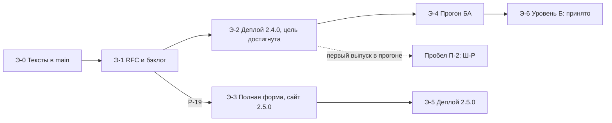

# RFC-PUB-001: Роадмэп публикации промптов всех шагов потока BCREQ (#454)

## Summary / BLUF

**Цель: на [сайте](https://g-ivan-a.github.io/mango_ba_prompts/) есть промпт
для каждого шага потока BCREQ. Сейчас на проде актуальны 0 шагов из 13.** В
`main` готовы все 13. Осталось одно действие — деплой, и задачи на него в
бэклоге до этого RFC не было.

1. **Цель достигается одним деплоем.** Тексты, метки и данные сайта в `main`
   целостны: это показал [аудит](../../experiments/issue_454/audit_flow_coverage.log).
   Деплой — действие владельца: нужны права на исходный репозиторий и проверка
   пароля. Задача — новая [BL-232](../../pr-ops/backlog-repository.md#bl-232-публикация-сайта-на-прод-и-приёмка).
2. **«Опубликовано» значит разное.** Уровень А — текст доступен на сайте с
   честной меткой: это цель issue #454. Уровень Б — текст измерен и принят. Он
   требует прогонов БА и в ноябрьское окно не укладывается.
3. **Новых промптов писать не нужно.** Единственная заглушка — Ш-Р. Её
   достаточно: настоящий текст нечем измерить, пока нет случая выпуска. Задача —
   новая [BL-170](../../pr-ops/backlog-ba-model.md#bl-170-промпт-шага-выпуска-ш-р-вместо-заглушки),
   по триггеру.
4. **Решение владельца одно — [Р-19](../../pr-ops/BACKLOG.md#2-решения-владельца).**
   Оно подтверждает границу цели и снимает формальные зависимости, из-за которых
   BL-157в, BL-230 и BL-231 нельзя начать сейчас. Деплой этого решения не ждёт.
5. **Роадмэп** — [раздел 3](#3-роадмэп). Каждая его строка ведёт на задачу или на
   названный пробел. Статусы сверяет валидатор: они не могут разойтись с бэклогом.

## 1. Цель и как её измерить

| Код | Цель | Как проверить | Значение на 2026-11-05 |
| --- | --- | --- | --- |
| Ц-1 | На проде каждый из 13 шагов отдаёт текущий текст из `main` с меткой `published` или `by-test` | `python3 experiments/issue_454/audit_flow_coverage.py`, поле `prod.steps_current` | **0 из 13** |
| Ц-2 | БА может пройти шаги по сайту: вход, вкладки этапов, копирование | Ручная проверка в чистой вкладке, порядок [`docs/site-access.md`](../site-access.md#ручной-деплой) | не проверено, на проде нет набора |
| Ц-3 | Движение к цели видно в одном документе | Этот RFC и `scripts/validate_issue_454_publication_roadmap.py` | этот PR |

Ц-1 и Ц-2 вместе закрывают цель 1 issue #454, Ц-3 — цель 2.

**Два уровня публикации.** Их нельзя смешивать, иначе метка на сайте обещает
больше, чем проверено.

| Уровень | Что значит | Условие | Кто закрывает |
| --- | --- | --- | --- |
| А. Доступно | Текст на сайте, метка честная: `published` или `by-test` | Деплой | BL-232 |
| Б. Принято | Текст измерен и принят человеком, пометка «по тесту» снята | Прогоны БА, `ba_reviewed: true`, ADR | BL-157в, остаток BL-156, BL-111, BL-158 |

Правило DEC-427-11 остаётся: в `prompts/` текст попадает, только если он не хуже
базовой линии. Цель уровня А это правило не ослабляет: черновики идут на сайт с
меткой `by-test`.

## 2. Где мы сейчас

Срез на 2026-11-05. Все значения проверены чтением.

| Что | Факт | Свидетельство |
| --- | --- | --- |
| Прод | `gh-pages` = `b273b387` от 2026-10-27; `data/test-kit.json` отдаёт 404; 14 промптов v0.1; Ш-Р нет | [лог аудита](../../experiments/issue_454/audit_flow_coverage.log), [аудит #452](../../experiments/issue_452/audit_publication.log) |
| `main` | Сайт 2.4.0, комплект 0.5: 13 шагов, 9 `published`, 4 `by-test`, хеши сходятся | [`site/data/test-kit.json`](../../site/data/test-kit.json), аудит: `integrity problems: none` |
| Runtime | Срез `68ad8fcf` = runtime `main`, реестр 0.5, маршрут `sections_toc`; открытых задач и PR нет. Осталась заглушка З-2 | [реестр](../../standards/bcreq-runtime-references.md) |
| Замеры | Есть у Ш-0, Ш-1, Ш-2, Ш-3, Ш-6, Ш-В; у всех `ba_reviewed: false` | раздел 4 |
| Человек | Прогона БА с `ba_reviewed: true` нет | строка BL-157 |

**Почему 0, а не 7.** У семи шагов номер версии на проде и в `main` совпадает
(0.1), но тексты разные: в `main` они закреплены на SHA runtime (BL-156а), поэтому
сравнение номеров завышает результат. Аудит сравнивает сами тексты и хеши.

## 3. Роадмэп

Статус — срез на дату в шапке. Источник статуса — только
[`pr-ops/BACKLOG.md`](../../pr-ops/BACKLOG.md): валидатор падает при расхождении.

<!-- roadmap:start -->
| Этап | Результат | Задача или пробел | Статус | Кто | Зависит от | Критерий |
| --- | --- | --- | --- | --- | --- | --- |
| Э-0 | Тексты, метки и данные сайта в `main` | [BL-156](../../pr-ops/backlog-ba-model.md#bl-156-промпты-шагов-потока-из-стандартов-по-тесту) | ЧАСТИЧНО | исполнитель | — | 13 шагов, хеши сходятся; остаток — уровень Б |
| Э-0 | Промпт Ш-В v0.3 | [BL-156г](../../pr-ops/backlog-ba-model.md#bl-156г-правило-правка-без-добавлений-и-шаги-одного-процесса) | DONE | исполнитель | — | RUN-0085 |
| Э-0 | Блок практики и правила сессии | [BL-167](../../pr-ops/backlog-ba-model.md#bl-167-блок-отраслевая-практика--на-решение-ба-в-шагах-ш-1-ш-3-ш-6), [BL-168](../../pr-ops/backlog-ba-model.md#bl-168-правила-многоходовой-сессии-правок) | DONE, DONE | исполнитель | — | RUN-0086, RUN-0087 |
| Э-1 | Роадмэп, границы цели, задачи | Этот RFC, [Р-19](../../pr-ops/BACKLOG.md#2-решения-владельца) | ждёт | владелец | — | Ответ на Р-19, статус RFC |
| Э-2 | **Сайт 2.4.0 на проде. Цель достигнута** | [BL-232](../../pr-ops/backlog-repository.md#bl-232-публикация-сайта-на-прод-и-приёмка) (был пробел П-1) | TODO | владелец | — | `prod.steps_current` = 13, пароль проверен |
| Э-3 | Таблица шагов процесса v0.3 | [BL-230](../../pr-ops/backlog-repository.md#bl-230-процесс-bcreq-v03-шаги-потока-в-форме-v01) | TODO | исполнитель | Р-19 | Каждый шаг ссылается на существующий промпт |
| Э-3 | «Варианты дальше», промпты шагов без пометки архива, сайт 2.5.0 | [BL-231](../../pr-ops/backlog-repository.md#bl-231-раздел-процессы-копирование-промпта-и-варианты-дальше) | TODO | исполнитель | BL-230, Р-19 | Тесты сайта, скриншот |
| Э-4 | Прогон одной новой задачи по сайту, калибровка судьи | [BL-157в](../../pr-ops/backlog-ba-model.md#bl-157в-первый-прогон-bl-111-с-комплектом) | deferred (triggered) | БА | BL-232, Р-19 | Прогон в `runs/` с `ba_reviewed: true` |
| Э-5 | Сайт 2.5.0 на проде | Порядок BL-232, условие готовности BL-231 | — | владелец | BL-231 | Аудит 13 из 13 на новой версии |
| Э-6 | Серия прогонов и замер остальных шагов | [BL-111](../../pr-ops/backlog-ba-model.md#bl-111-серия-реальных-прогонов-этапа-1) | TODO | БА, исполнитель | Р-01, BL-101…BL-103 | Вне цели #454 |
| Э-6 | Снятие пометки «по тесту» | [BL-158](../../pr-ops/backlog-ba-model.md#bl-158-обратное-согласование-стандартов-по-тесту-через-adr) | deferred (triggered) | владелец | BL-111 | Вне цели #454 |
| Вне ряда | Промпт Ш-Р вместо заглушки | [BL-170](../../pr-ops/backlog-ba-model.md#bl-170-промпт-шага-выпуска-ш-р-вместо-заглушки) (был пробел П-2) | deferred (triggered) | исполнитель | BL-157 | Прогон дошёл до Ш-Р или просьба владельца |
| Вне ряда | Образцы разделов для Ш-3…Ш-8, снятие З-2 | **Пробел П-6**, задачи нет | — | владелец в runtime (РТ-2) | Данные прогона БА | Прогон БА покажет дефекты формы вывода |
<!-- roadmap:end -->

**Что не блокирует цель, хотя открыто.** BL-162 (поправка ADR-003) можно делать в
любой момент, на цель не влияет. BL-161, BL-164…BL-166 ждут своих триггеров.

## 4. Покрытие по шагам потока

Состав шагов — [RFC #427, раздел 9.2](2026-11-bcreq-flow-processes-prompts.md) и
[комплект прогона](../ba-processes/bcreq-run-kit.md). «Прод» — версия в каталоге на
проде: ни у одного шага текст не совпадает с `main`, карточек шагов на проде нет.

<!-- coverage:start -->
| Шаг | Промпт | Режим | `main` | Прод | Замер | Заглушка | Закрывает шаг |
| --- | --- | --- | --- | --- | --- | --- | --- |
| Ш-0 | `bcreq-constitution-governance-oneshot` | by-test | 0.2 | 0.1 | RUN-0083, RUN-0087 | — | BL-232 |
| Ш-1 | `bcreq-context-understanding-stepwise` | by-test | 0.2 | 0.1 | RUN-0083, RUN-0086 | — | BL-232 |
| Ш-2 | `bcreq-products-impact-analysis-stepwise` | by-test | 0.1 | 0.1 | RUN-0083 | — | BL-232 |
| Ш-3 | `bcreq-fr-documentation-stepwise` | published | 0.2 | 0.1 | RUN-0086 | З-2 | BL-232 |
| Ш-4 | `bcreq-nfr-documentation-stepwise` | published | 0.1 | 0.1 | нет | З-2 | BL-232 |
| Ш-5 | `bcreq-uc-modeling-stepwise` | published | 0.1 | 0.1 | нет | З-2 | BL-232 |
| Ш-6 | `bcreq-orr-solution-design-stepwise` | published | 0.2 | 0.1 | RUN-0086 | — | BL-232 |
| Ш-7 | `bcreq-constraints-documentation-stepwise` | published | 0.1 | 0.1 | нет | — | BL-232 |
| Ш-8 | `bcreq-uc-modeling-stepwise` | published | 0.1 | 0.1 | нет | З-2 | BL-232 |
| Ш-9 | `bcreq-extra-risk-analysis-stepwise` | published | 0.1 | 0.1 | нет | — | BL-232 |
| Ш-В | `bcreq-review-validation-oneshot` | published | 0.3 | 0.1 | RUN-0081, RUN-0082, RUN-0084, RUN-0085 | — | BL-232 |
| Ш-Р | `bcreq-release-readiness-oneshot` | by-test | нет | нет | нет | заглушка шага | BL-232, затем BL-170 |
| Ш-С | `bcreq-scenarios-modeling-oneshot` | published | 0.1 | 0.1 | нет | З-2 | BL-232 |
<!-- coverage:end -->

Итого 13 шагов и 12 файлов: Ш-5 и Ш-8 используют один файл. Текст Ш-Р — только
черновик в `prompts/drafts/`, на сайт он попадает через комплект прогона. Замеры
синтетические (`ba_reviewed: false`) и потому не приёмка. Шаги без замера идут
как v0.1 с закреплёнными ссылками: сравнения с базовой линией у них нет.

Промпты агентного маршрута в поток не входят и пробелом не считаются: RFC #427
прямо выводит их из ручного потока.

## 5. Пробелы

| Код | Пробел | Мешает цели | Что с ним |
| --- | --- | --- | --- |
| П-1 | У деплоя не было задачи: только упоминание в строке BL-157. README и `docs/site-access.md` описывают деплой по-разному | **Да, единственный** | [BL-232](../../pr-ops/backlog-repository.md#bl-232-публикация-сайта-на-прод-и-приёмка) |
| П-2 | У Ш-Р только заглушка, задачи на настоящий промпт нет | Нет: заглушка честно помечена | [BL-170](../../pr-ops/backlog-ba-model.md#bl-170-промпт-шага-выпуска-ш-р-вместо-заглушки), по триггеру |
| П-3 | Формальные зависимости: BL-157в ждёт BL-111, та — BL-101…BL-103, BL-202 и Р-01, Р-02; BL-230 ждёт весь BL-156; BL-231 ждёт Р-09 | Не мешает Ц-1, мешает Э-3 и Э-4 | [Р-19](../../pr-ops/BACKLOG.md#2-решения-владельца), DEC-454-03 |
| П-4 | Ш-4, Ш-5, Ш-7, Ш-8, Ш-9, Ш-С не измерены; Ш-0, Ш-1, Ш-2 — только один синтетический прогон A-IN (RUN-0083, N = 1) или точечные замеры | Нет: это уровень Б | Остаток BL-156 и BL-111, новых задач не нужно |
| П-5 | Граница цели не была записана: вне её `asr-*`, `letter-customer-*`, `meeting-*`, `session-debug-*`, агентный маршрут, 39 классов пилота | Уточняет цель | Р-19, DEC-454-01 |
| П-6 | Заглушка З-2: образцов разделов нет в срезе runtime (РТ-2, P1) | Нет: заглушка явная | **Задачи нет сейчас.** РТ-2 создаёт владелец, если прогон БА покажет дефекты формы вывода Ш-3…Ш-8 |
| П-7 | 14 промптов шагов помечены архивом в каталоге, «Варианты дальше» не реализованы | Нет: набор на сайте идёт мимо этой пометки | BL-230, BL-231 |

**Наблюдение вне пробелов.** RFC стратегии имеет `status: accepted`, а строка Р-01
в бэклоге — «ждёт». Ответа владельца с принятием в PR #421 я не нашёл, поэтому
статус не менял. На цель это не влияет: DEC-454-03 развязывает BL-157в и BL-111.

## 6. План на 5–7 ноября

| День | Кто | Что | Результат |
| --- | --- | --- | --- |
| 5.11 | владелец | Смержить PR #455, ответить на Р-19 одной строкой | Бэклог и RFC в `main`, зависимости сняты |
| 5.11 | владелец | Деплой 2.4.0 по [`docs/site-access.md`](../site-access.md#ручной-деплой), проверка пароля в чистой вкладке (BL-232) | **Цель Ц-1 и Ц-2** |
| 5.11 | исполнитель или владелец | Повторить аудит, записать итог в BL-232 | `prod.steps_current` = 13 |
| 6.11 | исполнитель | BL-230 и BL-231 одним PR: процесс v0.3, сайт 2.5.0 | PR на ревью |
| 6.11 | БА | Начать одну новую задачу по сайту 2.4.0 (BL-157в) | Данные для наблюдения |
| 7.11 | владелец | Принять процесс v0.3, смержить PR BL-230, BL-231, деплой 2.5.0, повторить аудит | Полная форма на проде |
| 7.11 | БА, исполнитель | Записать прогон в `runs/` с `ba_reviewed: true`, если задача завершена | BL-157в |

**Что в плане не гарантировано.** Цель зависит только от владельца и может быть
достигнута 5 ноября. BL-230 и BL-231 за день — моя оценка, при условии что Р-19
получено утром 6 ноября. Прогон БА за два дня не обещаю: его длительность задаёт реальная задача, а
7 ноября — суббота. Если прогон не завершён, BL-157в просто остаётся открытой. На
цель это не влияет.

**Если Р-19 не дано.** Деплой 2.4.0 всё равно выполним: цель достигается. BL-230,
BL-231 и BL-157в ждут, как и сейчас.

## 7. Решения на согласование

Ответ — одна строка в комментарии к
[PR #455](https://github.com/G-Ivan-A/mango_ba_prompts/pull/455): `Р-19 да` или
`Р-19: DEC-454-NN нет`.

| Код | Вопрос | Рекомендация | Почему |
| --- | --- | --- | --- |
| DEC-454-01 | Что значит «все промпты» | 13 шагов потока на проде, `published` или `by-test` с честной меткой. Агентный маршрут и промпты вне BCREQ не входят | Цель названа «для реализации всех шагов потока BCREQ». Граница сайта задана в issue #391 |
| DEC-454-02 | Хватит ли заглушки Ш-Р для первого деплоя | Да, BL-170 — по триггеру | Случая выпуска нет, базовой линии для Р-03 нет; выдуманные правила — инфляция. Черновик честно говорит, что содержательных правил сверх контрактов нет |
| DEC-454-03 | Снять формальные зависимости | BL-157в не ждёт BL-111 и BL-101…BL-103, серия BL-111 остаётся; BL-230 не ждёт остатка BL-156; BL-231 не ждёт Р-09 | Владелец в issue #450 уже сузил триггер BL-157в. Остаток BL-156 ждёт прогонов, а BL-157в ждёт сайта: иначе круг. Р-15 и DEC-427-12 новее и конкретнее Р-09 |
| DEC-454-04 | Порядок деплоев | Два: 2.4.0 сейчас, 2.5.0 после BL-231 | Деплой не должен ждать полной формы: набор уже работает, а прод отстаёт с 27 октября |

## 8. Граничные случаи

| Случай | Что делаем |
| --- | --- |
| Деплой прошёл, аудит показывает меньше 13 | BL-232 не `DONE`. Сравнить `gh-pages` с `site/` проверенного коммита |
| Деплой сделан с коммита старше `main` | Аудит покажет расхождение. Выкладывать только проверенный коммит |
| После деплоя слит PR с промптами | Прод снова отстаёт. Повторный деплой — та же процедура, новая задача не нужна |
| БА начал работу до деплоя | Такой прогон идёт не по набору: в карточке указать фактические промпты, новый начинать после деплоя (вывод PR #451) |
| Прогон БА показал регрессию опубликованного текста | Откат версии в `prompts/` и повторный деплой: деплой обратим, история `gh-pages` сохраняется |
| Владелец отверг DEC-454-01 и хочет все файлы | Р-19 меняет цель; потребуется отдельная задача на границу сайта (issue #391, вопросы PR #453) |
| Сайт откроют без пароля | Барьер клиентский, файлы доступны напрямую (`docs/site-access.md`). Те же тексты лежат в публичном репозитории, новой утечки публикация не создаёт |

## 9. Что не делаем и почему

- **Новые замеры до прогона БА.** Синтетика уже дала что могла, GS-BCREQ-26 и S6-a1
  ждут данных BL-157в.
- **Настоящий промпт Ш-Р сейчас.** Нечем измерить.
- **Автоматический деплой.** Actions отключены; `docs/site-access.md` запрещает их
  включать.
- **Задача в runtime.** Там нет открытых работ, блокера цели нет. Тела задач
  создаёт владелец (A-08 RFC #427).
- **Деплой этим PR.** У исполнителя нет прав на исходный репозиторий, а проверку
  пароля нельзя делегировать.

## 10. Риски

| Риск | Вероятность | Что снижает |
| --- | --- | --- |
| Прод снова отстанет после следующего слияния: автоматического деплоя нет | Высокая | Аудит одной командой, повторный деплой в условии готовности BL-231 |
| Метка `published` прочитается как «принято человеком» | Средняя | Два уровня в разделе 1; все замеры — `ba_reviewed: false`; BL-157в |
| Роадмэп устареет | Средняя | Валидатор сверяет статусы и шаги, падает с подсказкой обновить срез |
| Р-19 не отвечено долго | Средняя | Цель от него не зависит |
| Настоящий пароль не сработает на проде | Низкая, но я проверить не могу | Проверка владельца в чистой вкладке — условие BL-232 |

## 11. Связь с другими RFC

- [RFC-RT-001](2026-11-runtime-product-catalog-golden-set.md), стартовый SSOT issue:
  поправка 0.8 ссылается сюда. Содержание RFC-RT-001 (каталог и golden set runtime)
  не меняется.
- [RFC #427](2026-11-bcreq-flow-processes-prompts.md): шаги потока, DEC-427-11,
  DEC-427-12 действуют. Р-19 меняет только зависимости задач, а не решения RFC.
- Р-19 при ответе «да» также принимает этот RFC в версии 0.1; перевод в `accepted` —
  после ответа владельца.

## Related Artifacts

- [Аудит покрытия](../../experiments/issue_454/audit_flow_coverage.py) — [лог](../../experiments/issue_454/audit_flow_coverage.log), [факты](../../experiments/issue_454/audit_flow_coverage.json)
- [Аудит публикации #452](../../experiments/issue_452/audit_publication.py) — [лог](../../experiments/issue_452/audit_publication.log)
- [Постановка задачи](../../experiments/issue_454/task-statement.md)
- [Валидатор роадмэпа](../../scripts/validate_issue_454_publication_roadmap.py) — [мутации](../../experiments/issue_454/mutations.log)
- [Бэклог, цепочка на 2026-11-05](../../pr-ops/BACKLOG.md) — статусы, BL-170, BL-232, Р-19
- [Порядок деплоя](../site-access.md#ручной-деплой)
