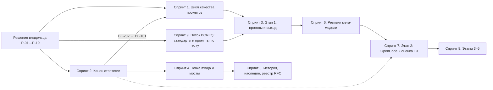

# Бэклог mango_ba_prompts

Этот файл — входной документ бэклога. В нём порядок работ, решения владельца
и статусы. Содержание задач вынесено в два файла карточек:

| Файл | Что внутри |
| --- | --- |
| [`backlog-ba-model.md`](backlog-ba-model.md) | Трек Б, задачи `BL-1xx`: модель БА — процессы, промпты, уроки, golden set, этапы 1–5. |
| [`backlog-repository.md`](backlog-repository.md) | Трек А, задачи `BL-2xx`: документы и устройство репозитория. |
| [`backlog-instruction.md`](backlog-instruction.md) | Правила ведения: форматы, статусы, жизненный цикл, проверки. |

Бэклог — согласовательный шаг (issue #418). Он ничего не меняет в
репозитории: промпты, прогоны, стандарты, канонические документы, ADR, RFC и
сайт не правятся. Исполнение начинается отдельными PR после решений владельца.

## Как читать за две минуты

1. Раздел 1 — весь порядок работ на одной странице: схема и таблица шагов.
2. Раздел 2 — девятнадцать решений владельца `Р-01…Р-19`. Без них задачи не
   стартуют. У каждого решения есть рекомендация; ответ — одна строка в
   комментарии к PR #421 (`Р-13…Р-15` — к PR #428, `Р-16` — к PR #436,
   `Р-17` — к PR #437, `Р-18` — к PR #449, `Р-19` — к PR #455).
3. Раздел 3 — ответ про мета-модель БА Хаба: на этом шаге не меняем.
4. Раздел 4 — спринты в формате бэклога Хаба. Название задачи — ссылка на
   карточку: почему, что меняется, источники с цитатой, когда готово.
5. Разделы 5–7 — открытые вопросы, технический долг и архив прежнего плана.

Коды в тексте:

| Код | Что это | Где описан |
| --- | --- | --- |
| `BL-1xx` | Задача трека Б (модель БА) | [`backlog-ba-model.md`](backlog-ba-model.md) |
| `BL-2xx` | Задача трека А (репозиторий) | [`backlog-repository.md`](backlog-repository.md) |
| `Р-NN` | Решение владельца | [Раздел 2](#2-решения-владельца) |
| `КФ-NN` | Противоречие между документами | [Противоречия](#противоречия-которые-снимают-решения) |
| `S-NNN` | Технический долг | [Раздел 6](#6-технический-долг-соответствия-стандартам-хаба-issue-267) |
| `M-NNN` | Задача прежнего плана миграции | [Раздел 7](#7-архив) |
| «B-NNN Хаба» | Задача бэклога Хаба | бэклог Хаба |

Коды документов-источников, на которые ссылаются решения и карточки:

| Код | Что это | Где описан |
| --- | --- | --- |
| `DEC-NN` | Решение RFC модернизации репозитория | [RFC модернизации](../docs/rfc/2026-10-repository-modernization.md#решения-на-согласование) |
| `CH-N` | Требование владельца из чатов #413 | [RFC модернизации](../docs/rfc/2026-10-repository-modernization.md#требования-владельца-из-чатов-приложенных-к-413) |
| `DEC-411-NN` | Решение RFC уроков | [RFC уроков](../docs/rfc/2026-10-bcreq-run-lessons-pipeline.md#решения-на-согласование) |
| `DEC-420-NN` | Решение RFC раздела «Стандарты» | [RFC #420](../docs/rfc/2026-10-standards-page.md#решения-на-согласование) |
| `DEC-415-NN` | Решение RFC стратегии | [RFC стратегии](../docs/rfc/2026-10-ba-automation-strategy.md#решения-на-согласование) |
| `DEC-427-NN` | Решение RFC потока BCREQ: процессы, стандарты, промпты (issue #427) | [RFC #427](../docs/rfc/2026-11-bcreq-flow-processes-prompts.md#11-решения-на-согласование) |
| `DEC-454-NN` | Решение роадмэпа публикации промптов (issue #454) | [RFC-PUB-001](../docs/rfc/2026-11-bcreq-prompts-publication-roadmap.md#7-решения-на-согласование) |
| `П-NN` | Пробел на пути к цели публикации (issue #454) | [RFC-PUB-001](../docs/rfc/2026-11-bcreq-prompts-publication-roadmap.md#5-пробелы) |
| `REC-425-NN` | Рекомендация проверки промптов, классов и стандартов BCREQ (issue #425) | [Проверка #425](../docs/analysis/2026-11-02-bcreq-prompts-classes-standards-check.md#recommendations) |
| `P-N` | Процесс в мета-модели runtime; P-08 — оценка тендерного ТЗ | [RFC-ТТЗ, мета-модель](../docs/rfc/2026-11-ttz-feasibility-flow.md#5-мета-модель-применение-сейчас-и-возможные-расширения) |
| `И-N` | Справочник runtime в перечне исключений (BL-154) | [Реестр справочников, раздел 2](../standards/bcreq-runtime-references.md#2-перечень) |
| `ТС-N` | Требование к справочнику runtime (BL-154) | [Реестр справочников, раздел 3](../standards/bcreq-runtime-references.md#3-требования-к-справочникам) |
| `З-N` | Заглушка недостающего справочника runtime (BL-155) | [Реестр справочников, раздел 4](../standards/bcreq-runtime-references.md#4-заглушки) |
| `РТ-N` | Задача на справочник для репозитория runtime (BL-155) | [Реестр справочников, раздел 6](../standards/bcreq-runtime-references.md#6-задачи-для-репозитория-runtime) |
| `К-NN` | Класс операции ручного процесса BCREQ (39 стандартов классов) | [Каталог классов](../standards/bcreq-manual-classes/README.md) |
| `Ш-N` | Шаг потока BCREQ этапа 1 (Ш-0…Ш-10, Ш-В, Ш-Р, Ш-С) | [Комплект прогона](../docs/ba-processes/bcreq-run-kit.md#1-порядок-шагов) |
| `ХАБ-N` | Задача для Хаба по RFC-RT-001 (норма привязки к каталогу продуктов) | [RFC-RT-001, раздел 6](../docs/rfc/2026-11-runtime-product-catalog-golden-set.md#6-хаб-1--тело-задачи-для-hybrid-intelligence-lab-норма-привязки) |
| `REC-417-NN` | Рекомендация проверки стратегии на индустриальные практики | [PR #419, Recommendations](https://github.com/G-Ivan-A/mango_ba_prompts/blob/c6e748511684d3a68338b14c23dfa13d4e4a30b5/docs/analysis/2026-10-31-industry-practice-check.md#recommendations) |
| `T-NN` | Задача реестра задач исполнения (аудит #409) | [Реестр задач](../docs/analysis/2026-10-31-follow-up-tasks.md#задачи-на-изменение-репозитория) |
| `Т-NN` | Требование RFC-AIN-001 (кириллическая «Т») | [Матрица требований A-IN](../docs/rfc/2026-11-a-in-decomposition.md#11-фт-нфт-и-evidence-приёмки) |
| `F-NN` | Находка аудита репозитория | [Аудит, реестр находок](../docs/audit/2026-10-31-repository-audit.md#реестр-находок) |
| `L-NN` | Урок прогонов BCREQ | [Реестр уроков](../standards/bcreq-lessons/README.md#уроки) |
| `RFC-NNNN` | Запись реестра RFC промптов | [Реестр RFC](../docs/rfc/rfc-registry.md) |
| `LG-N` | Правило передачи опыта в Хаб (ADR-014 Хаба) | ADR-014 Хаба |
| `ADR-NNN` | Архитектурное решение | [`docs/adr/`](../docs/adr/) |
| `RUN-NNNN` | Прогон промптов | [`runs/`](../runs/) |

Статусы и поля таблиц — как в бэклоге Хаба; расшифровка — в
[`backlog-instruction.md`](backlog-instruction.md#статусы).

## 1. Логика и порядок на одной странице

Порядок владельца: Этап 1 → ревизия мета-модели БА Хаба → этап 2 на OpenCode.
Этап 1 — работа БА с промптами в чате; его выход — базовая линия метрик.
Сверка с мета-моделью идёт по данным этапа 1, а не до них. Пакет OpenCode
собирается на сверенной модели.

Чтобы этап 1 дал измеримый результат, сначала замыкается цикл качества
промптов: замечание БА → урок → блок уроков в промпте → проверка на golden set.
Параллельно трек А приводит канонические документы к стратегии, чтобы задачи
этапов ссылались на одну версию правды.



| Шаг | Спринт | Трек | Что получаем | Ворота перехода |
| --- | --- | --- | --- | --- |
| 0 | — | — | Решения `Р-01…Р-22` | Ответ владельца в PR #421, PR #428, PR #436, PR #437, PR #449, PR #455, PR #457 и PR #465 |
| 1 | [Спринт 1](#спринт-1-цикл-качества-промптов) | Б | Уроки в промптах, единый словарь кодов, golden set и порог | BL-101…BL-103 `DONE` |
| 1 | [Спринт 2](#спринт-2-канон-стратегии) | А | Канон версии 2.0, ADR этапов 3–4, принятый RFC модернизации | BL-201…BL-203 `DONE` |
| 1 | [Спринт 9](#спринт-9-поток-bcreq-стандарты-и-промпты-по-тесту) | Б, А | Стандарты и промпты «по тесту», раздел «Процессы» в форме до 2.0.0, комплект прогона | BL-150…BL-155, BL-159, BL-163 `DONE`; BL-157 — `deferred (triggered)` (этапы BL-157а и BL-157б — `DONE`, PR #439 и PR #447; BL-157в — вход владельца разобран в issue #448, нужен прогон БА с `ba_reviewed: true`; BL-157г — `DONE`, [PR #459](https://github.com/G-Ivan-A/mango_ba_prompts/pull/459), RUN-0090, RUN-0091); BL-156 — `ЧАСТИЧНО` (этапы BL-156а…BL-156г — `DONE`, PR #445, PR #449, [PR #451](https://github.com/G-Ivan-A/mango_ba_prompts/pull/451); остаток — 10 черновиков до golden set или прогонов BL-111); BL-167, BL-168 — `DONE`, [PR #451](https://github.com/G-Ivan-A/mango_ba_prompts/pull/451), RUN-0086, RUN-0087; BL-232 — `TODO`, деплой: [роадмэп](../docs/rfc/2026-11-bcreq-prompts-publication-roadmap.md#3-роадмэп); BL-162, BL-170, BL-230, BL-231 — `TODO`; BL-171 — после прогона БА; BL-158, BL-161, BL-165, BL-166, BL-174 — после прогонов; BL-160 — к этапу 3; BL-164 — проект #466, исполнение BL-177 |
| 1–3 | [Спринт 10](#спринт-10-доисследование-provenance) | Б | Аналитическая рекомендация без внедрения provenance | BL-182 `TODO`, отдельное решение владельца до любых изменений |
| 2 | [Спринт 3](#спринт-3-этап-1-прогоны-и-выход) | Б | Реальные прогоны этапа 1, базовая линия метрик | Ворота 1: решение владельца о выходе (BL-113) |
| 3 | [Спринт 6](#спринт-6-ревизия-мета-модели-после-этапа-1) | Б | Запись совместимости с мета-моделью БА Хаба | BL-121 `DONE`; BL-122 — по Р-12 |
| 4 | [Спринт 7](#спринт-7-этап-2-opencode-и-оценка-тз) | Б | Пакет OpenCode, квалификация клиента, оценка ТЗ | Ворота 2: golden set на пакете не хуже базовой линии |
| 5 | [Спринт 8](#спринт-8-этапы-35) | Б | Стенд n8n, код, масштабирование | Icebox до ворот 2 |
| 1–3 | [Спринт 4](#спринт-4-точка-входа-и-мосты), [Спринт 5](#спринт-5-история-наследие-реестр-rfc) | А | Точка входа, связи с Хабом и runtime, разметка истории | Не блокируют трек Б |

Критический путь: Р-02 → BL-202 (перенумерация ADR) → BL-101 → BL-102 →
BL-103 → BL-111 → BL-112 → BL-113 → BL-121 → BL-131 → BL-132.

Почему именно так:

- Без уроков в промптах прогоны этапа 1 повторят уже известные ошибки
  (BL-101); без единого словаря кодов ошибки разных прогонов не сравнить
  (BL-102); без порога нельзя сказать «стало лучше» (BL-103).
- Без базовой линии этапа 1 нечем проверить ворота этапа 2 «не хуже этапа 1»
  (BL-113).
- Сверка с мета-моделью до этапа 1 — сверка с гипотезой; после — с фактами
  (BL-121).
- Прогоны этапа 1 на новых задачах идут с промптами «по тесту» из
  стандартов, а не с классами без доказательства (BL-156, BL-157); стандарты
  принимаются ADR по итогам этих прогонов (BL-158).
- Трек А идёт параллельно и блокирует трек Б в двух местах: номер ADR уроков
  (BL-202 → BL-101) и пакет `AGENTS.md` этапа 2 (BL-211 ↔ BL-131).

## 2. Решения владельца

Каждое решение открывает задачи. Рекомендация — вариант, который бэклог
предлагает по источникам; владелец может выбрать другой.

| Р | Что решить | Рекомендация | Открывает | Статус |
| --- | --- | --- | --- | --- |
| **Р-01** | Принять RFC стратегии v0.2 (PR #419) и рекомендации REC-417-01…06 | Принять: слить PR #419, RFC → `accepted` | BL-111, BL-113, BL-131, BL-133, BL-141…BL-143, BL-201, BL-202, BL-224 | ждёт |
| **Р-02** | Принять ADR реестра уроков и решения DEC-411-01…12 RFC уроков | Принять как в RFC; DEC-411-06 — полные блоки уроков (качество выше экономии, issue #418) | BL-101…BL-109, BL-112, BL-114, BL-115, BL-134, BL-224 | ждёт |
| **Р-03** | Порог приёмки DEC-411-04 и минимальное число прогонов N | Порог — «не хуже одновременного контроля»: замер правки `prompts/` идёт с контрольным плечом (опубликованный текст) в тех же повторах и у тех же судей; N = 3; медиана новой версии не хуже медианы контроля по сданным кейсам, ядру и ложным дефектам. Почему: [RUN-0082](../runs/2026/RUN-0082/outputs/golden-set-report.md) (issue #446) — на одном тексте ядро 6…10 из 11, максимум 56/62 = 0,90, прежнее предложение «0,95, N = 5» недостижимо и сравнивает с одним историческим замером. Принято 2026-11-04 ([issue #448](https://github.com/G-Ivan-A/mango_ba_prompts/issues/448), ответ 3); первый замер по правилу — [RUN-0084](../runs/2026/RUN-0084/outputs/golden-set-report.md) | BL-103, BL-113, BL-156 (этапы BL-156б, BL-156в, BL-156г), BL-167, BL-168 | принято |
| **Р-04** | Статус репозитория в экосистеме (DEC-01) и ответ на CH-6 | Вариант В «Гибрид» RFC модернизации; строку Хаба о статусе — через BL-122 | BL-122, BL-203, BL-212 | ждёт |
| **Р-05** | Видимость репозитория (DEC-03) и граница с runtime (DEC-04) | DEC-03: Public до решения по ADR-009 Хаба; DEC-04: runtime — исполнение и KB | BL-203, BL-212, BL-221 | ждёт |
| **Р-06** | Один источник пакета этапа 2 (DEC-06): пакет Хаба (Спринт 28 Хаба) или локальный | Пакет Хаба; ADR-016 спицы — профиль применения пакета | BL-131, BL-132 | ждёт |
| **Р-07** | Корневой `AGENTS.md` через ADR (DEC-07) | Принять: нужен для пакета этапа 2 | BL-211 | ждёт |
| **Р-08** | Разметка истории (DEC-09), локальный KB (DEC-10), легаси-именование S-001 | DEC-09: правило каталога плюс блок перехода; DEC-10: `kb/` на месте с указателем на runtime; S-001 — Icebox | BL-221…BL-223, BL-225 | принято ([issue #456](https://github.com/G-Ivan-A/mango_ba_prompts/pull/457#issuecomment-6670328819)) |
| **Р-09** | Порядок правок сайта (DEC-11, DEC-415-08) и раздел «Стандарты» (#420) | Сайт — только после принятия канона, отдельными задачами; #420 — через PR #422 | BL-110, BL-204…BL-206 | ждёт |
| **Р-10** | Требования из чатов CH-1…CH-7 | CH-1 пометить заменённым решением #417; CH-6 закрыть ответом Р-04; остальные — как в RFC | BL-203 | ждёт |
| **Р-11** | Номер ADR уроков и срок юридической проверки n8n | ADR уроков → ADR-018; юридическая проверка — до запуска стенда этапа 3 | BL-141, BL-202 | ждёт |
| **Р-12** | Мета-модель БА Хаба и передача опыта в Хаб | Мета-модель на этом шаге не менять; сверка BL-121 после этапа 1; BL-122 — только если владелец снимет запрет #413 на передачу | BL-121…BL-124 | ждёт |
| **Р-13** | Принять RFC потока BCREQ (PR #428, редакция 0.2) и решения DEC-427-01…13 | Принять: поток (поток создания ценности) — верхнеуровневый процесс получения BCREQ; цепочка Поток → Процесс (подпроцессы) → Операция → Артефакт; шаг и гейт — элементы процесса, не уровни; операция — тип из `catalog.json`, промпт её исполняет; мета-модель не меняется; уровни таксономии операций — техдолг S-010; базовый стандарт и восемь профилей; ссылки на runtime по перечню; RFC → `accepted` | BL-150…BL-155, BL-125 | принято ([PR #428](https://github.com/G-Ivan-A/mango_ba_prompts/pull/428#issuecomment-6579261813)) |
| **Р-14** | Режим «по тесту» и обратное согласование стандартов через ADR (DEC-427-07, DEC-427-08) | Принять: стандарты и промпты вводятся пробной редакцией; один ADR по итогам прогонов; долг S-009 | BL-151, BL-152, BL-156, BL-158 | принято ([issue #432](https://github.com/G-Ivan-A/mango_ba_prompts/issues/432)) |
| **Р-15** | Основная линия этапа 1 и раздел «Процессы» (DEC-427-04, DEC-427-12, REC-425-01) | Шаги v0.1 — основная линия; классы — пилот до BL-134; раздел «Процессы» — в форме до 2.0.0 с копированием промпта | BL-156, BL-157, BL-230, BL-231 | принято ([PR #439](https://github.com/G-Ivan-A/mango_ba_prompts/pull/439#issuecomment-6630337995)) |
| **Р-16** | Значение `код` и определение гейта в ADR-003 и онтологии (BL-159, issue #433) | Вариант А: принять поправку 0.2 ADR-003 — исполнитель `человек` \| `llm` \| `гибрид` \| `код`; гейт — точка решения, исполнитель по типу гейта, ключевые гейты — `человек`; «молчание = согласие» ADR-0003 — только для PR и документов, не для гейтов процесса BCREQ | BL-162 | принято, вариант А+ ([PR #439](https://github.com/G-Ivan-A/mango_ba_prompts/pull/439#issuecomment-6630337995)) |
| **Р-17** | Каталог продуктов для runtime (RFC-RT-001, PR #437): принять каталог `docs/taxonomy/products.json` 2026-10-28.1 целиком как таксономию runtime | Принято 2026-11-03 ([комментарий владельца](https://github.com/G-Ivan-A/mango_ba_prompts/pull/437#issuecomment-6605372609)): 74 узла с портала переведены из `added-for-review` в `accepted`, каталог `status: accepted`; условие по таксономии для РТ-1 выполнено; РТ-1 и РТ-3 владелец создаёт в runtime | BL-163 | принято |
| **Р-18** | Ограждающий показатель в пред-регистрации замеров `prompts/` | Ввести для будущих замеров: кроме трёх медиан Р-03 плечо не публикуется, если есть кейс, проваленный 3 из 3 у плеча и 0 из 3 у контроля. Почему: в [RUN-0084](../runs/2026/RUN-0084/outputs/golden-set-report.md) (issue #448) A2 провалил GS-BCREQ-25 3 из 3 при 0 из 3 у A0, а три медианы регрессию пропустили. Это практика guardrail-метрик в A/B-тестах. RUN-0084 не пересматривается | BL-156г, BL-167, BL-168 | **принято** ([issue #450](https://github.com/G-Ivan-A/mango_ba_prompts/issues/450)) |
| **Р-19** | Граница цели «все промпты на сайте» и снятие формальных зависимостей ([RFC-PUB-001](../docs/rfc/2026-11-bcreq-prompts-publication-roadmap.md#7-решения-на-согласование), DEC-454-01…04) | Да, всё вместе. Цель — 13 шагов потока на проде с честной меткой `published` или `by-test`, агентный маршрут и промпты вне BCREQ не входят; Ш-Р v0.2 хватает для первого прогона БА, настоящий случай выпуска — BL-174; BL-157в не ждёт BL-111 и BL-101…BL-103, BL-230 не ждёт остатка BL-156, BL-231 не ждёт Р-09; следующий деплой — 2.6.0 после слияния PR #455, дальше по классу правки из раздела 12. Ответ также принимает RFC-PUB-001 v0.2. Деплой BL-232 этого решения не ждёт | BL-157, BL-174, BL-230, BL-231 | ждёт |
| **Р-20** | Что входит в документ ТЗ, режимы Ш-3 и Ш-6, контракт выпуска, параллельная серия, комплект для прогона БА ([RFC-PUB-001](../docs/rfc/2026-11-bcreq-prompts-publication-roadmap.md#7-решения-на-согласование), DEC-454-05…09) | Да, всё вместе. Раздел 5 в ТЗ по умолчанию не входит, его включает политика адресатов (Q9 RFC #420); Ш-3 и Ш-6 остаются `by-test` по R2 RUN-0089, хотя `prompts/` v0.2 измерен на golden set, откат — одна строка комплекта; контракт A-RELEASE и «Выпуск» пишем (BL-234); серия BL-173 идёт параллельно прогону БА по правилам раздела 12 RFC-PUB-001, сначала `contact-center`; БА проходит 1135 и 1137 на комплекте 0.7, версия пишется в карточку, разницу с машинной базой на 9 шагах из 12 читаем с учётом текста | BL-123, BL-157в, BL-173, BL-233, BL-234 | ждёт |
| **Р-21** | Вопросы по корректировкам issue #464: расхождение «Пользователь» с IREB, узкий состав стейкхолдеров 2.5, поток CS вместо стадии A-Tech, место блока «Индустриальные стандарты» ([PR #465](https://github.com/G-Ivan-A/mango_ba_prompts/pull/465), раздел «Вопросы владельцу») | Да, всё вместе: правило владельца о «Пользователе» оставить, 2.5 — заглушка до документов команд, отдельный поток CS, блок после раздела 8. Молчание при слиянии — согласие | BL-235, BL-236 | ждёт |
| **Р-22** | Снять формальную зависимость срезов А и Б Спринта 5 от BL-203 | Снять: T-05 зависит только от DEC-10, а срез А ничего не архивирует; реестр допускает такую правку метаданных | Срез А BL-223; срез Б BL-221 (после подтверждения деплоя и решения Р-05) | принято ([issue #456](https://github.com/G-Ivan-A/mango_ba_prompts/pull/457#issuecomment-6670328819)) |

**Движение по цепочке Р-17 (на 2026-11-04, issue #446).**

| Шаг | Что | Статус | Свидетельство |
| --- | --- | --- | --- |
| Предшествующий | BL-156а: реестр 0.4, черновики и ссылки v0.1 по SHA runtime `f31dcde3` | `review` → `DONE` (PR #445 слит; ответ владельца в issue #446, пункт 1) | [PR #445](https://github.com/G-Ivan-A/mango_ba_prompts/pull/445), строка BL-156 |
| Текущий — закрывается | BL-157б: тестовый набор этапа 1 на сайте (2.2.0), A-IN — `by-test` по синтетическому прогону RUN-0083, комплект v0.3 | `deferred (triggered)` → `review` | [issue #446](https://github.com/G-Ivan-A/mango_ba_prompts/issues/446), [PR #447](https://github.com/G-Ivan-A/mango_ba_prompts/pull/447), [RUN-0083](../runs/2026/RUN-0083/outputs/report.md), строка BL-157 |
| Текущий — замер | BL-156б: замер с повторами Ш-В (Р-03), N = 3 | остаётся `deferred (triggered)`: обе версии ниже RUN-0079 по ядру, публикации нет | [RUN-0082](../runs/2026/RUN-0082/outputs/golden-set-report.md), строка BL-156 |
| Открывает | BL-157в: первый прогон BL-111 с комплектом | `deferred (triggered)` до входа от владельца | строка BL-157 |
| Открывает | BL-156в: правило Ш-В «правка без добавлений», замер с одновременным контролем | `deferred (triggered)` до бюджета владельца (около 0,7 млн токенов; с BL-156б — около 1 млн) | строка BL-156 |
| Открывает | РТ-7: компактное оглавление разделов БЗ runtime | предложено, задачу создаёт владелец | [RFC-RT-001, раздел 14](../docs/rfc/2026-11-runtime-product-catalog-golden-set.md#14-поправка-05-исполнение-bl-157б-issue-446) |
| Ждёт триггера | BL-165, BL-166 | `deferred (triggered)` | строки BL-164…BL-166 |

**Движение по цепочке Р-17 (на 2026-11-04, issue #448).**

| Шаг | Что | Статус | Свидетельство |
| --- | --- | --- | --- |
| Предшествующий | BL-157б: тестовый набор этапа 1 на сайте, A-IN — `by-test` по RUN-0083 | `review` → `DONE` (PR #447 слит; ответ владельца в issue #448, ответ 2) | [PR #447](https://github.com/G-Ivan-A/mango_ba_prompts/pull/447), строка BL-157 |
| Текущий — закрывается | BL-156б и BL-156в: замер Ш-В на плечах A0/A1/A2 с одновременным контролем (Р-03 принято), N = 3; публикуется Ш-В v0.2 — тип гейта и правило «правка без добавлений» | `deferred (triggered)` → `review` | [issue #448](https://github.com/G-Ivan-A/mango_ba_prompts/issues/448), [PR #449](https://github.com/G-Ivan-A/mango_ba_prompts/pull/449), [RUN-0084](../runs/2026/RUN-0084/outputs/golden-set-report.md), строка BL-156 |
| Текущий — разбор | BL-157в: шесть выгрузок чатов БА — 255 правок, практика не предложена 19 раз | вход владельца получен и разобран; остаётся `deferred (triggered)` до прогона БА с `ba_reviewed: true` | [разбор BL-157в](../docs/analysis/2026-11-04-bl-157v-chat-analysis.md), строка BL-157 |
| Текущий — сайт | Раздел «Процессы» 2.3.0: подстраницы этапов 1–4, карточки шагов для БА, id промпта и шаг в первой строке копии | в PR #449 (отзыв владельца в issue #448) | [скриншоты](../site/screenshots/issue-448/), [комплект прогона](../docs/ba-processes/bcreq-run-kit.md) |
| Открывает | BL-156г: правило «правка без добавлений» отличает два действия в одном ФТ от шагов одного процесса (GS-BCREQ-25) | `TODO`, бюджет около 0,7 млн токенов | строка BL-156, [RUN-0084, «Рекомендации»](../runs/2026/RUN-0084/outputs/golden-set-report.md#рекомендации) |
| Открывает | BL-167: блок «Отраслевая практика — на решение БА» в Ш-1, Ш-3, Ш-6 | `TODO` | строка BL-167, [разбор BL-157в, раздел 6](../docs/analysis/2026-11-04-bl-157v-chat-analysis.md#6-почему-ии-агенты-не-предлагают-отраслевую-практику-сразу) |
| Открывает | BL-168: правила многоходовой сессии правок | `TODO` | строка BL-168, [разбор BL-157в, раздел 5](../docs/analysis/2026-11-04-bl-157v-chat-analysis.md#5-открытые-паттерны) |
| Открывает | Р-18: ограждающий показатель в пред-регистрации | ждёт решения владельца | строка Р-18 |
| Открывает | 50 кандидатов в golden set и уроки | вход BL-112, в golden set не добавлены | [разбор BL-157в, раздел 7](../docs/analysis/2026-11-04-bl-157v-chat-analysis.md#7-кандидаты-в-golden-set-и-уроки) |
| Ждёт владельца | РТ-7: компактное оглавление разделов БЗ runtime | задачу создаёт владелец в runtime (issue #448, ответ 5) | [RFC-RT-001, раздел 14](../docs/rfc/2026-11-runtime-product-catalog-golden-set.md#14-поправка-05-исполнение-bl-157б-issue-446) |

**Движение по цепочке (на 2026-11-05, issue #450).**

| Шаг | Что | Статус | Свидетельство |
| --- | --- | --- | --- |
| Предшествующий (полнота) | BL-156б, BL-156в: Ш-В v0.2 по RUN-0084; BL-157б | `review` → `DONE` (PR #449 слит, стартовый SSOT issue #450) | [PR #449](https://github.com/G-Ivan-A/mango_ba_prompts/pull/449) |
| Предшествующий (полнота) | РТ-7: оглавление разделов БЗ runtime | слита (runtime PR #23); срез `68ad8fcf`, реестр 0.5, маршрут `sections_toc`; Р-1 снят | [runtime PR #23](https://github.com/G-Ivan-A/mango-ba-ai-runtime/pull/23), [RFC-RT-001, раздел 16](../docs/rfc/2026-11-runtime-product-catalog-golden-set.md) |
| Предшествующий (полнота) | Р-18: ограждающий показатель | принято (issue #450) | строка Р-18 |
| Текущий — закрывается | BL-156г: Ш-В v0.3 по RUN-0085 | `TODO` → `review` | [отчёт](../runs/2026/RUN-0085/outputs/golden-set-report.md) |
| Текущий — закрывается | BL-167: блок практики в Ш-1, Ш-3, Ш-6 v0.2 по RUN-0086 | `TODO` → `review` | [отчёт](../runs/2026/RUN-0086/outputs/golden-set-report.md) |
| Текущий — закрывается | BL-168: правила сессии в Ш-0 v0.2 по RUN-0087 | `TODO` → `review` | [отчёт](../runs/2026/RUN-0087/outputs/golden-set-report.md) |
| Текущий — сайт | Сайт 2.4.0 с этими промптами; проверка готовности к деплою | в PR #451; прод — действие владельца | [PR #451](https://github.com/G-Ivan-A/mango_ba_prompts/pull/451), [`docs/site-access.md`](../docs/site-access.md#ручной-деплой) |
| Открывает | BL-157в: прогон БА по сайту 2.4.0 с `ba_reviewed: true` | `deferred (triggered)`; ждёт деплой и БА, это же калибровка судьи | строка BL-157 |
| Открывает | Остаточные кейсы: GS-BCREQ-26 (3/3 в обоих плечах RUN-0085), S6-a1 (3/3 в обоих плечах RUN-0086) | наблюдение; решение — после данных BL-157в | отчёты RUN-0085, RUN-0086 |
| Ждёт триггера | BL-165, BL-166 | `deferred (triggered)` | строки BL-164…BL-166 |

**Движение по цепочке (на 2026-11-05, issue #454).**

| Шаг | Что | Статус | Свидетельство |
| --- | --- | --- | --- |
| Предшествующий (полнота) | BL-156г: Ш-В v0.3 по RUN-0085 | `review` → `DONE` (PR #451 слит) | [PR #451](https://github.com/G-Ivan-A/mango_ba_prompts/pull/451) |
| Предшествующий (полнота) | BL-167, BL-168: практика и правила сессии по RUN-0086, RUN-0087 | `review` → `DONE` (PR #451 слит) | [PR #451](https://github.com/G-Ivan-A/mango_ba_prompts/pull/451) |
| Предшествующий (полнота) | BL-156: этапы а…г `DONE`; остаток — черновики до прогонов BL-111 и golden set | `review` → `ЧАСТИЧНО`: остаток ждёт прогонов | строка BL-156 |
| Предшествующий (полнота) | Источники BL-165, BL-166; аудит прода | слито | [PR #453](https://github.com/G-Ivan-A/mango_ba_prompts/pull/453) |
| Предшествующий (полнота) | Сайт 2.5.0, комплект 0.6 выложены владельцем: `gh-pages` = `50a547aa`, копирование 13 из 13 в браузере на проде | факт; пароль отключён на время отладки (BL-169) | [обход прода](../experiments/issue_454/site_walkthrough_prod.json) |
| Предшествующий (полнота) | BL-157г: машинная база RUN-0090, RUN-0091 на задачах 1135 и 1137, тексты комплекта 0.5 | `review` → `DONE` (PR #459 слит); прод уже 2.5.0, строка issue #458 ниже записана при 2.4.0 | [PR #459](https://github.com/G-Ivan-A/mango_ba_prompts/pull/459), [RFC-MR-001](../docs/rfc/2026-11-bcreq-machine-run-baseline.md) |
| Текущий — закрывается | RFC-PUB-001 v0.3: подтверждение по стадиям, 8 разделов, план закрытия потока, параллельная подготовка, сверка текстов с машинной базой (issue #454) | RFC `proposed`, [PR #455](https://github.com/G-Ivan-A/mango_ba_prompts/pull/455) | [RFC-PUB-001](../docs/rfc/2026-11-bcreq-prompts-publication-roadmap.md) |
| Текущий — закрывается | Сквозной замер потока: RUN-0089 и подтверждающий RUN-0092 (R4, R5, R6 сданы, R3' не сдан), комплект 0.7, сайт 2.6.0, Ш-3…Ш-9 и Ш-Р v0.2 — `by-test` | в этом PR | [RUN-0089](../runs/2026/RUN-0089/outputs/report.md), [RUN-0092](../runs/2026/RUN-0092/outputs/report.md) |
| Открывает | BL-232: деплой 2.6.0 и приёмка; без него БА копирует с прода комплект 0.6 | `TODO`; действие владельца, Р-19 не ждёт | строка BL-232 |
| Открывает | Р-19 и Р-20: граница цели, зависимости, раздел 5 в ТЗ, режимы Ш-3 и Ш-6, контракт выпуска, параллельная серия | ждут ответа в [PR #455](https://github.com/G-Ivan-A/mango_ba_prompts/pull/455) | строки Р-19, Р-20 |
| Открывает | BL-170: задача в runtime на маршрут Коллтрекинга; без неё БА сам разрешает нужные документы на первом вопросе Ш-0 | `TODO`; создаёт владелец, Р-МР-2 | строка BL-170 |
| Открывает | BL-233: содержательные пробелы шагов; BL-234: контракт стадии A-RELEASE и гейта «Выпуск» | `TODO` | строки BL-233, BL-234 |
| Открывает | BL-173: синтетическая серия по классам продукта параллельно с прогоном БА | `deferred (triggered)` | строка BL-173 |
| Открывает после BL-232 | BL-157в: прогон БА по сайту 2.6.0, задачи 1135 и 1137, защита от якоря, `ba_reviewed: true`; без него готовность не доказать | `deferred (triggered)` | строка BL-157 |
| Открывает после Р-19 | BL-230, BL-231: процесс v0.3, «Варианты дальше», следующая версия сайта | `TODO` | строки BL-230, BL-231 |
| Ждёт триггера | BL-123: документы ФТ и ТЗ в Word; BL-171: правки по находкам машины, Р-МР-4; BL-174: Ш-Р по случаю выпуска; BL-158, BL-161, BL-165, BL-166 | `deferred (triggered)` | их строки |

**Движение по цепочке (на 2026-11-05, issue #464).**

| Шаг | Что | Статус | Свидетельство |
| --- | --- | --- | --- |
| Предшествующий (полнота) | Комплект 0.7, сайт 2.6.0, RFC-PUB-001, RUN-0089, RUN-0092: основа этой работы | в PR #455, ещё не слит; его коммиты входят в PR #465, сливать первым | [PR #455](https://github.com/G-Ivan-A/mango_ba_prompts/pull/455) |
| Предшествующий (вход) | Первый тест БА на задаче 1135: разбор чата и замечания владельца | получен, разобран; `ba_reviewed` не выставлен: тест прерван на A-IN | [issue #464](https://github.com/G-Ivan-A/mango_ba_prompts/issues/464) |
| Текущий — закрывается | Стандарты разделов 1, 2, 3, 5, 6, стадия A-IN с шагом Ш-А, проверка исполнимости, выход в поток CS, комплект 0.8, сайт 2.7.0 | в PR #465; новый текст промптов не измерен, режим `by-test` | [PR #465](https://github.com/G-Ivan-A/mango_ba_prompts/pull/465) |
| Открывает | BL-232: деплой уже 2.7.0, а не 2.6.0, и приёмка | `TODO`; действие владельца после слияния PR #455, PR #457 и PR #465 | строка BL-232 |
| Открывает | Р-21: вопросы к владельцу по терминам, стейкхолдерам и потоку CS | ждёт ответа в [PR #465](https://github.com/G-Ivan-A/mango_ba_prompts/pull/465); молчание при слиянии — согласие с рекомендацией | строка Р-21 |
| Открывает | BL-235: поток CS вместо заглушки; BL-236: реестр 2.5 по документам команд Mango Office | `deferred (triggered)` до данных владельца | строки BL-235, BL-236 |
| Открывает | BL-175: случай видов сущности в golden set и замер Ш-А | `deferred (triggered)` до первых данных BL-157в | строка BL-175 |
| Открывает после BL-232 | BL-157в: прогон БА по сайту 2.7.0, комплект 0.8; без него новые правила A-IN не подтвердить | `deferred (triggered)` | строка BL-157 |
| Обновление #470 | BL-232: кандидат на деплой — сборка 2.8.2; находка аудита: прод показывает 2.7.0 без записи приёмки, проверить снятие блокировки BL-157в | `TODO`; действие владельца | [аудит](../docs/audit/2026-11-07-bcreq-ttz-rfc-audit.md#7-рекомендация-и-движение-бэклога) |
| Ждёт триггера | BL-158: ADR по стандартам «по тесту» получит следующий номер после ADR-019, а номер ADR-018 остаётся за уроками | `deferred (triggered)` без изменений | строка BL-158 |

**Движение по цепочке (на 2026-11-05, issue #460).**

| Шаг | Что | Статус | Свидетельство |
| --- | --- | --- | --- |
| Текущий — сайт | Сайт 2.5.0: все 13 шагов на «Процессах», контейнер чтения, пароль отключён на отладку | в PR #461; прод — действие владельца | [PR #461](https://github.com/G-Ivan-A/mango_ba_prompts/pull/461) |
| Открывает | BL-157в: прогон БА уже по сайту 2.5.0 с `ba_reviewed: true` | `deferred (triggered)` без изменений | строка BL-157 |
| Открывает | BL-169: вернуть пароль сайта | `deferred (triggered)` до завершения отладки BL-157в | строка BL-169 |

**Движение по цепочке (на 2026-11-05, issue #458).**

| Шаг | Что | Статус | Свидетельство |
| --- | --- | --- | --- |
| Предшествующий (полнота) | BL-156г: Ш-В v0.3 по RUN-0085 | `review` → `DONE` (PR #451 слит 2026-11-05, `54ebd33c`) | [PR #451](https://github.com/G-Ivan-A/mango_ba_prompts/pull/451) |
| Предшествующий (полнота) | BL-167, BL-168: практика и правила сессии по RUN-0086, RUN-0087 | `review` → `DONE` (PR #451 слит) | [PR #451](https://github.com/G-Ivan-A/mango_ba_prompts/pull/451) |
| Предшествующий (полнота) | BL-156: этапы а…г `DONE`; остаток — 10 черновиков до golden set или прогонов BL-111 | `review` → `ЧАСТИЧНО`: PR нет, остаток ждёт прогонов | строка BL-156 |
| Предшествующий (полнота) | Сайт 2.5.0 с 13 шагами в `main` | слит (PR #461); прод на 2.4.0 (`gh-pages` `54e253b1`), данные 13 шагов совпадают с `main`; деплой 2.5.0 — действие владельца | [PR #461](https://github.com/G-Ivan-A/mango_ba_prompts/pull/461) |
| Текущий — закрывается | BL-157г: машинный прогон задач 1135 и 1137, `partial-success` у обоих, гейты `pending` | `TODO` → `review` | [RUN-0090](../runs/2026/RUN-0090/outputs/report.md), [RUN-0091](../runs/2026/RUN-0091/outputs/report.md), [RFC-MR-001](../docs/rfc/2026-11-bcreq-machine-run-baseline.md), [PR #459](https://github.com/G-Ivan-A/mango_ba_prompts/pull/459) |
| Открывает | BL-157в: прогон БА по задачам 1135 и 1137 с `ba_reviewed: true`, сравнение по протоколу RFC-MR-001 | `deferred (triggered)` без изменений; машинный прогон её не закрывает | строка BL-157 |
| Открывает | BL-170: расхождение маршрута каталог ↔ БЗ у `call-tracking` | `TODO`, новая; задача в runtime — действие владельца | строка BL-170 |
| Открывает | BL-171: пакет правок промптов по машинному прогону | `deferred (triggered)`, новая; ждёт данные BL-157в | строка BL-171 |

### Как дать решение

Одна строка в комментарии к
[PR #421](https://github.com/G-Ivan-A/mango_ba_prompts/pull/421) (для Р-13…Р-15 —
к [PR #428](https://github.com/G-Ivan-A/mango_ba_prompts/pull/428), для Р-16 —
к [PR #436](https://github.com/G-Ivan-A/mango_ba_prompts/pull/436), для Р-17 — к
[PR #437](https://github.com/G-Ivan-A/mango_ba_prompts/pull/437), для Р-18 — к
[PR #449](https://github.com/G-Ivan-A/mango_ba_prompts/pull/449), для Р-19 — к
[PR #455](https://github.com/G-Ivan-A/mango_ba_prompts/pull/455)) на каждое
решение: номер, ответ, при необходимости — вариант или число.

```text
Р-01 да
Р-03 порог 0.95, N = 5
Р-04 В
Р-06 пакет Хаба
Р-12 да, передача закрыта
Р-13 да
Р-16 да
```

«Да» означает рекомендацию из таблицы. Чтобы принять все рекомендации
сразу, достаточно одной строки «Р-01…Р-15 да» (и «Р-16 да» отдельно —
варианты Р-16 описаны в [ADR-003, поправка 0.2](../docs/adr/003-ba-ontology.md#поправка-02-тип-гейта-проект-ждёт-р-16);
«Р-17 да» — к PR #437).
После ответа статус решения меняется
на «принято» с ссылкой на комментарий, а зависящие задачи становятся
доступны к исполнению.

### Противоречия, которые снимают решения

| КФ | Противоречие | Снимает |
| --- | --- | --- |
| КФ-01 | `docs/roadmap.md`: этап 4 — потоки на сервере; RFC стратегии (DEC-415-10): этап 4 — код без n8n | Р-01, BL-201 |
| КФ-02 | Реестр задач: T-03 реализована; генератор сайта читает `docs/ba-ecosystem.md`, не roadmap | Р-09, BL-204 |
| КФ-03 | Два ADR с номером 017 в `docs/adr/` | Р-11, BL-202 |
| КФ-04 | Хаб: репозиторий — наследие, новая разработка не ведётся; здесь идёт разработка этапов | Р-04, BL-122 |
| КФ-05 | ADR-017: юридическая проверка n8n до этапа 4; RFC стратегии — на этапе 3 | Р-11, BL-202 |
| КФ-06 | Пакет OpenCode собирает Хаб (Спринт 28 Хаба) и предлагает собрать RFC стратегии | Р-06, BL-131 |
| КФ-07 | Цифры долга S-002 и S-003 расходятся с аудитом F-20 | BL-223 |
| КФ-08 | CH-1: OpenCode «не требование»; #417: на этапе 2 выбран OpenCode | Р-10, BL-203 |
| КФ-09 | #413: передача опыта в Хаб не рассматривается; RFC уроков: обобщённое наблюдение уходит в Хаб | Р-12, BL-122 |
| КФ-10 | CH-6 требует решения о статусе до T-задач; DEC-01 и DEC-04 ещё не выбраны | Р-04, BL-203 |

Источники каждого противоречия — в карточке задачи, которая его снимает.

## 3. Мета-модель БА Хаба на этом шаге

Да, подтверждаем: мета-модель БА Хаба на этом шаге не меняем.
Критических предпосылок для её изменения нет.

Почему не меняем:

- Хаб сам держит свою методологию БА в Icebox до метрик реальной работы
  ([бэклог Хаба, Спринт 14](https://github.com/G-Ivan-A/hybrid-Intelligence-lab/blob/32b5fa524e542af23c1a8e67c919bd66d5f4e399/ops/backlog.md#спринт-14-единая-методология-ба-оптимизированная-под-ии-агентов)).
  Метрики реальной работы даст этап 1 (Спринт 3).
- Решение #413: передача опыта в Хаб не рассматривается
  ([план действий, раздел 2](../docs/report/2026-10-31-repository-action-plan.md#2-решения-владельца-в-413-и-как-они-применены)).
- Мета-модель остаётся нормой; результат эксперимента сам по себе норму не
  меняет ([RFC модернизации](../docs/rfc/2026-10-repository-modernization.md#параллельное-развитие-с-мета-моделью-и-обратная-связь)).
- Задачи спринтов 1–3 — уроки, словарь кодов, golden set, порог, прогоны —
  живут в этом репозитории и не требуют полей или операций, которых нет в
  мета-модели.

Некритические расхождения есть, и они не блокируют этап 1:

- S-004, S-005, S-007, S-008 (раздел 6) правятся только в Хабе; до решения
  Р-12 они остаются локальной дельтой.
- Хаб отмечает этот репозиторий как наследие (КФ-04); снимается Р-04.

Что запланировано:

| Задача | Когда | Что делает |
| --- | --- | --- |
| [BL-121](backlog-ba-model.md#bl-121-запись-совместимости-с-мета-моделью-ба-хаба) | После выхода из этапа 1 (BL-113), до пакета этапа 2 | Локальная запись совместимости: фаза BCREQ ↔ элемент мета-модели, дельта, доказательство из прогонов. В Хаб ничего не уходит. |
| [BL-122](backlog-ba-model.md#bl-122-предложение-в-хаб-по-итогам-сверки-условная) | Только если Р-12 снимает запрет #413 | Одно предложение в Хаб в форме LG-5 ADR-014 Хаба: кандидаты из BL-121 и долг S-004/S-005/S-007/S-008. Иначе `CANCELLED`. |

Когда вопрос откроется снова: если BL-121 найдёт расхождение, которое нельзя
оставить локальной дельтой (например, пакет Хаба по Р-06 требует поля
контракта, которого нет в мета-модели). Тогда BL-122 выносится на решение
владельца до старта BL-131.

## 4. Спринты

Номер спринта — идентификатор, а не порядок; порядок — в разделе 1.
Колонка «Зависимости»: задачи `BL`, долг `S` и, после точки с запятой,
решения владельца `Р`.

### Спринт 1: Цикл качества промптов

**Story.** БА указывает модели на ошибки, но промпты на `main` без блока
уроков, и модель повторяет известные ошибки. Ручная правка уроков в промптах
уже теряла уроки. Коды ошибок в прогонах разные, golden set — черновик,
порога нет: сказать «промпт стал лучше» нельзя.

**Цель.** Замечание БА доходит до промпта через реестр уроков и
проверяется golden set с утверждённым порогом.

**Критерий закрытия.** Блоки уроков во всех промптах BCREQ; единый словарь
кодов в контракте прогона; golden set и рубрика `reviewed`; порог и N
записаны; BL-104…BL-110 имеют решение.

| ID | Название | Приоритет | Зависимости | Статус | Issue | Источник | Краткое содержание | Режим запуска |
| --- | --- | --- | --- | --- | --- | --- | --- | --- |
| BL-101 | [Принять ADR реестра уроков и вставить блоки уроков в промпты](backlog-ba-model.md#bl-101-принять-adr-реестра-уроков-и-вставить-блоки-уроков-в-промпты) | P0 | BL-202; Р-02 | TODO | — (planned) | RFC уроков, DEC-411-01 | ADR уроков → `accepted`; генерируемый блок «Уроки прогонов» в каждом промпте BCREQ; ручная правка уроков запрещена. | Structured |
| BL-102 | [Четыре поля контракта прогона и единый словарь кодов](backlog-ba-model.md#bl-102-четыре-поля-контракта-прогона-и-единый-словарь-кодов) | P0 | BL-101; Р-02 | TODO | — (planned) | RFC уроков, DEC-411-02, DEC-411-03 | Контракт прогона получает поля для уроков; коды ошибок новых прогонов — ID уроков L-NN. | Structured |
| BL-103 | [Golden set, рубрика и порог приёмки в статусе `reviewed`](backlog-ba-model.md#bl-103-golden-set-рубрика-и-порог-приёмки-в-статусе-reviewed) | P0 | BL-102; Р-02, Р-03 | TODO | — (planned) | RFC уроков, DEC-411-04; стандарт evals | Место evals, ревью golden set и рубрики, порог и N, сверка модели-судьи с человеком. | Hybrid |
| BL-104 | [Решить судьбу урока L-42](backlog-ba-model.md#bl-104-решить-судьбу-урока-l-42) | P1 | BL-101; Р-02 | TODO | — (planned) | RFC уроков, DEC-411-05 | Владелец принимает или отклоняет L-42; принятый урок получает кейс golden set. | Hybrid |
| BL-105 | [Очистить промпт конституции от частных случаев](backlog-ba-model.md#bl-105-очистить-промпт-конституции-от-частных-случаев) | P1 | BL-101; Р-02 | TODO | — (planned) | Правило G1–G5 | Ссылки на прогоны и issue уходят из промпта в реестр уроков; ALLOWLIST пуст. | Structured |
| BL-106 | [Зафиксировать бюджет токенов этапа 1: полные блоки уроков](backlog-ba-model.md#bl-106-зафиксировать-бюджет-токенов-этапа-1-полные-блоки-уроков) | P0 | BL-101; Р-02 | TODO | — (planned) | RFC уроков, DEC-411-06; issue #418 | Этап 1 работает с полными блоками уроков: качество выше экономии токенов. | Structured |
| BL-107 | [Разобрать старые RFC на промпты](backlog-ba-model.md#bl-107-разобрать-старые-rfc-на-промпты) | P2 | BL-101; Р-02 | TODO | — (planned) | Реестр RFC | Каждая запись RFC-1027, RFC-1025, RFC-MCH: урок, отказ или отдельный RFC. | Hybrid |
| BL-108 | [Навигация README промптов и стандартов на реестр уроков](backlog-ba-model.md#bl-108-навигация-readme-промптов-и-стандартов-на-реестр-уроков) | P2 | BL-101; Р-02 | TODO | — (planned) | RFC уроков, DEC-411-10 | Оба README ведут на `standards/bcreq-lessons/`. | Structured |
| BL-109 | [Принять ручной конвейер BCREQ и ADR-015 как вход этапа 1](backlog-ba-model.md#bl-109-принять-ручной-конвейер-bcreq-и-adr-015-как-вход-этапа-1) | P1 | Р-02 | TODO | — (planned) | RFC уроков, DEC-411-12 | RFC ручного конвейера и ADR-015 → `accepted`; метаданные ADR-015 исправлены. | Structured |
| BL-110 | [Выровнять стандарты и промпты BCREQ по практике прогонов](backlog-ba-model.md#bl-110-выровнять-стандарты-и-промпты-bcreq-по-практике-прогонов) | P1 | BL-205; Р-09 | TODO | — (planned) | RFC #420, DEC-420-08 | ФТ-NN, формула BABOK, пункты ФДР «5.N (ФТ-NN)», НФТ 4.N, полные названия ОРР, ФДР, ТС в стандартах и промптах; метки «#420» снимаются. | Structured |

### Спринт 2: Канон стратегии

**Story.** RFC стратегии (PR #419) меняет этапы: этап 4 — код без n8n,
добавлен этап 5, на этапе 2 — OpenCode. Канонические документы, ADR, RFC
модернизации и сайт пока говорят другое. Пока канон расходится со
стратегией, каждая задача этапов ссылается на свою версию правды.

**Цель.** Канонические документы, ADR и сайт описывают одни и те же пять
этапов.

**Критерий закрытия.** Четыре канонических документа версии 2.0; номера ADR
уникальны; RFC модернизации `accepted`; сайт показывает этапы из канона.

| ID | Название | Приоритет | Зависимости | Статус | Issue | Источник | Краткое содержание | Режим запуска |
| --- | --- | --- | --- | --- | --- | --- | --- | --- |
| BL-201 | [Перенести RFC стратегии в канонические документы версии 2.0](backlog-repository.md#bl-201-перенести-rfc-стратегии-в-канонические-документы-версии-20) | P0 | Р-01 | TODO | [PR #419](https://github.com/G-Ivan-A/mango_ba_prompts/pull/419) | RFC стратегии, «Перенос в канонические документы» | Vision, concept, architecture, roadmap → 2.0: пять этапов, этап 4 — код. | Structured |
| BL-202 | [ADR исполнителей этапов 3–4 и перенумерация дубля ADR-017](backlog-repository.md#bl-202-adr-исполнителей-этапов-34-и-перенумерация-дубля-adr-017) | P0 | Р-11, Р-01 | TODO | — (planned) | `docs/adr/`; RFC стратегии | ADR уроков → 018; новый ADR: стенд n8n на этапе 3, код на этапе 4; один срок юридической проверки. Перенумерация не ждёт BL-201. | Structured |
| BL-203 | [Поправки и принятие RFC модернизации репозитория](backlog-repository.md#bl-203-поправки-и-принятие-rfc-модернизации-репозитория) | P1 | BL-201; Р-04, Р-05, Р-10 | TODO | — (planned) | RFC модернизации, DEC-01…DEC-11 | Выбраны варианты DEC и CH; внесены поправки RFC уроков; RFC → `accepted`. | Hybrid |
| BL-204 | [Исправить запись о T-03 и раздел сайта «О проекте»](backlog-repository.md#bl-204-исправить-запись-о-t-03-и-раздел-сайта-о-проекте) | P1 | BL-201; Р-09 | TODO | — (planned) | `scripts/generate-pages-data.mjs`; реестр задач | Генератор сайта читает этапы из roadmap; запись T-03 исправлена. | Structured |
| BL-205 | [Раздел сайта «Стандарты»](backlog-repository.md#bl-205-раздел-сайта-стандарты) | P2 | Р-09 | in-progress | [#420](https://github.com/G-Ivan-A/mango_ba_prompts/issues/420), [PR #422](https://github.com/G-Ivan-A/mango_ba_prompts/pull/422) | Issue #420 | Введение, основания глоссария и консистентность раздела «Стандарты». | Hybrid |
| BL-206 | [Страницы сайта по RFC #420 (прототип site-v2)](backlog-repository.md#bl-206-страницы-сайта-по-rfc-420-прототип-site-v2) | P2 | BL-201, BL-205; Р-09 | TODO | — (planned) | RFC #420, DEC-420-10 | `site/` и тесты сайта по прототипу site-v2: «Стандарты», зоны сайта, «Справочник», «О проекте». | Hybrid |

### Спринт 3: Этап 1: прогоны и выход

**Story.** Метрики этапа 1 сейчас — сигнал на синтетике: человек оценки не
подтверждал. Без серии реальных прогонов нет базовой линии, а без неё
ворота этапа 2 «не хуже этапа 1» не проверить.

**Цель.** Базовая линия метрик этапа 1 на реальных прогонах и решение
владельца о выходе.

**Критерий закрытия.** N прогонов в `runs/`; несопоставленных кодов 0;
отчёт серии с вердиктом по порогу; решение владельца о выходе записано.

| ID | Название | Приоритет | Зависимости | Статус | Issue | Источник | Краткое содержание | Режим запуска |
| --- | --- | --- | --- | --- | --- | --- | --- | --- |
| BL-111 | [Серия реальных прогонов этапа 1](backlog-ba-model.md#bl-111-серия-реальных-прогонов-этапа-1) | P0 | BL-101, BL-102, BL-103; Р-01 | TODO | — (planned) | RFC стратегии, этап 1 | 5–10 обезличенных прогонов BCREQ с замечаниями БА и оценкой по рубрике. | Hybrid |
| BL-112 | [Уроки и golden set из новых прогонов](backlog-ba-model.md#bl-112-уроки-и-golden-set-из-новых-прогонов) | P0 | BL-111; Р-02 | TODO | — (planned) | Ворота 1 RFC стратегии | Новые коды сопоставлены с уроками; новые кейсы — в golden set. | Hybrid |
| BL-113 | [Базовая линия метрик и решение о выходе из этапа 1](backlog-ba-model.md#bl-113-базовая-линия-метрик-и-решение-о-выходе-из-этапа-1) | P0 | BL-112; Р-01, Р-03 | TODO | — (planned) | RFC стратегии, ворота 1 | Отчёт серии: метрики, профиль провалов, вердикт по порогу; решение владельца. | Hybrid |
| BL-114 | [Самодостаточность промптов и справочники в runtime](backlog-ba-model.md#bl-114-самодостаточность-промптов-и-справочники-в-runtime) | P2 | BL-106, BL-112; Р-02 | TODO | — (planned) | RFC #420, риск 12 | Промпт самодостаточен, где возможно; где раздувается — справочник из mango-ba-ai-runtime (только этап 1). | Hybrid |
| BL-115 | [Обобщение golden set](backlog-ba-model.md#bl-115-обобщение-golden-set) | P3 | BL-112; Р-02 | deferred (triggered) | — (deferred) | RFC #420, риск 13 | Триггер: BL-112. Повторяющиеся кейсы golden set заменяются обобщёнными правилами без потери качества. | Creative |

### Спринт 4: Точка входа и мосты

**Story.** Пакет этапа 2 собирается в формате `AGENTS.md`, а корень
репозитория закрыт allowlist'ом. Роли этого репозитория, runtime и Хаба
описаны в разных местах по-разному.

**Цель.** Агент и человек находят правила репозитория из одной точки; связи
с Хабом и runtime описаны в одном месте.

**Критерий закрытия.** `AGENTS.md` в корне по ADR; `docs/README.md` — карта
`docs/`; раздел о связях; маркеры пробела evals заменены.

| ID | Название | Приоритет | Зависимости | Статус | Issue | Источник | Краткое содержание | Режим запуска |
| --- | --- | --- | --- | --- | --- | --- | --- | --- |
| BL-211 | [Корневой `AGENTS.md` и `docs/README.md` (T-01)](backlog-repository.md#bl-211-корневой-agentsmd-и-docsreadmemd-t-01) | P1 | BL-203; Р-07 | TODO | — (planned) | RFC модернизации, DEC-07 | ADR о корневом `AGENTS.md`; файл по bootstrap Хаба; карта `docs/`. | Structured |
| BL-212 | [SSOT и связи с Хабом и runtime (T-08)](backlog-repository.md#bl-212-ssot-и-связи-с-хабом-и-runtime-t-08) | P2 | BL-203, BL-103; Р-05, Р-04 | TODO | — (planned) | RFC модернизации, DEC-03, DEC-04 | Один раздел о связях репозиториев; маркеры «evals отсутствуют» → ссылка на golden set. | Structured |

### Спринт 5: История, наследие, реестр RFC

**Story.** Долг frontmatter, неверные статусы ADR и устаревшие записи
реестра RFC мешают отличить действующее от исторического. Локальный
KB-конвейер дублирует runtime.

**Цель.** Исторические файлы размечены, лишнее выведено, реестр RFC отражает
реальные статусы.

**Критерий закрытия.** Нет `docs/contracts/`; frontmatter действующих
каталогов проходит валидатор; у каждой записи реестра RFC есть решение;
S-001 в Icebox подтверждён.

| ID | Название | Приоритет | Зависимости | Статус | Issue | Источник | Краткое содержание | Режим запуска |
| --- | --- | --- | --- | --- | --- | --- | --- | --- |
| BL-221 | [Вывести локальный KB-конвейер (T-05)](backlog-repository.md#bl-221-вывести-локальный-kb-конвейер-t-05) | P2 | Р-05; деплой (Р-22 снимает BL-203); Р-08 принято | TODO | — (planned) | RFC модернизации, DEC-10 | `kb/` на месте с указателем на runtime; конвейер выведен из сборки. | Structured |
| BL-222 | [Структура `docs/` (T-06)](backlog-repository.md#bl-222-структура-docs-t-06) | P2 | BL-211, BL-221; Р-08 | TODO | — (planned) | RFC модернизации, T-06 | Перенос `docs/contracts/` с журналом путей; все RFC — в реестре. | Structured |
| BL-223 | [Разметка истории, статусы ADR, архив (T-07)](backlog-repository.md#bl-223-разметка-истории-статусы-adr-архив-t-07) | P2 | BL-203 для остатка (срез А исполнен без неё, Р-22); S-002, S-003; Р-08 принято | TODO | [#456](https://github.com/G-Ivan-A/mango_ba_prompts/issues/456), [PR #457](https://github.com/G-Ivan-A/mango_ba_prompts/pull/457) | RFC модернизации, DEC-09 | Правило каталога плюс блок перехода; S-002 и S-003 закрыты с актуальными числами. Исполнен срез А: `ai-generated` убрано из 65 исторических файлов, сторож `validate_issue_456_slice_a`; статусы ADR и блоки перехода — остаток. | Structured |
| BL-224 | [Разобрать реестр RFC](backlog-repository.md#bl-224-разобрать-реестр-rfc) | P1 | BL-107, BL-201; Р-01, Р-02 | TODO | — (planned) | `docs/rfc/rfc-registry.md` | Статусы всех записей реестра RFC приведены к фактам. | Hybrid |
| BL-225 | [Легаси-именование хронологических файлов (S-001)](backlog-repository.md#bl-225-легаси-именование-хронологических-файлов-s-001) | P3 | S-001; Р-08 | deferred (icebox) | — (deferred) | Раздел 6, S-001 | Переименование не делается; allowlist заморожен. Возврат — при переносе в другой репозиторий. | — |

### Спринт 6: Ревизия мета-модели после этапа 1

**Story.** Мета-модель БА Хаба остаётся нормой и на этом шаге не меняется
(раздел 3). После этапа 1 практика BCREQ сверяется с ней по фактам, чтобы
пакет этапа 2 строился на сверенной модели.

**Цель.** Запись совместимости с мета-моделью; решение по каждому
расхождению.

**Критерий закрытия.** BL-121 `DONE`; BL-122 `DONE` или `CANCELLED` по Р-12;
BL-125 `DONE` или перенесена решением владельца (техдолг S-010).

| ID | Название | Приоритет | Зависимости | Статус | Issue | Источник | Краткое содержание | Режим запуска |
| --- | --- | --- | --- | --- | --- | --- | --- | --- |
| BL-121 | [Запись совместимости с мета-моделью БА Хаба](backlog-ba-model.md#bl-121-запись-совместимости-с-мета-моделью-ба-хаба) | P1 | BL-113; Р-12 | TODO | — (planned) | План действий #413, раздел 4.4 | Фаза BCREQ ↔ элемент мета-модели; дельта и доказательство из прогонов. Локально. | Hybrid |
| BL-122 | [Предложение в Хаб по итогам сверки (условная)](backlog-ba-model.md#bl-122-предложение-в-хаб-по-итогам-сверки-условная) | P3 | BL-121, S-004, S-005, S-007, S-008; Р-12, Р-04 | deferred (triggered) | — (deferred) | Решение #413; RFC уроков | Триггер: Р-12 снимает запрет #413. Одно предложение в Хаб в форме LG-5. | Hybrid |
| BL-123 | [Проекции выпуска: документы ФТ и ТЗ в Word](backlog-ba-model.md#bl-123-проекции-выпуска-документы-фт-и-тз-в-word) | P2 | BL-121; Р-12, Р-20 | deferred (triggered) | — (deferred) | RFC #420, риск 10 | Триггер: BL-121. Необязательный шаг выпуска после Г-W: ФТ (1, 2.1–2.4, 3, 4) и ТЗ (+6), выгрузка в Word. Состав и очистку пакетов уже задаёт Ш-Р v0.2 (RUN-0092); на этапе 1 БА переносит пакет в Word сам, остаётся автоматическая выгрузка. | Hybrid |
| BL-124 | [Вопросы Заказчику: стадия A-IN и архив 8.4 (досогласовать)](backlog-ba-model.md#bl-124-вопросы-заказчику-стадия-a-in-и-архив-84-досогласовать) | P3 | BL-121; Р-12 | deferred (triggered) | — (deferred) | RFC #420, риск 10б | Триггер: решение владельца. Где формируются вопросы и что хранит 8.4; метка «Досогласовать» снимается. | Structured |
| BL-125 | [Уровни таксономии операций: тип работы, контракт, атомарная операция](backlog-ba-model.md#bl-125-уровни-таксономии-операций-тип-работы-контракт-атомарная-операция) | P2 | BL-121; Р-13 | deferred (triggered) | — (deferred) | RFC #427, DEC-427-13 | Техдолг S-010: «операция» означает три уровня (13 типов работы, 39 контрактов C, 31 `OP-*`). Один ADR разводит уровни и сопоставляет C ↔ навык L3 ↔ `OP-*`. Триггер: BL-121 `DONE`. | Hybrid |

### Спринт 7: Этап 2: OpenCode и оценка ТЗ

**Story.** Владелец выбрал OpenCode для этапа 2 (#417). Хаб уже собирает
пакет OpenCode; два пакета разойдутся. Оценка ТЗ заказчика дала результат на
RUN-0077, но процесса и golden set для неё нет.

**Цель.** BCREQ в OpenCode не хуже этапа 1; процесс оценки ТЗ описан и
проверяется golden set.

**Критерий закрытия.** Пакет из одного источника; P01–P08 пройдены; golden
set на пакете не хуже базовой линии; процесс оценки ТЗ `reviewed`.

| ID | Название | Приоритет | Зависимости | Статус | Issue | Источник | Краткое содержание | Режим запуска |
| --- | --- | --- | --- | --- | --- | --- | --- | --- |
| BL-131 | [Пакет этапа 2 для OpenCode из одного источника](backlog-ba-model.md#bl-131-пакет-этапа-2-для-opencode-из-одного-источника) | P0 | BL-113, BL-121; Р-01, Р-06 | deferred (triggered) | — (deferred) | Issue #417; Спринт 28 Хаба | Триггер: ворота 1 и BL-121. Навыки `SKILL.md`, правила `AGENTS.md`, уроки и golden set — в пакете. | Hybrid |
| BL-132 | [Квалификация закреплённой версии OpenCode по P01–P08](backlog-ba-model.md#bl-132-квалификация-закреплённой-версии-opencode-по-p01p08) | P0 | BL-131; Р-06 | deferred (triggered) | — (deferred) | ADR-016 | Триггер: BL-131. Проверки P01–P08 на закреплённой версии; отчёт в `runs/`. | Structured |
| BL-133 | [Процесс оценки ТЗ заказчика](backlog-ba-model.md#bl-133-процесс-оценки-тз-заказчика) | P1 | #466 (проект); Р-ТТЗ-1…3 (пилот) | ЧАСТИЧНО | — (deferred) | RFC стратегии, цели | Проект активирован #466: RFC-TTZ-001 и сайт — BL-176 (`review`). Проба/проверенный golden set — BL-177, автоматизация — BL-178; DoD целиком ещё не выполнен. | Creative |
| BL-134 | [Классы C01…C39 как цель этапов 2–3](backlog-ba-model.md#bl-134-классы-c01c39-как-цель-этапов-23) | P1 | BL-109, BL-113; Р-02 | deferred (triggered) | — (deferred) | RFC уроков, DEC-411-07 | Триггер: ворота 1. Golden set на 39 классах против 14 промптов; выбор основы навыков. | Hybrid |

### Спринт 8: Этапы 3–5

**Story.** Стенд n8n на этапе 3, процессы в коде на этапе 4,
масштабирование на этапе 5. Задачи записаны, чтобы этапы 1–2 не закрыли им
дорогу; старт — после ворот этапа 2.

**Цель.** Сохранить задачи этапов 3–5 до появления данных этапов 1–2.

**Критерий закрытия.** Спринт выходит из Icebox решением владельца после
ворот этапа 2.

| ID | Название | Приоритет | Зависимости | Статус | Issue | Источник | Краткое содержание | Режим запуска |
| --- | --- | --- | --- | --- | --- | --- | --- | --- |
| BL-141 | [Этап 3: испытательный стенд n8n](backlog-ba-model.md#bl-141-этап-3-испытательный-стенд-n8n) | P2 | BL-131, BL-202; Р-01, Р-11 | deferred (icebox) | — (deferred) | RFC стратегии, DEC-415-09 | Стенд n8n для отладки; контракты процессов вне n8n; юридическая проверка до запуска. | — |
| BL-142 | [Этап 4: промышленное исполнение процессов в коде](backlog-ba-model.md#bl-142-этап-4-промышленное-исполнение-процессов-в-коде) | P3 | BL-141; Р-01 | deferred (icebox) | — (deferred) | RFC стратегии, DEC-415-10 | ADR исполнителя этапа 4; контракты со стенда без переписывания. | — |
| BL-143 | [Этап 5: масштабирование на продуктовые команды](backlog-ba-model.md#bl-143-этап-5-масштабирование-на-продуктовые-команды) | P3 | BL-141; Р-01 | deferred (icebox) | — (deferred) | RFC стратегии, этап 5 | Шаблон подключения команды; свой golden set и тот же порог. | — |

### Спринт 9: Поток BCREQ: стандарты и промпты по тесту

**Story.** Владелец хочет набор промптов для следующих прогонов на новых
задачах, чтобы подтвердить или поправить промпты. Сейчас раздел сайта
«Процессы» копирует стандарты 39 классов, у которых нет доказательства
качества, а промпт, класс и стандарт — один файл. RFC #427 предлагает поток,
процессы, набор стандартов и промптов; спринт его реализует.

**Цель.** Стандарты и промпты «по тесту» собраны по
[RFC #427](../docs/rfc/2026-11-bcreq-flow-processes-prompts.md#12-план-реализации);
раздел «Процессы» показывает шаги потока в форме до 2.0.0; комплект прогона
готов.

**Критерий закрытия.** BL-150…BL-157, BL-159, BL-162, BL-230, BL-231, BL-232, BL-233, BL-234 `DONE`;
BL-158, BL-161 — `deferred (triggered)` до прогонов на новых задачах; BL-160 —
`deferred (triggered)` до старта стенда n8n (BL-141); BL-163 `DONE`
(РТ-1 слита в runtime 2026-11-04, исполнение — issue #442); BL-164 —
`ЧАСТИЧНО`: проект #466, mapping для пилота — BL-177; BL-165,
BL-166 — `deferred (triggered)` по решению владельца в issue #444; BL-167,
BL-168 (из разбора чатов BL-157в, issue #448) — `DONE`; BL-169 — `DONE` после
завершения отладки BL-157в; BL-170 — `DONE`; BL-171 — `deferred (triggered)` до
данных прогона БА (BL-157в); BL-174 — `deferred (triggered)` до первого выпуска в
прогоне (issue #454); BL-173 — `deferred (triggered)` до Р-20 (issue #454); BL-175 —
`deferred (triggered)` до первых данных BL-157в (issue #464); BL-235, BL-236 —
`deferred (triggered)` до данных владельца (issue #464).

| ID | Название | Приоритет | Зависимости | Статус | Issue | Источник | Краткое содержание | Режим запуска |
| --- | --- | --- | --- | --- | --- | --- | --- | --- |
| BL-150 | [Словарь потока BCREQ и цепочка элементов](backlog-ba-model.md#bl-150-словарь-потока-bcreq-и-цепочка-элементов) | P0 | Р-13 | DONE | [#430](https://github.com/G-Ivan-A/mango_ba_prompts/issues/430), [PR #431](https://github.com/G-Ivan-A/mango_ba_prompts/pull/431) | RFC #427, DEC-427-01 | Цепочка Поток → Процесс (подпроцессы) → Операция → Артефакт; шаг, гейт и стадия артефакта — в глоссарии и процессе BCREQ; мета-модель не меняется. | Structured |
| BL-151 | [Базовый стандарт ручного промпта BCREQ по тесту](backlog-ba-model.md#bl-151-базовый-стандарт-ручного-промпта-bcreq-по-тесту) | P0 | BL-150; Р-13, Р-14 | DONE | [#432](https://github.com/G-Ivan-A/mango_ba_prompts/issues/432), [PR #435](https://github.com/G-Ivan-A/mango_ba_prompts/pull/435) | RFC #427, DEC-427-05 | Общая часть 39 стандартов классов одним файлом; у каждого правила — источник. | Hybrid |
| BL-152 | [Профили архетипов по тесту](backlog-ba-model.md#bl-152-профили-архетипов-по-тесту) | P1 | BL-151; Р-13, Р-14 | DONE | [#432](https://github.com/G-Ivan-A/mango_ba_prompts/issues/432), [PR #435](https://github.com/G-Ivan-A/mango_ba_prompts/pull/435) | RFC #427, DEC-427-05 | До восьми профилей по типу действия; профиль без своих правил сливается с соседним. | Hybrid |
| BL-153 | [Каталог сигнатур операций и карта шагов потока](backlog-ba-model.md#bl-153-каталог-сигнатур-операций-и-карта-шагов-потока) | P1 | BL-150; Р-13 | DONE | [#430](https://github.com/G-Ivan-A/mango_ba_prompts/issues/430), [PR #431](https://github.com/G-Ivan-A/mango_ba_prompts/pull/431) | RFC #427, DEC-427-05 | Префикс операций в каталоге и поле «шаг потока»; генератор и тесты сайта. | Structured |
| BL-154 | [Справочники runtime: перечень, требования, закреплённый срез](backlog-ba-model.md#bl-154-справочники-runtime-перечень-требования-закреплённый-срез) | P1 | BL-151; Р-13 | DONE | [#430](https://github.com/G-Ivan-A/mango_ba_prompts/issues/430), [PR #431](https://github.com/G-Ivan-A/mango_ba_prompts/pull/431) | RFC #427, DEC-427-09 | Реестр `standards/bcreq-runtime-references.md`: И-1…И-10, ТС-1…ТС-7, ссылки по SHA, проверка SHA валидатором; BL-151 подключит реестр ссылкой; уточняет BL-114. | Hybrid |
| BL-155 | [Заглушки недостающих справочников runtime](backlog-ba-model.md#bl-155-заглушки-недостающих-справочников-runtime) | P1 | BL-154; Р-13 | DONE | [#430](https://github.com/G-Ivan-A/mango_ba_prompts/issues/430), [PR #431](https://github.com/G-Ivan-A/mango_ba_prompts/pull/431) | RFC #427, DEC-427-10 | Блок заглушки и З-1…З-4 в реестре, задачи для runtime РТ-1…РТ-4 (создаёт владелец); остаток — вставка блоков в промпты шагов в BL-156. | Structured |
| BL-156 | [Промпты шагов потока из стандартов по тесту](backlog-ba-model.md#bl-156-промпты-шагов-потока-из-стандартов-по-тесту) | P0 | BL-151, BL-152, BL-153, BL-155, BL-157 (этап BL-157а); Р-14, Р-15 | ЧАСТИЧНО | [#444](https://github.com/G-Ivan-A/mango_ba_prompts/issues/444), [PR #445](https://github.com/G-Ivan-A/mango_ba_prompts/pull/445), [#446](https://github.com/G-Ivan-A/mango_ba_prompts/issues/446), [PR #447](https://github.com/G-Ivan-A/mango_ba_prompts/pull/447), [#448](https://github.com/G-Ivan-A/mango_ba_prompts/issues/448), [PR #449](https://github.com/G-Ivan-A/mango_ba_prompts/pull/449), [#450](https://github.com/G-Ivan-A/mango_ba_prompts/issues/450), [PR #451](https://github.com/G-Ivan-A/mango_ba_prompts/pull/451), [#454](https://github.com/G-Ivan-A/mango_ba_prompts/issues/454), [PR #455](https://github.com/G-Ivan-A/mango_ba_prompts/pull/455) | RFC #427, DEC-427-11 | Четыре этапа. BL-156а — `DONE` (PR #445): реестр справочников 0.4 на runtime `f31dcde3`, 11 черновиков пересобраны, 14 промптов v0.1 закреплены на SHA; golden set Ш-В [RUN-0081](../runs/2026/RUN-0081/outputs/golden-set-report.md). BL-156б и BL-156в — `DONE` (PR #449): замер с одновременным контролем по Р-03 [RUN-0084](../runs/2026/RUN-0084/outputs/golden-set-report.md) (A0 — v0.1, A1 — + тип гейта, A2 — + правило «правка без добавлений»; N = 3) — медианы A0 54/9/0, A1 55/9/0, A2 56/10/0; по правилу пред-регистрации опубликован Ш-В v0.2 (A2), провалы K5 17 → 7. До этого — [RUN-0082](../runs/2026/RUN-0082/outputs/golden-set-report.md) (PR #447): обе версии ниже исторического замера, разброс ядра 6…10 на одном тексте. BL-156г — `DONE` (PR #451 слит, issue #454): A2 провалил GS-BCREQ-25 (L-25) 3 из 3 при 0 из 3 у контроля; замер [RUN-0085](../runs/2026/RUN-0085/outputs/golden-set-report.md): A2 58/10/0, A3 59/11/0, GS-BCREQ-25 1/3 → 0/3, сторож Р-18 пуст, опубликован Ш-В v0.3. Остаток: остальные 10 черновиков «по тесту» — до своего golden set или прогонов BL-111. Заготовка — PR #439 ([разбор готовности](../docs/analysis/2026-11-04-bl-156-157-readiness-check.md)). | Creative |
| BL-157 | [Комплект прогона на новых задачах](backlog-ba-model.md#bl-157-комплект-прогона-на-новых-задачах) | P0 | Р-15, Р-19; этап BL-157в — BL-111, BL-232 | deferred (triggered) | [#438](https://github.com/G-Ivan-A/mango_ba_prompts/issues/438), [PR #439](https://github.com/G-Ivan-A/mango_ba_prompts/pull/439), [#446](https://github.com/G-Ivan-A/mango_ba_prompts/issues/446), [PR #447](https://github.com/G-Ivan-A/mango_ba_prompts/pull/447), [#448](https://github.com/G-Ivan-A/mango_ba_prompts/issues/448), [PR #449](https://github.com/G-Ivan-A/mango_ba_prompts/pull/449), [#450](https://github.com/G-Ivan-A/mango_ba_prompts/issues/450), [PR #451](https://github.com/G-Ivan-A/mango_ba_prompts/pull/451), [#458](https://github.com/G-Ivan-A/mango_ba_prompts/issues/458), [PR #459](https://github.com/G-Ivan-A/mango_ba_prompts/pull/459), [#454](https://github.com/G-Ivan-A/mango_ba_prompts/issues/454), [PR #455](https://github.com/G-Ivan-A/mango_ba_prompts/pull/455) | RFC #427, раздел 9.4 | П-П: BL-157 сначала, этапами ([разбор готовности](../docs/analysis/2026-11-04-bl-156-157-readiness-check.md)). BL-157а — `DONE` (PR #439). BL-157б — `DONE` (PR #447): тестовый набор этапа 1 на сайте, A-IN — `by-test` по RUN-0083 (черновики 12/12, v0.1 10/12), комплект v0.3. BL-157в — `deferred (triggered)`: шесть выгрузок чатов владельца разобраны в PR #449 ([разбор](../docs/analysis/2026-11-04-bl-157v-chat-analysis.md): 255 правок БА, 176 закрыты текущими правилами, практика не предложена 19 раз), новых RUN нет; триггер — БА проводит новые задачи 1135 и 1137 по сайту (issue #458, каждая задача — отдельный RUN; на проде сайт 2.5.0, в ветке PR #465 — 2.7.0 и комплект 0.8, деплой — действие владельца, задача BL-232), прогон в `runs/` с `ba_reviewed: true`. BL-157г — `DONE` ([PR #459](https://github.com/G-Ivan-A/mango_ba_prompts/pull/459) слит): машинная база [RUN-0090](../runs/2026/RUN-0090/outputs/report.md), [RUN-0091](../runs/2026/RUN-0091/outputs/report.md), оба `partial-success`, приёмкой не считаются; БА читает их после своего прогона ([RFC-MR-001](../docs/rfc/2026-11-bcreq-machine-run-baseline.md), раздел 3). Р-19 (DEC-454-03) предлагает снять формальное ожидание BL-111: прогон BL-157в не ждёт серии. | Structured |
| BL-158 | [Обратное согласование стандартов по тесту через ADR](backlog-ba-model.md#bl-158-обратное-согласование-стандартов-по-тесту-через-adr) | P1 | BL-156, BL-111; Р-14 | deferred (triggered) | — (deferred) | RFC #427, DEC-427-08 | Триггер: прогоны на новых задачах. Один ADR снимает пометку «по тесту»; закрывает долг раздела 6. | Hybrid |
| BL-159 | [Типы гейтов во всех документах проекта](backlog-ba-model.md#bl-159-типы-гейтов-во-всех-документах-проекта) | P1 | BL-150; Р-13 | DONE | [#433](https://github.com/G-Ivan-A/mango_ba_prompts/issues/433), [PR #436](https://github.com/G-Ivan-A/mango_ba_prompts/pull/436) | RFC #427, поправка 0.4 (issue #430) | Гейт: `человек`, `гибрид`, `llm`, `код`; ключевые — человеческие. Перечень пройден, валидатор #433 держит тип гейта; ADR-003 и онтология — BL-162 (Р-16); журнал К-34 с полем расхождения — для BL-161. | Hybrid |
| BL-160 | [Валидаторы процесса: чистые функции для гейта `код`](backlog-ba-model.md#bl-160-валидаторы-процесса-чистые-функции-для-гейта-код) | P2 | BL-151, BL-153 | deferred (triggered) | — (deferred) | Issue #432, словарь потока, раздел 3.8 | Триггер: старт BL-141 или решение проверять прогоны в CI. Проверки выхода шага — чистые функции на стандартной библиотеке: CI на этапах 1–2, узел валидации n8n на этапе 3. | Structured |
| BL-161 | [Журнал К-34 по Г-IN и решение о типе гейта](backlog-ba-model.md#bl-161-журнал-к-34-по-г-in-и-решение-о-типе-гейта) | P2 | BL-159, BL-157 | deferred (triggered) | — (deferred) | BL-159, issue #433 | Триггер: прогоны этапа 1 с записями К-34 по Г-IN. Сводка совпадений рекомендации и решения; решение владельца о пересмотре B3 для G1 и типе Г-IN. | Hybrid |
| BL-162 | [Поправка 0.2 ADR-003: тип гейта в онтологии](backlog-ba-model.md#bl-162-поправка-02-adr-003-тип-гейта-в-онтологии) | P1 | BL-159; Р-16 | TODO | — (planned) | BL-159, issue #433 | Р-16 принято (А+): применить поправку 0.2 ADR-003 с тремя уточнениями А+ к ADR и онтологии; снять пометки «проект» и перевести валидатор #433 в режим «принято». | Structured |
| BL-163 | [Реестр справочников на каталог продуктов runtime](backlog-ba-model.md#bl-163-реестр-справочников-на-каталог-продуктов-runtime) | P1 | BL-155; Р-17 | DONE | [#442](https://github.com/G-Ivan-A/mango_ba_prompts/issues/442), [PR #443](https://github.com/G-Ivan-A/mango_ba_prompts/pull/443) | RFC-RT-001, раздел 8; поправка 0.3 | РТ-1 слита ([runtime PR #16](https://github.com/G-Ivan-A/mango-ba-ai-runtime/pull/16), `2db0ef51`): реестр на этом SHA, И-2 → «Да», З-1 снята, тест клона по каталогу. Копия каталога старше Р-17 — правило чтения и задача РТ-6 (создаёт владелец). Ссылка промпта анализа влияния на продукты (раздел 2.2 BCREQ) на каталог — в BL-156а (issue #444). | Structured |
| BL-164 | [Индустриальная таксономия для оценки тендерного ТЗ](backlog-ba-model.md#bl-164-индустриальная-таксономия-для-оценки-тендерного-тз) | P2 | BL-133 | ЧАСТИЧНО | [#434](https://github.com/G-Ivan-A/mango_ba_prompts/issues/434), [PR #437](https://github.com/G-Ivan-A/mango_ba_prompts/pull/437) | RFC-RT-001, подраздел 3.1; комментарий владельца к PR #437 | Проектная часть активирована #466: RFC-TTZ-001 §4. Полное сопоставление для пилота — BL-177 после решения по RFC. Сопоставить каталог Mango с TM Forum, UNSPSC, ОКПД 2 и функциями внешних продуктов по слою классификации Хаба; отдельно от каталога. | Structured |
| BL-165 | [Human Review кейсов `contact-center` в golden set runtime](backlog-ba-model.md#bl-165-human-review-кейсов-contact-center-в-golden-set-runtime) | P2 | BL-163; РТ-3 (слита) | deferred (triggered) | — (deferred) | [runtime PR #21](https://github.com/G-Ivan-A/mango-ba-ai-runtime/pull/21); Issue #444, раздел 3; RFC-RT-001, поправка 0.4 | Решение владельца в issue #444: отложено. Владелец или БА проверяет по смыслу 7 структурных кейсов `golden/cases.yaml` класса `contact-center`, сформированных в runtime PR #21 (`structural_only: true`, `confirmed_by: none`); итог — `confirmed_by` и правки кейсов задачей runtime. Триггер: замер промптов по golden set runtime или решение владельца. | Hybrid |
| BL-166 | [Маппинг кандидатов RUN-0074 на классы и функции каталога](backlog-ba-model.md#bl-166-маппинг-кандидатов-run-0074-на-классы-и-функции-каталога) | P2 | BL-163; РТ-3 (слита) | deferred (triggered) | — (deferred) | [RUN-0074](../runs/2026/RUN-0074/outputs/golden-set-candidates.md); [runtime PR #21](https://github.com/G-Ivan-A/mango-ba-ai-runtime/pull/21); Issue #444, раздел 3; RFC-RT-001, подраздел 7.1 | Решение владельца в issue #444: отложено. 46 кандидатов RUN-0074 (30 с `confirmed_by: user`) с полем `product` `lk`, `cross`, `cc` сопоставить классу runtime и id функции каталога (гейт `человек`); перенос — задачей runtime. Триггер: нужда в положительных кейсах сверх синтетических или решение владельца. | Hybrid |
| BL-167 | [Блок «Отраслевая практика — на решение БА» в шагах Ш-1, Ш-3, Ш-6](backlog-ba-model.md#bl-167-блок-отраслевая-практика--на-решение-ба-в-шагах-ш-1-ш-3-ш-6) | P1 | BL-156а; Р-03, Р-18 | DONE | [#450](https://github.com/G-Ivan-A/mango_ba_prompts/issues/450), [PR #451](https://github.com/G-Ivan-A/mango_ba_prompts/pull/451) | [Разбор BL-157в](../docs/analysis/2026-11-04-bl-157v-chat-analysis.md), раздел 6 | 19 правок БА — модель не предложила практику, 10 из них на Ш-6. Разрешённая L-03 форма становится обязательным местом в выводе шага: до трёх пунктов с проверяемым источником, «в раздел не включено». [RUN-0086](../runs/2026/RUN-0086/outputs/golden-set-report.md): польза 0 → 2, 2, 1 на Ш-1, Ш-3, Ш-6, сторож Р-18 пуст; опубликованы v0.2. Открыт кейс S6-a1 (3/3 в обоих плечах). | Hybrid |
| BL-168 | [Правила многоходовой сессии правок](backlog-ba-model.md#bl-168-правила-многоходовой-сессии-правок) | P1 | BL-156а; Р-03, Р-18 | DONE | [#450](https://github.com/G-Ivan-A/mango_ba_prompts/issues/450), [PR #451](https://github.com/G-Ivan-A/mango_ba_prompts/pull/451) | [Разбор BL-157в](../docs/analysis/2026-11-04-bl-157v-chat-analysis.md), раздел 5 | Четыре паттерна открытых правок БА (19 правок): правка от последней версии БА, пересказ понимания до правки, один вопрос — одна тема, текст для Заказчика без внутренних заметок. [RUN-0087](../runs/2026/RUN-0087/outputs/golden-set-report.md): сценарии 4/5 → 5/5, сторож Р-18 пуст; Ш-0 v0.2 с правилами сессии. | Hybrid |
| BL-169 | [Вернуть пароль сайта после отладки BL-157в](backlog-ba-model.md#bl-169-вернуть-пароль-сайта-после-отладки-bl-157в) | P1 | BL-157 | deferred (triggered) | [#460](https://github.com/G-Ivan-A/mango_ba_prompts/issues/460), [PR #461](https://github.com/G-Ivan-A/mango_ba_prompts/pull/461) | Issue #460 | Триггер: владелец объявил отладку BL-157в завершённой. Откат коммита отключения в `site/gate.js`, деплой, проверка формы входа на каноническом сайте. | Structured |
| BL-170 | [Расхождение маршрута каталог ↔ база знаний для Коллтрекинга](backlog-ba-model.md#bl-170-расхождение-маршрута-каталог--база-знаний-для-коллтрекинга) | P1 | BL-157г | TODO | [#458](https://github.com/G-Ivan-A/mango_ba_prompts/issues/458), [PR #459](https://github.com/G-Ivan-A/mango_ba_prompts/pull/459) | [RFC-MR-001](../docs/rfc/2026-11-bcreq-machine-run-baseline.md), раздел 2 | `call-tracking` в каталоге runtime — класс `analytics-reporting`, а документы с разделами о Коллтрекинге (`mango-lk-manual`, `rolevaya-model-vats`) в `docs/kb/MAP.json` — только `voice-ucaas`. Из-за этого As-Is задачи 1137 собран не по тем документам. Задачу в runtime создаёт владелец; до слияния БА сам разрешает эти документы на Ш-0. | Structured |
| BL-171 | [Пакет правок промптов по машинному прогону](backlog-ba-model.md#bl-171-пакет-правок-промптов-по-машинному-прогону) | P2 | BL-157в; Р-03, Р-18 | deferred (triggered) | [#458](https://github.com/G-Ivan-A/mango_ba_prompts/issues/458), [PR #459](https://github.com/G-Ivan-A/mango_ba_prompts/pull/459) | [RFC-MR-001](../docs/rfc/2026-11-bcreq-machine-run-baseline.md), раздел 4 | Триггер: прогон БА (BL-157в) записан и подтвердил дефект. Кандидаты: приоритет вопросов 8.4, зависимые места в замечании Ш-В и перепроверка после возврата, конфликт правила «ФТ не пиши» с целью 3–7 ФТ на Ш-3. Без данных БА промпты не правятся. | Creative |
| BL-172 | [Решение о публичных источниках отчёта RUN-0060](backlog-ba-model.md#bl-172-решение-о-публичных-источниках-отчёта-run-0060) | P1 | — | deferred (triggered) | [#462](https://github.com/G-Ivan-A/mango_ba_prompts/issues/462), [PR #463](https://github.com/G-Ivan-A/mango_ba_prompts/pull/463) | Issue #462 | Сайт очищен, но отчёт остаётся в `runs/` и истории git публичного репозитория: владелец решает, нужно ли его убирать. | Structured |
| BL-173 | [Синтетическая серия по классам продукта](backlog-ba-model.md#bl-173-синтетическая-серия-по-классам-продукта) | P2 | BL-157 (этап BL-157б); Р-20; BL-170 для `analytics-reporting` | deferred (triggered) | — (deferred) | [RFC-PUB-001](../docs/rfc/2026-11-bcreq-prompts-publication-roadmap.md#12-параллельный-трек-синтетика-рядом-с-тестом-ба), раздел 12 | RUN-0089 проверил один класс, `voice-ucaas`. Тем же порядком — сначала `contact-center`. У `analytics-reporting` уже есть RUN-0091 с дефектом маршрута, новый документ — только после BL-170 и по отдельному решению (Р-МР-3). Итог — данные профиля, а не новые промпты (К6). Триггер: Р-20 и слит PR #455. | Hybrid |
| BL-174 | [Промпт шага выпуска Ш-Р вместо заглушки](backlog-ba-model.md#bl-174-промпт-шага-выпуска-ш-р-вместо-заглушки) | P2 | BL-157; Р-19 | deferred (triggered) | — (deferred) | [RFC-PUB-001](../docs/rfc/2026-11-bcreq-prompts-publication-roadmap.md#5-пробелы), пробел П-2; RFC #427, раздел 5.4 | Ш-Р — единственный шаг без промпта в `prompts/`: черновик v0.2 собран из контрактов операций, правил очистки и манифеста пакетов К-32. RUN-0092: R3' не сдан, пакеты читает и правит БА. RUN-0091: К-33 раньше К-32. Триггер: прогон БА дошёл до Ш-Р или просьба владельца. Тогда разбор случая выпуска, ключ уроков через BL-112, замер по Р-03. | Hybrid |
| BL-175 | [Случай видов сущности в golden set и замер новых правил A-IN](backlog-ba-model.md#bl-175-случай-видов-сущности-в-golden-set-и-замер-новых-правил-a-in) | P2 | BL-157 (этап BL-157в); Р-03 | deferred (triggered) | — (deferred) | [#464](https://github.com/G-Ivan-A/mango_ba_prompts/issues/464) | Новые правила 2.4, Ш-А и порядка сбора на A-IN не измерены: golden set заморожен на время прогона БА. Триггер: первые данные BL-157в или просьба владельца. Тогда случай видов звонка и сравнение с контролем по Р-03. #468 добавляет кандидаты S01…S16 и новый маршрут после BL-180; запрет новых дорогих прогонов сохраняется, замер не выполнен. | Hybrid |
| BL-230 | [Процесс BCREQ v0.3: шаги потока в форме v0.1](backlog-repository.md#bl-230-процесс-bcreq-v03-шаги-потока-в-форме-v01) | P0 | BL-150, BL-156; Р-15, Р-19 | TODO | — (planned) | RFC #427, DEC-427-04 | Таблица шагов v0.1 с колонками «Зачем шаг» и «Варианты дальше»; классы — блок «пилот». Р-19 (DEC-454-03) предлагает снять ожидание остатка BL-156: шаги уже есть в комплекте 0.7. | Structured |
| BL-231 | [Раздел «Процессы»: копирование промпта и варианты дальше](backlog-repository.md#bl-231-раздел-процессы-копирование-промпта-и-варианты-дальше) | P0 | BL-230; Р-15, Р-09, Р-19 | TODO | — (planned) | RFC #427, DEC-427-12 | Генератор и сайт: шаг копирует промпт, показывает зачем шаг и что дальше; тест и скриншот. Сайт 2.3.0 (PR #449) уже даёт для тестового набора карточки шагов «зачем шаг / что подготовить / что делает БА / результат», подстраницы этапов и id промпта в копии; остаются «Варианты дальше» и таблица шагов процесса v0.3 (BL-230). Р-19 (DEC-454-03) предлагает снять ожидание Р-09: DEC-427-12 новее и конкретнее. После слияния — повторный деплой порядком BL-232. | Hybrid |
| BL-232 | [Публикация сайта на прод и приёмка](backlog-repository.md#bl-232-публикация-сайта-на-прод-и-приёмка) | P0 | — | TODO | — (planned) | [RFC-PUB-001](../docs/rfc/2026-11-bcreq-prompts-publication-roadmap.md#5-пробелы), пробел П-1; issue #454 | Решение #472, ADR-018 §1: прод намеренно 2.7.0; промежуточные 2.8.x не публикуются по каждой задаче. BL-232 открыт до завершения цикла, пакетного деплоя и комплексной приёмки владельцем. | Structured |
| BL-233 | [Содержательные пробелы шагов по замеру RUN-0089](backlog-repository.md#bl-233-содержательные-пробелы-шагов-по-замеру-run-0089) | P1 | BL-157 (этап BL-157б) | TODO | [#454](https://github.com/G-Ivan-A/mango_ba_prompts/issues/454) | [RUN-0089](../runs/2026/RUN-0089/outputs/report.md), [RFC-PUB-001](../docs/rfc/2026-11-bcreq-prompts-publication-roadmap.md#5-пробелы), пробел П-4 | S1.1, S1.3, S1.4, S3.2, S3.6, S8.1 не сданы в лучшем плече RUN-0089. Проверки в карточках Ш-3 и Ш-9 добавлены, не измерены. Правка текстов шагов и новый замер отдельным прогоном; провалы RUN-0092, если есть. Кандидаты BL-171 сюда не входят (Р-МР-4). | Hybrid |
| BL-234 | [Контракт стадии A-RELEASE и гейта «Выпуск»](backlog-repository.md#bl-234-контракт-стадии-a-release-и-гейта-выпуск) | P1 | Р-20 | TODO | [#454](https://github.com/G-Ivan-A/mango_ba_prompts/issues/454) | [RFC-PUB-001](../docs/rfc/2026-11-bcreq-prompts-publication-roadmap.md#5-пробелы), пробел П-8 | Контракт стадий заканчивается на Г-W: у «Выпуск» нет критериев, раздел 2 и возвраты его не описывают. Промпт и карточка есть. Критерии из К-12, К-31, К-32, К-33, К-35, поправка контракта, блок в Ш-Р. | Structured |
| BL-235 | [Поток CS: от заглушки к модели](backlog-repository.md#bl-235-поток-cs-от-заглушки-к-модели) | P2 | Р-21 | deferred (triggered) | [#464](https://github.com/G-Ivan-A/mango_ba_prompts/issues/464) | [Заглушка потока CS](../docs/ba-processes/cs-flow-stub.md) | Выход из BCREQ при результате «Да» проверки исполнимости уже есть в модели, сам поток — заглушка. Триггер: Р-21 и данные владельца о клиентском сервисе. | Structured |
| BL-236 | [Реестр 2.5 по документам команд Mango Office](backlog-repository.md#bl-236-реестр-25-по-документам-команд-mango-office) | P2 | Р-21 | deferred (triggered) | [#464](https://github.com/G-Ivan-A/mango_ba_prompts/issues/464) | [Стандарт раздела 2](../standards/bcreq-sections/02-business-context.md#25--заглушка-стейкхолдеров) | Пункт 2.5 сейчас заглушка: Заказчик и Продуктовая команда. Триггер: документы владельца о командах и продуктах. Тогда пункт становится основой внутренних согласований. | Structured |

## Поток ТТЗ: issue #466

Предыдущий шаг — принятый каркас #427 и каталог BL-163. Текущий — полный
проект #466; его DoD не включает выполнение будущего тендера. BL-133 и
BL-164 — `ЧАСТИЧНО`: проектирование активировано прямым поручением, их полный
DoD не объявляется выполненным. Следующий рекомендуемый шаг — ручная проба
после решения по RFC, поскольку исходные PDF не переоценивались.

### Спринт 10. Проект и проба потока ТТЗ

| ID | Название | Приоритет | Зависимости | Статус | Issue | Источник | Краткое содержание | Режим запуска |
| --- | --- | --- | --- | --- | --- | --- | --- | --- |
| BL-176 | [Проект потока ТТЗ и представление стандартов](backlog-ba-model.md#bl-176-проект-потока-ттз-и-представление-стандартов) | P1 | #427, BL-163, #466 | review | [ #466](https://github.com/G-Ivan-A/mango_ba_prompts/issues/466), [PR #467](https://github.com/G-Ivan-A/mango_ba_prompts/pull/467) | RFC-TTZ-001 | Полная постановка, evidence, отчётность, мета-модель, план и сайт 2.8.0. Новые оценки не проводились. | Creative |
| BL-177 | [Ручная проба ТТЗ и подтверждение кандидатов БА](backlog-ba-model.md#bl-177-ручная-проба-ттз-и-подтверждение-кандидатов-ба) | P1 | Р-ТТЗ-1…5, BL-133, BL-164 | TODO | — (planned) | RFC-TTZ-001 §3, §6…§8 | RFC §3, §6…§8; F1+F2, метрики до агентного маршрута | Hybrid |
| BL-178 | [Агентный маршрут ТТЗ и интеграционные контракты](backlog-ba-model.md#bl-178-агентный-маршрут-ттз-и-интеграционные-контракты) | P2 | BL-177 принят | deferred (triggered) | — (deferred) | RFC-TTZ-001 §5, §8, §9 | RFC §5, §8, §9; P-08 пока вне среза runtime | Hybrid |

Р-ТТЗ-1…3 — решения на рассмотрение, не принятые автоматически: пробный поток
без изменения онтологии, независимые F1+F2 вместо N повторов, последовательность
проект → ручная проба → автоматизация. Деплой сборки 2.8.0 — открытый BL-232.

## Декомпозиция A-IN: issue #468

Предыдущие #427/#464 (#465 merged) дали правила и комплект 0.8, но не
24-шаговый маршрут и не замер новых правил; BL-175 не завершён. Смежный
BL-176 (#466) остаётся review, его принятие здесь не подразумевается.
BL-179 подготовил RFC #468; аудит BL-181 (#470/#471) принят решениями
#472 / ADR-018. В #474 владелец принял RFC-AIN-001 целиком, включая Р-AIN-1…3.
Предыдущий BL-180 завершён merge [PR #475](https://github.com/G-Ivan-A/mango_ba_prompts/pull/475)
08.11.2026: 24 полных draft промпта, общая рамка, адаптеры всех входов,
процессы и сайт 2.8.4 в форме 2.7.0. История и 39 классов сохранены;
добавлены доказательная нормализация, Reality Check и память 08/16/24.

| ID | Название | Приоритет | Зависимости | Статус | Issue | Источник | Краткое содержание | Режим запуска |
| --- | --- | --- | --- | --- | --- | --- | --- | --- |
| BL-179 | [Декомпозиция A-IN и RFC](backlog-ba-model.md#bl-179-декомпозиция-a-in-и-rfc) | P1 | #427, #464 | DONE | [#468](https://github.com/G-Ivan-A/mango_ba_prompts/issues/468), [PR #469](https://github.com/G-Ivan-A/mango_ba_prompts/pull/469) | RFC-AIN-001 | Принят в #474; предшественник BL-180, P01…P20 и LE сохранены | Creative |
| BL-180 | [Производство и миграция промптов A-IN](backlog-ba-model.md#bl-180-производство-и-миграция-промптов-a-in) | P1 | BL-179; BL-181; #472 | DONE | [#474](https://github.com/G-Ivan-A/mango_ba_prompts/issues/474), [PR #475](https://github.com/G-Ivan-A/mango_ba_prompts/pull/475) | RFC-AIN-001 §3…8 | PR #475 слит 08.11; 24 draft контракта, допуски, copy UI формы 2.7.0, доступ к БЗ и память; provenance-пилот отложен в BL-182 | Creative |
| BL-238 | [Проверка и подготовка пакетного деплоя 2.8.x](backlog-repository.md#bl-238-проверка-и-подготовка-пакетного-деплоя-28x) | P0 | BL-180 | DONE | [#476](https://github.com/G-Ivan-A/mango_ba_prompts/issues/476), [PR #477](https://github.com/G-Ivan-A/mango_ba_prompts/pull/477) | issue #476 | 2.8.5: 24 полных шага, архив 2.7.0 без потерь, фильтры, ссылки, стандарты, браузерные проверки и пакет для ручного деплоя | Creative |
| BL-239 | [Сборка сайта с CRLF и BOM без потерь архива](backlog-repository.md#bl-239-сборка-сайта-с-crlf-и-bom-без-потерь-архива) | P0 | BL-238 | review | [#480](https://github.com/G-Ivan-A/mango_ba_prompts/issues/480), [PR #481](https://github.com/G-Ivan-A/mango_ba_prompts/pull/481) | ошибка сборки после #477 | 2.8.6: точная регрессия CRLF, чтение BOM, неизменный архив, проверенный пакет для ручной публикации | Creative |

**Движение по цепочке (#480).** Предыдущий BL-238 `DONE`: PR #477 принят
09.11. Текущий BL-239 закрывает блокировку сборки и повторную проверку пакета;
`review` до принятия PR #481. Следующий существующий BL-232 `TODO`:
ручной пакетный деплой 2.8.6 и комплексная приёмка владельцем. Новые задачи
производства не открываются; BL-175/BL-182 сохраняют прежние статусы.

**Движение по цепочке (#476).** BL-179 и BL-181 `DONE`; предыдущий BL-180 `DONE`
по merge #475. BL-238 — проверка/подготовка 2.8.5, `DONE` по merge #477 (09.11).
Следующий BL-232 — существующий `TODO`: ручной пакетный деплой и комплексная
приёмка владельцем, не закрытые подготовкой. BL-182 и BL-175 не блокируют
подготовку; порядок проверок моделей/БА ADR-018 сохранён, их результаты не заявлены.

Следующие: BL-182 — отдельный спринт исследования provenance без внедрения;
малые прогоны на двух моделях → коррекция → первые тесты БА →
при положительном сигнале затратный BL-175, согласно ADR-018. BL-175 остаётся
TODO, BL-232 TODO — ручной пакетный деплой после цикла, прод намеренно 2.7.0.
Новых классов и нового бэклога вместо этих задач не создано. Подготовка ТТЗ
BL-177/BL-178 идёт параллельно по #472; стадия оценки — следующая после приёма.


## Спринт 10. Доисследование provenance

Цель — исследование, не изменение метамодели. По решению владельца 08.11
оставляем Да/Нет/Частично; RFC-PROV-001 отложен. Спринт не блокирует BL-180.

| ID | Название | Приоритет | Зависимости | Статус | Issue | Источник | Краткое содержание | Режим запуска |
| --- | --- | --- | --- | --- | --- | --- | --- | --- |
| BL-182 | [Доисследование provenance aether-orbis без внедрения](backlog-ba-model.md#bl-182-доисследование-provenance-aether-orbis-без-внедрения) | P2 | материалы BL-180 | TODO | [PR #475](https://github.com/G-Ivan-A/mango_ba_prompts/pull/475) | решение владельца 08.11 | Сценарии, семантика, стоимость и рекомендация; без пилота, миграции и изменений -orbis | Creative |

## Аудит RFC: issue #470

Исторический срез #470: предшествующие BL-176 (#466) и BL-179 (#468) комплектны как проекты, решения по ним не приняты:
статус обоих `review`. Текущий BL-181 проводит аудит и дополняет оба RFC, но не принимает их и не
запускает производство. Он открывает решения Р-AIN-3, Р-ТТЗ-4 и Р-ТТЗ-5; правила и метрики входят в
существующие BL-180, BL-177 и BL-175, новых задач производства нет.

| ID | Название | Приоритет | Зависимости | Статус | Issue | Источник | Краткое содержание | Режим запуска |
| --- | --- | --- | --- | --- | --- | --- | --- | --- |
| BL-181 | [Аудит RFC BCREQ и ТТЗ](backlog-ba-model.md#bl-181-аудит-rfc-bcreq-и-ттз) | P1 | BL-176, BL-179 | DONE | [#470](https://github.com/G-Ivan-A/mango_ba_prompts/issues/470), [PR #471](https://github.com/G-Ivan-A/mango_ba_prompts/pull/471) | [Аудит](../docs/audit/2026-11-07-bcreq-ttz-rfc-audit.md) | Полнота RFC, проблемы 1135, незавершённые RFC, имена `docs/rfc` | Hybrid |

## 5. Открытые вопросы

Этот раздел — единый трекер открытых вопросов проекта. Если в
[`pr-ops/session-digests.md`](session-digests.md) появляется новый открытый
вопрос, Исполнитель добавляет его сюда, если вопрос ещё не зафиксирован.

- [ ] [2026-11-05] [issue #464] Вопросы владельцу по корректировкам `#standards`: расхождение
      «Пользователь» с IREB, состав стейкхолдеров 2.5, поток CS, случай golden set.
      Решение — Р-21. Источник: [PR #465](https://github.com/G-Ivan-A/mango_ba_prompts/pull/465).
- [ ] [2026-06-11] [konard] Нужен ли в Хабе зеркальный label
      `spoke-candidate` для встречного потока предложений?
      Источник: [`docs/rfc-hub-integration.md`](../docs/rfc-hub-integration.md).
- [ ] [2026-06-11] [konard] Порог C1 «≥ 2 применения» — достаточен или
      требуется 3?
      Источник: [`docs/rfc-hub-integration.md`](../docs/rfc-hub-integration.md).
- [ ] [2026-06-16] [issue #101] Стандарт фиксации экспериментов — Draft v0.1:
      достаточно ли 6 метрик и субъективной шкалы `quality`; где граница между
      Уровнем 0 (Issue) и Уровнем 1 (Markdown). Валидировать на 2–3 следующих
      экспериментах. Источник:
      [`standards/experiment-log-standard.md`](../standards/experiment-log-standard.md).
- [ ] [2026-06-16] [issue #101] Рекомендации по онтологии для трека ADR
      #003–#008 (НЕ менять здесь): O1 разделение `documentation` на
      «генерацию с нуля» vs «редактирование черновика»; O2 «валидация против
      источника» как первоклассная семантика; O3 типизация промежуточных
      артефактов (As-Is-выжимка, сценарная матрица, отчёт валидации, вопросы
      заказчику). Источник:
      [`docs/analysis/experiment-1027-analysis.md`](../docs/analysis/experiment-1027-analysis.md).
- [ ] [2026-08-17] [issue #263] Статус хабового RFC «Принципы БА-автоматизации»:
      в `docs/rfc/` Хаба на SHA `56db375` такого документа нет, поэтому в
      [`docs/hub-research-dependencies.md`](../docs/hub-research-dependencies.md)
      он не зарегистрирован. Нужен ли якорь и по какому пути — решение
      Пользователя. Источник:
      [issue #263](https://github.com/G-Ivan-A/mango_ba_prompts/issues/263).
- [ ] [2026-08-17] [issue #263] **Пробел: evals и golden-set отсутствуют.**
      Проверка репозитория подтвердила утверждение анализа готовности Хаба:
      каталога `evals/` нет, `runs/*/metadata.yaml` не содержит эталона для
      сравнения. Пока пробел не закрыт, «evals-метрика» не может объявляться
      механизмом проверки операции (см.
      [`ai-governance/ai-governance.md`](../ai-governance/ai-governance.md#статус-механизмов-проверки-на-сегодня)).
      Нужна отдельная задача: формат golden-set, место хранения и связь с
      `runs/`. Источник:
      [issue #263](https://github.com/G-Ivan-A/mango_ba_prompts/issues/263).
- [ ] [2026-08-17] [issue #263] **Блокер Q1: инструментарий веб-ресурса (app)
      после приватизации.** GitHub Pages не работает для приватных репозиториев
      на бесплатном плане, поэтому перевод в Private выключает текущий канал
      публикации каталога. Варианты A (внешний портал `open-ai.ru`),
      B (поэтапная миграция с внешним билдом) и C (вывод через
      `ai-ba-playbooks`) зафиксированы в
      [`ai-governance/ai-governance.md`](../ai-governance/ai-governance.md#веб-ресурс-app-после-приватизации);
      выбор — решение Пользователя до смены видимости. Источник:
      [issue #263](https://github.com/G-Ivan-A/mango_ba_prompts/issues/263).

Связь с задачами бэклога:

- Пробел evals и golden-set закрывают BL-103 и BL-112; маркеры пробела в
  документах заменяет BL-212.
- Вопросы о встречном потоке в Хаб (`spoke-candidate`, порог C1) зависят от
  решения Р-12: пока передача опыта в Хаб закрыта решением #413, они не
  исполняются.
- Блокер Q1 веб-ресурса зависит от видимости репозитория (Р-05, DEC-03).

## 6. Технический долг соответствия стандартам Хаба (issue #267)

Раздел заведён при подключении валидаторов Хаба
([`tools/README.md`](../tools/README.md)) в issue
[#267](https://github.com/G-Ivan-A/mango_ba_prompts/issues/267). Критические
несоответствия корневых файлов исправлены в том же PR; ниже — некритические
находки, которые требуют отдельных reviewable задач, потому что затрагивают
массовые переименования, генерируемые артефакты или сам Хаб.

| ID | Находка | Масштаб | Почему не в issue #267 | Приоритет |
| --- | --- | --- | --- | --- |
| S-001 | Легаси-именование хронологических артефактов: `docs/adr/` (14 файлов), `docs/rfc/` (10), `docs/analysis/` (2) не соответствуют `standards/file-naming.md` (`YYYY-MM-adr-NNN-name.md`, `YYYY-MM-name.md`, `YYYY-MM-DD-name.md`). Заморожены в [`tools/file-naming-legacy-allowlist.txt`](../tools/file-naming-legacy-allowlist.txt). | 26 файлов | Переименование ломает внутренние ссылки (README, CHANGELOG, artifact-map, ADR-перекрёстные ссылки) и внешние permalink'и; нужна миграция ссылок одним PR. | P1 |
| S-002 | Frontmatter-долг вне области issue #267: на 2026-11-06 после среза А и слияния #455, #465 `./tools/validate-frontmatter.sh .` даёт 2735 ошибок в 1222 файлах (`runs/` — 1715, `docs/` — 360, `prompts/` — 307, `standards/` — 179, `experiments/` — 124, `kb/` — 17, `pr-ops/` — 16, `patterns/` — 16, `scripts/` — 1). Прежняя запись «23 062 ошибки в 1 287 файлах» устарела. | 1222 файла | Основная масса — `runs/`, который не переписывается; `standards/` и `prompts/` заморожены хешами и связаны с issue #464. Требуется решение, какие каталоги вообще попадают под governance-frontmatter. Числа пересчитаны после слияния PR #455 и PR #465. | P1 |
| S-003 | Поле `ai-generated` (запрещено `frontmatter-docs-standard.md`) на 2026-11-06 после среза А и слияния #455, #465 остаётся в 743 файлах вне корня: `runs/` — 659, `standards/` — 32, `experiments/` — 32, `docs/` — 10, `prompts/` — 8, `patterns/` — 1, `pr-ops/` — 1. | 743 файла | Файлы цепочки BCREQ, входы сайта и замороженные каталоги — после подтверждения деплоя; в `runs/` поле остаётся. Часть S-002. | P2 |
| S-004 | `standards/frontmatter-docs-standard.md` Хаба относит `ai-rules/` к governance-классу (словарь `draft/proposed/accepted/...`), а хабовый валидатор — к классу `default` (где допустим `canonical`). Спица следует валидатору. | Расхождение в Хабе | Правится в Хабе, не в спице (source of truth). Нужен issue/RFC в `hybrid-Intelligence-lab`. | P1 |
| S-005 | `ai-rules/agent-onboarding-protocol.md` (v1.5) в Хабе не имеет `owner`, хотя стандарт требует его для governance-артефактов. В спице `owner: G-Ivan-A` добавлен локально — это единственная локальная дельта к синкнутому файлу. | 1 файл | Устраняется добавлением `owner` в Хабе, после чего локальная дельта снимается следующим синком. | P2 |
| S-006 | Расширение контракта прогонов (issue [#293](https://github.com/G-Ivan-A/mango_ba_prompts/issues/293): `run_type`, правила границ) выполнено по цепочке анализ → стандарт, без RFC: [`docs/analysis/2026-08-21-runs-type-gap-analysis.md`](../docs/analysis/2026-08-21-runs-type-gap-analysis.md) есть, RFC в `docs/rfc/` — нет. Нужно восстановить цепочку анализ → RFC → стандарт постфактум и провести решение через RFC-регистр. | 1 стандарт + 1 RFC | Приоритет по времени: 30+ прогонов требовалось зафиксировать с правильной таксономией до оформления RFC (обоснование в постановке issue #293). Обратная совместимость сохранена, поэтому восстановление цепочки не блокирует фиксацию прогонов. | P1 |
| S-007 | Валидатор генома Хаба [`templates/htom/tools/validate-repository-structure.sh`](https://github.com/G-Ivan-A/hybrid-Intelligence-lab/blob/main/templates/htom/tools/validate-repository-structure.sh) проверяет **наличие** обязательных корневых файлов, но не **закрытость** корня: лишний `*.md` в корне проходит проверку. Именно этот зазор дал дрейф issue #291 (причина 2 [аудита](../docs/audit/2026-08-21-root-structure-audit.md)). | Дефект контракта в Хабе | Локальная дельта в [`tools/validate-repository-structure.sh`](../tools/validate-repository-structure.sh) закрывает корень allowlist'ом и лечит симптом в одной спице. Системное решение — RFC в `hybrid-Intelligence-lab`. | P1 |
| S-008 | `standards/cascading-context-loading-standard.md` требует «соседний `.executable.md`», что механически порождает файлы в каталоге full-слоя — в т.ч. в корне. Формулировку стоит заменить на «связанный ссылкой» (связь и так держится на `full_version`/`related_standard`). | 1 стандарт | Правка нормы, а не файлов; нужен отдельный issue, чтобы не смешивать с миграцией #291. | P2 |
| S-009 | Стандарты и промпты BCREQ вводятся «по тесту» до ADR ([RFC #427, раздел 7.4](../docs/rfc/2026-11-bcreq-flow-processes-prompts.md#74-технический-долг-обратное-согласование-через-adr)): цепочка анализ → RFC → ADR → стандарт нарушена осознанно, чтобы проверить стандарты прогонами до приёмки. | 1 базовый стандарт + до 8 профилей | Не про соответствие Хабу, а про порядок приёмки норм в спице; закрывается одним ADR по итогам прогонов. | P1 |
| S-010 | Слово «операция» означает три уровня ([RFC #427, раздел 4.4](../docs/rfc/2026-11-bcreq-flow-processes-prompts.md#44-уровни-таксономии-операций-техдолг-s-010)): 13 типов когнитивной работы ADR-003 (например, `ingestion` — «Нормализация формы»), 39 контрактов C01…C39 и 31 атомарная операция `OP-*` runtime. Нормализация расшифровки целиком — подпроцесс (навык `SK-transcript-normalization`), атомарна только `normalize-text`. | ADR-003, ADR-004, `docs/taxonomy.md`, `catalog.json` | Сейчас не правится: цель этапа — промпты и процессы, правка таксономии не даёт ни одного промпта. Разводится одним ADR после сверки BL-121. | P2 |


Связь с задачами бэклога:

| Долг | Задача | Примечание |
| --- | --- | --- |
| S-001 | BL-225 | `docs/rfc` переименован (#470); `docs/adr` и `docs/analysis` — Icebox, allowlist не растёт. |
| S-002, S-003 | BL-223 | Числа обновлены в issue #456 (КФ-07). Закрытие долга — при завершении BL-223. |
| S-004, S-005, S-007, S-008 | BL-122 | Правятся только в Хабе; до решения Р-12 — локальная дельта. |
| S-006 | BL-102 | Цепочка анализ → RFC → стандарт для контракта прогонов восстанавливается вместе с новыми полями контракта. |
| S-009 | BL-158 | Обратное согласование: один ADR по итогам прогонов снимает пометку «по тесту». |
| S-010 | BL-125 | Один ADR разводит уровни таксономии операций: тип работы, контракт, атомарная операция. |

Отклонение от генома Хаба, о котором сообщает проверка D6
`tools/validate-repository-structure.sh`: файловый минимум генома
`.github/ISSUE_TEMPLATE/task*.md` здесь не требуется, у репозитория свой набор
шаблонов issue (`prompt-feedback`, `run-execution`, `run-statistics`). Это
осознанная локальная дельта, задача не нужна.

## 7. Архив

Бэклог Хаба не ведёт архивного файла: история живёт в issue, PR и
`CHANGELOG.md`. Здесь — только указатель на прежний план, чтобы ссылки на
`M-NNN` оставались понятны.

Прежняя версия 0.3 этого файла — план физической миграции из Хаба, Фаза 1
(issue #14). Все девять задач выполнены: issue #28–#36 закрыты 4–5 июня 2026 года; полный
текст —
[`pr-ops/BACKLOG.md` v0.3](https://github.com/G-Ivan-A/mango_ba_prompts/blob/350927f2221dd318ee1e70b3c6bbf8520f51cf87/pr-ops/BACKLOG.md),
реестр issue — [`migration-phase1-issues.md`](migration-phase1-issues.md).

| ID | Задача | Приоритет | Зависимости | Статус |
| --- | --- | --- | --- | --- |
| M-001 | Переписать README.md спока | P0 | — | DONE |
| M-002 | Создать базовую структуру папок проекта | P0 | — | DONE |
| M-003 | Скопировать `standards/GLOSSARY.md` из Хаба | P0 | M-002 | DONE |
| M-004 | Перенести и переименовать `classification-glossary` → `standards/product-classification-contract.md` | P0 | M-002 | DONE |
| M-005 | Перенести эксперименты в `prompts/experiments/` | P0 | M-002 | DONE |
| M-006 | Нормализовать промпты (7 полей frontmatter) | P1 | M-002, M-003, M-004 | DONE |
| M-007 | Создать `docs/hub-research-dependencies.md` | P1 | M-006 | DONE |
| M-008 | Добавить временный workflow в `CONTRIBUTING.md` | P0 | — | DONE |
| M-009 | Создать Migration Manifest | P2 | M-006 | DONE |

Критический путь прежнего плана: `M-002 → (M-003 ∥ M-004 ∥ M-005) → M-006 →
(M-007 ∥ M-009)`.

Связанные артефакты прежнего плана:

- Issue: <https://github.com/G-Ivan-A/mango_ba_prompts/issues/14>
- Утверждённый RFC: [`docs/analysis/migration-strategy-rfc.md`](../docs/analysis/migration-strategy-rfc.md)
- Human Review: [`docs/reviews/migration-rfc-human-review-2026-06.md`](../docs/reviews/migration-rfc-human-review-2026-06.md)
- Контракт и правила: [`ai-governance/ai-governance.md`](../ai-governance/ai-governance.md), [`ai-rules/ai-quick-rules.md`](../ai-rules/ai-quick-rules.md)
- Вклад и workflow: [`CONTRIBUTING.md`](../CONTRIBUTING.md)

## Решения по аудиту RFC — #472

[ADR-018](../docs/adr/2026-11-adr-018-rfc-audit-decisions.md) фиксирует пакетный
деплой BL-232 (прод 2.7.0 намеренно), параллельную подготовку ТТЗ (Р-ТТЗ-5),
обязательную проверку внутренних ссылок и порядок LE/LT: две модели → несколько
итераций → первые тесты БА → положительный сигнал → дорогие измерения BL-175.
Эта запись заменяет прежние указания немедленного деплоя 2.8.x и ожидания
базовой линии BCREQ для подготовки ТТЗ. Остальные решения RFC не приняты.

| ID | Название | Приоритет | Зависимости | Статус | Issue | Источник | Краткое содержание | Режим запуска |
| --- | --- | --- | --- | --- | --- | --- | --- | --- |
| BL-237 | [Аудит и обновление внешних ссылок на переименованные RFC](backlog-repository.md#bl-237-аудит-и-обновление-внешних-ссылок-на-переименованные-rfc) | P2 | Охват владельца | TODO | [#472](https://github.com/G-Ivan-A/mango_ba_prompts/issues/472) | ADR-018 §3 | Проверить Хаб, runtime, ai-ba-playbooks и подтверждённые владельцем репозитории | Hybrid |
