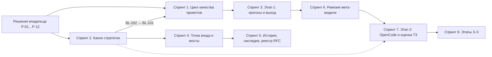

# Бэклог mango_ba_prompts

Этот файл — входной документ бэклога. В нём порядок работ, решения владельца
и статусы. Содержание задач вынесено в два файла карточек:

| Файл | Что внутри |
| --- | --- |
| [`backlog-ba-model.md`](backlog-ba-model.md) | Трек Б, задачи `BL-1xx`: модель БА — процессы, промпты, уроки, golden set, этапы 1–5. |
| [`backlog-repository.md`](backlog-repository.md) | Трек А, задачи `BL-2xx`: документы и устройство репозитория. |
| [`backlog-instruction.md`](backlog-instruction.md) | Правила ведения: форматы, статусы, жизненный цикл, проверки. |

Бэклог — согласовательный шаг (issue #418). Он ничего не меняет в
репозитории: промпты, прогоны, стандарты, канонические документы, ADR, RFC и
сайт не правятся. Исполнение начинается отдельными PR после решений владельца.

## Как читать за две минуты

1. Раздел 1 — весь порядок работ на одной странице: схема и таблица шагов.
2. Раздел 2 — двенадцать решений владельца `Р-01…Р-12`. Без них задачи не
   стартуют. У каждого решения есть рекомендация; ответ — одна строка в
   комментарии к PR #421.
3. Раздел 3 — ответ про мета-модель БА Хаба: на этом шаге не меняем.
4. Раздел 4 — спринты в формате бэклога Хаба. Название задачи — ссылка на
   карточку: почему, что меняется, источники с цитатой, когда готово.
5. Разделы 5–7 — открытые вопросы, технический долг и архив прежнего плана.

Коды в тексте:

| Код | Что это | Где описан |
| --- | --- | --- |
| `BL-1xx` | Задача трека Б (модель БА) | [`backlog-ba-model.md`](backlog-ba-model.md) |
| `BL-2xx` | Задача трека А (репозиторий) | [`backlog-repository.md`](backlog-repository.md) |
| `Р-NN` | Решение владельца | [Раздел 2](#2-решения-владельца) |
| `КФ-NN` | Противоречие между документами | [Противоречия](#противоречия-которые-снимают-решения) |
| `S-NNN` | Технический долг | [Раздел 6](#6-технический-долг-соответствия-стандартам-хаба-issue-267) |
| `M-NNN` | Задача прежнего плана миграции | [Раздел 7](#7-архив) |
| «B-NNN Хаба» | Задача бэклога Хаба | бэклог Хаба |

Коды документов-источников, на которые ссылаются решения и карточки:

| Код | Что это | Где описан |
| --- | --- | --- |
| `DEC-NN` | Решение RFC модернизации репозитория | [RFC модернизации](../docs/rfc/2026-10-repository-modernization.md#решения-на-согласование) |
| `CH-N` | Требование владельца из чатов #413 | [RFC модернизации](../docs/rfc/2026-10-repository-modernization.md#требования-владельца-из-чатов-приложенных-к-413) |
| `DEC-411-NN` | Решение RFC уроков | [RFC уроков](../docs/rfc/2026-10-bcreq-run-lessons-pipeline.md#решения-на-согласование) |
| `DEC-420-NN` | Решение RFC раздела «Стандарты» | [RFC #420](../docs/rfc/2026-10-standards-page-rfc.md#решения-на-согласование) |
| `DEC-415-NN` | Решение RFC стратегии | [RFC стратегии](../docs/rfc/2026-10-ba-automation-strategy.md#решения-на-согласование) |
| `REC-417-NN` | Рекомендация проверки стратегии на индустриальные практики | [PR #419, Recommendations](https://github.com/G-Ivan-A/mango_ba_prompts/blob/c6e748511684d3a68338b14c23dfa13d4e4a30b5/docs/analysis/2026-10-31-industry-practice-check.md#recommendations) |
| `T-NN` | Задача реестра задач исполнения (аудит #409) | [Реестр задач](../docs/analysis/2026-10-31-follow-up-tasks.md#задачи-на-изменение-репозитория) |
| `F-NN` | Находка аудита репозитория | [Аудит, реестр находок](../docs/audit/2026-10-31-repository-audit.md#реестр-находок) |
| `L-NN` | Урок прогонов BCREQ | [Реестр уроков](../standards/bcreq-lessons/README.md#уроки) |
| `RFC-NNNN` | Запись реестра RFC промптов | [Реестр RFC](../docs/rfc/rfc-register.md) |
| `LG-N` | Правило передачи опыта в Хаб (ADR-014 Хаба) | ADR-014 Хаба |
| `ADR-NNN` | Архитектурное решение | [`docs/adr/`](../docs/adr/) |
| `RUN-NNNN` | Прогон промптов | [`runs/`](../runs/) |

Статусы и поля таблиц — как в бэклоге Хаба; расшифровка — в
[`backlog-instruction.md`](backlog-instruction.md#статусы).

## 1. Логика и порядок на одной странице

Порядок владельца: Этап 1 → ревизия мета-модели БА Хаба → этап 2 на OpenCode.
Этап 1 — работа БА с промптами в чате; его выход — базовая линия метрик.
Сверка с мета-моделью идёт по данным этапа 1, а не до них. Пакет OpenCode
собирается на сверенной модели.

Чтобы этап 1 дал измеримый результат, сначала замыкается цикл качества
промптов: замечание БА → урок → блок уроков в промпте → проверка на golden set.
Параллельно трек А приводит канонические документы к стратегии, чтобы задачи
этапов ссылались на одну версию правды.



| Шаг | Спринт | Трек | Что получаем | Ворота перехода |
| --- | --- | --- | --- | --- |
| 0 | — | — | Решения `Р-01…Р-12` | Ответ владельца в PR #421 |
| 1 | [Спринт 1](#спринт-1-цикл-качества-промптов) | Б | Уроки в промптах, единый словарь кодов, golden set и порог | BL-101…BL-103 `DONE` |
| 1 | [Спринт 2](#спринт-2-канон-стратегии) | А | Канон версии 2.0, ADR этапов 3–4, принятый RFC модернизации | BL-201…BL-203 `DONE` |
| 2 | [Спринт 3](#спринт-3-этап-1-прогоны-и-выход) | Б | Реальные прогоны этапа 1, базовая линия метрик | Ворота 1: решение владельца о выходе (BL-113) |
| 3 | [Спринт 6](#спринт-6-ревизия-мета-модели-после-этапа-1) | Б | Запись совместимости с мета-моделью БА Хаба | BL-121 `DONE`; BL-122 — по Р-12 |
| 4 | [Спринт 7](#спринт-7-этап-2-opencode-и-оценка-тз) | Б | Пакет OpenCode, квалификация клиента, оценка ТЗ | Ворота 2: golden set на пакете не хуже базовой линии |
| 5 | [Спринт 8](#спринт-8-этапы-35) | Б | Стенд n8n, код, масштабирование | Icebox до ворот 2 |
| 1–3 | [Спринт 4](#спринт-4-точка-входа-и-мосты), [Спринт 5](#спринт-5-история-наследие-реестр-rfc) | А | Точка входа, связи с Хабом и runtime, разметка истории | Не блокируют трек Б |

Критический путь: Р-02 → BL-202 (перенумерация ADR) → BL-101 → BL-102 →
BL-103 → BL-111 → BL-112 → BL-113 → BL-121 → BL-131 → BL-132.

Почему именно так:

- Без уроков в промптах прогоны этапа 1 повторят уже известные ошибки
  (BL-101); без единого словаря кодов ошибки разных прогонов не сравнить
  (BL-102); без порога нельзя сказать «стало лучше» (BL-103).
- Без базовой линии этапа 1 нечем проверить ворота этапа 2 «не хуже этапа 1»
  (BL-113).
- Сверка с мета-моделью до этапа 1 — сверка с гипотезой; после — с фактами
  (BL-121).
- Трек А идёт параллельно и блокирует трек Б в двух местах: номер ADR уроков
  (BL-202 → BL-101) и пакет `AGENTS.md` этапа 2 (BL-211 ↔ BL-131).

## 2. Решения владельца

Каждое решение открывает задачи. Рекомендация — вариант, который бэклог
предлагает по источникам; владелец может выбрать другой.

| Р | Что решить | Рекомендация | Открывает | Статус |
| --- | --- | --- | --- | --- |
| **Р-01** | Принять RFC стратегии v0.2 (PR #419) и рекомендации REC-417-01…06 | Принять: слить PR #419, RFC → `accepted` | BL-111, BL-113, BL-131, BL-133, BL-141…BL-143, BL-201, BL-202, BL-224 | ждёт |
| **Р-02** | Принять ADR реестра уроков и решения DEC-411-01…12 RFC уроков | Принять как в RFC; DEC-411-06 — полные блоки уроков (качество выше экономии, issue #418) | BL-101…BL-109, BL-112, BL-114, BL-115, BL-134, BL-224 | ждёт |
| **Р-03** | Порог приёмки DEC-411-04 и минимальное число прогонов N | Порог — доля сданных применимых кейсов golden set; RUN-0079 дал 61/62 (0.98). Предложение: порог 0.95, N = 5 | BL-103, BL-113 | ждёт |
| **Р-04** | Статус репозитория в экосистеме (DEC-01) и ответ на CH-6 | Вариант В «Гибрид» RFC модернизации; строку Хаба о статусе — через BL-122 | BL-122, BL-203, BL-212 | ждёт |
| **Р-05** | Видимость репозитория (DEC-03) и граница с runtime (DEC-04) | DEC-03: Public до решения по ADR-009 Хаба; DEC-04: runtime — исполнение и KB | BL-203, BL-212, BL-221 | ждёт |
| **Р-06** | Один источник пакета этапа 2 (DEC-06): пакет Хаба (Спринт 28 Хаба) или локальный | Пакет Хаба; ADR-016 спицы — профиль применения пакета | BL-131, BL-132 | ждёт |
| **Р-07** | Корневой `AGENTS.md` через ADR (DEC-07) | Принять: нужен для пакета этапа 2 | BL-211 | ждёт |
| **Р-08** | Разметка истории (DEC-09), локальный KB (DEC-10), легаси-именование S-001 | DEC-09: правило каталога плюс блок перехода; DEC-10: `kb/` на месте с указателем на runtime; S-001 — Icebox | BL-221…BL-223, BL-225 | ждёт |
| **Р-09** | Порядок правок сайта (DEC-11, DEC-415-08) и раздел «Стандарты» (#420) | Сайт — только после принятия канона, отдельными задачами; #420 — через PR #422 | BL-110, BL-204…BL-206 | ждёт |
| **Р-10** | Требования из чатов CH-1…CH-7 | CH-1 пометить заменённым решением #417; CH-6 закрыть ответом Р-04; остальные — как в RFC | BL-203 | ждёт |
| **Р-11** | Номер ADR уроков и срок юридической проверки n8n | ADR уроков → ADR-018; юридическая проверка — до запуска стенда этапа 3 | BL-141, BL-202 | ждёт |
| **Р-12** | Мета-модель БА Хаба и передача опыта в Хаб | Мета-модель на этом шаге не менять; сверка BL-121 после этапа 1; BL-122 — только если владелец снимет запрет #413 на передачу | BL-121…BL-124 | ждёт |

### Как дать решение

Одна строка в комментарии к
[PR #421](https://github.com/G-Ivan-A/mango_ba_prompts/pull/421) на каждое
решение: номер, ответ, при необходимости — вариант или число.

```text
Р-01 да
Р-03 порог 0.95, N = 5
Р-04 В
Р-06 пакет Хаба
Р-12 да, передача закрыта
```

«Да» означает рекомендацию из таблицы. Чтобы принять все рекомендации
сразу, достаточно одной строки «Р-01…Р-12 да». После ответа статус решения меняется
на «принято» с ссылкой на комментарий, а зависящие задачи становятся
доступны к исполнению.

### Противоречия, которые снимают решения

| КФ | Противоречие | Снимает |
| --- | --- | --- |
| КФ-01 | `docs/roadmap.md`: этап 4 — потоки на сервере; RFC стратегии (DEC-415-10): этап 4 — код без n8n | Р-01, BL-201 |
| КФ-02 | Реестр задач: T-03 реализована; генератор сайта читает `docs/ba-ecosystem.md`, не roadmap | Р-09, BL-204 |
| КФ-03 | Два ADR с номером 017 в `docs/adr/` | Р-11, BL-202 |
| КФ-04 | Хаб: репозиторий — наследие, новая разработка не ведётся; здесь идёт разработка этапов | Р-04, BL-122 |
| КФ-05 | ADR-017: юридическая проверка n8n до этапа 4; RFC стратегии — на этапе 3 | Р-11, BL-202 |
| КФ-06 | Пакет OpenCode собирает Хаб (Спринт 28 Хаба) и предлагает собрать RFC стратегии | Р-06, BL-131 |
| КФ-07 | Цифры долга S-002 и S-003 расходятся с аудитом F-20 | BL-223 |
| КФ-08 | CH-1: OpenCode «не требование»; #417: на этапе 2 выбран OpenCode | Р-10, BL-203 |
| КФ-09 | #413: передача опыта в Хаб не рассматривается; RFC уроков: обобщённое наблюдение уходит в Хаб | Р-12, BL-122 |
| КФ-10 | CH-6 требует решения о статусе до T-задач; DEC-01 и DEC-04 ещё не выбраны | Р-04, BL-203 |

Источники каждого противоречия — в карточке задачи, которая его снимает.

## 3. Мета-модель БА Хаба на этом шаге

Да, подтверждаем: мета-модель БА Хаба на этом шаге не меняем.
Критических предпосылок для её изменения нет.

Почему не меняем:

- Хаб сам держит свою методологию БА в Icebox до метрик реальной работы
  ([бэклог Хаба, Спринт 14](https://github.com/G-Ivan-A/hybrid-Intelligence-lab/blob/32b5fa524e542af23c1a8e67c919bd66d5f4e399/ops/backlog.md#спринт-14-единая-методология-ба-оптимизированная-под-ии-агентов)).
  Метрики реальной работы даст этап 1 (Спринт 3).
- Решение #413: передача опыта в Хаб не рассматривается
  ([план действий, раздел 2](../docs/report/2026-10-31-repository-action-plan.md#2-решения-владельца-в-413-и-как-они-применены)).
- Мета-модель остаётся нормой; результат эксперимента сам по себе норму не
  меняет ([RFC модернизации](../docs/rfc/2026-10-repository-modernization.md#параллельное-развитие-с-мета-моделью-и-обратная-связь)).
- Задачи спринтов 1–3 — уроки, словарь кодов, golden set, порог, прогоны —
  живут в этом репозитории и не требуют полей или операций, которых нет в
  мета-модели.

Некритические расхождения есть, и они не блокируют этап 1:

- S-004, S-005, S-007, S-008 (раздел 6) правятся только в Хабе; до решения
  Р-12 они остаются локальной дельтой.
- Хаб отмечает этот репозиторий как наследие (КФ-04); снимается Р-04.

Что запланировано:

| Задача | Когда | Что делает |
| --- | --- | --- |
| [BL-121](backlog-ba-model.md#bl-121-запись-совместимости-с-мета-моделью-ба-хаба) | После выхода из этапа 1 (BL-113), до пакета этапа 2 | Локальная запись совместимости: фаза BCREQ ↔ элемент мета-модели, дельта, доказательство из прогонов. В Хаб ничего не уходит. |
| [BL-122](backlog-ba-model.md#bl-122-предложение-в-хаб-по-итогам-сверки-условная) | Только если Р-12 снимает запрет #413 | Одно предложение в Хаб в форме LG-5 ADR-014 Хаба: кандидаты из BL-121 и долг S-004/S-005/S-007/S-008. Иначе `CANCELLED`. |

Когда вопрос откроется снова: если BL-121 найдёт расхождение, которое нельзя
оставить локальной дельтой (например, пакет Хаба по Р-06 требует поля
контракта, которого нет в мета-модели). Тогда BL-122 выносится на решение
владельца до старта BL-131.

## 4. Спринты

Номер спринта — идентификатор, а не порядок; порядок — в разделе 1.
Колонка «Зависимости»: задачи `BL`, долг `S` и, после точки с запятой,
решения владельца `Р`.

### Спринт 1: Цикл качества промптов

**Story.** БА указывает модели на ошибки, но промпты на `main` без блока
уроков, и модель повторяет известные ошибки. Ручная правка уроков в промптах
уже теряла уроки. Коды ошибок в прогонах разные, golden set — черновик,
порога нет: сказать «промпт стал лучше» нельзя.

**Цель.** Замечание БА доходит до промпта через реестр уроков и
проверяется golden set с утверждённым порогом.

**Критерий закрытия.** Блоки уроков во всех промптах BCREQ; единый словарь
кодов в контракте прогона; golden set и рубрика `reviewed`; порог и N
записаны; BL-104…BL-110 имеют решение.

| ID | Название | Приоритет | Зависимости | Статус | Issue | Источник | Краткое содержание | Режим запуска |
| --- | --- | --- | --- | --- | --- | --- | --- | --- |
| BL-101 | [Принять ADR реестра уроков и вставить блоки уроков в промпты](backlog-ba-model.md#bl-101-принять-adr-реестра-уроков-и-вставить-блоки-уроков-в-промпты) | P0 | BL-202; Р-02 | TODO | — (planned) | RFC уроков, DEC-411-01 | ADR уроков → `accepted`; генерируемый блок «Уроки прогонов» в каждом промпте BCREQ; ручная правка уроков запрещена. | Structured |
| BL-102 | [Четыре поля контракта прогона и единый словарь кодов](backlog-ba-model.md#bl-102-четыре-поля-контракта-прогона-и-единый-словарь-кодов) | P0 | BL-101; Р-02 | TODO | — (planned) | RFC уроков, DEC-411-02, DEC-411-03 | Контракт прогона получает поля для уроков; коды ошибок новых прогонов — ID уроков L-NN. | Structured |
| BL-103 | [Golden set, рубрика и порог приёмки в статусе `reviewed`](backlog-ba-model.md#bl-103-golden-set-рубрика-и-порог-приёмки-в-статусе-reviewed) | P0 | BL-102; Р-02, Р-03 | TODO | — (planned) | RFC уроков, DEC-411-04; стандарт evals | Место evals, ревью golden set и рубрики, порог и N, сверка модели-судьи с человеком. | Hybrid |
| BL-104 | [Решить судьбу урока L-42](backlog-ba-model.md#bl-104-решить-судьбу-урока-l-42) | P1 | BL-101; Р-02 | TODO | — (planned) | RFC уроков, DEC-411-05 | Владелец принимает или отклоняет L-42; принятый урок получает кейс golden set. | Hybrid |
| BL-105 | [Очистить промпт конституции от частных случаев](backlog-ba-model.md#bl-105-очистить-промпт-конституции-от-частных-случаев) | P1 | BL-101; Р-02 | TODO | — (planned) | Правило G1–G5 | Ссылки на прогоны и issue уходят из промпта в реестр уроков; ALLOWLIST пуст. | Structured |
| BL-106 | [Зафиксировать бюджет токенов этапа 1: полные блоки уроков](backlog-ba-model.md#bl-106-зафиксировать-бюджет-токенов-этапа-1-полные-блоки-уроков) | P0 | BL-101; Р-02 | TODO | — (planned) | RFC уроков, DEC-411-06; issue #418 | Этап 1 работает с полными блоками уроков: качество выше экономии токенов. | Structured |
| BL-107 | [Разобрать старые RFC на промпты](backlog-ba-model.md#bl-107-разобрать-старые-rfc-на-промпты) | P2 | BL-101; Р-02 | TODO | — (planned) | Реестр RFC | Каждая запись RFC-1027, RFC-1025, RFC-MCH: урок, отказ или отдельный RFC. | Hybrid |
| BL-108 | [Навигация README промптов и стандартов на реестр уроков](backlog-ba-model.md#bl-108-навигация-readme-промптов-и-стандартов-на-реестр-уроков) | P2 | BL-101; Р-02 | TODO | — (planned) | RFC уроков, DEC-411-10 | Оба README ведут на `standards/bcreq-lessons/`. | Structured |
| BL-109 | [Принять ручной конвейер BCREQ и ADR-015 как вход этапа 1](backlog-ba-model.md#bl-109-принять-ручной-конвейер-bcreq-и-adr-015-как-вход-этапа-1) | P1 | Р-02 | TODO | — (planned) | RFC уроков, DEC-411-12 | RFC ручного конвейера и ADR-015 → `accepted`; метаданные ADR-015 исправлены. | Structured |
| BL-110 | [Выровнять стандарты и промпты BCREQ по практике прогонов](backlog-ba-model.md#bl-110-выровнять-стандарты-и-промпты-bcreq-по-практике-прогонов) | P1 | BL-205; Р-09 | TODO | — (planned) | RFC #420, DEC-420-08 | ФТ-NN, формула BABOK, пункты ФДР «5.N (ФТ-NN)», НФТ 4.N, полные названия ОРР, ФДР, ТС в стандартах и промптах; метки «#420» снимаются. | Structured |

### Спринт 2: Канон стратегии

**Story.** RFC стратегии (PR #419) меняет этапы: этап 4 — код без n8n,
добавлен этап 5, на этапе 2 — OpenCode. Канонические документы, ADR, RFC
модернизации и сайт пока говорят другое. Пока канон расходится со
стратегией, каждая задача этапов ссылается на свою версию правды.

**Цель.** Канонические документы, ADR и сайт описывают одни и те же пять
этапов.

**Критерий закрытия.** Четыре канонических документа версии 2.0; номера ADR
уникальны; RFC модернизации `accepted`; сайт показывает этапы из канона.

| ID | Название | Приоритет | Зависимости | Статус | Issue | Источник | Краткое содержание | Режим запуска |
| --- | --- | --- | --- | --- | --- | --- | --- | --- |
| BL-201 | [Перенести RFC стратегии в канонические документы версии 2.0](backlog-repository.md#bl-201-перенести-rfc-стратегии-в-канонические-документы-версии-20) | P0 | Р-01 | TODO | [PR #419](https://github.com/G-Ivan-A/mango_ba_prompts/pull/419) | RFC стратегии, «Перенос в канонические документы» | Vision, concept, architecture, roadmap → 2.0: пять этапов, этап 4 — код. | Structured |
| BL-202 | [ADR исполнителей этапов 3–4 и перенумерация дубля ADR-017](backlog-repository.md#bl-202-adr-исполнителей-этапов-34-и-перенумерация-дубля-adr-017) | P0 | Р-11, Р-01 | TODO | — (planned) | `docs/adr/`; RFC стратегии | ADR уроков → 018; новый ADR: стенд n8n на этапе 3, код на этапе 4; один срок юридической проверки. Перенумерация не ждёт BL-201. | Structured |
| BL-203 | [Поправки и принятие RFC модернизации репозитория](backlog-repository.md#bl-203-поправки-и-принятие-rfc-модернизации-репозитория) | P1 | BL-201; Р-04, Р-05, Р-10 | TODO | — (planned) | RFC модернизации, DEC-01…DEC-11 | Выбраны варианты DEC и CH; внесены поправки RFC уроков; RFC → `accepted`. | Hybrid |
| BL-204 | [Исправить запись о T-03 и раздел сайта «О проекте»](backlog-repository.md#bl-204-исправить-запись-о-t-03-и-раздел-сайта-о-проекте) | P1 | BL-201; Р-09 | TODO | — (planned) | `scripts/generate-pages-data.mjs`; реестр задач | Генератор сайта читает этапы из roadmap; запись T-03 исправлена. | Structured |
| BL-205 | [Раздел сайта «Стандарты»](backlog-repository.md#bl-205-раздел-сайта-стандарты) | P2 | Р-09 | in-progress | [#420](https://github.com/G-Ivan-A/mango_ba_prompts/issues/420), [PR #422](https://github.com/G-Ivan-A/mango_ba_prompts/pull/422) | Issue #420 | Введение, основания глоссария и консистентность раздела «Стандарты». | Hybrid |
| BL-206 | [Страницы сайта по RFC #420 (прототип site-v2)](backlog-repository.md#bl-206-страницы-сайта-по-rfc-420-прототип-site-v2) | P2 | BL-201, BL-205; Р-09 | TODO | — (planned) | RFC #420, DEC-420-10 | `site/` и тесты сайта по прототипу site-v2: «Стандарты», зоны сайта, «Справочник», «О проекте». | Hybrid |

### Спринт 3: Этап 1: прогоны и выход

**Story.** Метрики этапа 1 сейчас — сигнал на синтетике: человек оценки не
подтверждал. Без серии реальных прогонов нет базовой линии, а без неё
ворота этапа 2 «не хуже этапа 1» не проверить.

**Цель.** Базовая линия метрик этапа 1 на реальных прогонах и решение
владельца о выходе.

**Критерий закрытия.** N прогонов в `runs/`; несопоставленных кодов 0;
отчёт серии с вердиктом по порогу; решение владельца о выходе записано.

| ID | Название | Приоритет | Зависимости | Статус | Issue | Источник | Краткое содержание | Режим запуска |
| --- | --- | --- | --- | --- | --- | --- | --- | --- |
| BL-111 | [Серия реальных прогонов этапа 1](backlog-ba-model.md#bl-111-серия-реальных-прогонов-этапа-1) | P0 | BL-101, BL-102, BL-103; Р-01 | TODO | — (planned) | RFC стратегии, этап 1 | 5–10 обезличенных прогонов BCREQ с замечаниями БА и оценкой по рубрике. | Hybrid |
| BL-112 | [Уроки и golden set из новых прогонов](backlog-ba-model.md#bl-112-уроки-и-golden-set-из-новых-прогонов) | P0 | BL-111; Р-02 | TODO | — (planned) | Ворота 1 RFC стратегии | Новые коды сопоставлены с уроками; новые кейсы — в golden set. | Hybrid |
| BL-113 | [Базовая линия метрик и решение о выходе из этапа 1](backlog-ba-model.md#bl-113-базовая-линия-метрик-и-решение-о-выходе-из-этапа-1) | P0 | BL-112; Р-01, Р-03 | TODO | — (planned) | RFC стратегии, ворота 1 | Отчёт серии: метрики, профиль провалов, вердикт по порогу; решение владельца. | Hybrid |
| BL-114 | [Самодостаточность промптов и справочники в runtime](backlog-ba-model.md#bl-114-самодостаточность-промптов-и-справочники-в-runtime) | P2 | BL-106, BL-112; Р-02 | TODO | — (planned) | RFC #420, риск 12 | Промпт самодостаточен, где возможно; где раздувается — справочник из mango-ba-ai-runtime (только этап 1). | Hybrid |
| BL-115 | [Обобщение golden set](backlog-ba-model.md#bl-115-обобщение-golden-set) | P3 | BL-112; Р-02 | deferred (triggered) | — (deferred) | RFC #420, риск 13 | Триггер: BL-112. Повторяющиеся кейсы golden set заменяются обобщёнными правилами без потери качества. | Creative |

### Спринт 4: Точка входа и мосты

**Story.** Пакет этапа 2 собирается в формате `AGENTS.md`, а корень
репозитория закрыт allowlist'ом. Роли этого репозитория, runtime и Хаба
описаны в разных местах по-разному.

**Цель.** Агент и человек находят правила репозитория из одной точки; связи
с Хабом и runtime описаны в одном месте.

**Критерий закрытия.** `AGENTS.md` в корне по ADR; `docs/README.md` — карта
`docs/`; раздел о связях; маркеры пробела evals заменены.

| ID | Название | Приоритет | Зависимости | Статус | Issue | Источник | Краткое содержание | Режим запуска |
| --- | --- | --- | --- | --- | --- | --- | --- | --- |
| BL-211 | [Корневой `AGENTS.md` и `docs/README.md` (T-01)](backlog-repository.md#bl-211-корневой-agentsmd-и-docsreadmemd-t-01) | P1 | BL-203; Р-07 | TODO | — (planned) | RFC модернизации, DEC-07 | ADR о корневом `AGENTS.md`; файл по bootstrap Хаба; карта `docs/`. | Structured |
| BL-212 | [SSOT и связи с Хабом и runtime (T-08)](backlog-repository.md#bl-212-ssot-и-связи-с-хабом-и-runtime-t-08) | P2 | BL-203, BL-103; Р-05, Р-04 | TODO | — (planned) | RFC модернизации, DEC-03, DEC-04 | Один раздел о связях репозиториев; маркеры «evals отсутствуют» → ссылка на golden set. | Structured |

### Спринт 5: История, наследие, реестр RFC

**Story.** Долг frontmatter, неверные статусы ADR и устаревшие записи
реестра RFC мешают отличить действующее от исторического. Локальный
KB-конвейер дублирует runtime.

**Цель.** Исторические файлы размечены, лишнее выведено, реестр RFC отражает
реальные статусы.

**Критерий закрытия.** Нет `docs/contracts/`; frontmatter действующих
каталогов проходит валидатор; у каждой записи реестра RFC есть решение;
S-001 в Icebox подтверждён.

| ID | Название | Приоритет | Зависимости | Статус | Issue | Источник | Краткое содержание | Режим запуска |
| --- | --- | --- | --- | --- | --- | --- | --- | --- |
| BL-221 | [Вывести локальный KB-конвейер (T-05)](backlog-repository.md#bl-221-вывести-локальный-kb-конвейер-t-05) | P2 | BL-203; Р-08, Р-05 | TODO | — (planned) | RFC модернизации, DEC-10 | `kb/` на месте с указателем на runtime; конвейер выведен из сборки. | Structured |
| BL-222 | [Структура `docs/` (T-06)](backlog-repository.md#bl-222-структура-docs-t-06) | P2 | BL-211, BL-221; Р-08 | TODO | — (planned) | RFC модернизации, T-06 | Перенос `docs/contracts/` с журналом путей; все RFC — в реестре. | Structured |
| BL-223 | [Разметка истории, статусы ADR, архив (T-07)](backlog-repository.md#bl-223-разметка-истории-статусы-adr-архив-t-07) | P2 | BL-203, S-002, S-003; Р-08 | TODO | — (planned) | RFC модернизации, DEC-09 | Правило каталога плюс блок перехода; S-002 и S-003 закрыты с актуальными числами. | Structured |
| BL-224 | [Разобрать реестр RFC](backlog-repository.md#bl-224-разобрать-реестр-rfc) | P1 | BL-107, BL-201; Р-01, Р-02 | TODO | — (planned) | `docs/rfc/rfc-register.md` | Статусы всех записей реестра RFC приведены к фактам. | Hybrid |
| BL-225 | [Легаси-именование хронологических файлов (S-001)](backlog-repository.md#bl-225-легаси-именование-хронологических-файлов-s-001) | P3 | S-001; Р-08 | deferred (icebox) | — (deferred) | Раздел 6, S-001 | Переименование не делается; allowlist заморожен. Возврат — при переносе в другой репозиторий. | — |

### Спринт 6: Ревизия мета-модели после этапа 1

**Story.** Мета-модель БА Хаба остаётся нормой и на этом шаге не меняется
(раздел 3). После этапа 1 практика BCREQ сверяется с ней по фактам, чтобы
пакет этапа 2 строился на сверенной модели.

**Цель.** Запись совместимости с мета-моделью; решение по каждому
расхождению.

**Критерий закрытия.** BL-121 `DONE`; BL-122 `DONE` или `CANCELLED` по Р-12.

| ID | Название | Приоритет | Зависимости | Статус | Issue | Источник | Краткое содержание | Режим запуска |
| --- | --- | --- | --- | --- | --- | --- | --- | --- |
| BL-121 | [Запись совместимости с мета-моделью БА Хаба](backlog-ba-model.md#bl-121-запись-совместимости-с-мета-моделью-ба-хаба) | P1 | BL-113; Р-12 | TODO | — (planned) | План действий #413, раздел 4.4 | Фаза BCREQ ↔ элемент мета-модели; дельта и доказательство из прогонов. Локально. | Hybrid |
| BL-122 | [Предложение в Хаб по итогам сверки (условная)](backlog-ba-model.md#bl-122-предложение-в-хаб-по-итогам-сверки-условная) | P3 | BL-121, S-004, S-005, S-007, S-008; Р-12, Р-04 | deferred (triggered) | — (deferred) | Решение #413; RFC уроков | Триггер: Р-12 снимает запрет #413. Одно предложение в Хаб в форме LG-5. | Hybrid |
| BL-123 | [Проекции выпуска: документы ФТ и ТЗ в Word](backlog-ba-model.md#bl-123-проекции-выпуска-документы-фт-и-тз-в-word) | P2 | BL-121; Р-12 | deferred (triggered) | — (deferred) | RFC #420, риск 10 | Триггер: BL-121. Необязательный шаг выпуска после Г-W: ФТ (1, 2.1–2.4, 3, 4) и ТЗ (+6), выгрузка в Word. | Hybrid |
| BL-124 | [Вопросы Заказчику: стадия A-IN и архив 8.4 (досогласовать)](backlog-ba-model.md#bl-124-вопросы-заказчику-стадия-a-in-и-архив-84-досогласовать) | P3 | BL-121; Р-12 | deferred (triggered) | — (deferred) | RFC #420, риск 10б | Триггер: решение владельца. Где формируются вопросы и что хранит 8.4; метка «Досогласовать» снимается. | Structured |

### Спринт 7: Этап 2: OpenCode и оценка ТЗ

**Story.** Владелец выбрал OpenCode для этапа 2 (#417). Хаб уже собирает
пакет OpenCode; два пакета разойдутся. Оценка ТЗ заказчика дала результат на
RUN-0077, но процесса и golden set для неё нет.

**Цель.** BCREQ в OpenCode не хуже этапа 1; процесс оценки ТЗ описан и
проверяется golden set.

**Критерий закрытия.** Пакет из одного источника; P01–P08 пройдены; golden
set на пакете не хуже базовой линии; процесс оценки ТЗ `reviewed`.

| ID | Название | Приоритет | Зависимости | Статус | Issue | Источник | Краткое содержание | Режим запуска |
| --- | --- | --- | --- | --- | --- | --- | --- | --- |
| BL-131 | [Пакет этапа 2 для OpenCode из одного источника](backlog-ba-model.md#bl-131-пакет-этапа-2-для-opencode-из-одного-источника) | P0 | BL-113, BL-121; Р-01, Р-06 | deferred (triggered) | — (deferred) | Issue #417; Спринт 28 Хаба | Триггер: ворота 1 и BL-121. Навыки `SKILL.md`, правила `AGENTS.md`, уроки и golden set — в пакете. | Hybrid |
| BL-132 | [Квалификация закреплённой версии OpenCode по P01–P08](backlog-ba-model.md#bl-132-квалификация-закреплённой-версии-opencode-по-p01p08) | P0 | BL-131; Р-06 | deferred (triggered) | — (deferred) | ADR-016 | Триггер: BL-131. Проверки P01–P08 на закреплённой версии; отчёт в `runs/`. | Structured |
| BL-133 | [Процесс оценки ТЗ заказчика](backlog-ba-model.md#bl-133-процесс-оценки-тз-заказчика) | P1 | BL-131; Р-01 | deferred (triggered) | — (deferred) | RFC стратегии, цели | Триггер: BL-131. Процесс по образцу RUN-0077, golden set, риск prompt injection. | Creative |
| BL-134 | [Классы C01…C39 как цель этапов 2–3](backlog-ba-model.md#bl-134-классы-c01c39-как-цель-этапов-23) | P1 | BL-109, BL-113; Р-02 | deferred (triggered) | — (deferred) | RFC уроков, DEC-411-07 | Триггер: ворота 1. Golden set на 39 классах против 14 промптов; выбор основы навыков. | Hybrid |

### Спринт 8: Этапы 3–5

**Story.** Стенд n8n на этапе 3, процессы в коде на этапе 4,
масштабирование на этапе 5. Задачи записаны, чтобы этапы 1–2 не закрыли им
дорогу; старт — после ворот этапа 2.

**Цель.** Сохранить задачи этапов 3–5 до появления данных этапов 1–2.

**Критерий закрытия.** Спринт выходит из Icebox решением владельца после
ворот этапа 2.

| ID | Название | Приоритет | Зависимости | Статус | Issue | Источник | Краткое содержание | Режим запуска |
| --- | --- | --- | --- | --- | --- | --- | --- | --- |
| BL-141 | [Этап 3: испытательный стенд n8n](backlog-ba-model.md#bl-141-этап-3-испытательный-стенд-n8n) | P2 | BL-131, BL-202; Р-01, Р-11 | deferred (icebox) | — (deferred) | RFC стратегии, DEC-415-09 | Стенд n8n для отладки; контракты процессов вне n8n; юридическая проверка до запуска. | — |
| BL-142 | [Этап 4: промышленное исполнение процессов в коде](backlog-ba-model.md#bl-142-этап-4-промышленное-исполнение-процессов-в-коде) | P3 | BL-141; Р-01 | deferred (icebox) | — (deferred) | RFC стратегии, DEC-415-10 | ADR исполнителя этапа 4; контракты со стенда без переписывания. | — |
| BL-143 | [Этап 5: масштабирование на продуктовые команды](backlog-ba-model.md#bl-143-этап-5-масштабирование-на-продуктовые-команды) | P3 | BL-141; Р-01 | deferred (icebox) | — (deferred) | RFC стратегии, этап 5 | Шаблон подключения команды; свой golden set и тот же порог. | — |

## 5. Открытые вопросы

Этот раздел — единый трекер открытых вопросов проекта. Если в
[`pr-ops/session-digests.md`](session-digests.md) появляется новый открытый
вопрос, Исполнитель добавляет его сюда, если вопрос ещё не зафиксирован.

- [ ] [2026-06-11] [konard] Нужен ли в Хабе зеркальный label
      `spoke-candidate` для встречного потока предложений?
      Источник: [`docs/rfc-hub-integration.md`](../docs/rfc-hub-integration.md).
- [ ] [2026-06-11] [konard] Порог C1 «≥ 2 применения» — достаточен или
      требуется 3?
      Источник: [`docs/rfc-hub-integration.md`](../docs/rfc-hub-integration.md).
- [ ] [2026-06-16] [issue #101] Стандарт фиксации экспериментов — Draft v0.1:
      достаточно ли 6 метрик и субъективной шкалы `quality`; где граница между
      Уровнем 0 (Issue) и Уровнем 1 (Markdown). Валидировать на 2–3 следующих
      экспериментах. Источник:
      [`standards/experiment-log-standard.md`](../standards/experiment-log-standard.md).
- [ ] [2026-06-16] [issue #101] Рекомендации по онтологии для трека ADR
      #003–#008 (НЕ менять здесь): O1 разделение `documentation` на
      «генерацию с нуля» vs «редактирование черновика»; O2 «валидация против
      источника» как первоклассная семантика; O3 типизация промежуточных
      артефактов (As-Is-выжимка, сценарная матрица, отчёт валидации, вопросы
      заказчику). Источник:
      [`docs/analysis/experiment-1027-analysis.md`](../docs/analysis/experiment-1027-analysis.md).
- [ ] [2026-08-17] [issue #263] Статус хабового RFC «Принципы БА-автоматизации»:
      в `docs/rfc/` Хаба на SHA `56db375` такого документа нет, поэтому в
      [`docs/hub-research-dependencies.md`](../docs/hub-research-dependencies.md)
      он не зарегистрирован. Нужен ли якорь и по какому пути — решение
      Пользователя. Источник:
      [issue #263](https://github.com/G-Ivan-A/mango_ba_prompts/issues/263).
- [ ] [2026-08-17] [issue #263] **Пробел: evals и golden-set отсутствуют.**
      Проверка репозитория подтвердила утверждение анализа готовности Хаба:
      каталога `evals/` нет, `runs/*/metadata.yaml` не содержит эталона для
      сравнения. Пока пробел не закрыт, «evals-метрика» не может объявляться
      механизмом проверки операции (см.
      [`ai-governance/ai-governance.md`](../ai-governance/ai-governance.md#статус-механизмов-проверки-на-сегодня)).
      Нужна отдельная задача: формат golden-set, место хранения и связь с
      `runs/`. Источник:
      [issue #263](https://github.com/G-Ivan-A/mango_ba_prompts/issues/263).
- [ ] [2026-08-17] [issue #263] **Блокер Q1: инструментарий веб-ресурса (app)
      после приватизации.** GitHub Pages не работает для приватных репозиториев
      на бесплатном плане, поэтому перевод в Private выключает текущий канал
      публикации каталога. Варианты A (внешний портал `open-ai.ru`),
      B (поэтапная миграция с внешним билдом) и C (вывод через
      `ai-ba-playbooks`) зафиксированы в
      [`ai-governance/ai-governance.md`](../ai-governance/ai-governance.md#веб-ресурс-app-после-приватизации);
      выбор — решение Пользователя до смены видимости. Источник:
      [issue #263](https://github.com/G-Ivan-A/mango_ba_prompts/issues/263).

Связь с задачами бэклога:

- Пробел evals и golden-set закрывают BL-103 и BL-112; маркеры пробела в
  документах заменяет BL-212.
- Вопросы о встречном потоке в Хаб (`spoke-candidate`, порог C1) зависят от
  решения Р-12: пока передача опыта в Хаб закрыта решением #413, они не
  исполняются.
- Блокер Q1 веб-ресурса зависит от видимости репозитория (Р-05, DEC-03).

## 6. Технический долг соответствия стандартам Хаба (issue #267)

Раздел заведён при подключении валидаторов Хаба
([`tools/README.md`](../tools/README.md)) в issue
[#267](https://github.com/G-Ivan-A/mango_ba_prompts/issues/267). Критические
несоответствия корневых файлов исправлены в том же PR; ниже — некритические
находки, которые требуют отдельных reviewable задач, потому что затрагивают
массовые переименования, генерируемые артефакты или сам Хаб.

| ID | Находка | Масштаб | Почему не в issue #267 | Приоритет |
| --- | --- | --- | --- | --- |
| S-001 | Легаси-именование хронологических артефактов: `docs/adr/` (14 файлов), `docs/rfc/` (10), `docs/analysis/` (2) не соответствуют `standards/file-naming.md` (`YYYY-MM-adr-NNN-name.md`, `YYYY-MM-name.md`, `YYYY-MM-DD-name.md`). Заморожены в [`tools/file-naming-legacy-allowlist.txt`](../tools/file-naming-legacy-allowlist.txt). | 26 файлов | Переименование ломает внутренние ссылки (README, CHANGELOG, artifact-map, ADR-перекрёстные ссылки) и внешние permalink'и; нужна миграция ссылок одним PR. | P1 |
| S-002 | Frontmatter-долг вне области issue #267: `./tools/validate-frontmatter.sh .` даёт 23 062 ошибки в 1 287 файлах (`kb/` — 22 413, `docs/` — 304, `prompts/` — 118, `standards/` — 101, `runs/` — 85, `pr-ops/` — 24, `patterns/` — 16). | 1 287 файлов | Основная масса — генерируемые артефакты `kb/processed/` и `runs/`: их чинит генератор (`scripts/kb/extract.py`), а не ручная правка. Требуется решение, какие каталоги вообще попадают под governance-frontmatter. | P1 |
| S-003 | Поле `ai-generated` (запрещено `frontmatter-docs-standard.md`) остаётся в 1 243 файлах вне корня. | 1 243 файла | Массовая правка; для генерируемых файлов — правка шаблонов генератора. Часть S-002. | P2 |
| S-004 | `standards/frontmatter-docs-standard.md` Хаба относит `ai-rules/` к governance-классу (словарь `draft/proposed/accepted/...`), а хабовый валидатор — к классу `default` (где допустим `canonical`). Спица следует валидатору. | Расхождение в Хабе | Правится в Хабе, не в спице (source of truth). Нужен issue/RFC в `hybrid-Intelligence-lab`. | P1 |
| S-005 | `ai-rules/agent-onboarding-protocol.md` (v1.5) в Хабе не имеет `owner`, хотя стандарт требует его для governance-артефактов. В спице `owner: G-Ivan-A` добавлен локально — это единственная локальная дельта к синкнутому файлу. | 1 файл | Устраняется добавлением `owner` в Хабе, после чего локальная дельта снимается следующим синком. | P2 |
| S-006 | Расширение контракта прогонов (issue [#293](https://github.com/G-Ivan-A/mango_ba_prompts/issues/293): `run_type`, правила границ) выполнено по цепочке анализ → стандарт, без RFC: [`docs/analysis/2026-08-21-runs-type-gap-analysis.md`](../docs/analysis/2026-08-21-runs-type-gap-analysis.md) есть, RFC в `docs/rfc/` — нет. Нужно восстановить цепочку анализ → RFC → стандарт постфактум и провести решение через RFC-регистр. | 1 стандарт + 1 RFC | Приоритет по времени: 30+ прогонов требовалось зафиксировать с правильной таксономией до оформления RFC (обоснование в постановке issue #293). Обратная совместимость сохранена, поэтому восстановление цепочки не блокирует фиксацию прогонов. | P1 |
| S-007 | Валидатор генома Хаба [`templates/htom/tools/validate-repository-structure.sh`](https://github.com/G-Ivan-A/hybrid-Intelligence-lab/blob/main/templates/htom/tools/validate-repository-structure.sh) проверяет **наличие** обязательных корневых файлов, но не **закрытость** корня: лишний `*.md` в корне проходит проверку. Именно этот зазор дал дрейф issue #291 (причина 2 [аудита](../docs/audit/2026-08-21-root-structure-audit.md)). | Дефект контракта в Хабе | Локальная дельта в [`tools/validate-repository-structure.sh`](../tools/validate-repository-structure.sh) закрывает корень allowlist'ом и лечит симптом в одной спице. Системное решение — RFC в `hybrid-Intelligence-lab`. | P1 |
| S-008 | `standards/cascading-context-loading-standard.md` требует «соседний `.executable.md`», что механически порождает файлы в каталоге full-слоя — в т.ч. в корне. Формулировку стоит заменить на «связанный ссылкой» (связь и так держится на `full_version`/`related_standard`). | 1 стандарт | Правка нормы, а не файлов; нужен отдельный issue, чтобы не смешивать с миграцией #291. | P2 |


Связь с задачами бэклога:

| Долг | Задача | Примечание |
| --- | --- | --- |
| S-001 | BL-225 | Icebox; allowlist не растёт. |
| S-002, S-003 | BL-223 | Числа устарели: аудит F-20 даёт другой масштаб (КФ-07). Актуальные числа записываются при закрытии BL-223. |
| S-004, S-005, S-007, S-008 | BL-122 | Правятся только в Хабе; до решения Р-12 — локальная дельта. |
| S-006 | BL-102 | Цепочка анализ → RFC → стандарт для контракта прогонов восстанавливается вместе с новыми полями контракта. |

Отклонение от генома Хаба, о котором сообщает проверка D6
`tools/validate-repository-structure.sh`: файловый минимум генома
`.github/ISSUE_TEMPLATE/task*.md` здесь не требуется, у репозитория свой набор
шаблонов issue (`prompt-feedback`, `run-execution`, `run-statistics`). Это
осознанная локальная дельта, задача не нужна.

## 7. Архив

Бэклог Хаба не ведёт архивного файла: история живёт в issue, PR и
`CHANGELOG.md`. Здесь — только указатель на прежний план, чтобы ссылки на
`M-NNN` оставались понятны.

Прежняя версия 0.3 этого файла — план физической миграции из Хаба, Фаза 1
(issue #14). Все девять задач выполнены: issue #28–#36 закрыты 4–5 июня 2026 года; полный
текст —
[`pr-ops/BACKLOG.md` v0.3](https://github.com/G-Ivan-A/mango_ba_prompts/blob/350927f2221dd318ee1e70b3c6bbf8520f51cf87/pr-ops/BACKLOG.md),
реестр issue — [`migration-phase1-issues.md`](migration-phase1-issues.md).

| ID | Задача | Приоритет | Зависимости | Статус |
| --- | --- | --- | --- | --- |
| M-001 | Переписать README.md спока | P0 | — | DONE |
| M-002 | Создать базовую структуру папок проекта | P0 | — | DONE |
| M-003 | Скопировать `standards/GLOSSARY.md` из Хаба | P0 | M-002 | DONE |
| M-004 | Перенести и переименовать `classification-glossary` → `standards/product-classification-contract.md` | P0 | M-002 | DONE |
| M-005 | Перенести эксперименты в `prompts/experiments/` | P0 | M-002 | DONE |
| M-006 | Нормализовать промпты (7 полей frontmatter) | P1 | M-002, M-003, M-004 | DONE |
| M-007 | Создать `docs/hub-research-dependencies.md` | P1 | M-006 | DONE |
| M-008 | Добавить временный workflow в `CONTRIBUTING.md` | P0 | — | DONE |
| M-009 | Создать Migration Manifest | P2 | M-006 | DONE |

Критический путь прежнего плана: `M-002 → (M-003 ∥ M-004 ∥ M-005) → M-006 →
(M-007 ∥ M-009)`.

Связанные артефакты прежнего плана:

- Issue: <https://github.com/G-Ivan-A/mango_ba_prompts/issues/14>
- Утверждённый RFC: [`docs/analysis/migration-strategy-rfc.md`](../docs/analysis/migration-strategy-rfc.md)
- Human Review: [`docs/reviews/migration-rfc-human-review-2026-06.md`](../docs/reviews/migration-rfc-human-review-2026-06.md)
- Контракт и правила: [`ai-governance/ai-governance.md`](../ai-governance/ai-governance.md), [`ai-rules/ai-quick-rules.md`](../ai-rules/ai-quick-rules.md)
- Вклад и workflow: [`CONTRIBUTING.md`](../CONTRIBUTING.md)
