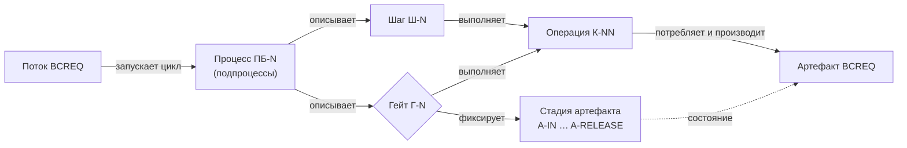

# Словарь потока BCREQ

> Носитель — [RFC #427](../docs/rfc/2026-11-bcreq-flow-processes-prompts.md)
> (`accepted`, решения DEC-427-01, DEC-427-06), задача
> [BL-150](../pr-ops/backlog-ba-model.md#bl-150-словарь-потока-bcreq-и-цепочка-элементов).
> Определение гейта уточнено по issue
> [#430](https://github.com/G-Ivan-A/mango_ba_prompts/issues/430) — поправка
> 0.4 RFC, [раздел 3](#3-гейт-определение-типы-ключевые-гейты).
> Собственный стандарт спицы. Термины не дублируют
> [`GLOSSARY.md`](GLOSSARY.md): это рабочая копия Хаба, её локально не
> правят ([ADR-0004](../docs/adr/0004-hub-resync-2026-08.md)). Передать
> термин «поток» в Хаб может только BL-122 по решению Р-12.

Словарь нужен, чтобы стандарты и промпты Спринта 9 не называли промпт
классом, шаг — процессом, а стадию — уровнем (риск Т-1 SSOT
[#425](../docs/analysis/2026-11-02-bcreq-prompts-classes-standards-check.md)).
Одно слово — одно значение. Если термин здесь расходится с другим
документом спицы, действует этот словарь, а расхождение записывается в
[BL-159](../pr-ops/backlog-ba-model.md#bl-159-типы-гейтов-во-всех-документах-проекта).

## 1. Цепочка элементов

**Поток → Процесс (подпроцессы) → Операция → Артефакт** (RFC #427,
раздел 4.1). Шаг и гейт — элементы описания процесса. Стадия — состояние
артефакта. Ни шаг, ни гейт, ни стадия не являются звеньями цепочки
(раздел 4.2 RFC).

## 2. Термины

| Термин | Определение | Не путать с | Источник |
| --- | --- | --- | --- |
| Поток (поток создания ценности, value stream) | Процесс верхнего уровня, который проводит один сложносоставной продукт определённого типа от запроса Заказчика до передачи ему принятого результата. Результат получается запуском цикла процессов и подпроцессов | «поток n8n» (workflow n8n), поток выполнения (thread), Kanban flow, конвейер П1–П6 | RFC #427, раздел 3.3; ГОСТ Р 56020-2020, п. 4.1.10 |
| Поток BCREQ | Поток для документа BCREQ: от сырого запроса в Jira до утверждённого и зафиксированного BCREQ. Синоним без нового термина — «процесс BCREQ (верхнего уровня)» | один промпт или один чат | RFC #427, раздел 3.3 |
| Процесс (подпроцесс) | Повторяемый сценарий, который описывает шаги и гейты; декомпозируется в подпроцессы любой глубины. В потоке BCREQ — девять процессов ПБ-0…ПБ-7 и ПБ-С | этап проекта («этап 1…4» дорожной карты), стадия артефакта | RFC #427, разделы 4.1, 5.3; ADR-003, ребро «декомпозируется в» |
| Шаг потока | Место в последовательности процесса, где выполняется одна или несколько операций. В ручном режиме — один вызов промпта. Номера Ш-0…Ш-9, Ш-В, Ш-Р и Ш-С вне последовательности | шаг класса Ш-1…Ш-39 процесса v0.2 ([раздел 4](#4-два-пространства-номеров-ш)) | RFC #427, разделы 4.2, 5.4 |
| Гейт | [Раздел 3](#3-гейт-определение-типы-ключевые-гейты) | шлюз BPMN без задачи решения; этап согласования | RFC #427, раздел 4.2 (поправка 0.4) |
| Стадия артефакта | Состояние артефакта BCREQ, которое фиксирует пройденный гейт: A-IN, A-CORE, A-WORK, A-RELEASE | этап проекта; уровень цепочки | RFC #427, раздел 4.2; ADR-003, ребро «имеет состояние» |
| Операция | Атомарное действие процесса: одно преобразование входных артефактов в один выходной артефакт, вердикт или запись, заданное контрактом. Дальнейшее деление не даёт проверяемого промежуточного артефакта | промпт; 13 типов когнитивной работы ADR-003; 31 операция `OP-*` runtime (техдолг S-010) | RFC #427, раздел 4.3 |
| Тип операции (класс, контракт операции, сигнатура) | Операция как понятие: вход → выход, поведение, стоп-кран, проверки. 39 записей К-01…К-39 каталога; это «класс промпта» #403 | экземпляр операции; стандарт | RFC #427, разделы 4.3, 6.2; [`catalog.json`](bcreq-manual-classes/catalog.json) |
| Экземпляр операции | Тип операции на конкретном шаге или гейте процесса: К-16 на шаге Ш-3 | тип операции | RFC #427, раздел 4.3 |
| Исполнение операции | Кто и как выполнил экземпляр: промпт и модель, человек, скрипт | исполнитель гейта (это частный случай) | RFC #427, раздел 4.3; ADR-003, ребро «выполняется» |
| Артефакт | Информационный объект, который операция потребляет или производит; имеет состояние | файл репозитория | RFC #427, раздел 4.1; ADR-003 |
| Промпт | Исполняемый текст шага для модели: базовый стандарт + профиль + контракты операций шага + ссылки на справочники. То, что БА копирует в чат | контракт; стандарт; класс | RFC #427, разделы 6.1, 6.2 (DEC-427-06) |
| Стандарт | Обязательные правила для всех ручных промптов (базовый стандарт) или для типа действия (профиль). Промпт собирается из стандарта и проверяется по нему | промпт | RFC #427, разделы 6.2, 7.1 |
| Профиль | Стандарт одного типа действия: INGEST, EXTRACT, ANALYZE, ELICIT, GENERATE, VERIFY, TRANSFORM, RECORD | архетип-гипотеза `archetypes.json` до BL-152 | RFC #427, раздел 7.1 |
| Контракт состояния, контракт гейтов | Перенос состояния между вызовами; критерии и исходы гейтов | контракт операции | RFC #427, раздел 6.2; [`docs/contracts/`](../docs/contracts/) |
| Справочник runtime | Внешний к промпту артефакт `mango-ba-ai-runtime`, на который промпт ссылается по закреплённому SHA. Перечень И-1…И-10 | правило (правила — в стандарте и промпте) | RFC #427, раздел 8; [реестр справочников](bcreq-runtime-references.md) |
| Заглушка | Блок промпта на месте справочника, которого в runtime нет: «[СПРАВОЧНИК ОТСУТСТВУЕТ: …]». Известный пробел, а не дефект промпта | `[ТРЕБУЕТСЯ УТОЧНЕНИЕ]` в документе | RFC #427, раздел 8.4; [реестр справочников, раздел 4](bcreq-runtime-references.md#4-заглушки) |
| Режим «по тесту» | Пробная редакция стандарта или промпта до приёмки; приёмка — по прогонам и golden set, затем ADR (техдолг S-009) | черновик без проверки | RFC #427, раздел 7.3 (DEC-427-07, ждёт Р-14) |
| Прогон | Одна траектория по графу потока на конкретной задаче с записью в `runs/` | шаг; тест | RFC #427, раздел 6.2; runtime `routes/rg-bcreq-v1.yaml`: «прогон — одна траектория по нему» |
| Код ошибки C01…C25 | Код дефекта в реестрах прогонов и уроках (`lessons.json`, `coverage.json`). Остаётся с префиксом `C` | ID операции К-01…К-39 | REC-425-07; BL-153 |

Цепочка производства промпта: **стандарт → контракт операции → промпт →
шаг → прогон** (RFC #427, раздел 6.2).

## 3. Гейт: определение, типы, ключевые гейты

### 3.1. Определение

> **Гейт** — точка решения в процессе: по критериям выбирает исход
> (дальше, уточнение с возвратом, отказ) и тем самым ребро, по которому
> процесс идёт дальше. Состоит из операций «собрать доказательства»
> (К-20) → решение → «записать решение» (К-34) и выбора ребра по
> предикату исхода. Решение принимает исполнитель по **типу гейта**:
> человек, гибрид (модель рекомендует с обоснованием — решает человек)
> или машина (промпт, агент или код). **Ключевые гейты — человеческие.**
> Гейт исполняется как подпроцесс или как процесс — по архитектуре
> запуска родительского процесса.

Было в RFC #427 (редакция 0.3, раздел 4.2): «Точка решения человека в
процессе». Проверка гипотезы владельца и вердикт —
[раздел 3.5](#35-проверка-гипотезы-430). Цепочка элементов и решение
DEC-427-01 не меняются: гейт остаётся элементом процесса.

### 3.2. Четыре части гейта

| № | Часть | Что происходит | Операция | Чем задано |
| --- | --- | --- | --- | --- |
| 1 | Доказательства | Отчёт по критериям гейта: что выполнено, что нет, с источником | К-20 | [контракт гейтов](../docs/contracts/bcreq-stage-gates.md), раздел 2 |
| 2 | Решение | Исполнитель по типу гейта выбирает исход из закрытого списка | — (решение, промпта у человеческого решения нет) | тип гейта, [раздел 3.3](#33-типы-гейта) |
| 3 | Запись | Решение, кто решил, основание, расхождение с рекомендацией | К-34 | раздел 8.5 BCREQ; правило Г3 контракта гейтов |
| 4 | Выбор ребра | Следующий шаг выбирается предикатом исхода, а не усмотрением | — | runtime `AGENTS.md`: «Следующий узел выбирать предикатом ребра, а не усмотрением» |

Части 1, 3 и 4 одинаковы для всех типов. Тип гейта меняет только
исполнителя части 2. Поэтому перевод гейта из одного типа в другой не
меняет граф процесса: меняется исполнитель решения, рёбра остаются.

### 3.3. Типы гейта

Значения согласованы с исполнителем онтологии БА (`человек` | `llm` |
`гибрид`, [ba-ontology.md](ba-ontology.md), раздел 1). Новое значение —
`код`: детерминированная проверка, которую в онтологии пока нет
(запись в BL-159).

| Тип | Кто принимает решение | Роль модели | Аналог BPMN 2.0 | Пример в проекте |
| --- | --- | --- | --- | --- |
| `человек` | Человек с полномочием (Заказчик, ПО, архитектор, БА) | Готовит доказательства (К-20), исход не выбирает | User Task → Exclusive Gateway | Г-С1 «Согласование 1» (Заказчик) |
| `гибрид` | Человек: принимает рекомендацию модели или отклоняет её | Готовит доказательства и рекомендует исход с обоснованием по критериям | Service Task (агент рекомендует) → User Task (человек решает) → Exclusive Gateway | Г-IN: модель выводит отчёт по Г-IN.1…Г-IN.5 и рекомендацию, решает БА (правила П-5, П-7 процесса, Г1 контракта гейтов) |
| `llm` (машина: промпт или агент) | Промпт или агент по правилам: определяет намерение и исход по критериям, выбирает ребро | Принимает решение; человек контролирует выборочно и по журналу | Service Task агента → Exclusive Gateway | runtime: гейт `G-mach` — «системный промпт машинного гейта» (`evaluation/validate-package.md`); operation gate `llm` ([правило B3](bcreq-process-standard.md)) |
| `код` (машина: детерминированное правило) | Валидатор, схема, таблица решений | Не участвует | Business Rule Task (DMN) или Script Task → Exclusive Gateway | runtime: ярус G2 «схема»; валидаторы `make validate-full` в CI |

Правила типов:

1. **Fail-closed для машинных гейтов.** Отказ останавливает маршрут;
   одна корректирующая попытка того же узла; второй отказ — эскалация
   человеку (runtime `AGENTS.md`, правило 4; `routes/rg-bcreq-v1.yaml`,
   `gate_policy`).
2. **Порядок гейтов на узле.** `G-self → G-mach → G-human`: дешёвая
   машинная проверка идёт до человека, а не вместо него (runtime
   `AGENTS.md`, правило 4).
3. **Гибрид фиксирует расхождение.** К-34 записывает рекомендацию,
   решение и причину расхождения. Этот журнал — доказательство для
   решения о переводе гейта в машинный тип (правило 5).
4. **Молчание — не согласие.** Решение `человек` и `гибрид` — явный
   ответ человека (правило П-5 процесса).
5. **Перевод типа — решение владельца.** Гейт переходит `человек →
   гибрид → llm` или `код` только решением владельца на доказательствах:
   golden set или журнал К-34 показывает, что рекомендация совпадает с
   решением человека по критериям гейта. Порог совпадения задаёт решение
   владельца; этот словарь его не задаёт.

### 3.4. Ключевые гейты

Ключевой гейт — гейт, который остаётся `человек` при любой
автоматизации. Гейт ключевой, если выполнено хотя бы одно условие:

| № | Условие | Основание |
| --- | --- | --- |
| КГ-1 | Решение принимает роль с полномочием вне команды БА: Заказчик, ПО продукта, архитектор, руководитель КК | Stage-Gate: решение принимают «Gatekeepers» — руководители с полномочием; контракт гейтов, раздел 2 |
| КГ-2 | Исход необратим или выходит вовне: отправка Заказчику, baseline, выпуск | runtime `routes/rg-bcreq-v1.yaml`, узел n7: «отправка вовне необратима (GT-6, не ниже G5)»; ярус G5 — «человек» (`taxonomy/operations.yaml`) |
| КГ-3 | Гейт принимает риск: приёмка рисков, утверждение структуры документа | [правило B3](bcreq-process-standard.md): G1/G2/G3 «**НЕ ДОЛЖНЫ** проходиться автоматически LLM» |
| КГ-4 | Человек должен иметь возможность отменить или пересмотреть вывод модели | EU AI Act, ст. 14(4)(d): «to decide … not to use the high-risk AI system or to otherwise disregard, override or reverse the output» |

Цель автоматизации (гипотеза владельца, issue #430): все гейты, кроме
ключевых, — машинные. Ключевой гейт может готовиться гибридно
(предпроверка критериев моделью), но решение по нему принимает человек.

### 3.5. Проверка гипотезы #430

Гипотеза владельца: гейт, как в BPMN, может быть человеческим,
машинным (код или ИИ-агент) или гибридным; гейт может исполняться
промптом (по правилам определить намерение и ребро); цель —
машинные гейты, кроме ключевых; на стадиях A-IN и далее гейт может быть
гибридным.

| № | Утверждение | Вердикт | Доказательство |
| --- | --- | --- | --- |
| Г-1 | Гейт бывает человеческим, машинным и гибридным | Подтверждено | BPMN 2.0.2: User Task — «a human performer performs the Task with the assistance of a software application» (с. 160); Business Rule Task — «input to a Business Rules Engine» (с. 161); Service Task — «a Web service or an automated application» (с. 156). Camunda: «People review, approve, or take over through human tasks, so there is a human in the loop where you need one» ([Agentic orchestration](https://docs.camunda.io/docs/components/agentic-orchestration/agentic-orchestration-overview/)). В проекте уже есть: operation gate `llm`/`гибрид` (B3), `G-mach` runtime |
| Г-2 | «Аналогично гейтам в BPMN» | Подтверждено с уточнением | Шлюз BPMN работы не делает: «Gateways do not represent 'work' being done» (BPMN 2.0.2, §10.6, с. 286). Исполнителя у шлюза нет — исполнитель у задачи решения перед ним. Гейт проекта = задача решения (тип гейта) + шлюз (выбор ребра). Автоматизация меняет задачу, шлюз не меняется |
| Г-3 | Гейт может исполняться промптом: определить намерение, по правилу выбрать ребро | Подтверждено | BPMN: решение — «a question … Each answer is associated with a condition Expression» (§10.6.2, с. 289); исключающий шлюз — «The first condition that evaluates to true determines the Sequence Flow» (табл. 13.2, с. 435). Runtime: `G-mach` — системный промпт; рёбра с предикатами `gate_passed`, «Ребро «по усмотрению» запрещено» (`routes/rg-bcreq-v1.yaml`) |
| Г-4 | Цель — машинные гейты, кроме ключевых | Подтверждено | Stage-Gate: ключевые гейты — «go/kill and resource-allocation decision point where senior leaders assess the project's business value» ([Stage-Gate](https://www.stage-gate.com/blog/the-stage-gate-model-an-overview/)). AI HLEG: HITL «in every decision cycle … in many cases is neither possible nor desirable» ([Ethics Guidelines, 2019, с. 16](https://ec.europa.eu/newsroom/dae/document.cfm?doc_id=60419)) — отсюда HOTL для неключевых гейтов |
| Г-5 | На A-IN и далее гейт может быть гибридным | Подтверждено; уже так | Г-IN сегодня — гибрид по факту: «Модель только рекомендует следующий класс и гейт» (П-5), «C20 предлагает гейт, человек решает» (П-7), «промпт только рекомендует» (Г1). Г-С1, Г-W, выпуск — ключевые (КГ-1, КГ-2): гибридной может быть только предпроверка |

**Вердикт: гипотеза подтверждена с уточнением Г-2; уточнение
определения принимается** (поправка 0.4 RFC #427). Риск гибрида — automation
bias: человек склонен принимать рекомендацию не глядя (EU AI Act,
ст. 14(4)(b)). Защита — правило 3 раздела 3.3: расхождение
рекомендации и решения записывается и проверяется.

### 3.6. Гейты потока BCREQ

| Гейт | Процесс | Переход стадии | Кто решает | Тип сейчас | Ключевой | Целевой тип | Основание |
| --- | --- | --- | --- | --- | --- | --- | --- |
| Г-IN | ПБ-1 | A-IN → A-CORE | БА | `гибрид` | нет | `гибрид`; кандидат в `llm` после журнала К-34 и решения владельца | П-5, П-7, Г1; гейт внутренний, исход обратим (возврат в A-IN) |
| Г-С1 «Согласование 1» | ПБ-3 | A-CORE → A-WORK | Заказчик | `человек` | да (КГ-1, КГ-2) | `человек`; предпроверка Г-С1.1…Г-С1.5 — `гибрид` для БА | Контракт гейтов, раздел 2 |
| Г-W | ПБ-5 | A-WORK → A-RELEASE | ПО продукта, архитектор продукта, руководитель КК | `человек` | да (КГ-1, КГ-3) | `человек`; предпроверка Г-W.1…Г-W.5 — `гибрид` | Контракт гейтов, раздел 2; B3 (G2) |
| Выпуск | ПБ-7 | A-RELEASE → утверждённый BCREQ | по процессу A-RELEASE | `человек` | да (КГ-2, КГ-3) | `человек` | B3 (G3); GT-6 runtime |
| Операционный гейт шага (G-self, G-mach) | любой | без смены стадии | модель или код | `llm` или `код` | нет | `llm` или `код` | B3: «Прочие границы — operation gate (`llm`/`гибрид`)»; runtime `gate_policy` |

На этапе 1 (ручные прогоны) поток не меняется: все четыре гейта стадий
решает человек, как в контракте гейтов. Новое — только тип в описании
гейта и правило перевода типа.

## 4. Два пространства номеров «Ш-»

| Пространство | Номера | Что нумерует | Где | Судьба |
| --- | --- | --- | --- | --- |
| Шаг потока | Ш-0…Ш-9, Ш-В, Ш-Р, Ш-С | Шаг процесса потока, один промпт v0.1 | RFC #427, раздел 5.4; [процесс, раздел 0](../docs/ba-processes/bcreq-manual-process.md#0-поток-bcreq-процессы-шаги-гейты); контракт гейтов | Основная линия этапа 1 (DEC-427-04, ждёт Р-15) |
| Шаг класса | Ш-1…Ш-39 | Первое появление класса операции в таблице 1.2 процесса v0.2 | [процесс, раздел 1.2](../docs/ba-processes/bcreq-manual-process.md#12-шаги) | Пилот; таблицу заменяет BL-230 (процесс v0.3) |

Пока обе таблицы живут в одном документе, «Ш-3» без уточнения означает
шаг потока. Шаг класса пишется с ID операции: «Ш-22 (К-16)». Поле
`flow_step` каталога связывает операцию с шагом потока.

## 5. Идентификаторы

| Префикс | Что | Пример | Источник |
| --- | --- | --- | --- |
| `ПБ-` | Процесс потока BCREQ | ПБ-3 | RFC #427, раздел 5.3 |
| `Ш-` | Шаг потока или шаг класса ([раздел 4](#4-два-пространства-номеров-ш)) | Ш-3 | RFC #427, раздел 5.4 |
| `Г-` | Гейт стадии | Г-С1 | контракт гейтов |
| `К-` | Тип операции (контракт), бывший `C` | К-16 (было C16) | REC-425-07, BL-153; поле `history.previous_id` каталога |
| `C` | Код ошибки прогона, не операция | C09 в RUN-0073 | `standards/bcreq-lessons/` |
| `И-` | Справочник runtime | И-1 | RFC #427, раздел 8.2 |
| `ТС-` | Требование к справочнику | ТС-1 | RFC #427, раздел 8.3 |

`К` — кириллическая буква (U+041A), как `Ш`, `Г`, `И`.

## 6. Источники

- [RFC #427](../docs/rfc/2026-11-bcreq-flow-processes-prompts.md), разделы 3–8 (`accepted`, поправка 0.4).
- [ADR-003: онтология БА](../docs/adr/003-ba-ontology.md), [ba-ontology.md](ba-ontology.md), [bcreq-process-standard.md](bcreq-process-standard.md), правило B3.
- [Контракт стадий и гейтов](../docs/contracts/bcreq-stage-gates.md), [процесс BCREQ](../docs/ba-processes/bcreq-manual-process.md).
- OMG BPMN 2.0.2: <https://www.omg.org/spec/BPMN/2.0.2/PDF> — §10.6 (с. 286, 289), Tasks (с. 156, 160, 161), табл. 13.2 (с. 435).
- Camunda 8 Docs: [exclusive gateways](https://docs.camunda.io/docs/components/modeler/bpmn/exclusive-gateways/), [business rule tasks](https://docs.camunda.io/docs/components/modeler/bpmn/business-rule-tasks/), [user tasks](https://docs.camunda.io/docs/components/modeler/bpmn/user-tasks/), [agentic orchestration](https://docs.camunda.io/docs/components/agentic-orchestration/agentic-orchestration-overview/).
- Stage-Gate International: <https://www.stage-gate.com/blog/the-stage-gate-model-an-overview/>.
- EU AI Act, ст. 14: <https://artificialintelligenceact.eu/article/14/>.
- AI HLEG, Ethics Guidelines for Trustworthy AI (2019), с. 16: <https://ec.europa.eu/newsroom/dae/document.cfm?doc_id=60419>.
- mango-ba-ai-runtime @ [`5d8c201`](https://github.com/G-Ivan-A/mango-ba-ai-runtime/tree/5d8c201511fd730a596c9f9b4588470a7b01edc9): `AGENTS.md`, `routes/rg-bcreq-v1.yaml`, `evaluation/validate-package.md`, `taxonomy/operations.yaml`.
